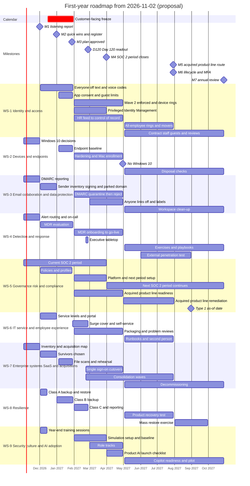
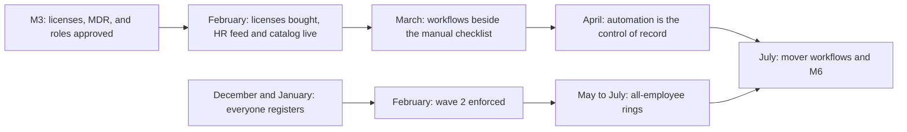

# 03. Twelve-month roadmap

> **Reference work.** Fictional scenario built for a public portfolio. Not deployed in, derived from, or describing any employer environment. Not professional advice.

## Purpose and scope

This roadmap runs the IT and security plan for Fabrikam, Inc. (fictional) from day 1 (2026-11-02) to the first annual program review in October 2027: the milestones, Phases 4 and 5 by workstream, the dependencies and critical path, interim cover until each new role starts, and what waits for year two. Phases 1 to 3 are in document [02](02-first-90-days.md). The appendix indexes the action IDs (06.24 is in document 06), and every date is a proposal ([01](01-scenario-and-assumptions.md)).

**Terms.** IT: information technology. MFA: multifactor authentication. KPI: key performance indicator. MDR: managed detection and response. GRC: governance, risk, and compliance. HR: human resources. AI: artificial intelligence. SaaS: software as a service. ADR: architecture decision record. SOC 2 is the attestation report on Fabrikam's controls that customers ask for; a Type 1 report covers control design at one date, and a Type II report also covers operation over a period ([10](10-governance-and-compliance-program.md)). A control of record is the process the SOC 2 audit firm tests. CSF: the National Institute of Standards and Technology (NIST) Cybersecurity Framework 2.0, whose current Profile records where Fabrikam's practice stands and whose target Profile records where the plan commits to take it. DMARC (Domain-based Message Authentication, Reporting, and Conformance): the published policy for mail that fails Fabrikam's email authentication. Copilot means Microsoft Copilot (formerly Microsoft 365 Copilot).

## Phases and milestones

| Phase | Name | Window | Calendar |
|---|---|---|---|
| Phase 1 | Listen and learn | Days 1 to 30 | November 2026 |
| Phase 2 | Stabilize | Days 31 to 60 | December 2026; customer-facing freeze from mid-December |
| Phase 3 | Commit | Days 61 to 90 | January 2027; the freeze continues through year-end and tax form season |
| Phase 4 | Build | Months 4 to 6 | February to April 2027 |
| Phase 5 | Scale and sustain | Months 7 to 12 | May to October 2027 |

| ID | When | Milestone |
|---|---|---|
| M1 | Day 30 (2026-12-01) | Listening report and environment baseline: inventories v1, KPI baselines, top risks draft |
| M2 | Day 60 (2026-12-31) | Stabilization quick wins done; risk register v1; current SOC 2 period on track |
| M3 | Day 90 (end of January 2027); the executive team meets Thursday 2027-01-28 | 12-month plan, budget proposal, policy set, and CSF current and target Profiles approved by the executive team, the current Profile at Category level with Subcategory detail by M7 |
| D120 | Friday 2027-02-26, the last business day of February | Day 120 readout: KPIs against their Phase 1 baselines, early Phase 4 actions under way, and what is at risk |
| M4 | Month 5 (end of March 2027) | The current SOC 2 review period closes with no new exceptions caused by the Director's changes; the next period continues without a gap |
| M5 | Month 9 (July 2027) | The acquired product line's controls assessed, with a dated path into SOC 2 Type II scope |
| M6 | Month 9 (July 2027) | Identity lifecycle automation live for all employees; phishing-resistant MFA for all admins and most users |
| M7 | Month 12 (October 2027) | First annual program review: KPIs against targets, re-baselined risks, next-year plan |

## The year at a glance

The next SOC 2 period and the acquired product line's first Type II period run past M7 ([10](10-governance-and-compliance-program.md)).

## Phases 4 and 5 in brief

**Phase 4, Build (February to April 2027):** the licenses approved at M3 arrive in February and, in the base case, both new roles in March; phishing-resistant sign-in for the highest-risk roles, just-in-time administration, the HR-driven account feed, and DMARC enforcement; the MDR service live by the end of April; and a clean close of the current SOC 2 period at M4.

**Phase 5, Scale and sustain (May to October 2027):** coverage widens to most employees by M6, the executive team confirms the acquired product line's route at M5, one external penetration test runs from June to August, the Copilot pilot follows the oversharing work, and the first annual program review closes the year at M7.

## Workstreams in Phases 4 and 5

| Workstream | Phase 4 (February to April 2027) | Phase 5 (May to October 2027) | What the business has by M7 |
|---|---|---|---|
| WS-1 Identity and access ([06](06-microsoft-365-security-baseline.md), [07](07-identity-lifecycle-joiners-movers-leavers.md)) | Wave 2 phishing-resistant enforcement; just-in-time administration; the HR feed, the control of record from April | Phishing-resistant MFA for most users by M6, guests ready before 2027-07-01; movers; contract staff, guests, and wider reviews | A phished password or code no longer opens most accounts; leavers lose access on time |
| WS-2 Devices and endpoints ([06](06-microsoft-365-security-baseline.md), [13](13-it-service-management.md)) | Attack surface reduction rules blocking, finance last; remaining Macs enrolled; the last Windows 10 devices removed | Quarterly checks of sanitization certificates against disposal records for Fabrikam's own devices | Managed, encrypted, patched computers, and no Windows 10 |
| WS-3 Email, collaboration, and data protection ([06](06-microsoft-365-security-baseline.md), [15](15-enterprise-systems-and-saas.md)) | DMARC to reject, domain by domain; from March, "Anyone" links off, data loss prevention for payroll identifiers, and external Teams chat limited to partners; workspace rules | Inactive and ownerless workspaces cleaned up before the Copilot pilot and at M7 | Spoofed Fabrikam mail rejected; customer payroll files out of open links and mailboxes |
| WS-4 Detection and response ([08](08-detection-and-incident-response.md), [ADR-003](adr/ADR-003-managed-detection-and-response.md)) | MDR live by the end of April; the first executive tabletop in the week of 2027-02-22, beside D120 on purpose so that 11.08 can re-rate R-01 for the readout; attack disruption; custom detections from March; the ransomware playbook drafted; the first notification drill in April | Quarterly exercises, a second tabletop, and the second notification drill; one external penetration test, June to August 2027; the ransomware playbook exercised and the remaining playbooks written; MDR review at M7 | Serious incidents contained within hours, at any hour |
| WS-5 Governance, risk, and compliance ([10](10-governance-and-compliance-program.md), [11](11-risk-management.md), [12](12-metrics-and-executive-reporting.md)) | Next-period planning, the compliance platform, and acquired product line readiness; D120; the current period closes at M4; the month-6 review | The proposed route, confirmed at M5: a Type 1 report on controls as of 2027-08-31, issued in the second half of 2027, then a Type II period to 2028-03-31; the month-9 review; the annual program review at M7 | A clean SOC 2 close and a dated route for the acquired product line |
| WS-6 IT service and employee experience ([13](13-it-service-management.md)) | Packaged apps for self-service; problem reviews; a March pulse survey | A runbook and a second trained person for every critical task by M6; hiring triggers at month 9 | Help on time, new hires ready on day one, and no critical task resting on one person |
| WS-7 Enterprise systems, SaaS, and acquisition integration ([15](15-enterprise-systems-and-saas.md), [ADR-005](adr/ADR-005-acquired-company-consolidation.md)) | Single sign-on cutovers, finance first; consolidation waves from late February; duplicates and the virtual private network retired | The remaining waves, one identity per person before M6; leftovers decommissioned; the long tail behind single sign-on | One identity per person, duplicates retired, and sensitive applications behind single sign-on |
| WS-8 Resilience ([14](14-business-continuity-and-backup.md), [ADR-006](adr/ADR-006-microsoft-365-backup.md)) | Class C protected and KPI-19 reported; the quarterly class A test; the customer payroll contingency recommendation; the continuity drill | The isolated copy, if funded; Engineering's product recovery test by July; a mass restore exercise | Critical data restores within hours, and a tested product payroll path |
| WS-9 Security culture and AI adoption ([09](09-security-awareness-and-training.md), [16](16-ai-adoption-guardrails.md)) | Simulation setup and the baseline simulation; role tracks; AI training, prompt data loss prevention (preview, as of 2026-10-14), AI app discovery, and the product AI launch checklist with Engineering | Simulations every two months and verification drills; the Copilot readiness gate and a pilot of about 8 to 10 weeks; the expansion decision at M7 | More phishing reported, fewer clicks, and AI on approved tools under an approved AI security standard |

## Dependencies and the critical path

Most Phase 4 controls wait for the M3 licensing approval and the February purchase. The MDR service also needs the audit firm's agreement on monitoring evidence, lifecycle automation needs Governance licenses and the January HR feed, enforcement needs registration before 2027-02-01 and enrolled devices, consolidation needs the HR feed's worker-ID match, controls of record wait for the M4 close, the Type 1 report waits for readiness and remediation, the Copilot pilot waits for the oversharing work, and DMARC reject on the main domain waits for every third-party sender.

**The critical path** runs from M3 to M6 with no slack, and a second chain follows Microsoft's 2027-02-01 date. If the M3 licensing decision slips, just-in-time administration, endpoint detection and response, and the MDR service slip with it ([06](06-microsoft-365-security-baseline.md)).

## Interim cover until each role starts

Recruiting is prepared in Phase 3. Offers go out after the executive team approves the budget at M3 (Thursday 2027-01-28), so in the base case the GRC Analyst and the Security Engineer start in March 2027. As an option, the executive team can pre-approve both roles at M2 so offers go out in January and both start in February. Actions before March name the interim owners below; document [04](04-operating-model-team-and-budget.md) counts each role's monthly load. Interim owners cover each new role's March actions until it starts and pair with it through its first month; if either role starts after March, its March and April actions stay with the interim owners, and the next Quarterly Risk Review reports the effect on M6.

| Role | Interim owners until the role starts | Source |
|---|---|---|
| GRC Analyst | The Director of IT and Security with the outside audit-readiness consultant, who stays until the GRC Analyst starts and at least through M4: the evidence calendar, change evidence, the register and exceptions, acquired product line readiness (10.19), and the platform connection (10.20); the Director compiles the KPIs with the IT Operations Manager | [10](10-governance-and-compliance-program.md), [11](11-risk-management.md), [12](12-metrics-and-executive-reporting.md), [13](13-it-service-management.md) |
| Security Engineer | The Director of IT and Security for decisions, technical exception assessments, light checks of AI tools and other applications, the role's KPIs, the tabletop scope (17.03), and the ransomware playbook draft with the MDR provider (08.10); the Systems Engineer (Identity and Endpoint) for hands-on work, with partner help: just-in-time administration, endpoint detection and response, and MDR onboarding (06.25), simulation setup (09.09), backup alerts (14.11), and the monthly Secure Score review | [06](06-microsoft-365-security-baseline.md), [08](08-detection-and-incident-response.md), [09](09-security-awareness-and-training.md), [11](11-risk-management.md), [14](14-business-continuity-and-backup.md), [15](15-enterprise-systems-and-saas.md), [16](16-ai-adoption-guardrails.md), [17](17-threat-profile.md) |
| Service desk capacity | No permanent hire planned: contracted surge support covers the February peak and the consolidation waves, and hiring triggers are checked at the month-9 review | [13](13-it-service-management.md) |

When Phase 4 work collides, the IT and Security Steering Group sets the order and consolidation waves yield first ([15](15-enterprise-systems-and-saas.md)).

## Deferred to year two

- One combined SOC 2 period for both products from 2028-04-01, after the acquired product line's first Type II period (2027-09-01 to 2028-03-31) ([10](10-governance-and-compliance-program.md)).
- Processing Integrity, Privacy, or a SOC 1 report, decided at M7, with readiness in year two if approved ([10](10-governance-and-compliance-program.md)).
- Repeatable (Tier 3) for the CSF Govern function, proposed for the end of year two ([10](10-governance-and-compliance-program.md)).
- Microsoft Purview Suite (formerly Microsoft 365 E5 Compliance) or Microsoft 365 E5, revisited at M7 or when a Copilot pilot is approved, and wider Copilot rollout, decided at M7; Microsoft 365 E7 stays rejected ([ADR-001](adr/ADR-001-microsoft-365-security-licensing.md), [16](16-ai-adoption-guardrails.md)).
- A security information and event management system ([08](08-detection-and-incident-response.md)).
- Certificate-based authentication, rejected for year one ([ADR-004](adr/ADR-004-phishing-resistant-authentication-rollout.md)).
- A restore path for Teams messages, and the isolated backup copy if not funded at M3 ([ADR-006](adr/ADR-006-microsoft-365-backup.md)).
- Closing R-02 and R-08, which in the illustration stay High, above appetite, at M7, because their strongest treatments sit with Engineering's roadmap and partners' controls ([11](11-risk-management.md)).
- A fuller AI agent standard; in year one, AI agents stay at policy level: intake approval, then document 07's controls for accounts that software uses ([16](16-ai-adoption-guardrails.md)).

## Resourcing and dependencies

Roles, partners, hiring, and budget lines are in [04](04-operating-model-team-and-budget.md). Phase 4 needs Microsoft Defender Suite (formerly Microsoft 365 E5 Security) and Microsoft Entra ID Governance if approved at M3 ([ADR-001](adr/ADR-001-microsoft-365-security-licensing.md)); Phase 5 adds Copilot pilot licenses after the readiness gate ([16](16-ai-adoption-guardrails.md)), the external penetration test ([08](08-detection-and-incident-response.md)), and an isolated backup copy only if funded ([ADR-006](adr/ADR-006-microsoft-365-backup.md)). The roadmap depends on every plan document; documents 06, 07, 08, 10, 14, and 15 set most dates.

## Risks and open questions

- Phase 4 is crowded: the February registration peak, policy rings, Mac enrollment, single sign-on cutovers, and consolidation waves draw on one small team, and on interim owners until both roles start ([04](04-operating-model-team-and-budget.md), [15](15-enterprise-systems-and-saas.md)).
- Systems in the current SOC 2 system description change only after M4 or with the audit firm's agreement, which may push some cutovers into May ([15](15-enterprise-systems-and-saas.md)).
- R-02, R-04, and R-08 depend on Engineering's roadmap ([11](11-risk-management.md)).
- Microsoft's dates may move and are rechecked at each phase gate ([ADR-004](adr/ADR-004-phishing-resistant-authentication-rollout.md)).

## Framework mapping

By identifier only, consistent with the [crosswalk](crosswalk/csf2-soc2-crosswalk.md).

| Theme | NIST CSF 2.0 | SOC 2 (2017 Trust Services Criteria) |
|---|---|---|
| Oversight of the program against milestones | GV.OV-01, GV.OV-02, GV.OV-03 | CC1.2, CC4.1, CC4.2 |
| Risk responses delivered through the workstreams | GV.RM-02, ID.RA-06 | CC5.1 |
| Improvement from reviews, tests, and exercises | ID.IM-01, ID.IM-02 | CC4.1, A1.3 |
| Continuity through the payroll calendar | GV.RM-04, PR.IR-03, ID.IM-04 | CC9.1 |

## Appendix: action index

Each ID points to the phase plan of the document its first two digits name.

### Milestones

| ID | Met by |
|---|---|
| M1 | 05.11 |
| M2 | 11.03, 10.09 |
| M3 | 10.13, 10.14, 16.16 |
| D120 | 12.07 |
| M4 | 10.21 |
| M5 | 10.23 |
| M6 | 07.17, 06.32 |
| M7 | 12.12 |

### Workstreams in Phases 4 and 5

**WS-1 Identity and access** ([06](06-microsoft-365-security-baseline.md), [07](07-identity-lifecycle-joiners-movers-leavers.md)). Measures: KPI-08, KPI-09, KPI-12, KPI-13, KPI-22, KPI-23.

- **Phase 4.** February, in order: phishing-resistant enforcement for the wave 2 group and finance and payroll's identity changes in week 1, their endpoint baseline in weeks 2 to 3, then device rings (06.24); the HR feed and access catalog, with surge cover (07.11, 07.12, 13.15). February to March: just-in-time administration and risk-based policies (06.25), by the Systems Engineer (Identity and Endpoint) with partner help until the Security Engineer arrives. April: automation becomes the control of record after a March parallel run, with automated reviews and self-service requests (07.13, 07.14, 13.17).
- **Phase 5.** Phishing-resistant MFA for most users by M6, with guests ready before Microsoft's 2027-07-01 date for external users (06.32); a token protection pilot (06.33); movers and the M6 check in July (07.16, 07.17); contract staff, guests, and wider reviews (07.18, 07.19).

**WS-2 Devices and endpoints** ([06](06-microsoft-365-security-baseline.md), [13](13-it-service-management.md)). Measures: KPI-06, KPI-10, KPI-11.

- **Phase 4.** Finance and payroll on the endpoint baseline in February, weeks 2 to 3 (06.24); attack surface reduction rules blocking in rings with finance last, the Strict mail preset for executives, finance, payroll, and People, web protection, and enterprise Wi-Fi (06.26); the remaining Macs enrolled and personal phones on app protection (06.29); from March, vulnerability targets measured with Microsoft Defender Suite data, and the last Windows 10 devices removed (06.30, 13.20).
- **Phase 5.** Quarterly checks of sanitization certificates against disposal records for Fabrikam's own devices (13.22).

**WS-3 Email, collaboration, and data protection** ([06](06-microsoft-365-security-baseline.md), [15](15-enterprise-systems-and-saas.md)). Measures: KPI-17, KPI-24, and the supporting check of sending domains at p=reject (document 12).

- **Phase 4.** DMARC from quarantine to reject, domain by domain, with every sending domain at reject by the end of April unless a main-domain sender still needs alignment (06.27); from March, "Anyone" links off, a secure exchange path for Support, data loss prevention blocking external sharing of payroll identifiers, manual labels, and external Teams chat limited to allowed partner domains (06.28); workspace naming, expiry, and the two-owner rule (15.18).
- **Phase 5.** Inactive and ownerless workspaces cleaned up before the Copilot pilot and again at M7 (15.25).

**WS-4 Detection and response** ([08](08-detection-and-incident-response.md), [ADR-003](adr/ADR-003-managed-detection-and-response.md)). Measures: KPI-16, KPI-17, KPI-18.

- **Phase 4.** MDR onboarding beside the internal on-call from February, live by the end of April once the audit firm agrees the monitoring evidence, with the ransomware playbook drafted with the MDR provider and document 14's backup steps (08.10, 14.11); the first executive tabletop in late February (08.09, 17.03); automatic attack disruption once Defender Suite is live and the HR automation is checked (08.11); March to April: custom detections for R-01 and for Temporary Access Pass and method changes (08.12); April: KPI-16 to KPI-18 reported, and the first notification drill with General Counsel and the Chief Customer Officer (08.13).
- **Phase 5.** Quarterly exercises with the MDR provider, a second executive tabletop around month 8, the second notification drill in September, and a twice-yearly end-to-end alert check in the live tenant, with a second leg agreed in advance with the MDR provider (a vendor-documented benign test alert or the provider's own test procedure) that records whether the provider triaged it and phoned the on-call; one external penetration test, June to August 2027, after the Phase 4 controls land and before the Type 1 date, scoped with Engineering to the corporate tenant and identity, the customer administrator sign-in and bank-change paths, and integrations, with findings feeding KPI-18 and the R-02 and R-08 ratings (08.14); the ransomware playbook exercised, and the other planned playbooks written and exercised (08.15); the log retention decision and MDR review at M7 (08.16).

**WS-5 Governance, risk, and compliance** ([10](10-governance-and-compliance-program.md), [11](11-risk-management.md), [12](12-metrics-and-executive-reporting.md)). Measures: KPI-01 to KPI-05.

- **Phase 4.** February: next-period planning and the platform contract (10.18), acquired product line readiness with Engineering through April (10.19, 05.14), monthly risk status with R-01 and R-06 re-rated (11.08), and the D120 readout (12.07). February to March: the compliance platform connected, by the Director and then the GRC Analyst (10.20). March: the register and KPI collection pass to the GRC Analyst on arrival (11.08, 12.08), and the current period closes, with the next starting on 2027-04-01 (10.21, M4). April: wider vendor reviews (10.22), the change process as a control of record (13.19), the first quarterly re-performance of the KPIs (12.09), and the month-6 Quarterly Risk Review (11.09, 12.10).
- **Phase 5.** Acquired product line gaps closed; the Sales leader and the Chief Customer Officer confirm which waiting deals accept a Type 1 and how much business is waiting, and the executive team confirms the route at M5 (10.23); a Type 1 report as of 2027-08-31 (10.24); management responses and privacy positions (10.25, 10.26); the month-9 review (11.10, 12.11); a monthly review of Secure Score and Microsoft Entra recommendations (06.35). At M7: year-two report scope, the Current Profile reassessed with its Subcategory detail, risks and baselines refreshed, and the annual program review (10.27, 10.28, 11.11, 07.20, 17.04, 05.15, 01.03, 12.12).

**WS-6 IT service and employee experience** ([13](13-it-service-management.md)). Measures: KPI-20, KPI-21, KPI-24.

- **Phase 4.** Surge cover from Friday 2027-01-29 through the first week of February, on terms agreed in January and with surge staff trained on the caller verification script on 28 and 29 January, after the M3 approval (13.12, 13.14, 13.15); standard apps packaged for self-service, other software routed to intake (13.16); monthly problem reviews and a pulse survey in March (13.18).
- **Phase 5.** A tested runbook and a second trained person for every critical administrative task by M6 (13.21); hiring triggers checked at the month-9 review (13.23); service levels re-baselined at M7 (13.24).

**WS-7 Enterprise systems, SaaS, and acquisition integration** ([15](15-enterprise-systems-and-saas.md), [ADR-005](adr/ADR-005-acquired-company-consolidation.md)). Measures: KPI-05, KPI-06, KPI-07, KPI-23.

- **Phase 4.** Single sign-on cutovers in order, from the finance system in February, after finance and payroll's identity and endpoint changes (06.24), to the customer relationship management system and marketing automation in April, with provisioning following (15.14, 07.15); consolidation waves from late February (15.16); duplicates retired at notice dates and renewals reviewed 120 days ahead (15.17, 15.21); SaaS discovery, the older brand domain that still sends either enforced or moved to a subdomain, lookalike domain monitoring live, and automation hardened (15.15, 15.19, 15.20); the virtual private network and leftover network services retired (06.31).
- **Phase 5.** The remaining waves, with the acquired product line's team on standard identity, devices, and files before M5 and one identity per person before M6 (15.22); leftovers decommissioned and the long tail behind single sign-on (15.23, 15.24); inventory and license spend re-baselined at M7 (15.26).

**WS-8 Resilience** ([14](14-business-continuity-and-backup.md), [ADR-006](adr/ADR-006-microsoft-365-backup.md)). Measures: KPI-19, KPI-18.

- **Phase 4.** February: class C data protected, KPI-19 reported, the backup role made just-in-time, and alerts on backup administration changes to the on-call, and to the MDR provider if it triages custom detections (14.10, 14.11). March: the quarterly class A scenario test and vendor recovery terms (14.12). The customer payroll contingency recommendation goes to the Chief Product Officer and the Chief Customer Officer (14.13). April: the continuity drill (14.14).
- **Phase 5.** The isolated copy, if funded (14.15); Engineering's full product recovery test of the payroll path by July (14.16); a mass restore exercise in August or September (14.17); next year-end readiness and the business impact analysis refreshed for M7 (14.18).

**WS-9 Security culture and AI adoption** ([09](09-security-awareness-and-training.md), [16](16-ai-adoption-guardrails.md)). Measures: KPI-14, KPI-15.

- **Phase 4.** February: simulation training set up, the administrators' track, and the executive briefing (09.09, 09.10). March to April: the baseline simulation, role tracks, and the first quarterly assessment report (09.11, 09.12, 09.13). From March: AI training and acknowledgments, data loss prevention on Copilot prompts (preview, as of 2026-10-14), and AI app discovery (16.08, 16.09, 16.10). April: the product AI launch checklist, with Engineering (16.17).
- **Phase 5.** Simulations every two months and verification drills in May and October (09.14, 09.15); the Copilot readiness gate, then a pilot of about 8 to 10 weeks with trained users (06.34, 16.11 to 16.13, 09.16); the expansion decision at M7 and the guardrails and the AI security standard reviewed (16.14, 16.15); Cybersecurity Awareness Month and the program review (09.17).

### Dependencies

| Work | Waits for | Source |
|---|---|---|
| Defender Suite controls: just-in-time administration, risk policies, endpoint detection and response, attack disruption, simulations, discovery, vulnerability data (06.25, 08.11, 09.09, 15.15, 16.10, 06.30) | The M3 licensing approval and the February purchase (06.23) | [ADR-001](adr/ADR-001-microsoft-365-security-licensing.md) |
| The MDR service live by the end of April (08.10) | Defender Suite telemetry; the audit firm's agreement on monitoring evidence | [ADR-003](adr/ADR-003-managed-detection-and-response.md) |
| Lifecycle automation and M6 (07.12 to 07.17) | Microsoft Entra ID Governance licenses approved at M3, and the HR feed built in January (07.09) | [ADR-002](adr/ADR-002-hr-system-of-record-drives-identity.md) |
| Phishing-resistant enforcement (06.24, 06.32) | Registration before 2027-02-01 (06.11, 06.21), and enrolled devices (06.17, 06.29) | [ADR-004](adr/ADR-004-phishing-resistant-authentication-rollout.md) |
| The finance single sign-on cutover (15.14) | Finance and payroll's February identity and endpoint changes (06.24) | [06](06-microsoft-365-security-baseline.md), [15](15-enterprise-systems-and-saas.md) |
| Consolidation waves (15.16) | The HR feed's worker-ID match (07.11), and the device order in ADR-008 | [ADR-005](adr/ADR-005-acquired-company-consolidation.md) |
| Controls of record from 2027-04-01 (07.14, 13.19, 10.20) | The current period closing at M4 (10.21) | [10](10-governance-and-compliance-program.md) |
| The acquired product line's Type 1 report (10.24) | Readiness (10.19), remediation (10.23), and the team on standard controls (15.22) | [10](10-governance-and-compliance-program.md), [15](15-enterprise-systems-and-saas.md) |
| The product AI launch checklist (16.17) | The AI security standard approved at M3 (16.16) | [16](16-ai-adoption-guardrails.md) |
| The Copilot pilot (16.13) | Oversharing fixed (06.18, 06.28, 15.18), and the readiness gate (16.11) | [16](16-ai-adoption-guardrails.md) |
| DMARC reject on the main domain (06.27) | Every third-party sender aligned | [06](06-microsoft-365-security-baseline.md) |
| The external penetration test (08.14) | The Phase 4 controls in place, and scope agreed with Engineering | [08](08-detection-and-incident-response.md) |

## Sources

- Plan documents relied on (internal cross-references, not external sources): [01. Scenario and assumptions](01-scenario-and-assumptions.md); [02. The first 90 days](02-first-90-days.md); [04. Operating model, team, and budget](04-operating-model-team-and-budget.md); [05. Environment discovery](05-environment-discovery.md); [06. Microsoft 365 security baseline](06-microsoft-365-security-baseline.md); [07. Identity lifecycle: joiners, movers, and leavers](07-identity-lifecycle-joiners-movers-leavers.md); [08. Detection and incident response](08-detection-and-incident-response.md); [09. Security awareness and training](09-security-awareness-and-training.md); [10. Governance and compliance program](10-governance-and-compliance-program.md); [11. Risk management](11-risk-management.md); [12. Metrics and executive reporting](12-metrics-and-executive-reporting.md); [13. IT service management](13-it-service-management.md); [14. Business continuity and backup](14-business-continuity-and-backup.md); [15. Enterprise systems and SaaS](15-enterprise-systems-and-saas.md); [16. AI security and adoption guardrails](16-ai-adoption-guardrails.md); [17. Threat profile](17-threat-profile.md); [ADR-001](adr/ADR-001-microsoft-365-security-licensing.md), [ADR-002](adr/ADR-002-hr-system-of-record-drives-identity.md), [ADR-003](adr/ADR-003-managed-detection-and-response.md), [ADR-004](adr/ADR-004-phishing-resistant-authentication-rollout.md), [ADR-005](adr/ADR-005-acquired-company-consolidation.md), [ADR-006](adr/ADR-006-microsoft-365-backup.md), and [ADR-008](adr/ADR-008-endpoint-management-standard.md); and the [CSF 2.0 and SOC 2 crosswalk](crosswalk/csf2-soc2-crosswalk.md).
- Passkeys by default and retirement of Microsoft-provided SMS and voice authentication. Microsoft Learn. https://learn.microsoft.com/en-us/entra/identity/authentication/concept-sms-voice-retirement . Checked 2026-10-13. Primary.
- Security Suites (Microsoft Licensing guidance; Microsoft Defender Suite, previously Microsoft 365 E5 Security, and Microsoft Purview Suite, previously Microsoft 365 E5 Compliance). Microsoft. https://www.microsoft.com/licensing/guidance/Security-Suites . Checked 2026-10-13. Primary.
- Enterprise data protection in Microsoft Copilot and Microsoft Copilot Chat (product name change). Microsoft Learn. https://learn.microsoft.com/en-us/microsoft-365/copilot/enterprise-data-protection . Checked 2026-10-13. Primary.
- Microsoft Purview DLP for Microsoft 365 Copilot and Cowork (ms.date 2026-10-05), on blocking sensitive information types in prompts (preview). Microsoft Learn. https://learn.microsoft.com/en-us/purview/dlp-microsoft365-copilot-location-learn-about . Checked 2026-10-14. Primary.
