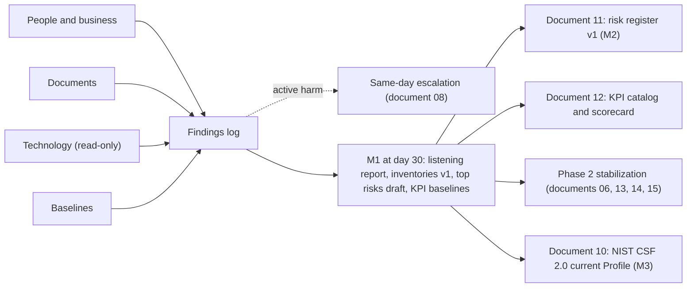

# 05. Environment discovery

> **Reference work.** Fictional scenario built for a public portfolio. Not deployed in, derived from, or describing any employer environment. Not professional advice.

## Purpose and scope

This document explains how the Director of IT and Security maps the people, processes, technology, data, and vendors of Fabrikam (fictional) in Phase 1 (days 1 to 30) without disturbing the business or the SOC 2 review period in progress. It sets the ground rules, the four discovery streams, how each KPI is first measured, and how each day-1 assumption in document [01](01-scenario-and-assumptions.md) is verified, and it ends with what M1 delivers at day 30. The changes Phase 1 makes belong to other documents; this one produces the facts they depend on.

## Principles

- **Listen first.** For the first two weeks the Director asks more than proposes. Executives hear their own priorities played back in the listening report before they see recommendations, and the IT team's knowledge counts as evidence: who really approves access, and what broke last year, rarely sits in a system.
- **Read-only by default.** Discovery uses built-in Microsoft Entra roles, which carry no extra license cost: Reports Reader for sign-in and audit reports, and Global Reader or Security Reader only where broader reading is needed. Microsoft labels Global Reader and Security Reader as privileged roles (label in preview, as of 2026-10-13), because reading everything is itself sensitive. These assignments therefore go through the change process, are recorded, carry an end date recorded in the change ticket (without Privileged Identity Management, Entra ID P1 role assignments do not expire on their own, so action 05.12 removes each one on its date), and count toward KPI-09. They are requested in week 1 and approved at the first weekly Change Advisory Board in week 2 (document [13](13-it-service-management.md)), and later exports use them. Until then, week-1 data exports use read-only reporting access: the report and export views of the admin centers, opened from the IT team's existing administrator accounts, with no setting changed and each export logged in the findings log. Discovery never adds a Global Administrator.
- **Protect the SOC 2 period in progress.** The current review period closes at the end of March 2027 (M4). Any change to a control the audit firm is testing needs the auditor's agreement first, sought through the finance manager who coordinates SOC 2. That includes the short list of urgent Phase 1 changes (emergency access accounts, MFA on every admin, the discovery read roles, alert routing, the Microsoft Entra log archive, and confirming that critical data can be recovered), which this document and documents [06](06-microsoft-365-security-baseline.md), [08](08-detection-and-incident-response.md), and [14](14-business-continuity-and-backup.md) own and which run through the change process with a ticket and an approval. They are prepared and disclosed in week 1 and applied at the first Change Advisory Board in week 2. The one exception is the week-1 sample restore (action 14.01), which changes no control and runs in week 1.
- **Active harm overrides listening.** A sign of compromise or live exposure, such as an enabled account belonging to a departed administrator, a rule forwarding a finance mailbox to an outside address, or a payroll export behind an anonymous link, goes to the CTO and the accountable executive the same day and is handled under document 08; a fix that cannot wait for the weekly board follows document 13's emergency change path.
- **Write it down.** Every finding enters one findings log with its date, source, evidence location, related assumption (A-01 to A-12) and risk (R-01 to R-15), proposed severity, and owner. Exports hold user lists, configurations, and customer data paths, so they live in one restricted location with a named access list and a deletion date.
- **Measure before changing.** Baselines come before stabilization changes, so the Day 120 readout (end of February 2027; milestone D120) can show what actually moved. Log windows set the pace: Microsoft Entra sign-in and audit logs keep 30 days on Entra ID P1, advanced hunting (where licensed) reaches back 30 days, and Microsoft Purview Audit (Standard) keeps 180 days. Exports start in week 1, and each records its date range.
- **Triangulate.** What people say, what systems show, and what documents claim are compared. Where they disagree, the disagreement is a finding.

## Discovery streams

Four streams run in parallel. The Director leads; the IT Operations Manager and the three IT generalists run the technical exports around their service desk work.

### Stream 1: People and business

The Director meets each executive, the IT Operations Manager, an Engineering Manager, the SRE lead, and the Support and Sales leaders, using the [stakeholder conversation guide](templates/stakeholder-conversation-guide.md). Customers' benefits open enrollment runs through December and year-end preparation starts in November, so these conversations are booked in the first days.

The Director then watches the processes that touch customer or employee data, because what people do under time pressure is the real control.

| Process | What to observe | Feeds |
|---|---|---|
| Support | How agents confirm a caller is an authorized customer administrator before changing access or bank details; how customer payroll exports are requested, moved, stored, and deleted during a case; how support staff gain and lose access to customer data in the product | R-02, R-07, A-06 |
| Sales | How customer security questionnaires and SOC 2 report requests are handled, and by whom; what enterprise buyers ask about the acquired product line | R-11, M5 |
| Finance | How vendor bank-detail changes and urgent payment requests are verified; who can change vendor master data; how changes to Fabrikam employees' own direct deposit are verified; how SOC 2 evidence is gathered today | R-01, A-10 |
| People | How joiners, movers, and leavers reach IT, and how fast (measured in action 07.01); data quality in the HR system of record (Fabrikam's own product), including whether contractors are recorded in it; training records | R-05, A-03, A-11 |
| Service desk | Ticket volumes, categories, resolution times, and the after-hours path; whether analysts can see each employee's phone number in the HR system of record and the date it last changed, which the callback check in document 13 relies on (action 13.03) | A-07, KPI-20 to KPI-24 |

### Stream 2: Documents

| Document | What to extract | Feeds |
|---|---|---|
| Current SOC 2 Type II report, with the readiness consultant's tracker | System boundary and period dates; exceptions and management responses; complementary user entity controls (controls the report assumes customers run); subservice organizations and whether they are carved out; control owners | Documents [10](10-governance-and-compliance-program.md) and [11](11-risk-management.md); KPI-03, KPI-04 |
| Policies | Owner, approval date, rewrite cycle, and gaps against POL-01 to POL-15 | Document 10; KPI-02 |
| Customer contracts and data processing terms, through the contract clause inventory that the General Counsel and the Director start in action 08.04 | Security commitments, incident notification clocks, audit rights, subprocessor terms, availability commitments, data return and deletion | Document 08, where the shortest clock becomes the planning clock; document 10 |
| Incident, test, and continuity records | Incident tickets; payment-fraud attempts Finance remembers; customer reports of account takeover; penetration test reports and open findings; the last product disaster recovery test; the continuity plan; acquisition integration records | Documents 08, 11, and 14; [ADR-005](adr/ADR-005-acquired-company-consolidation.md) |

### Stream 3: Technology

Every export is read-only. The first one confirms that Microsoft's July 2026 additions to E3 (Defender for Office 365 Plan 1, Intune Plan 2, Remote Help, and Intune Advanced Analytics) appear in the tenant's licenses. Microsoft says no customer action was required, but the plan relies on them, so they are checked rather than assumed.

| Area | What to capture | Source and license |
|---|---|---|
| Authentication and admin access | Conditional Access policies and their exclusions; the methods each user has registered and uses (push, SMS, voice, passkey); whether the tenant set the temporary opt-out from passkey auto-enablement; Global Administrators and other privileged role assignments; whether emergency access accounts exist and when they last worked | Microsoft Entra admin center (Entra ID P1): Authentication methods activity, and role assignments downloaded as CSV |
| Accounts and applications | Accounts from the acquisitions, each matched to an owner (the reconciliation itself is action 07.02); guests by last sign-in; the tenant's user consent setting (Microsoft's own pages disagree on the default, so the tenant is read directly); existing consent grants; service principals with secrets or certificates | Entra admin center; the People team for account owners |
| Devices | One reconciled count from Intune, the Defender portal, Entra device records, and purchase records; compliance policy coverage and the "Mark devices with no compliance policy assigned as" setting, whose default is Compliant; Mac management state; how local admin rights are granted and whether Windows LAPS is set up; disk encryption; the Windows edition each laptop runs (Pro, or Enterprise through subscription activation, which document 06's Quick Assist reinstall block needs); personal phones reaching email and Teams; the browsers and browser extensions in use on managed computers (document 06's extension approved list, 06.26, starts from them) | Intune (Plan 1 in E3, Plan 2 since July 2026), whose Discovered apps report lists the apps installed on company-owned devices; Defender for Endpoint Plan 1; IT hardware partner records; for browser extensions, the stakeholder conversations and the IT team |
| Remaining Windows 10 devices | Owner and purpose; Windows 11 hardware eligibility; whether ESU Year 1 was bought and activated. ESU is sold by year and is cumulative, so starting in Year 2 means paying for Year 1 as well, which favors replacement | Intune device list; purchase records |
| Email | Every accepted domain with its SPF record, DKIM signing status, and DMARC record; known third-party senders per domain (CRM, support desk, marketing automation, transactional email); SMTP AUTH senders and whether each uses Basic or Modern authentication, customer-facing senders first; Defender for Office 365 policy state | Public DNS; Defender portal; the Exchange admin center's SMTP AUTH clients report (up to 90 days, exportable) |
| Collaboration and data | Organization sharing level and whether "Anyone" links expire; anonymous links created recently; sites and teams without an active owner; where customer payroll exports sit during support cases | SharePoint admin center; sharing events in Purview Audit (Standard) |
| Detection and logging | Where each alert type goes, who reads it, and what happens at night and on weekends; log retention settings; what the finance system, HR system of record, service desk tool, and code hosting record about bank-detail, payment, direct-deposit, reset, and repository access changes, and for how long | Defender portal; the shared mailbox and ticket records; each system's owner (document 08 relies on these audit trails) |
| SaaS, acquisitions, and AI | Applications on Entra single sign-on; subscriptions in finance spend and card data; duplicate tools; separate tenants, file stores, device tools, and identities left from the acquisitions; AI tools in use, by team | Entra enterprise applications; finance system; stakeholder conversations |
| Resilience | Microsoft 365 retention settings; date of the corporate continuity plan; date and result of the last product disaster recovery test | Admin centers; the SRE lead |
| Product customer-data paths | Where customer data enters and leaves the product; which corporate roles can reach it; integration credentials and partner connections; product logs available to an investigation; the cloud provider as a subservice organization; confirm how customers' shared devices use the app | Engineering Manager and SRE lead (product architecture stays with Engineering, document 01) |
| Offices | Network equipment and who manages it; printers and multifunction devices, which Microsoft names among typical SMTP AUTH senders; physical access; local servers or file storage left from the acquisitions | Walk-through with each office contact |
| Internet-facing corporate assets | What Fabrikam exposes to the internet outside the product platform: inherited VPN appliances and firewalls, management interfaces reachable from the internet, and forgotten acquired web apps and DNS names, each with an owner and its firmware or software currency. A device with a vulnerability under active exploitation is active harm: same-day escalation and document 13's emergency change path | The email domain table and public DNS records; registrar accounts; the offices' public address ranges; office walk-throughs; acquisition records |
| Vendors | Vendors paid through accounts payable, joined with the data each can reach; contract security terms; SOC reports on file; how deep a review each needs, judged by data access and business criticality | Finance system; contracts; the General Counsel |

Three gaps are expected on E3, and the baseline states them rather than guessing:

- **Sensitive files at scale.** Content explorer's interface needs E5. SharePoint Advanced Management applies only once at least one user holds a Microsoft Copilot license, or with its Plan 1 add-on, or with E7; discovery confirms whether any of these is already true.
- **Unsanctioned SaaS.** Cloud App Discovery in E3 works from uploaded firewall or proxy logs, which a remote-first company may not have. Endpoint-based discovery needs Defender for Cloud Apps and Defender for Endpoint Plan 2.
- **Vulnerability data.** Vulnerability management comes with Defender for Endpoint Plan 2, not Plan 1.

Whether to close these gaps is a decision for [ADR-001](adr/ADR-001-microsoft-365-security-licensing.md).

### Stream 4: Baselines

Each KPI gets a first value, a date, a source, and a data quality note, or an honest "no data yet" with the date the first value will exist. Definitions, formulas, and targets are in document [12](12-metrics-and-executive-reporting.md) and [`data/kpi-catalog.csv`](../data/kpi-catalog.csv).

Several baselines can later use the advanced hunting queries in the table below. All eight need licensing above E3, so they run from Phase 4 with the Defender Suite licenses proposed in ADR-001: Defender for Endpoint Plan 1 lists no hunting capability, and Microsoft lists advanced hunting among the Defender for Office 365 Plan 2 additions. In Phase 1, each query's header names its E3 alternative where one exists, and the first-measurement source in the KPI table further down stands in.

| Query | What it finds | Used for |
|---|---|---|
| [`q01-sign-ins-without-strong-auth.kql`](../queries/q01-sign-ins-without-strong-auth.kql) | Successful sign-ins that did not require MFA | A cross-check for A-01 and KPI-08; KPI-08 coverage itself comes from Authentication methods activity |
| [`q02-legacy-auth-sign-ins.kql`](../queries/q02-legacy-auth-sign-ins.kql) | Sign-ins from legacy authentication clients, including authenticated SMTP | A-05 (SMTP AUTH senders); legacy protocol use before CA-01 (document 06) |
| [`q03-privileged-role-changes.kql`](../queries/q03-privileged-role-changes.kql) | Microsoft Entra admin role assignments added or removed | Changes between KPI-09 counts |
| [`q04-external-mail-forwarding-rules.kql`](../queries/q04-external-mail-forwarding-rules.kql) | Inbox rules and mailbox settings that forward or redirect mail outside the company | The active harm check (R-01) |
| [`q05-app-consent-grants.kql`](../queries/q05-app-consent-grants.kql) | App consent grants, with admin consent and high-impact permissions flagged | A-02; applications missing from the inventory (KPI-07) |
| [`q06-stale-accounts.kql`](../queries/q06-stale-accounts.kql) | Enabled accounts with no successful sign-in in the last 30 days | A-02 and A-03; a cross-check for KPI-12 |
| [`q07-windows-10-devices.kql`](../queries/q07-windows-10-devices.kql) | Windows 10 devices still seen by Microsoft Defender | A-04 |
| [`q08-anonymous-sharing-links.kql`](../queries/q08-anonymous-sharing-links.kql) | "Anyone" sharing links created, changed, used, and removed | A-06 |

Microsoft Secure Score and Microsoft Entra recommendations are inputs, not targets. Each open recommendation is a prompt to check against Fabrikam's own risks. Neither becomes a KPI: Microsoft says Secure Score is not an absolute measure of how likely a breach is and shows recommendations regardless of license edition, and Entra recommendations differ in the license each needs.

| KPI | First measurement and source | Note |
|---|---|---|
| KPI-01 | Draft top risks with a named executive owner and an approved treatment | Near zero at M1 because no register exists; first real value at M2 |
| KPI-02 | Each policy's last approval date against its stated rewrite cycle; the yearly owner review sign-off starts at M3, when approval counts as the first (document 10) | Policy documents and their version history |
| KPI-03 | Controls tested in the last SOC 2 report, and those with exceptions | Plus the audit firm's interim view of the current period, if offered |
| KPI-04 | Exceptions still open from the last report, aged from the report date | Report and management responses |
| KPI-05 | Vendors with customer or employee data that have a dated review on file | Vendor list from Stream 3 |
| KPI-06 | Intune-managed devices divided by the reconciled device count | The denominator combines every source, not Intune alone |
| KPI-07 | Applications on Entra single sign-on divided by application inventory v1 | Only as complete as the inventory |
| KPI-08 | Admins and all users with a phishing-resistant method registered, and sign-ins that used one | Authentication methods activity joined with role assignments |
| KPI-09 | Active assignments to roles Microsoft labels privileged (label in preview, as of 2026-10-13) | All standing on day 1, since Entra ID P1 has no Privileged Identity Management; includes discovery roles |
| KPI-10 | Compliant devices in Intune | Record the no-policy setting beside the number; if it says Compliant, the figure overstates |
| KPI-11 | Operating system update currency from Intune as a proxy for corporate endpoints; Engineering's scanner data for the product where it exists | The true baseline waits for the tooling decision in ADR-001 |
| KPI-12 | Leavers in the last six months: HR leave date against account disable date, measured in action 07.01 | HR system of record and Purview Audit (Standard), which keeps 180 days; any leaver account still enabled is an urgent finding |
| KPI-13 | "No reviews run" | First value from the manual reviews that document [07](07-identity-lifecycle-joiners-movers-leavers.md) starts in Phase 2; Entra access reviews need Microsoft Entra ID Governance or Microsoft Entra Suite (some capabilities work with Entra ID P2) |
| KPI-14 | Completion of the annual training video | Training records from People |
| KPI-15 | No baseline; the first simulation sets it | Attack simulation training needs E5 or Defender for Office 365 Plan 2, and E3 gets only a limited trial (document [09](09-security-awareness-and-training.md)) |
| KPI-16 | Recent high-severity Defender alerts, as a proxy until document 08's severity matrix applies: time to first human action, and to containment where recorded | Defender portal alert history, the mailbox, and tickets; low confidence, labeled interim |
| KPI-17 | Incidents over the last 12 months, rebuilt from tickets, the shared mailbox, and stakeholder accounts | Low confidence; document 08 starts the incident register in Phase 1 |
| KPI-18 | No baseline; no exercises on record | First value after the first tabletop (document 08) |
| KPI-19 | Documented restore tests in the last 12 months that met a stated recovery time | Expected none for Microsoft 365; product test from the SRE lead; targets come from document 14 |
| KPI-20 | Resolution times by priority over the last 90 days | IT service management tool; targets may not exist yet (document [13](13-it-service-management.md)) |
| KPI-21 | Survey results if the tool collects them, otherwise a short pulse survey | Small samples are labeled as such |
| KPI-22 | A proxy until the definition in document 12 can be measured: hires in the last six months with account, device, and core access ready on the start date, measured in action 07.01 | HR start dates, tickets, and Entra account creation dates; the catalog's phishing-resistant sign-in condition is first measured once document 07's workflow runs in Phase 4 (Lifecycle Workflows history, Intune compliance, and the manager's day-two confirmation) |
| KPI-23 | Access requests fulfilled without manual work | Expected zero, because accounts are created by hand |
| KPI-24 | Corporate IT changes in the last 90 days without incident or rollback | If no change records exist, the first month of Change Advisory Board records sets it |

## Verifying the day-1 assumptions

| ID | Method | Evidence | Owner role | Phase |
|---|---|---|---|---|
| A-01 | Read Conditional Access, authentication methods, and role assignments; check emergency access accounts and the passkey opt-out setting | Policy notes, registration and usage data, role assignment export | IT Operations Manager | Phase 1 |
| A-02 | Take owners for acquisition accounts from the reconciliation in action 07.02; list guests by last sign-in; read the consent setting and existing grants | Owner list, guest list, consent findings | IT Operations Manager | Phase 1 |
| A-03 | Use the handoff map and six-month leaver and joiner timings from action 07.01; confirm whether any access review has run | Lifecycle process map with timings | IT Operations Manager, with the VP of People | Phase 1 |
| A-04 | Reconcile device sources; read compliance setup and local admin practice; list Windows 10 devices with ESU status | Device inventory v1; Windows 10 cover-or-replace facts | IT Operations Manager | Phase 1 |
| A-05 | Read DNS records per domain; list third-party senders; run the SMTP AUTH clients report; read Defender for Office 365 policies | Domain table; SMTP AUTH sender list, customer-facing first | IT Operations Manager | Phase 1; the sender inventory completes in Phase 2 from DMARC aggregate reports (document 06) |
| A-06 | Read sharing settings; count recent anonymous links; follow one support case's data path | Sharing findings; data path notes | IT Operations Manager, with the Support leader | Phase 1 |
| A-07 | Trace alert routing and response by time of day; read log retention settings | Alert routing map; response time sample | Director of IT and Security | Phase 1 |
| A-08 | Build the application inventory from Entra, finance spend, and stakeholder conversations; mark duplicates and single sign-on status | Application inventory v1 | IT Operations Manager, with the CFO's team | Phase 1 |
| A-09 | Read Microsoft 365 retention settings and the continuity plan; get the date and result of the last product disaster recovery test | Resilience findings | Director of IT and Security, with the SRE lead | Phase 1 |
| A-10 | Read the SOC 2 report and readiness tracker; list control owners and the vendor reviews on file | Control owner list; evidence practice notes | Director of IT and Security | Phase 1 |
| A-11 | Read training records; confirm that no simulation has run | Completion data | Director of IT and Security, with the VP of People | Phase 1 |
| A-12 | Ask every stakeholder about AI use and plans; review product AI features with the Chief Product Officer | AI use notes by team, with no list of individuals | Director of IT and Security | Phase 1 |

## Deliverables for M1

| Deliverable | Contents | Goes to |
|---|---|---|
| Listening report | What Fabrikam does well; themes from the conversations; assumptions confirmed or corrected; early findings and urgent items already handled; decisions needed in Phase 2 | The CTO and the executive team |
| Environment baseline with inventories v1 | Identities (from action 07.02) and privileged roles, devices, applications and integrations, email domains and senders, data locations in corporate systems, vendors with data access, offices, and internet-facing assets, each with its source, date, owner, and known gaps | Documents 06, 07, 13, 14, and [15](15-enterprise-systems-and-saas.md) |
| Top risks draft | R-01 to R-15 confirmed, re-scoped, or dropped, plus any new risks, each with evidence and a proposed executive owner | Document 11, for risk register v1 at M2 ([`data/risk-register.csv`](../data/risk-register.csv)) |
| KPI baselines | First value or "no data yet", with date, source, and data quality, for KPI-01 to KPI-24 | Document 12 and `data/kpi-catalog.csv` |

Two items cannot wait for M1. The SMTP AUTH sender list goes to document 06 as soon as it is ready, because Exchange Online disables SMTP AUTH Basic authentication by default at the end of December 2026 (Microsoft's announced timeline, seen through a community mirror of its message center and rechecked on publication day) and fixes should land before the mid-December freeze. The Windows 10 cover-or-replace facts go at once to the device workstream (WS-2, documents 06 and 13), because ESU Year 1 ended on 2026-10-13.

## Phase plan

| Phase | Action ID | Action | Outcome | KPI | Owner role | Workstream |
|---|---|---|---|---|---|---|
| Phase 1 | 05.01 | In week 1, agree discovery rules with the CTO and tell the SOC 2 audit firm, through the finance manager who coordinates SOC 2, which urgent changes Phase 1 will make, how each is documented, and that they are applied at the first Change Advisory Board in week 2 | No surprise exceptions in the current period | KPI-03 | Director of IT and Security | WS-5 |
| Phase 1 | 05.02 | Request read roles for discovery in week 1, each with an end date, for approval at the first Change Advisory Board in week 2; until then, run week-1 data exports with read-only reporting access, each logged in the findings log | Least-privilege, visible discovery access | KPI-09 | IT Operations Manager | WS-1 |
| Phase 1 | 05.03 | Hold the stakeholder conversations and observe the Support, Sales, Finance, People, and service desk processes | Listening notes, business calendar, and process findings | KPI-01 | Director of IT and Security | WS-5 |
| Phase 1 | 05.04 | Review the SOC 2 report, policies, and incident and test records, and read customer contracts through the clause inventory in action 08.04 | Document findings for the listening report and the top risks draft | KPI-04 | Director of IT and Security | WS-5 |
| Phase 1 | 05.05 | Export authentication, admin access, guest, and app consent state, and combine it with the account reconciliation in action 07.02 | Authentication and admin access findings; A-01 and A-02 verified | KPI-08, KPI-09 | IT Operations Manager | WS-1 |
| Phase 1 | 05.06 | Reconcile device inventories and list remaining Windows 10 devices with ESU status and Windows 11 eligibility | Device inventory v1; facts for the cover-or-replace decision | KPI-06, KPI-10 | IT Operations Manager | WS-2 |
| Phase 1 | 05.07 | Record email authentication per domain, third-party and SMTP AUTH senders (customer-facing first), sharing settings, and anonymous links | Email and collaboration findings ready before the mid-December freeze | None (inputs to document 06) | IT Operations Manager | WS-3 |
| Phase 1 | 05.08 | Build the application, vendor, and internet-facing asset inventories, including acquisition leftovers | Application inventory v1; vendor list with data access; internet-facing assets with owners and firmware currency | KPI-05, KPI-07 | IT Operations Manager | WS-7 |
| Phase 1 | 05.09 | Map the product's customer-data paths, integration credentials, and disaster recovery status with Engineering | Shared data path map; inputs to the RACI in document [04](04-operating-model-team-and-budget.md) | KPI-19 | Director of IT and Security | WS-5 |
| Phase 1 | 05.10 | Take the first measurement of every KPI and record its data quality | KPI baselines for document 12 | KPI-01 to KPI-24 | Director of IT and Security | WS-5 |
| Phase 1 | 05.11 | Verify A-01 to A-12, publish the listening report and environment baseline, and hand the top risks draft to document 11 | M1 met | KPI-01 | Director of IT and Security | WS-5 |
| Phase 2 | 05.12 | Close open discovery items (answers from counsel and Engineering, longer log windows) and remove discovery roles no longer needed | Inventories complete enough for risk register v1 at M2 | KPI-09 | IT Operations Manager | WS-5 |
| Phase 3 | 05.13 | Refresh the inventories and baselines that feed the NIST CSF 2.0 current Profile | The current Profile rests on evidence at M3 | None (input to document 10) | Director of IT and Security | WS-5 |
| Phase 4 | 05.14 | Run the same discovery method over the acquired product line's systems and data | Scope facts for the route that document 10 chooses toward M5 | KPI-03 | Director of IT and Security | WS-5 |
| Phase 5 | 05.15 | Repeat the baseline for the annual program review | Re-baselined inventories and KPIs for M7 | KPI-06, KPI-07 | GRC Analyst | WS-5 |

## Resourcing and dependencies

- **Roles (Phase 1).** The Director of IT and Security leads discovery. The IT Operations Manager and the three IT generalists run the exports around service desk work. Each executive gives one conversation plus follow-ups, and the General Counsel also starts the contract clause inventory with the Director (document 08). The Engineering Manager and the SRE lead map product data paths and disaster recovery status. The finance manager who coordinates SOC 2 and the outside audit-readiness consultant explain the current period.
- **Roles (later phases).** The GRC Analyst runs the M7 re-baseline; document 04 sets the hiring sequence.
- **Partners.** The SOC 2 audit firm (Phase 1 agreement on in-period changes), the IT hardware partner (purchase records and Windows 11 eligibility), and the penetration testing firm's past reports, read only.
- **Licenses.** No new licenses for Phase 1. Discovery uses Microsoft 365 E3: Microsoft Entra ID P1 (Conditional Access, Authentication methods activity, 30-day sign-in and audit logs), Intune, Defender for Endpoint Plan 1, Defender for Office 365 Plan 1, Exchange Online, SharePoint Online, and Purview Audit (Standard). Built-in Entra roles carry no extra cost. Hunting queries that need more than E3, and any trial to run them, are weighed in ADR-001.
- **Depends on.** Documents 01 (assumptions), [17](17-threat-profile.md) (what to look for), 06, 08, and 14 (the urgent Phase 1 actions), 10 (the SOC 2 period and policy set), 13 (ticket data and the change process), and the conversation template linked in Stream 1. It feeds documents [02](02-first-90-days.md), [03](03-twelve-month-roadmap.md), 11, 12, and 15.

## Risks and open questions

- **Thirty days is short.** Several baselines will be proxies or low-confidence samples. They are labeled, not hidden, and re-measured in Phase 2.
- **Log windows are short.** Anything older than 30 days in Entra logs, or 180 days in Purview Audit (Standard), is gone unless it was exported, so some history cannot be rebuilt. Document 08 starts archiving Entra sign-in and audit logs in Phase 1 (action 08.03), which helps only from that day forward.
- **Discovery access is sensitive.** Microsoft labels the broad read roles privileged, and the exports hold user lists and configurations. Both are time-boxed and protected.
- **E3 tool limits.** Sensitive-file discovery, SaaS discovery, and vulnerability data stay partial until ADR-001 decides.
- **Seasonal load.** November is busy for Support (customers' open enrollment) and for Engineering (year-end work before the mid-December freeze), so their time is booked early and kept short.
- **Candor.** People may say what they think a new leader wants to hear. Triangulation and watching real processes reduce this.
- **The auditor's role.** The audit firm may decline to comment on control design mid-period. The Director then documents each change and asks only for agreement that it will not disrupt testing.
- **Customers' shared devices.** They belong to customers, who secure and manage them (a complementary user entity control, document 10). Discovery confirms only how they use the app: what it keeps on a device, session length, and remote sign-out of a lost device.

## Framework mapping

By identifier only, consistent with the [crosswalk](crosswalk/csf2-soc2-crosswalk.md).

| Theme | NIST CSF 2.0 | SOC 2 (2017 TSC) |
|---|---|---|
| Business context and stakeholder needs | GV.OC-02, GV.OC-03, GV.OC-04, GV.OC-05 | CC2.1, CC3.1 |
| Asset, data, and data flow inventories | ID.AM-01, ID.AM-02, ID.AM-03, ID.AM-07 | CC6.1, C1.1 |
| Suppliers and their services | GV.SC-04, ID.AM-04 | CC9.2 |
| Risk identification | ID.RA-01, ID.RA-03, ID.RA-04 | CC3.2, CC3.4 |
| Evaluation and improvement | ID.IM-01 | CC4.1 |

## Sources

- The NIST Cybersecurity Framework (CSF) 2.0 (CSWP 29). NIST. https://nvlpubs.nist.gov/nistpubs/CSWP/NIST.CSWP.29.pdf . Checked 2026-10-13. Primary.
- 2017 Trust Services Criteria (With Revised Points of Focus, 2022), download page. AICPA & CIMA. https://www.aicpa-cima.com/resources/download/2017-trust-services-criteria-with-revised-points-of-focus-2022 . Checked 2026-10-13. Primary.
- SOC 2 guide, Chapter 1 excerpt (2018 edition), on complementary user entity controls and subservice organizations. AICPA, excerpt hosted by Wiley. https://catalogimages.wiley.com/images/db/pdf/9781945498602.excerpt.pdf . Checked 2026-10-13. Primary (AICPA text on a third-party host).
- Microsoft Entra built-in roles. Microsoft Learn. https://learn.microsoft.com/en-us/entra/identity/role-based-access-control/permissions-reference . Checked 2026-10-13. Primary.
- Privileged roles and permissions in Microsoft Entra ID (preview). Microsoft Learn. https://learn.microsoft.com/en-us/entra/identity/role-based-access-control/privileged-roles-permissions . Checked 2026-10-13. Primary.
- Overview of Microsoft Entra role-based access control (RBAC), including license requirements and role assignment download. Microsoft Learn. https://learn.microsoft.com/en-us/entra/identity/role-based-access-control/custom-overview . Checked 2026-10-13. Primary.
- Best practices for Microsoft Entra roles (Privileged Identity Management licensing). Microsoft Learn. https://learn.microsoft.com/en-us/entra/identity/role-based-access-control/best-practices . Checked 2026-10-13. Primary.
- Microsoft Entra data retention. Microsoft Learn. https://learn.microsoft.com/en-us/entra/identity/monitoring-health/reference-reports-data-retention . Checked 2026-10-13. Primary.
- Authentication Methods Activity. Microsoft Learn. https://learn.microsoft.com/en-us/entra/identity/authentication/howto-authentication-methods-activity . Checked 2026-10-13. Primary.
- Passkeys by default and retirement of Microsoft-provided SMS and voice authentication. Microsoft Learn. https://learn.microsoft.com/en-us/entra/identity/authentication/concept-sms-voice-retirement . Checked 2026-10-13. Primary.
- Configure How Users Consent to Applications. Microsoft Learn. https://learn.microsoft.com/en-us/entra/identity/enterprise-apps/configure-user-consent . Checked 2026-10-13. Primary.
- Manage app consent policies. Microsoft Learn. https://learn.microsoft.com/en-us/entra/identity/enterprise-apps/manage-app-consent-policies . Checked 2026-10-13. Primary.
- Microsoft 365 Packaging and Pricing Updates Public FAQ. Microsoft. https://www.microsoft.com/en-us/licensing/news/2026-m365-packaging-pricing-updates-faq . Checked 2026-10-13. Primary.
- Microsoft Intune Licensing Plans and Options. Microsoft Learn. https://learn.microsoft.com/en-us/intune/fundamentals/licensing . Checked 2026-10-13. Primary.
- Device compliance policies in Microsoft Intune. Microsoft Learn. https://learn.microsoft.com/en-us/intune/device-security/compliance/overview . Checked 2026-10-13. Primary.
- Discovered Apps, Microsoft Intune (ms.date 2025-12-03, updated 2026-07-01): a list of detected apps on Intune enrolled devices, collected for any app on corporate devices. Microsoft Learn. https://learn.microsoft.com/en-us/intune/app-management/discovered-apps . Checked 2026-10-14. Primary.
- Windows subscription activation (step-up from Windows Pro to Enterprise on Microsoft Entra joined devices). Microsoft Learn. https://learn.microsoft.com/en-us/windows/deployment/windows-subscription-activation . Checked 2026-10-14. Primary.
- Advanced hunting overview in Microsoft Defender XDR. Microsoft Learn. https://learn.microsoft.com/en-us/defender-xdr/advanced-hunting-overview . Checked 2026-10-13. Primary.
- Overview of Microsoft Defender for Endpoint Plan 1. Microsoft Learn. https://learn.microsoft.com/en-us/defender-endpoint/defender-endpoint-plan-1 . Checked 2026-10-13. Primary.
- Microsoft Defender service description (Defender for Endpoint Plan 2 capabilities). Microsoft Learn. https://learn.microsoft.com/en-us/office365/servicedescriptions/microsoft-365-service-descriptions/microsoft-365-tenantlevel-services-licensing-guidance/microsoft-defender-service-description . Checked 2026-10-13. Primary.
- Why do I need Microsoft Defender for Office 365? Microsoft Learn. https://learn.microsoft.com/en-us/defender-office-365/mdo-about . Checked 2026-10-13. Primary.
- Get started using Attack simulation training. Microsoft Learn. https://learn.microsoft.com/en-us/defender-office-365/attack-simulation-training-get-started . Checked 2026-10-13. Primary.
- Microsoft Secure Score. Microsoft Learn. https://learn.microsoft.com/en-us/defender-xdr/microsoft-secure-score . Checked 2026-10-13. Primary.
- What are Microsoft Entra recommendations? Microsoft Learn. https://learn.microsoft.com/en-us/entra/identity/monitoring-health/overview-recommendations . Checked 2026-10-13. Primary.
- Product Lifecycle FAQ, Extended Security Updates. Microsoft Learn. https://learn.microsoft.com/en-us/lifecycle/faq/extended-security-updates . Checked 2026-10-13. Primary.
- Extended Security Updates (ESU) program for Windows 10. Microsoft Learn. https://learn.microsoft.com/en-us/windows/whats-new/extended-security-updates . Checked 2026-10-13. Primary.
- Windows 11 requirements. Microsoft Learn. https://learn.microsoft.com/en-us/windows/whats-new/windows-11-requirements . Checked 2026-10-13. Primary.
- SMTP AUTH clients report in the new EAC in Exchange Online. Microsoft Learn. https://learn.microsoft.com/en-us/exchange/monitoring/mail-flow-reports/mfr-smtp-auth-clients-report . Checked 2026-10-13. Primary.
- Enable or disable SMTP AUTH in Exchange Online. Microsoft Learn. https://learn.microsoft.com/en-us/exchange/clients-and-mobile-in-exchange-online/authenticated-client-smtp-submission . Checked 2026-10-13. Primary.
- MC786329, Exchange Online to retire Basic Auth for Client Submission (SMTP AUTH). mc.merill.net, a community mirror of Microsoft 365 Message Center posts. https://mc.merill.net/message/MC786329 . Checked 2026-10-13. Secondary.
- How to use DKIM for email in your custom domain. Microsoft Learn. https://learn.microsoft.com/en-us/defender-office-365/email-authentication-dkim-configure . Checked 2026-10-13. Primary.
- Manage sharing settings for SharePoint and OneDrive in Microsoft 365. Microsoft Learn. https://learn.microsoft.com/en-us/sharepoint/turn-external-sharing-on-or-off . Checked 2026-10-13. Primary.
- Learn about auditing solutions in Microsoft Purview. Microsoft Learn. https://learn.microsoft.com/en-us/purview/audit-solutions-overview . Checked 2026-10-13. Primary.
- Microsoft Purview service description (Content explorer interface licensing). Microsoft Learn. https://learn.microsoft.com/en-us/office365/servicedescriptions/microsoft-365-service-descriptions/microsoft-365-tenantlevel-services-licensing-guidance/microsoft-purview-service-description . Checked 2026-10-13. Primary.
- Prerequisites for SharePoint Advanced Management. Microsoft Learn. https://learn.microsoft.com/en-us/sharepoint/sharepoint-advanced-management-prerequisites . Checked 2026-10-13. Primary.
- Discovery capability differences for Defender for Cloud Apps and Cloud App Discovery. Microsoft Learn. https://learn.microsoft.com/en-us/defender-cloud-apps/editions-cloud-app-security-aad . Checked 2026-10-13. Primary.
- Integrate Microsoft Defender for Endpoint (Defender for Cloud Apps). Microsoft Learn. https://learn.microsoft.com/en-us/defender-cloud-apps/mde-integration . Checked 2026-10-13. Primary.
