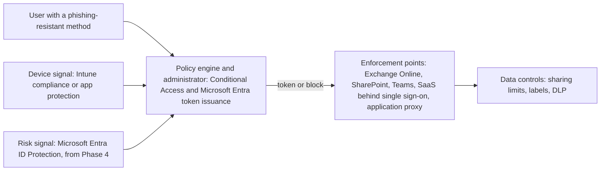
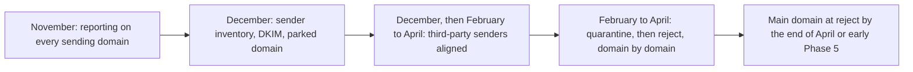

# 06. Microsoft 365 security baseline

> **Reference work.** Fictional scenario built for a public portfolio. Not deployed in, derived from, or describing any employer environment. Not professional advice.

## Purpose and scope

This document sets the Microsoft 365 security baseline that the Director of IT and Security proposes for Fabrikam (fictional): identity and access, devices, email, collaboration and data protection, logging, network and remote access, and the inputs that keep the baseline current. The main body explains each area and its reasoning; the appendices give every control its license, phase, KPI, and NIST CSF 2.0 and SOC 2 identifiers, and list the phase plan by action. The licensing decision is in [ADR-001](adr/ADR-001-microsoft-365-security-licensing.md), the authentication rollout in [ADR-004](adr/ADR-004-phishing-resistant-authentication-rollout.md), and the endpoint standard in [ADR-008](adr/ADR-008-endpoint-management-standard.md). Product cloud security, shared with Engineering under the RACI in document [04](04-operating-model-team-and-budget.md), is out of scope.

## How to read this baseline

- **"E3"** means Microsoft 365 E3 after Microsoft's July 2026 packaging update, which added Defender for Office 365 Plan 1, Intune Plan 2, Remote Help, and Intune Advanced Analytics, with rollout complete by August 1, 2026. Microsoft says no customer action is needed to receive them, so Phase 1 confirms the service plans in Fabrikam's tenant before anything depends on them.
- **"Defender Suite"** means Microsoft Defender Suite (formerly Microsoft 365 E5 Security) added to E3, which [ADR-001](adr/ADR-001-microsoft-365-security-licensing.md) proposes from Phase 4. It brings Microsoft Entra ID P2, Defender for Endpoint Plan 2, and Defender for Office 365 Plan 2.
- **Proposals.** Every cadence, target, and threshold is a proposal to tune after discovery (document [01](01-scenario-and-assumptions.md)). Document [05](05-environment-discovery.md) verifies the day-1 assumptions; document [12](12-metrics-and-executive-reporting.md) and the [KPI catalog](../data/kpi-catalog.csv) define the KPIs.
- **Change safety.** Every Conditional Access policy starts in report-only mode. Changes customers would notice (mail they receive, links they open) land before the mid-December freeze or after January 31. Internal work continues through year-end, except new enforcement on finance and payroll staff and devices. Until the current SOC 2 review period closes at M4, any change to how an in-scope control produces evidence is agreed with the SOC 2 audit firm first (document [10](10-governance-and-compliance-program.md)).
- **Threats.** S-01 to S-11 are the scenarios in the [threat profile](17-threat-profile.md).

### Zero Trust view

The baseline follows the logical components of NIST SP 800-207 (August 2020): a policy engine decides, a policy administrator opens or refuses the session, and policy enforcement points sit in front of resources. Microsoft services fill those roles at Fabrikam; another identity provider or device manager could fill the same ones.

| Section | CISA ZTMM v2.0 pillar | NIST SP 800-207 role | Implementation in this baseline |
|---|---|---|---|
| 1. Identity and access | Identity | Policy engine and policy administrator | Conditional Access and Microsoft Entra token issuance (Microsoft describes Conditional Access as its Zero Trust policy engine) |
| 2. Devices | Devices | Device posture input to the policy engine | Intune compliance and app protection; Conditional Access can also take compliance from supported third-party device managers |
| 3. Email | Applications and Workloads | Enforcement at the mail service | Exchange Online Protection and Defender for Office 365 |
| 4. Collaboration and data protection | Data | Enforcement at the resource | SharePoint and OneDrive sharing limits, sensitivity labels, DLP |
| 5. Logging and retention | Visibility and Analytics (cross-cutting) | Signals to the policy engine and to responders | Microsoft Entra and Purview audit logs, Defender XDR, the MDR provider |
| 6. Network and remote access | Networks | Enforcement in front of legacy applications | Device web protection, Microsoft Entra application proxy |
| 7. Tracking inputs | Governance (cross-cutting) | Continuous diagnostics | Secure Score, Microsoft Entra recommendations |

## 1. Identity and access

**Conditional Access.** The full reference set (CA-01 to CA-15) is in the appendix. A policy leaves report-only mode only after its results and the What If tool show the impact, and then goes to a pilot group before everyone. The emergency access group is the only exclusion, and neither office is a trusted named location. Conditional Access needs Microsoft Entra ID P1, which E3 includes; the risk-based policies (CA-13, CA-14) need P2, which comes with Defender Suite.

| Phase | Policies switched on | What changes |
|---|---|---|
| Phase 1 | CA-02 at MFA strength | MFA for every administrator |
| Phase 2 | CA-01 and CA-12 for all users, finance and payroll included; CA-03 and CA-10 for every ring except finance and payroll; CA-02 raised to phishing-resistant | Legacy protocols and device code flow blocked for everyone; MFA for all employees and method registration protected (finance and payroll in February) |
| Phase 3 | None (CA-04 in report-only) | No new enforcement on finance and payroll at year-end |
| Phase 4 | In February, CA-04, plus CA-03 and CA-10 for finance and payroll; CA-06 to CA-09 and CA-11 in rings; CA-13, CA-14 | Wave 2 group on phishing-resistant MFA; managed computers, protected phone apps, and supported platforms required; guests use MFA; risky sign-ins and users challenged |
| Phase 5 | CA-05 in rings; CA-15 pilot | Most users on phishing-resistant MFA by M6 |

**Authentication methods.** Microsoft made passkeys the default sign-in experience in Microsoft Entra from September 1, 2026, and retires Microsoft-provided SMS and voice MFA on February 1, 2027 (July 1, 2027 for Global Administrators and external users). After those dates a user whose only method is SMS or voice must register a passkey at sign-in, a blocking prompt with no opt-out. Fabrikam moves everyone to a non-telephony method by the end of Phase 3 and does not buy a third-party telephony service to keep SMS. Administrators and the wave 2 group (finance, payroll, People, Support staff with customer data access, executives, and IT staff daily accounts) use device-bound methods only; everyone else may use any phishing-resistant method, synced passkeys included. [ADR-004](adr/ADR-004-phishing-resistant-authentication-rollout.md) covers rollout order, recovery, and the assurance reasoning.

**Privileged access.** The baseline moves administrators to separate cloud-only admin accounts, cuts Global Administrators below five in Phase 1, adds just-in-time activation through Privileged Identity Management in Phase 4 with the [ADR-001](adr/ADR-001-microsoft-365-security-licensing.md) licenses, and creates two emergency access accounts first of all (06.01); the appendix "Identity and access controls" gives the design (KPI-09).

**Apps, automation, and guests.** In the first half of January (Phase 3), user consent narrows to verified publishers and low-impact permissions behind the admin consent workflow, and existing grants are reviewed (A-02, S-05). Automation runs as owned, least-privilege workload identities with credentials in a managed secrets vault, never as user accounts (R-08). From January, guests can no longer invite guests, see only their own directory objects, and lose SharePoint and OneDrive access after 90 days unless renewed; CA-11 requires MFA for guests from Phase 4. External Teams chat narrows to allowed partner domains in Phase 4, and Quick Assist leaves managed Windows devices with the January endpoint baseline, because Remote Help is the standard (appendix: External collaboration).

## 2. Devices

[ADR-008](adr/ADR-008-endpoint-management-standard.md) sets one endpoint standard: Intune for Windows and macOS, and app protection without enrollment for personal phones. Defender for Endpoint Plan 1, in E3, protects every computer until Plan 2 arrives with Defender Suite.

- **January (Phase 3), on E3; finance and payroll in February:** one Intune compliance policy per platform, with devices that have no policy marked not compliant; standing local admin rights removed and Windows LAPS on; BitLocker; Defender onboarded in active mode with tamper protection; the standard attack surface reduction (ASR) rules in Block and the rest in Audit; update rings with install deadlines; app protection policies for personal phones; Quick Assist removed from managed Windows devices and blocked from reinstalling.
- **Phase 4:** CA-06 requires compliant computers; ASR rules move to Block in rings, finance last; in the same rings, Microsoft Edge accepts only extensions on an approved list, because an AI extension can read every page a user opens (document [16](16-ai-adoption-guardrails.md), AIC-01); Windows Autopilot becomes the standard for new laptops; corporate Macs enroll through Apple's automated device enrollment with Platform SSO and FileVault; Defender for Endpoint Plan 2 adds endpoint detection and response, automatic attack disruption, and vulnerability data.
- **Windows 10.** Commercial Extended Security Updates (ESU) Year 1 ended 2026-10-13. Phase 1 decides each remaining device: upgrade, replace, or a short Year 2 bridge that the CFO approves. None remains after Phase 4.
- **Vulnerability targets.** Critical within 14 days, high 30, medium 60, low 90 or the next cycle; active exploitation moves an item to document 13's emergency path, with a fix or mitigation within 72 hours. Until Plan 2 data arrives, KPI-11 comes from Intune update compliance.

## 3. Email

Defender for Office 365 Plan 1, part of E3 since July 2026, runs on default policies today (assumption A-05). Phase 2 tightens it before mid-December: the Standard preset security policy for all users (Strict for executives, finance, payroll, and People after year-end); user impersonation protection for executives and the staff who approve payments or bank-detail changes, with Priority account tags for executives; Safe Links and Safe Attachments; Outlook's External tag; automatic external forwarding set explicitly off; and "Honor DMARC record policy" for inbound mail.

**SMTP AUTH deadline.** Exchange Online disables SMTP AUTH Basic authentication by default at the end of December 2026 (a secondary source), so Phase 1 lists every sender, customer-facing first, and Phase 2 moves each to a supported method before the freeze (appendix: Email controls, SMTP AUTH).

Two limits matter for payroll fraud (S-01). User impersonation protection does not act when the sender and recipient have emailed before, and a genuinely compromised supplier mailbox is not impersonation at all. The out-of-band check on every bank-detail change in the [payroll diversion playbook](playbooks/payroll-diversion-and-email-compromise.md) covers both.

### Email authentication: DMARC, DKIM, and SPF

**Why enforcement matters for a payroll and HR platform.** Customers' payroll administrators and hourly workers trust mail from Fabrikam's domains. A spoofed "confirm your new bank details" or "your pay statement is ready" message that appears to come from Fabrikam is the classic payroll diversion lure (S-09); the FBI has warned about phished credentials used to redirect direct deposits (2018) and about fake employee self-service sites built to steal pay (2025). Gmail and Outlook.com also require senders of more than 5,000 messages a day to pass SPF and DKIM and publish DMARC aligned with at least one of them, and Gmail has been ramping up enforcement since November 2025, so an unmanaged sender inventory is a delivery risk as well as a security one.

**In plain terms.** Three DNS records tell receiving mail systems how to treat mail that claims to come from a Fabrikam domain. SPF lists the servers allowed to send it. DKIM adds a signature showing the message was sent with the domain's authority and not altered. DMARC ties both to the address the reader sees, tells receivers what to do when a message fails (nothing, quarantine, or reject), and asks them to send reports back.

**Where Fabrikam stands.** The main domain publishes DMARC at p=none, and its aggregate reports go to a mailbox nobody reviews. Of the two older brand domains from the acquisitions, one no longer sends mail but publishes no SPF or DMARC record, and the other sends only through a marketing service and has no DMARC record (assumption A-05). That gives neither protection nor visibility: p=none asks receivers for no DMARC-specific action, so failing mail is left to each receiver's own filtering; the older brand domains ask receivers for nothing and get no reports back; and reports that nobody reads tell no one who is sending as Fabrikam, legitimately or not.

**Why companies stop there.** p=none meets the large mailbox providers' bulk-sender rules. Gmail's guidelines say the DMARC policy "can be set to none", Yahoo asks for at least p=none, and Outlook.com asks for at least p=none while recommending p=reject. Mail keeps flowing, the requirement looks met, and the reports pile up unread.

**What executives and service owners are asked.**

- **Owners.** Each sending service has an owner who aligns it by the 06.27 date or moves it to a subdomain: the Sales leader (CRM), the Support leader (support desk), the Marketing leader (marketing automation, and the older brand domain that still sends), and the Engineering Manager (transactional mail).
- **Calendar.** The Chief Customer Officer approves the enforcement calendar: after the freeze, the sending older brand domain first, the main domain last.
- **Quick win.** The parked brand domain is done in Phase 2 (06.16).
- **Finish line.** Done means every sending domain at p=reject and no unknown sender in the monthly report. It is reported as a supporting check under R-01 and R-02.

**The path.** Each step is a phase-plan action. Fabrikam ramps by domain and by time rather than by percentage, which works under both the revised DMARC standard and Microsoft's guidance (appendix: Email controls, DMARC ramp mechanism).

| Step | When | Action | Phase plan |
|---|---|---|---|
| 1. See who sends | Phase 1 | Publish a DMARC record at p=none with aggregate reporting (rua) on the older brand domain that still sends, point reporting on every sending domain at a monitored DMARC report processor, and name a reviewer. Mail delivery does not change | 06.06 |
| 2. Inventory, sign, and park | Phase 2 | Build the sender inventory from the reports. Confirm Microsoft 365 DKIM signing is on, with 2048-bit keys, for every custom domain that sends mail (two CNAME records each). Once discovery confirms nothing sends as it, give the older brand domain that no longer sends parked-domain records: SPF "v=spf1 -all", DMARC "v=DMARC1; p=reject;", no DKIM, and a null MX only if it receives no mail either | 06.16 |
| 3. Align third-party senders | Phase 2 for low-risk changes, Phase 4 for the rest | Make each sender category (CRM, support desk, marketing automation, transactional email) pass DMARC through DKIM signing with Fabrikam's domain or a custom return-path subdomain. Microsoft recommends a subdomain for services Fabrikam does not directly control, such as bulk marketing mail. Low-risk DKIM additions land before the mid-December freeze | 06.16, 06.27 |
| 4. Enforce | Phase 4, after the year-end freeze | Domain by domain, on the Chief Customer Officer's calendar, move to p=quarantine and then p=reject: the sending older brand domain first, the main domain last. Set explicit policies for subdomains (sp) and non-existent subdomains (np). Rollback is a DNS change, so record TTLs are lowered beforehand | 06.27 |
| 5. The older brand domain that still sends | Phase 4 | Either it follows step 4 to p=reject, or its mail moves to a subdomain of the main brand and it gets the parked-domain records from step 2. Document 15 decides when a domain retires completely, with the registration kept to block impersonation | 06.27 |
| 6. Inbound protection | Phase 2 | Microsoft 365 honors other domains' DMARC policies through the "Honor DMARC record policy" setting (Appendix: Email controls, Inbound DMARC) | 06.14 |

**Limits.** Enforcement stops exact-domain spoofing only. Lookalike domains, display-name tricks, and genuinely compromised accounts at Fabrikam or a supplier all pass DMARC. Out-of-band verification of every bank-detail change (the [payroll diversion playbook](playbooks/payroll-diversion-and-email-compromise.md)) covers them, and the FBI suggests domain monitoring that flags lookalike registrations: Fabrikam adds a lookalike domain monitoring service in Phase 4 (document [15](15-enterprise-systems-and-saas.md)).

**Optional brand benefit.** Once a domain is at enforcement, BIMI, a specification for showing a verified logo beside authenticated mail in supporting inboxes, becomes possible. The BIMI Group defines enforcement as p=quarantine or p=reject, and each mailbox provider decides whether a mark certificate is needed: Gmail requires a Verified Mark Certificate (its recommendation) or a Common Mark Certificate, and the BIMI Group lists Apple as requiring a Verified Mark Certificate.

**Cost drivers.** Small: no new Microsoft licenses. The work is DNS changes and settings in each sending service, time from the Systems Engineer (Identity and Endpoint) and each service's owner, a DMARC report processor subscription, and, optionally, a mark certificate for BIMI; the lookalike monitoring service is costed in document 15.

## 4. Collaboration and data protection

Assumption A-06 describes the gap: "Anyone" sharing links are allowed, there are no sensitivity labels, and customer payroll exports sit in email or OneDrive during support cases. The baseline closes it in three steps, each detailed with its license in the appendix "Collaboration and data protection controls": Anyone links limited before mid-December, once the Chief Customer Officer's team has warned customers; DLP for payroll identifiers in simulation in January; and in Phase 4, no Anyone links, DLP blocking, manual labels, and a restricted support case site. Microsoft Copilot (formerly Microsoft 365 Copilot) works within each user's existing permissions, so a pilot follows in Phase 5 only after that oversharing work, under the guardrails in document [16](16-ai-adoption-guardrails.md) (06.34, R-07).

## 5. Logging and retention

An investigation of business email compromise or data exposure usually has to look back well before the day of detection, and customer contracts can set notice clocks shorter than any statute (R-10; documents 08 and 10). Thirty days of Microsoft Entra sign-in history does not cover that, so:

- Microsoft Entra sign-in and audit logs are archived to Azure storage from Phase 1 (a consumption cost) and kept at least one year, longer where a customer contract requires. CISA's #StopRansomware Guide recommends keeping logs for critical systems for at least one year where possible.
- The unified audit log (Purview Audit Standard) keeps its E3 default of 180 days until document 08 decides in Phase 5, using the inventory of customer notification clauses, whether to extend it through Audit (Premium), which needs E5 or Purview Suite, or an export path.
- From Phase 4 the MDR provider ([ADR-003](adr/ADR-003-managed-detection-and-response.md)) gets telemetry it can act on (Defender for Endpoint Plan 2 in active mode and Microsoft Entra ID P2), least-privilege, time-bound access, and agreed response authority.

## 6. Network and remote access

Fabrikam is remote-first, so access decisions rest on identity and device (sections 1 and 2), not network location. Microsoft's network principles for Microsoft 365 point the same way: local internet egress, no hairpins through VPNs or proxies, no TLS inspection of Microsoft 365 traffic, and "equivalent trust for user devices inside the office or at remote locations". Both offices are treated as internet access with good hygiene, and nothing assumes an office topology before the Phase 1 inventory.

- **Offices.** Quick fixes in Phase 2: Wi-Fi key rotation, guest isolation, port forward cleanup, MFA on gear administration. Enterprise Wi-Fi with EAP-TLS device certificates follows in Phase 4 and needs a certificate authority (the Microsoft Cloud PKI add-on on E3, a conditional line in ADR-001) and a cloud RADIUS service.
- **Web protection on the device.** Defender for Endpoint network protection and web content filtering, both on E3: audit from January (Phase 3), block mode from Phase 4.
- **Remote access.** The target is no VPN. A surviving acquired web app goes behind Microsoft Entra application proxy (Entra ID P1); a non-web app is evaluated for Microsoft Entra Private Access (sold standalone or in Microsoft Entra Suite, a conditional line in ADR-001) for its named group only. VPN appliances, tunnels, and servers left from the acquisitions retire in Phases 4 and 5 ([ADR-005](adr/ADR-005-acquired-company-consolidation.md)).

Not proposed: routing all staff web traffic through a cloud proxy service. It would add the hairpin Microsoft's principles warn against, and device protection meets the need on licenses Fabrikam already holds.

## 7. Secure Score and Microsoft Entra recommendations

Both are tracking inputs, not measures of security: Microsoft states that Secure Score "isn't an absolute measurement of how likely your system or data could be breached". The Security Engineer reviews both monthly (the Systems Engineer (Identity and Endpoint) does so until the Security Engineer starts). Each item becomes a backlog task with an owner, is marked as met by another control, or goes to the exception process in document [11](11-risk-management.md), where the named executive owner decides on acceptance. No Secure Score headline appears on the executive scorecard, and no audit evidence is generated from it; the KPIs measure outcomes directly. In Phase 4 the CIS Microsoft 365 Foundations Benchmark v7.0.0 and CISA's SCuBA baselines (ScubaGear v1.8.0) give a second opinion on settings. Fabrikam describes its settings as informed by these baselines, never as compliant with them; CIS's terms for non-member use bar compliance claims.

## Threat coverage

How the baseline answers the scenarios in the [threat profile](17-threat-profile.md), and what it leaves open.

| Scenario | Closed or reduced by this baseline | Left open |
|---|---|---|
| S-01 Payroll diversion through BEC | Impersonation protection and the Strict preset for approvers, the External tag, no automatic external forwarding, phishing-resistant MFA for the wave 2 group | Lookalike domains and compromised suppliers, which the playbook's out-of-band check covers rather than technology. AI-cloned voices and video, which no Microsoft 365 control in this plan detects: external Teams chat stays open to every domain until 06.28 limits it in March, after the December to January peak, because the limit needs notice to external contacts and a domain list built from real use, so until March the call-back rule carries those lures on Teams (document [16](16-ai-adoption-guardrails.md), AIC-06) |
| S-02 Customer administrator takeover in the product | Indirectly: DMARC enforcement removes spoofed Fabrikam mail as a lure | Phishing-resistant sign-in for customer administrators is a product decision under document 04's RACI |
| S-03 Help desk impersonation | CA-10, Temporary Access Pass rules, the document 13 verification script, alerts on method changes | A determined caller against a rushed analyst; training and the second approver reduce it |
| S-04 Adversary-in-the-middle and token theft | Phishing-resistant methods (CA-02, CA-04, CA-05), device code flow blocked, risk-based policies from Phase 4, the token protection pilot | Wave 3 until CA-05 in Phase 5; theft from an infected device; token protection on Apple devices, which Microsoft's page lists as generally available for native apps but heads "Apple (Preview)" in its supported-devices section (as of 2026-10-13), so CA-15 stays a Windows pilot |
| S-05 Consent phishing | User consent limited to verified publishers, the admin consent workflow, review of existing grants, app governance from Phase 4 (16.10) | Over-privileged apps from verified publishers until review catches them |
| S-06 Ransomware | ASR rules, tamper protection, LAPS, no standing admin rights, endpoint detection and response with automatic attack disruption from Phase 4, the MDR provider; Quick Assist removed and external Teams chat limited, which narrows the route for callers posing as IT | Phases 1 to 3 run on Plan 1 without endpoint detection and response; recovery depends on [ADR-006](adr/ADR-006-microsoft-365-backup.md) |
| S-07 Insider misuse | No Anyone links, DLP for payroll identifiers, labels, support data handling | No insider risk tooling or endpoint DLP on the proposed licensing (ADR-001) |
| S-08 Integration credential compromise | Workload identity controls, vaulted credentials, alerts on their sign-ins, with the MDR provider if it triages custom detections (ADR-003) | Partner-side controls are contractual (document 10) |
| S-09 Spoofing of Fabrikam's domains | Every sending domain at p=reject, parked-domain records for the rest | Lookalike domains and display-name tricks |
| S-10 Lost or stolen devices | BitLocker and FileVault, compliance, LAPS, app protection with selective wipe | Customers' shared devices at work sites: customers secure and manage them (a complementary user entity control, document 10), while the app controls what it keeps on a device, session length, and remote sign-out of a lost device (a product control under document 04's RACI). Hourly workers' clock-in accounts on them are product identities (document 07) |
| S-11 Prompt injection against AI assistants and product AI features | Less for a steered assistant to reach: sharing limits, labels, and DLP for payroll identifiers (06.18, 06.22, 06.28), and the oversharing work that comes before any Copilot pilot (06.34); from Phase 4, Defender Suite brings Defender for Office 365 Plan 2, which Microsoft says checks inbound email for prompt injection with no added configuration (ADR-001) | No baseline setting stops a model from following planted instructions, and Microsoft says safeguards inside the assistant remain important. Copilot Chat in Outlook reads mail from Phase 2, before the email check arrives, and the ADR-001 fallback never brings it. Product AI features are Engineering's under document 04's RACI. Document 16 holds the AI controls (AIC-03, AIC-05, AIC-10) |

## Phase plan

One row per phase below; the appendix "Phase plan by action" lists every action (06.01 to 06.35) with the same columns. Phase 1's urgent changes, the emergency access accounts (06.01) and MFA on every administrator (06.03), are prepared in week 1 and applied at the first Change Advisory Board in week 2 (document 13).

| Phase | Action ID | Action | Outcome | KPI | Owner role | Workstream |
|---|---|---|---|---|---|---|
| Phase 1 | 06.01 to 06.08 | Emergency access; identity inventory and log archive; CA-02 on; report-only policies; SMTP AUTH fix plan; DMARC reporting; Windows 10 decisions; settings recorded | Tested break-glass path; MFA on every administrator; baselines for M1 | KPI-06, KPI-08, KPI-09, KPI-24 | Systems Engineer (Identity and Endpoint), IT Operations Manager, Director of IT and Security | WS-1, WS-2, WS-3 |
| Phase 2 | 06.09 to 06.11, 06.14 to 06.16, 06.18 to 06.20 | Administrators on phishing-resistant methods; CA-01 and CA-12 on for everyone, CA-03 and CA-10 on (finance and payroll in February); registration campaign; mail protection, SMTP AUTH fixes, DKIM, the parked brand domain; sharing limits; audit logging; office fixes | Identity and mail protections live before year-end | KPI-08, KPI-16, KPI-17, KPI-24 | Systems Engineer (Identity and Endpoint), IT Operations Manager, Service Desk Analyst | WS-1, WS-2, WS-3, WS-4 |
| Phase 3 | 06.12, 06.13, 06.17, 06.21 to 06.23 | Consent, workload identity, and guest limits; endpoint baseline (finance and payroll in February); CA-04 in report-only; every user off SMS and voice; DLP in simulation; licensing proposal and FastTrack request | Consent and endpoint protections in place; nobody stranded on 2027-02-01; licensing decided at M3 | KPI-01, KPI-07, KPI-08, KPI-10, KPI-13, KPI-17 | Systems Engineer (Identity and Endpoint), Service Desk Analyst, Director of IT and Security | WS-1, WS-2, WS-3, WS-5 |
| Phase 4 | 06.24 to 06.31 | CA-04 on and finance and payroll joined to the earlier controls, device policies in rings; Privileged Identity Management, risk policies, endpoint detection and response, MDR; hardening; DMARC enforcement; Anyone links off, DLP blocking, labels, external Teams chat limited; Macs and phones on one standard; vulnerability data; VPN retired | Wave 2 on phishing-resistant MFA; no standing admin roles beyond emergency access; sending domains at p=reject (the main domain may hold at quarantine into early Phase 5) | KPI-06, KPI-08, KPI-09, KPI-10, KPI-11, KPI-17, KPI-24 | Systems Engineer (Identity and Endpoint), Security Engineer, IT Operations Manager | WS-1, WS-2, WS-3, WS-7 |
| Phase 5 | 06.32 to 06.35 | CA-05 in rings; token protection pilot; Copilot readiness; monthly tracking review (running since Phase 2) | Phishing-resistant MFA for most users (M6); baseline re-baselined at M7 | KPI-01, KPI-08 | Systems Engineer (Identity and Endpoint), Security Engineer | WS-1, WS-5, WS-9 |

## Resourcing and dependencies

- **Roles.** The Systems Engineer (Identity and Endpoint) carries most Phase 1 to 3 work. The IT Operations Manager owns SMTP AUTH, Windows 10, and the network. The Service Desk Analyst supports registration and issues Temporary Access Passes under document 13's checks. The Security Engineer owns Privileged Identity Management, MDR onboarding, DLP enforcement, and the tracking inputs once in post (March 2027 in the base case, document 04); until then the Director of IT and Security makes the security engineering decisions and the Systems Engineer (Identity and Endpoint) does the hands-on work, with partner help where named. The Director owns the baseline and proposes the licensing. Business partners: the Engineering Manager (Engineering's ASR ring, Mac developer tooling, transactional mail), the Chief Customer Officer (support data handling, timing of customer-facing changes, the DMARC enforcement calendar), the Sales, Support, and Marketing leaders (their sending services), the CFO (licensing budget, any ESU spend), and General Counsel (retention schedule).
- **Partners.** FastTrack for Microsoft 365 comes first: Microsoft's deployment assistance benefit gives tenants with 150 or more licenses of an eligible plan, Microsoft 365 E3 included, remote guided help with Microsoft Entra, Intune, Defender, and Purview work (its scope varies by workload), before any paid partner is engaged; the Director requests it in December (06.23). Then the build partner, whose contracted help for February to April is in the M3 budget (document 04) and whose scope the Director agrees in January (06.23); the MDR provider (Phase 4); the IT hardware partner (Autopilot registration, replacement laptops, security keys, administrators' phones); the SOC 2 audit firm (agreement on evidence changes before M4).
- **Licenses and cost drivers by phase.** Phases 1 to 3: E3 only, plus FIDO2 security keys for the emergency accounts and for administrators' separate accounts (two models), company-owned phones for administrators, Azure storage for the log archive (consumption), a DMARC report processor subscription, a secrets vault and an enterprise password vault, and Windows 10 ESU only if a bridge is needed. Phase 4: Microsoft Defender Suite and Microsoft Entra ID Governance for all users if approved at M3; two conditional lines in ADR-001, the Microsoft Cloud PKI add-on for enterprise Wi-Fi and Microsoft Entra Private Access only if a surviving app needs it; a cloud RADIUS service for enterprise Wi-Fi, which is not a Microsoft license. Phase 5: Copilot licenses only after the pilot decision (document 16), which also enables SharePoint Advanced Management; an optional BIMI mark certificate.
- **Depends on.** Documents [05](05-environment-discovery.md) (discovery), [07](07-identity-lifecycle-joiners-movers-leavers.md) (admin inventory, guest reviews, access requests), [08](08-detection-and-incident-response.md) (alerting, MDR, log decisions), [09](09-security-awareness-and-training.md) (training for the wave 2 group and Support), [10](10-governance-and-compliance-program.md) (SOC 2 period, POL-03 to POL-07), [11](11-risk-management.md) (exceptions), [13](13-it-service-management.md) (identity checks, change management), [14](14-business-continuity-and-backup.md) (backup), [15](15-enterprise-systems-and-saas.md) (app inventory, domains, consolidation), [16](16-ai-adoption-guardrails.md) (Copilot), and [17](17-threat-profile.md) (threats); [ADR-001](adr/ADR-001-microsoft-365-security-licensing.md), [ADR-002](adr/ADR-002-hr-system-of-record-drives-identity.md), [ADR-003](adr/ADR-003-managed-detection-and-response.md), [ADR-004](adr/ADR-004-phishing-resistant-authentication-rollout.md), [ADR-005](adr/ADR-005-acquired-company-consolidation.md), and [ADR-008](adr/ADR-008-endpoint-management-standard.md).

## Risks and open questions

- **Licensing gate.** Privileged Identity Management, risk-based policies, endpoint detection and response, and MDR depth all depend on the M3 decision. If it slips, Phase 4 controls slip. The fallback in ADR-001 (the base Governance product plus Entra ID P2 for administrators) keeps just-in-time access and lifecycle automation, but not endpoint detection and response or risk-based policies for everyone.
- **License lapse.** If P2 or Governance licenses lapse, Microsoft removes eligible role assignments and makes active time-bound ones permanent, the opposite of the goal, so renewal dates sit with the CFO's team.
- **E3 gaps until Phase 4.** No endpoint detection and response, no central ASR reporting, risky-user reports limited to medium and high risk, and no vulnerability management.
- **Dates that may move.** The SMTP AUTH timeline rests on a community mirror of Microsoft's message center. The SMS and voice dates, the passkey default, and E3's July 2026 additions are rechecked on publication day and in the tenant.
- **Preview or unconfirmed status (as of 2026-10-13).** Microsoft Entra passkeys on Windows (public preview in Microsoft's March 2026 release notes, with no later general availability entry found) and token protection on Apple devices (Microsoft's page lists Apple native apps as generally available but heads its Apple supported-devices section "Apple (Preview)"). No enforcement in this baseline depends on them. macOS Platform SSO, which the baseline does use, has been generally available since August 2025 (Microsoft Entra release notes).
- **Conflicting Microsoft pages.** The default user consent setting, manual labeling on E3, and the passkey profile limit differ across Microsoft pages; Phase 1 confirms each in the tenant.
- **People and timing.** Forced registration from February 1 can flood the service desk (KPI-20) right after year-end, and the wave 2 group is busiest exactly when it should register; early December registration is the mitigation. February also brings finance and payroll onto CA-03, CA-10, and the endpoint baseline that everyone else received in December and January, so their ring follows 06.24's order, agreed with the CFO's team: identity changes first, then the endpoint baseline, then the finance single sign-on cutover. The legacy authentication and device code flow blocks (CA-01, CA-12) reach them before mid-December with everyone else: once report-only data shows no legitimate use, neither block changes what users do day to day, and these are the staff payroll diversion targets (S-01). ASR rules, token protection, and removing Mac admin rights can break Engineering tools, so Engineering's ring runs with the Engineering Manager and before finance.
- **Customer-facing changes.** DMARC enforcement and the end of Anyone links can stop mail or links customers rely on. The sender inventory and Support's replacement path come first, and the IT and Security Steering Group reviews the timing with the Chief Customer Officer.
- **Open questions for discovery.** Does any surviving acquired application need Private Access? Which Windows editions and hardware does the fleet run, and does subscription activation apply Windows Enterprise (the Quick Assist reinstall block needs it)? Do customer contracts require audit history beyond one year? Which retention features does the E3 license cover for support case data? Which browsers do staff use on managed computers? The extension allow list (06.26) covers Microsoft Edge; a second browser in wide use needs the same rule through its own enterprise policy before 06.26 counts as done.

## Framework mapping

The relationships below are this plan's own analysis, consistent with the [crosswalk](crosswalk/csf2-soc2-crosswalk.md); no official AICPA mapping between the Trust Services Criteria and CSF 2.0 was found.

| Theme | NIST CSF 2.0 | SOC 2 (2017 TSC) |
|---|---|---|
| Identity, authentication, privileged access | PR.AA-01, PR.AA-02, PR.AA-03, PR.AA-05, PR.IR-03 | CC6.1, CC6.2, CC6.3 |
| App consent and external collaboration | PR.AA-05, ID.AM-02 | CC6.1, CC6.2, CC6.3 |
| Devices and endpoint protection | ID.AM-01, ID.AM-08, PR.PS-01, PR.PS-05, PR.DS-01, DE.CM-09 | CC6.1, CC6.7, CC6.8, CC7.2 |
| Patching and vulnerability remediation | ID.RA-01, ID.RA-06, PR.PS-02, PR.PS-03 | CC7.1, CC8.1 |
| Email protection and authentication | PR.PS-01, PR.DS-02, DE.CM-09 | CC6.6, CC6.7, CC6.8 |
| Collaboration and data protection | ID.AM-07, PR.DS-01, PR.DS-02 | CC6.1, CC6.7, C1.1, C1.2 |
| Logging and retention | PR.PS-04, DE.CM-03, DE.CM-09, RS.AN-03 | CC7.2, CC7.3 |
| Network and remote access | ID.AM-03, PR.IR-01, DE.CM-01 | CC6.1, CC6.5, CC6.6 |
| Tracking and improvement | ID.RA-01, ID.IM-01 | CC4.1, CC7.1 |

## Appendix: Conditional Access reference set

"Admin roles" means every privileged directory role in the admin inventory (document [07](07-identity-lifecycle-joiners-movers-leavers.md)). "Admin accounts group" means the group of separate cloud-only admin accounts; CA-02, CA-09, and CA-15 target it as well as the roles, because from Phase 4 most roles are only eligible, and Microsoft notes that a user does not hold an eligible role until activation, so a policy scoped only to roles would not cover an admin account's sign-in before activation. Rollout rings are set by inclusion, so a ring that joins later, such as finance and payroll in February, needs no exclusion. "Wave 2 group" means finance, payroll, People, Support staff with customer data access, executives, and IT staff daily accounts ([ADR-004](adr/ADR-004-phishing-resistant-authentication-rollout.md)). "All employees" means all users except guest and external users. Neither office is a trusted named location, so no policy relaxes because of where someone sits. Conditional Access needs Microsoft Entra ID P1, which E3 includes; risk conditions need P2.

| ID | Intent | Users | Target resources | Conditions | Grant or session controls | Exclusions | Phase | License |
|---|---|---|---|---|---|---|---|---|
| CA-01 | Block legacy authentication | All users | All resources | Client apps: Exchange ActiveSync and other clients | Block | Emergency access group | Report-only Phase 1; on in Phase 2 for all users, finance and payroll included, after the SMTP AUTH fixes and once report-only data is clean | Entra ID P1 |
| CA-02 | Strong sign-in for administrators | Admin roles and the admin accounts group | All resources | None | Authentication strength: Multifactor authentication, raised in Phase 2 to a custom phishing-resistant strength that accepts only the admin account methods (ADR-004 wave 1: the administrators' security key model and Authenticator passkeys, by AAGUID) | Emergency access group | Short report-only window, then on in Phase 1 | Entra ID P1 |
| CA-03 | MFA for everyone | All employees | All resources | None | Authentication strength: Multifactor authentication | Emergency access group | Report-only Phase 1 beside existing policies; on in Phase 2 with older overlapping policies retired; finance and payroll join in February (Phase 4) | Entra ID P1 |
| CA-04 | Phishing-resistant MFA for high-risk business roles | Wave 2 group | All resources | None | Authentication strength: a custom device-bound strength that accepts only the wave 2 methods (ADR-004) | Emergency access group | Report-only Phase 3; on in February (Phase 4), after year-end close | Entra ID P1 |
| CA-05 | Phishing-resistant MFA for all employees | All employees | All resources | None | Authentication strength: Phishing-resistant MFA | Emergency access group | Report-only Phase 4; on in rings in Phase 5, most users by M6 | Entra ID P1 |
| CA-06 | Managed computers only | All employees | All resources | Device platforms: Windows, macOS | Require device to be marked as compliant | Emergency access group | Report-only Phase 2; on in rings in Phase 4 | Entra ID P1, Intune Plan 1 |
| CA-07 | Protected work apps on phones | All employees | Office 365 | Device platforms: iOS, Android | Require app protection policy | Emergency access group | Report-only Phase 2; on in Phase 4 | Entra ID P1, Intune Plan 1 |
| CA-08 | Block platforms Fabrikam does not support | All employees | All resources | Device platforms: any except Windows, macOS, iOS, Android | Block | Emergency access group | Report-only Phase 2; on in Phase 4 | Entra ID P1 |
| CA-09 | Administrator sessions | Admin roles and the admin accounts group | All resources | None | Require compliant device; sign-in frequency 4 hours; persistent browser session never | Emergency access group | Report-only Phase 2; on in Phase 4 | Entra ID P1, Intune Plan 1 |
| CA-10 | Protect registration of sign-in methods | All employees | User action: Register security information | None | Require multifactor authentication (a Temporary Access Pass satisfies it for new hires and recovery) | Emergency access group | Report-only Phase 1; on in Phase 2; finance and payroll join in February (Phase 4) | Entra ID P1 |
| CA-11 | Guests use MFA | Guest and external users | All resources | None | Authentication strength: Multifactor authentication | Emergency access group | Report-only Phase 2; on in Phase 4 after notice to external collaborators | Entra ID P1 |
| CA-12 | Block device code flow | All users | All resources | Authentication flows: device code flow | Block | Emergency access group | Report-only Phase 1; on in Phase 2 for all users, finance and payroll included, once report-only data is clean | Entra ID P1 |
| CA-13 | Step up risky sign-ins | All employees | All resources | Sign-in risk: medium, high | Authentication strength: Multifactor authentication; sign-in frequency every time | Emergency access group | Report-only, then on in Phase 4 | Entra ID P2 (Defender Suite) |
| CA-14 | Remediate risky users | All employees | All resources | User risk: high | Require risk remediation | Emergency access group | Report-only, then on in Phase 4 | Entra ID P2 (Defender Suite) |
| CA-15 | Bind sessions to the device | Admin roles, the admin accounts group, and the wave 2 group | Exchange Online, SharePoint Online, Teams services | Device platforms: Windows; client apps: mobile apps and desktop clients | Require token protection for sign-in sessions | Emergency access group | Report-only, then a pilot in Phase 5 | Entra ID P1 |

- **Emergency access.** Microsoft's guidance is to exclude emergency access accounts from Conditional Access policies that block or restrict sign-in, because a policy requiring MFA, a compliant device, or another control could lock them out in the emergency they exist for; report-only policies need no exclusion. Every enforced policy above blocks or restricts sign-in, so each lists the group, which is added before a policy leaves report-only. There are no other exclusions: an automation account that cannot meet a policy moves to a workload identity, as Microsoft recommends, instead of being excluded.
- **Method of change.** Each policy stays in report-only mode until its results and the What If tool show the impact, then goes to a pilot group before everyone. Microsoft does not allow "Require multifactor authentication" and "Require authentication strength" in the same policy, so the set uses strengths except CA-10, where Microsoft's guidance relies on a Temporary Access Pass satisfying MFA.
- **Phones.** CA-07 uses "Require app protection policy". Microsoft scheduled the approved client app grant for retirement in early March 2026 and directs new policies to app protection.
- **Device code flow.** Microsoft recommends blocking it wherever possible. Report-only data shows any legitimate use, for example a meeting-room device, so it can be fixed before CA-12 goes on.
- **Privileged Identity Management.** From Phase 4 (06.25), activating an admin role requires a Conditional Access authentication context. A companion policy to CA-02 targets that context for the admin accounts group rather than the roles, because Microsoft notes a user holds no role yet during activation; it requires the CA-02 custom strength with sign-in frequency set to every time, so activations prove the method again (Microsoft lets one reauthentication cover further activations for 10 minutes). The companion policy is ordinary Conditional Access (Entra ID P1); Privileged Identity Management itself needs P2 or Governance.
- **Token protection.** It is generally available for native apps on Windows. For Apple devices the same Microsoft page conflicts: its platform table lists iOS, iPadOS, and macOS native apps as generally available, while its supported-devices section is headed "Apple (Preview)" (as of 2026-10-13), and Apple devices must be MDM-managed with the Enterprise SSO plug-in or Platform SSO. Microsoft lists clients that fail under it, including Office perpetual clients, PowerShell modules that reach SharePoint, and Visual Studio Code extensions that reach Exchange or SharePoint, so CA-15 starts as a Windows pilot.
- **KPIs and mapping.** KPI-08 tracks CA-02, CA-04, CA-05, and CA-15; KPI-10 tracks CA-06 and CA-09; KPI-09 tracks the privileged population CA-02 protects. CSF 2.0: PR.AA-03, PR.AA-05, PR.IR-01. SOC 2: CC6.1, CC6.6.

## Appendix: Identity and access controls

### Authentication methods

| Population | Methods | Enforced by | Register | Enforce |
|---|---|---|---|---|
| Emergency access accounts | FIDO2 security keys of a model no other account uses, in their own passkey profile. Microsoft advises that emergency accounts not use the same authentication methods as other admin accounts; ADR-004 records why the admin accounts also carry security keys, of a different model | Microsoft's mandatory MFA (excluded from enforced Conditional Access policies) | Phase 1 | Phase 1 |
| Administrators' separate admin accounts | A FIDO2 security key (a model different from the emergency access keys, allowed by AAGUID in the custom strength) plus a device-bound passkey in Microsoft Authenticator on a company-owned, Intune-managed phone. Windows Hello for Business and the macOS platform credential count for an admin account only on a dedicated admin workstation where that account signs in to the operating system | CA-02 | Phase 2 | Phase 2 |
| Wave 2 group | Windows Hello for Business or the macOS platform credential, plus a device-bound passkey in Authenticator; no synced passkeys | CA-04 | Early December, before year-end close | February (Phase 4) |
| All other employees | Any phishing-resistant method, including synced passkeys; Authenticator push with number matching only as a bridge until CA-05 | CA-03, then CA-05 | By the end of Phase 3 | Phase 5 |
| Guests | MFA from their Microsoft Entra home tenant, which inbound cross-tenant access settings trust as the organization default or per partner; guests from other identity providers or with personal accounts register a method in Fabrikam's tenant and are 06.32's population | CA-11 | In Fabrikam's tenant only for guests outside Microsoft Entra | Phase 4 |

| Control | License | Phase | KPI | CSF 2.0 | SOC 2 |
|---|---|---|---|---|---|
| Passkey profiles per population, device-bound with attestation for administrators and wave 2 | Microsoft Entra ID (Microsoft states passkeys need no extra license) | 2 | KPI-08 | PR.AA-01, PR.AA-03 | CC6.1 |
| Windows Hello for Business; macOS Platform SSO with a Secure Enclave key | Windows Pro or Enterprise entitlement; Platform SSO is included in every Intune plan | 2 to 4 | KPI-08 | PR.AA-03 | CC6.1 |
| One-time Temporary Access Pass for onboarding and recovery. For a new hire, the account stays disabled until the verifier records the identity check, or the pass is issued during the verified call (document 07, R-15); for recovery, the pass follows the identity verification in document [13](13-it-service-management.md) | Microsoft Entra ID (Microsoft's page names no license) | 1 | KPI-22 | PR.AA-02, PR.AA-03 | CC6.2 |
| SMS and voice removed from the authentication methods policy | Microsoft Entra ID | 3 | KPI-08 | PR.AA-03 | CC6.1 |

### Privileged access

- **Fewer, separate, cloud-only admin accounts.** Administrators use cloud-only admin accounts separate from their daily accounts, each with a security key and an Authenticator passkey (methods table above), and sign in only from a compliant, Intune-managed computer (CA-09). Microsoft recommends fewer than five Global Administrators and raises an alert at five or more; its page does not say whether emergency accounts count, so Fabrikam counts them. Daily work uses least-privileged roles, and KPI-09 tracks standing assignments against Microsoft's guidance of fewer than 10 privileged role assignments overall.
- **Just-in-time access from Phase 4.** Privileged Identity Management needs Microsoft Entra ID P2 or Microsoft Entra ID Governance, so it arrives with the Phase 4 licenses in [ADR-001](adr/ADR-001-microsoft-365-security-licensing.md) (Defender Suite and Governance). Roles become eligible and time-bound, Global Administrator and Privileged Role Administrator activations need approval from one of at least two named approvers, as Microsoft recommends (the first to respond decides; with none named, Microsoft uses the active Privileged Role Administrators and Global Administrators, which outside an activation are only the emergency access accounts), and activation requires the authentication context that the CA-02 companion policy enforces (Conditional Access appendix). Only the emergency accounts keep a permanent active Global Administrator assignment, as Microsoft advises. Until Phase 4, fewer standing assignments and strong authentication carry the load.
- **Emergency access accounts.** Two cloud-only accounts on the onmicrosoft.com domain, each with FIDO2 security keys stored in separate secure locations, tied to no individual, and used only from a designated secure workstation. Every sign-in raises an alert on the on-call path (document [08](08-detection-and-incident-response.md)) and gets a post-use review. Microsoft asks for validation at least every 90 days, after IT staff changes, and when Microsoft Entra subscriptions change; Fabrikam meets that with a quarterly sign-in test against the live Conditional Access set (Microsoft's own example) plus a test after every IT staff change.

| Control | License | Phase | KPI | CSF 2.0 | SOC 2 |
|---|---|---|---|---|---|
| Emergency access accounts, alerting, and quarterly validation | Microsoft Entra ID P1 | 1 | KPI-09 | PR.AA-05, PR.IR-03 | CC6.1, CC6.3 |
| Fewer than five Global Administrators; separate admin accounts; least-privileged roles | Microsoft Entra ID P1 | 1 | KPI-09 | PR.AA-05 | CC6.3 |
| Privileged Identity Management with approval for the highest roles | Microsoft Entra ID P2 (Defender Suite) or Microsoft Entra ID Governance | 4 | KPI-09 | PR.AA-05 | CC6.1, CC6.3 |
| Admin sessions only from compliant workstations (CA-09) | Microsoft Entra ID P1, Intune Plan 1 | 4 | KPI-10 | PR.AA-05, PR.PS-01 | CC6.1 |

### App consent

Users can consent to third-party apps today (assumption A-02), the condition consent phishing needs (S-05). Microsoft recommends allowing user consent only for apps from verified publishers, so Fabrikam limits user consent to verified publishers and selected low-impact permissions and turns on the admin consent workflow, which lets a blocked user ask for review instead of looking for a workaround. Reviewers are the Systems Engineer (Identity and Endpoint) and, once in post, the Security Engineer; requests expire after 14 days. Approving a request needs a role that can grant it, and Microsoft lets only a Global Administrator approve a request for Microsoft Graph application permissions. Of the built-in roles, only Global Administrators and Privileged Role Administrators can grant application permissions for Microsoft Graph, and a custom role can be given the same right. Both roles stay with the fewest people and, from Phase 4, behind PIM approval, and no custom role is given that right. A setting change affects only future consents, so existing grants are exported, reviewed against document [15](15-enterprise-systems-and-saas.md)'s app inventory, and revoked where unneeded. Microsoft's pages disagree on the default consent setting, so Phase 1 records what the tenant actually has. App governance in Defender for Cloud Apps adds monitoring of OAuth apps once Defender Suite arrives (action 16.10).

| Control | License | Phase | KPI | CSF 2.0 | SOC 2 |
|---|---|---|---|---|---|
| User consent limited to verified publishers; admin consent workflow; review of existing grants | Microsoft Entra ID (Microsoft's pages name no added license); app governance needs Defender for Cloud Apps | 3 | KPI-07 | PR.AA-05, ID.AM-02 | CC6.1, CC6.3 |

### Workload identities and shared secrets

Integration and automation identities, such as the HR provisioning client in [ADR-002](adr/ADR-002-hr-system-of-record-drives-identity.md), can create or change accounts and reach customer data, so they get the same care as administrators (R-08).

- **No user accounts for automation.** Automation runs as service principals or managed identities, never as user accounts. Microsoft's mandatory MFA for its admin portals applies to user accounts, not workload identities, and Microsoft recommends moving automation to workload identities.
- **An owner and least privilege.** Each identity has a named owner and backup in the app inventory (documents 07 and 15) and only the API permissions it needs. Application permissions to Microsoft Graph go through the admin consent workflow, where only a Global Administrator can approve them. Of the built-in roles, only Global Administrators and Privileged Role Administrators can grant application permissions for Microsoft Graph, and a custom role can be given the same right. Both roles stay with the fewest people and, from Phase 4, behind PIM approval, and no custom role is given that right.
- **Credentials.** Credentials live in a managed secrets vault with access logging, never in scripts or code repositories, and are rotated on a schedule agreed with the owner. The Systems Engineer (Identity and Endpoint) watches these identities' sign-ins until the Security Engineer starts, then the Security Engineer does, with the MDR provider if the chosen service triages Fabrikam's custom detections (ADR-003, document 08).
- **Shared secrets that remain.** Accounts that cannot use single sign-on, such as some network gear and vendor consoles, keep their passwords in an enterprise password vault with access logging, and the leaver checklist rotates any secret a departing administrator knew (document 07). The emergency access keys stay in their safes, and the safe combinations change after anyone with access leaves, as Microsoft advises.

| Control | License | Phase | KPI | CSF 2.0 | SOC 2 |
|---|---|---|---|---|---|
| Workload identities with owners, least privilege, vaulted and rotated credentials; shared secrets in a password vault | Microsoft Entra ID P1; a secrets vault and an enterprise password vault (cost drivers) | 3 | KPI-01 | PR.AA-01, PR.AA-05 | CC6.1, CC6.3 |

### External collaboration

- **Who invites guests.** By Microsoft's default, anyone in the organization, guests included, can invite guests. January (Phase 3) limits invitations to members and admin roles. In Phase 4, once document 07's request path for external access exists, invitations narrow to admin roles and named holders of the Guest Inviter role.
- **What guests see.** Guest directory access moves to Microsoft's most restrictive option, their own directory objects only, after a short pilot with a few external teams.
- **How long access lasts.** SharePoint and OneDrive guest access expires automatically after 90 days unless renewed; with Microsoft Entra B2B integration on, Entra external collaboration settings also govern SharePoint sharing. Guest access reviews belong to document 07.
- **MFA.** CA-11, from Phase 4. Inbound cross-tenant access settings trust MFA from guests' Microsoft Entra home tenants, as the organization default or per partner; without that trust, Microsoft has guests complete MFA in the resource tenant. Guests from other identity providers or with personal accounts register a method in Fabrikam's tenant and are 06.32's population. No policy in the set blocks guests outright, so the access request path document 07 uses for guests stays open.
- **External Teams chat.** By default Teams allows chat with every external domain and with unmanaged Teams accounts. In Phase 4, after notice to external contacts, external chat is limited to allowed partner domains, built from the domains staff actually use, and chats with unmanaged Teams accounts are turned off.
- **Remote assistance.** Remote Help is the standard for support sessions (document [13](13-it-service-management.md)), so Quick Assist is removed from managed Windows devices with the January endpoint baseline (finance and payroll in February). Microsoft's Quick Assist page warns users never to allow a connection from someone claiming to be IT support unless they started the contact, and advises disabling or removing Quick Assist where another remote support tool such as Remote Help is used. Removal is by uninstalling the app, because blocking its service endpoint would also stop Remote Help. Because Quick Assist comes from the Microsoft Store, the uninstall is paired with a block on reinstalling it: the "Turn off the Store application" policy, which Microsoft's Intune guidance recommends for blocking users' access to the Store and which does not affect Intune's own Store app deployments. Microsoft applies that policy only to Windows Enterprise and Education (Microsoft 365 E3 includes Windows Enterprise, which subscription activation applies to Microsoft Entra joined devices), and it does not cover the winget command-line tool; if the IT ring shows that gap matters, the alternative is an App Control for Business rule that denies the Quick Assist package, which Windows Pro and Enterprise both support; Microsoft warns that once a package-name rule is in a policy, every packaged app in its scope must be controlled by package-name rules, so the IT ring tests it first.

| Control | License | Phase | KPI | CSF 2.0 | SOC 2 |
|---|---|---|---|---|---|
| Guest invitation limits, restricted guest directory access, 90-day SharePoint and OneDrive guest expiry; inbound MFA trust for guests' Microsoft Entra home tenants | Microsoft Entra ID P1; SharePoint Online (E3) | 3 and 4 | KPI-13 | PR.AA-01, PR.AA-05 | CC6.2, CC6.3 |
| External Teams chat limited to allowed partner domains; unmanaged Teams accounts off; Quick Assist removed and blocked from reinstalling, with Remote Help the standard | Microsoft Teams (E3); Intune Plan 1 and Remote Help (E3 since July 2026); the Store restriction needs Windows Enterprise (in Microsoft 365 E3) | Quick Assist 3 (finance and payroll 4); Teams 4 | KPI-17 | PR.AA-05, PR.PS-01 | CC6.6, CC6.8 |

## Appendix: Device controls

| Control | Design | License | Phase | KPI | CSF 2.0 | SOC 2 |
|---|---|---|---|---|---|---|
| Compliance | One Intune compliance policy per platform: supported OS version, disk encryption, Defender running with tamper protection, firewall on. The tenant marks devices with no compliance policy as not compliant, as Microsoft advises when Conditional Access uses compliance; CA-06 enforces it | Intune Plan 1, Entra ID P1 | 3 (finance and payroll 4); enforced 4 | KPI-10 | PR.PS-01, ID.AM-01 | CC6.1, CC6.8 |
| Autopilot | New laptops are registered for Windows Autopilot by the IT hardware partner at purchase (existing ones by hardware hash upload), join Microsoft Entra ID, enroll in Intune, and give users standard (non-administrator) accounts | Intune Plan 1, Entra ID P1 | Pilot 2; standard 4 | KPI-06 | ID.AM-08, PR.PS-01 | CC6.1, CC8.1 |
| Local administrator rights | Standing local admin rights removed. Windows LAPS rotates the local admin password and backs it up to Microsoft Entra ID; Macs enrolled through automated device enrollment get a LAPS-managed local admin account. Elevation goes through the service desk (document 13). Endpoint Privilege Management (Windows only) comes with E5 since July 2026, or with the Intune Suite or its add-on | Intune Plan 1, Entra ID | 3 (finance and payroll 4) | KPI-10 | PR.AA-05 | CC6.3 |
| Disk encryption | BitLocker through the endpoint security disk encryption policy, recovery keys in Microsoft Entra ID with every key view audited. FileVault on Macs marked corporate, with the recovery key escrowed in Intune and rotated | Intune Plan 1 | Windows 3 (finance and payroll 4); Macs 4 | KPI-10 | PR.DS-01 | CC6.1, CC6.7 |
| Endpoint protection | Defender for Endpoint onboarded through Intune on every Windows and Mac device, antivirus in active mode, tamper protection on. Endpoint detection and response, automatic attack disruption, and vulnerability data come with Plan 2 | Defender for Endpoint Plan 1 (E3); Plan 2 (Defender Suite) | 3 (finance and payroll 4); Plan 2 in 4 | KPI-06 | DE.CM-09, PR.PS-05 | CC6.8, CC7.2 |
| Attack surface reduction (ASR) rules | Windows only. The standard protection rules, which Microsoft recommends running in Block, go to Block in January (finance and payroll in February); the rest run in Audit, then Block in rings after January 31: IT, general staff, Engineering with the Engineering Manager, finance last. Exclusions go through the Change Advisory Board. Microsoft positions central ASR reporting at the E5 level, so on E3 the Audit review samples devices | Defender for Endpoint Plan 1 | 3; rings 4 | KPI-10 | PR.PS-05 | CC6.8 |
| Browser extensions | Microsoft Edge on managed Windows and Mac computers blocks every extension not on an approved list (ExtensionInstallBlocklist set to "*", with the approved extensions in its companion allow list policy), delivered through an Intune settings catalog profile on Windows and a preference file profile on macOS. Microsoft states that a blocked extension already installed is disabled, not removed, and the user cannot re-enable it. The list starts from the extensions Phase 1 discovery finds (document [05](05-environment-discovery.md)) and the tools already reviewed through AI intake (16.04); requests for new extensions go through the service desk, and AI extensions through intake. Rings follow the ASR order after January 31: IT, general staff, Engineering with the Engineering Manager, finance last. Where an approved extension has no need for them, Microsoft Edge's separate ExtensionSettings policy can keep extensions from reading named sensitive sites, such as the finance system and the customer support platform (runtime blocked hosts); Microsoft states that this policy supersedes the older extension policies, so if it is used, the block on all extensions and the approved list move into it, and the IT ring tests the result first. Other browsers on managed computers are an open question for discovery | Intune Plan 1 (E3); Microsoft Edge | 4 (rings) | KPI-10 | PR.PS-05, PR.PS-01 | CC6.8 |
| macOS | Corporate Macs enroll through Apple's automated device enrollment (new or wiped Macs) with Platform SSO, FileVault, and Defender for Endpoint. Defender supports the three most recent major macOS releases, so the compliance OS floor is the oldest of those | Intune Plan 1, Defender for Endpoint | 4 | KPI-06 | ID.AM-01, PR.PS-01 | CC6.1, CC6.8 |
| Personal phones | No enrollment. Intune app protection policies following Microsoft's data protection framework (enhanced level for most staff, high level for the wave 2 group): app PIN, encryption of work data, no saving to personal storage, copy and paste limits, selective wipe of company data. CA-07 requires it; Android also needs the Company Portal app | Intune Plan 1 (user license), Entra ID P1 | Policies 3; enforced 4 | KPI-17 | PR.DS-01, PR.AA-05 | CC6.1, CC6.7 |
| Windows 10 | Commercial Extended Security Updates (ESU) Year 1 ended 2026-10-13 and Year 2 ends 2027-10-12; buying Year 2 means paying for Year 1 too. Microsoft 365 Apps on Windows 10 stay on Version 2608 with security updates only until 2028-10-10. Phase 1 decides per device: upgrade to Windows 11 where the hardware meets Microsoft's minimums (TPM 2.0, Secure Boot, and the rest), otherwise replace; Year 2 ESU only as a short bridge, with the CFO approving that spend. Target: no Windows 10 by the end of Phase 4 | ESU per device, if used | Decide 1; done 4 | KPI-06 | PR.PS-02, PR.PS-03, ID.AM-08 | CC7.1, CC8.1 |
| Patching | Following NIST SP 800-40 Rev. 4, devices sit in maintenance groups with plans for routine patching, emergency patching, emergency mitigation, and unpatchable assets. Windows update rings in Intune (IT pilot, then everyone) carry install deadlines; Intune enforces macOS updates with deadlines through Apple's declarative device management; Microsoft 365 Apps and browsers follow the same rings. The Systems Engineer (Identity and Endpoint) packages third-party app updates, work that Enterprise Application Management (in E5) would automate. Patching continues through year-end; emergencies follow document 13's emergency change path | Intune Plan 1 | 3 (finance and payroll 4) | KPI-11 | PR.PS-02, ID.RA-01 | CC7.1, CC8.1 |
| Vulnerability remediation targets | From vendor severity: critical within 14 days, high 30, medium 60, low 90 or the next cycle. Active exploitation reported by the vendor, the MDR provider, or CISA's Known Exploited Vulnerabilities catalog moves an item to the emergency path (fix or mitigate within 72 hours). E3's Defender for Endpoint Plan 1 has no vulnerability management, so KPI-11 comes from Intune update compliance until Plan 2 data arrives in Phase 4. A missed target goes to the exception process in document [11](11-risk-management.md) | Intune Plan 1; Defender for Endpoint Plan 2 for vulnerability data | Targets 2; measured 4 | KPI-11 | ID.RA-01, ID.RA-06 | CC7.1 |

## Appendix: Email controls

| Control | Design | License | Phase | KPI | CSF 2.0 | SOC 2 |
|---|---|---|---|---|---|---|
| Preset protection | Standard preset security policy for all users before mid-December; Strict preset for executives, finance, payroll, and People after year-end. Microsoft fixes nearly all preset settings, which suits a small team | Defender for Office 365 Plan 1 (E3) | 2; Strict 4 | KPI-17 | PR.PS-01, DE.CM-09 | CC6.8 |
| Impersonation protection | User impersonation protection for executives and for the finance, payroll, and People staff who approve payments or bank-detail changes (preset policies allow up to 350 users). Fabrikam's accepted domains, older brand domains included, get domain impersonation protection automatically; up to 50 custom domains cover key counterparties by category, such as banks and benefits carriers. Executives carry the Priority account tag | Defender for Office 365 Plan 1 | 2 | KPI-17 | DE.CM-09 | CC6.6, CC6.8 |
| Safe Links and Safe Attachments | Safe Links and Safe Attachments for email through the preset policies, plus Safe Attachments for files in SharePoint, OneDrive, and Teams, which every E3 user is licensed for | Defender for Office 365 Plan 1 | 2 | KPI-17 | DE.CM-09 | CC6.8 |
| External sender tag | Outlook's native External tag, turned on for the organization (Microsoft says it takes 24 to 48 hours to appear); older subject-line rules removed | Exchange Online (E3) | 2 | KPI-15 | PR.PS-01 | CC6.6 |
| No automatic external forwarding | The outbound spam policy is set explicitly to off for automatic external forwarding, because Microsoft warns its default "system-controlled" value behaves differently by organization. Existing forwarding is listed first from the auto-forwarded messages report and owners are told; blocked forwards bounce. Business needs use shared mailboxes or delegation instead | Exchange Online Protection (E3) | List 1; block 2 | KPI-17 | PR.DS-02 | CC6.7 |
| Inbound DMARC | "Honor DMARC record policy" on, as Microsoft recommends, so mail failing another domain's enforced DMARC policy is treated as that domain asks | Exchange Online Protection | 2 | KPI-17 | DE.CM-09 | CC6.6 |
| SMTP AUTH | Exchange Online disables SMTP AUTH Basic authentication by default for existing tenants at the end of December 2026, per Microsoft's message center as relayed by a community mirror (Microsoft's own post could not be fetched). Phase 1 discovery (document 05) lists every device and application that sends this way, including scanners, line-of-business apps, and acquired-company senders, customer-facing first. Fixes land before the freeze: OAuth 2.0, the Microsoft Graph sendMail API, or another method Microsoft documents. SMTP AUTH is then off for the organization and on only for named mailboxes whose fix is still in flight, as Microsoft recommends | Exchange Online | Inventory 1; fixed 2 | KPI-24 | PR.AA-03 | CC6.1 |
| Email authentication (DMARC, DKIM, SPF) | The staged path in section 3: aggregate reporting, sender inventory and DKIM with 2048-bit keys (Microsoft documents 1024 as the default key size for New-DkimSigningConfig), parked-domain records for the older brand domain that no longer sends, third-party alignment by each service's owner, then quarantine and reject domain by domain on the Chief Customer Officer's calendar | No new Microsoft licenses; DNS and sender settings; a DMARC report processor subscription (cost driver) | 1 to 4 | KPI-24 (the DNS changes) | PR.PS-01, PR.DS-02 | CC6.6 |

**DMARC ramp mechanism.** Microsoft's setup guidance (updated July 2026) suggests stepping p=quarantine through the pct tag. The DMARC standard was revised in May 2026: RFC 9989 obsoletes RFC 7489, removes pct, and adds a t (test mode) tag. Because the standard and Microsoft's guidance now differ, Fabrikam ramps by domain and by time rather than by percentage, which works whichever version a receiver follows. Microsoft suggests reviewing reports weekly during rollout and monthly once stable.

## Appendix: Collaboration and data protection controls

| Control | Design | License | Phase | KPI | CSF 2.0 | SOC 2 |
|---|---|---|---|---|---|---|
| Sharing defaults | Phase 2: Anyone links limited to View with a 7-day maximum expiry (Microsoft applies a shorter maximum to existing links as well) and default links set to specific people; owners remove Anyone links to sensitive content. Phase 4, once Support's replacement path is live: no Anyone links (organization level "New and existing guests"), and Finance, People, and support case sites limited to existing guests or internal only | SharePoint Online and OneDrive (E3) | 2; 4 | KPI-17 | PR.AA-05, PR.DS-01 | CC6.1, C1.1 |
| Guest expiry | 90-day automatic expiry for SharePoint and OneDrive guest access (section 1); reviews in document 07 | SharePoint Online; Entra ID P2 or Governance for reviews | 3 | KPI-13 | PR.AA-05 | CC6.2 |
| Sensitivity labels | A short manual label set: Public, Internal, Confidential, and Restricted (customer and employee personal data), with visual markings. Microsoft's licensing table lists manual labeling for E3, though one sentence on the same page says labeling needs E5, so Phase 1 confirms in the tenant. Automatic labeling needs E5 or Microsoft Purview Suite | Microsoft 365 E3 (manual) | 4 | KPI-17 | ID.AM-07, PR.DS-01 | C1.1 |
| DLP for payroll identifiers | Policies for Exchange, SharePoint, and OneDrive using Microsoft's built-in types for U.S. Social Security numbers, U.S. bank account numbers, ABA routing numbers, and U.S. individual taxpayer identification numbers. In January the policies run in Microsoft's simulation mode, which evaluates them as if enforced but takes no action; external sharing of matches is blocked in Phase 4. Teams chat DLP and endpoint DLP need E5 or Purview Suite | Microsoft 365 E3 | Simulation 3; block 4 | KPI-17 | PR.DS-01, PR.DS-02 | CC6.7, C1.1 |
| Customer payroll data in support work | Customer exports stay in the customer support platform, never in email or personal OneDrive (assumption A-06). Customers upload through the platform; when a file must leave it, it goes to a restricted, Confidential-labeled support case site with no external sharing, DLP, and deletion after case closure on the schedule General Counsel sets under POL-15 (Phase 1 confirms which retention features E3 covers). Staff ask only for the fields a case needs. The Chief Customer Officer owns the process change; training is in document [09](09-security-awareness-and-training.md) | Microsoft 365 E3; support platform settings | Process 2; site and DLP 4 | KPI-17 | PR.DS-01, ID.AM-07 | C1.1, C1.2 |
| Copilot readiness | Oversharing first: remove Anyone links and broad organization-wide permissions on sensitive sites, label customer and employee data, then review site access; a pilot follows only after that work, under document 16's guardrails. Copilot works within each user's existing permissions and inherits sensitivity labels. SharePoint Advanced Management, whose oversharing reports and site access reviews help with that work, becomes available once at least one user holds a Copilot license, through its own add-on, or with E7. Purview DLP for prompts is available to every user of Copilot and Copilot Chat, though Microsoft labels its blocking of sensitive information types in prompts as preview (preview, as of 2026-10-14); DLP that stops Copilot from processing labeled files needs E5 or Purview Suite | Microsoft Copilot, a per-user add-on that E3 customers can buy; Copilot Chat is included at no extra cost and answers from the web, except that in Outlook it also reaches the user's mail, calendar, meetings, chats, and a bounded set of files (document 16); full work data needs a Copilot license | 5 | KPI-01 (the R-07 treatment plan) | PR.AA-05, PR.DS-01 | CC6.1, C1.1 |

## Appendix: Logging, network, and tracking controls

### Logging and retention

| Log | Default on E3 | With E5 or Purview Suite | Baseline decision |
|---|---|---|---|
| Unified audit log (Purview Audit Standard) | 180 days | Audit (Premium): one year by default for Microsoft Entra, Exchange, OneDrive, and SharePoint records; up to 10 years with a per-user add-on | On; whether to extend it through Audit (Premium) or an export path is decided in document 08 (Phase 5) |
| Microsoft Entra sign-in and audit logs | 30 days (P1 and P2) | Audit (Premium) can keep Entra audit logs longer | Archived to an Azure storage account through Azure Monitor from Phase 1, with document 08 (consumption cost); interactive sign-in and audit logs also go to a Log Analytics workspace for the Azure Monitor alerts in document 08's action 08.03 (Entra ID P1 or P2; consumption cost) |
| Risky sign-in reports | 30 days on P1 | 90 days on P2 | P2 with Defender Suite |
| Defender XDR alerts and hunting data | Depends on the Defender products enabled | Fuller endpoint, email, and identity data with the Plan 2 products | Shared with the MDR provider (document 08) |

**What the MDR provider needs** (provider choice in [ADR-003](adr/ADR-003-managed-detection-and-response.md)):

- Telemetry it can act on: Defender for Endpoint Plan 2 in active mode and, for identity coverage, Microsoft Entra ID P2. Microsoft's own MDR service requires at least one covered Defender product, or Entra ID P2, in active mode; an independent provider's prerequisites are confirmed during selection.
- Least-privilege, time-bound, reviewed access to the Defender portal, sign-in logs, and audit search.
- Agreed response authority (isolate a device, revoke sessions, disable an account), escalation contacts, and the after-hours path in document 08.

**Retention for investigations and notification duties (R-10).** Customer contracts set notice clocks that may be shorter than any statute (documents 08 and 10). Meeting them depends on saying quickly what an attacker touched, which needs sign-in, mailbox, and file activity for the whole dwell time. Thirty days of sign-in history does not cover that, which is why archiving starts in Phase 1 instead of waiting for the licensing decision. If document 08 adopts a SIEM, Microsoft Sentinel is supported in the Azure portal only until 2027-03-31, so new work goes to the Defender portal.

Licenses: E3 (Audit Standard, Entra ID P1 logs), Azure storage (consumption), Audit (Premium) only with E5 or Purview Suite. Phases: archive 1, MDR access 4, retention decision 5. KPI-16. CSF 2.0: PR.PS-04, DE.CM-03, DE.CM-09, RS.AN-03. SOC 2: CC7.2, CC7.3.

### Network and remote access

| Control | Design | License | Phase | KPI | CSF 2.0 | SOC 2 |
|---|---|---|---|---|---|---|
| Office baseline | Firewalls deny inbound by default, with no port forwards and no management interface reachable from the internet; supported firmware, backed-up configurations, retained logs. Wi-Fi uses WPA3-Enterprise (WPA2-Enterprise for older clients) with EAP-TLS device certificates; unmanaged devices use an isolated guest network with internet access only. Printers, room devices, and badge systems sit on their own segment. Network gear administrators sign in with single sign-on and MFA where supported | Existing gear; a certificate authority (the Microsoft Cloud PKI add-on on E3, a conditional line in ADR-001; included in E5) and a cloud RADIUS service | Quick fixes 2; enterprise Wi-Fi 4 | KPI-24 | PR.IR-01, ID.AM-03 | CC6.1, CC6.6 |
| Web protection on the device | Defender for Endpoint network protection and web content filtering, both available on E3: audit in January (Phase 3), block mode with a short category list in Phase 4. Microsoft warns that blocking the Uncategorized category can give unexpected results, so it stays open. Policy changes can take up to two hours; full HTTPS paths are blocked only in Edge; Macs need network protection in block mode; personal phones are not covered | Defender for Endpoint Plan 1 (E3) | Audit 3; block 4 | KPI-10 | DE.CM-01, PR.PS-01 | CC6.6, CC6.8 |
| Remote access | Target state: no VPN, because every corporate system is Microsoft 365 or SaaS behind single sign-on. An acquired application that survives consolidation is first retired or moved ([ADR-005](adr/ADR-005-acquired-company-consolidation.md)). A web app that must stay goes behind Microsoft Entra application proxy with pre-authentication and Conditional Access; a non-web app is evaluated for Microsoft Entra Private Access for that named group only, with per-app rather than subnet-wide access. Both use the same on-premises connector, which gets a sunset date | Application proxy: Entra ID P1; Private Access: the standalone Microsoft Entra Private Access license or Microsoft Entra Suite, with Entra ID P1 or P2 for each user (a conditional line in ADR-001) | 4 | KPI-24 | PR.IR-01, PR.AA-05 | CC6.1, CC6.6 |
| Retire leftover equipment | VPN appliances, site-to-site tunnels, file servers, print servers, and any directory servers from the acquisitions: confirm users from logs, get owner sign-off, disable for a two-week soak, sanitize media under NIST SP 800-88 Rev. 2, update the asset register. Every firewall, DNS, or Wi-Fi change goes through the Change Advisory Board with a written rollback; anything named in the SOC 2 system description waits for the audit firm's agreement | None new | 4 to 5 | KPI-24 | ID.AM-08, PR.PS-03 | CC6.5, CC8.1 |

Blocking unsanctioned cloud apps through Defender for Cloud Apps needs Defender for Endpoint Plan 2, which is an ADR-001 question.

### Tracking inputs

Secure Score shows the full set of recommendations for each licensed product regardless of license edition, so some recommendations need licenses Fabrikam does not hold. Microsoft Entra recommendations, which now include Identity Secure Score items, are analyzed daily, and some need P2. CISA makes ScubaGear available to private organizations.

| Control | License | Phase | KPI | CSF 2.0 | SOC 2 |
|---|---|---|---|---|---|
| Monthly review of Secure Score and Microsoft Entra recommendations into the backlog | Included with Microsoft 365 and Microsoft Entra; some recommendations need P2 | 2 onward | KPI-01 | ID.RA-01, ID.IM-01 | CC4.1, CC7.1 |

## Appendix: Phase plan by action

| Phase | Action ID | Action | Outcome | KPI | Owner role | Workstream |
|---|---|---|---|---|---|---|
| Phase 1 | 06.01 | Create two cloud-only emergency access accounts with their own FIDO2 security keys, permanent Global Administrator assignment, an alert on every sign-in, and a first sign-in test | A tested break-glass path before any policy change | KPI-09 | Systems Engineer (Identity and Endpoint) | WS-1 |
| Phase 1 | 06.02 | Inventory identity posture: Conditional Access policies, admin role assignments, registered methods (users with SMS or voice only), passkey settings, legacy-protocol sign-ins, consent grants, guests; start archiving Microsoft Entra sign-in and audit logs with document 08 | KPI-08 and KPI-09 baselines for M1; identity logs kept beyond 30 days | KPI-08 | Systems Engineer (Identity and Endpoint) | WS-1 |
| Phase 1 | 06.03 | Turn on CA-02 at MFA strength after a short report-only window; cut Global Administrators below five; move daily admin work to separate cloud-only accounts with least-privileged roles | MFA on every administrator; fewer standing assignments | KPI-09 | Director of IT and Security | WS-1 |
| Phase 1 | 06.04 | Create CA-01, CA-03, CA-10, and CA-12 in report-only and review results each week | Impact known before enforcement | KPI-08 | Systems Engineer (Identity and Endpoint) | WS-1 |
| Phase 1 | 06.05 | From document 05's SMTP AUTH sender list (devices, applications, acquired-company senders), assign a fix and an owner to each sender, customer-facing first | Fix plan ahead of the end-of-December default change | KPI-24 | IT Operations Manager | WS-3 |
| Phase 1 | 06.06 | DMARC step 1: publish a DMARC record at p=none with aggregate reporting on the older brand domain that still sends; point aggregate reporting (rua) on every sending domain at a monitored DMARC report processor and name a reviewer | Every sender visible, delivery unchanged | KPI-24 | Systems Engineer (Identity and Endpoint) | WS-3 |
| Phase 1 | 06.07 | Decide each remaining Windows 10 device: upgrade, replace, or a short Year 2 ESU bridge (the CFO approves any spend) | Every Windows 10 device has a dated path | KPI-06 | IT Operations Manager | WS-2 |
| Phase 1 | 06.08 | From document 05's inventories, record the settings this baseline will change: Intune and Defender coverage, antivirus mode, tamper protection, Mac management, mail policies and forwarding, consent and labeling defaults, office and remote access | Before-and-after baselines for M1 | KPI-06 | IT Operations Manager | WS-2 |
| Phase 2 | 06.09 | Administrator wave of ADR-004: register methods, create the passkey profiles, raise CA-02 to the custom phishing-resistant strength | Phishing-resistant sign-in for every administrator | KPI-08 | Systems Engineer (Identity and Endpoint) | WS-1 |
| Phase 2 | 06.10 | Before mid-December, after the SMTP AUTH fixes and once report-only data is clean: turn on CA-01 and CA-12 for all users, finance and payroll included, and CA-03 and CA-10 for all users except finance and payroll, who join in February with the wave 2 enforcement (06.24); retire overlapping older policies as each ring moves; start CA-06 to CA-09 and CA-11 in report-only | Legacy protocols and device code flow blocked for everyone; one MFA baseline | KPI-08 | Systems Engineer (Identity and Endpoint) | WS-1 |
| Phase 2 | 06.11 | Registration campaign: the wave 2 group registers in early December, before year-end close; everyone else registers a non-telephony method by the end of Phase 3 | Ready for the February 1 SMS and voice retirement | KPI-08 | Service Desk Analyst | WS-1 |
| Phase 2 | 06.14 | Email protection before mid-December: Standard preset for all, impersonation protection for executives and payment approvers, Priority account tags, External tag, automatic external forwarding off, inbound DMARC honored | Core BEC and phishing protections live before year-end (S-01, S-04) | KPI-17 | Systems Engineer (Identity and Endpoint) | WS-3 |
| Phase 2 | 06.15 | Fix SMTP AUTH senders before the freeze; SMTP AUTH off for the organization, on only for named mailboxes still being fixed | No customer-facing mail breaks at the end of December | KPI-24 | IT Operations Manager | WS-3 |
| Phase 2 | 06.16 | DMARC steps 2 and 3: sender inventory from the reports; DKIM on every Microsoft 365 custom domain that sends mail, with 2048-bit keys; parked-domain records on the older brand domain that no longer sends, once discovery confirms nothing sends as it; low-risk third-party DKIM records before mid-December | Known, signed senders; the parked brand domain at p=reject | KPI-24 | Systems Engineer (Identity and Endpoint) | WS-3 |
| Phase 2 | 06.18 | Before mid-December, once the Chief Customer Officer's team has warned customers who receive shared links: limit Anyone links to View with a 7-day maximum; default links to specific people; owners remove Anyone links to sensitive content | Fewer open links to customer data (A-06) | KPI-17 | Systems Engineer (Identity and Endpoint) | WS-3 |
| Phase 2 | 06.19 | Confirm unified audit logging and the mailbox audit actions investigations need, with document 08; agree any evidence change with the SOC 2 audit firm | Investigation logs confirmed before year-end | KPI-16 | Systems Engineer (Identity and Endpoint) | WS-4 |
| Phase 2 | 06.20 | Office network quick fixes: Wi-Fi key rotation, guest isolation, port forward cleanup, MFA on gear administration, scan-to-email moved off SMTP AUTH Basic | Office exposure reduced | KPI-24 | IT Operations Manager | WS-2 |
| Phase 3 | 06.12 | In the first half of January, still before document 07 issues the HR integration credential: limit user consent to verified publishers and low-impact permissions, confirming that the low-impact classification excludes every permission that Microsoft's managed consent policy keeps out of user consent (such as mail, files, sites, calendars, chats, and online meetings), and decide whether the default consent policy for named third-party mail apps stays on; turn on the admin consent workflow; review existing grants with document 15; put the workload identity and shared-secret controls in place | Consent phishing path narrowed (S-05); integration credentials vaulted | KPI-07 | Systems Engineer (Identity and Endpoint) | WS-1 |
| Phase 3 | 06.13 | In January, limit external collaboration: guests can no longer invite guests; restricted guest directory access after a pilot; 90-day SharePoint and OneDrive guest expiry; stale guests handed to document 07 | Guest access bounded and expiring | KPI-13 | Systems Engineer (Identity and Endpoint) | WS-1 |
| Phase 3 | 06.17 | In January, for all users except finance and payroll, who join in February (Phase 4), weeks 2 to 3, after their week 1 identity changes (06.24), apply the endpoint baseline: onboard device gaps, tamper protection, standard ASR rules in Block and others in Audit, Windows LAPS, BitLocker, one compliance policy per platform, update rings with deadlines, web protection in audit, app protection policies for personal phones, and Quick Assist removed, with the Microsoft Store restriction that blocks reinstalling it, once Remote Help is confirmed (document 13) | Baseline protections on every enrolled Windows device (finance and payroll in February) | KPI-10 | Systems Engineer (Identity and Endpoint) | WS-2 |
| Phase 3 | 06.21 | CA-04 in report-only for the wave 2 group; confirm every user has a non-telephony method before 2027-02-01; staff the service desk for forced registration prompts | No user stranded by the SMS and voice retirement | KPI-08 | Service Desk Analyst | WS-1 |
| Phase 3 | 06.22 | Run DLP for Social Security, bank account, routing, and taxpayer identification numbers in simulation mode; review ASR audit data; no new enforcement on finance and payroll | Rules tuned and ready for February | KPI-17 | Systems Engineer (Identity and Endpoint) | WS-3 |
| Phase 3 | 06.23 | Request FastTrack for Microsoft 365 in December (Microsoft's Request for Assistance), so its help is in place for February; agree the build partner's scope for February to April in January, so contracted help starts the week after M3; propose Defender Suite for all users from Phase 4 in the M3 budget (ADR-001); the executive team approves it or the fallback | Licensing decided at M3; FastTrack and build partner help lined up for February | KPI-01 | Director of IT and Security | WS-5 |
| Phase 4 | 06.24 | February, in order: in week 1, turn on CA-04 and bring finance and payroll into CA-03 and CA-10; in weeks 2 to 3, bring finance and payroll into the 06.17 endpoint baseline; the finance single sign-on cutover (15.14) follows both. Set inbound MFA trust for guests' Microsoft Entra home tenants as the organization default, then begin CA-06 to CA-09 and CA-11 in rings; start CA-05 in report-only | Wave 2 group on phishing-resistant MFA; finance and payroll on the full baseline; managed devices required | KPI-08 | Systems Engineer (Identity and Endpoint) | WS-1 |
| Phase 4 | 06.25 | February to March, with Defender Suite: Privileged Identity Management for admin roles, with activation behind the CA-02 authentication context; CA-13 and CA-14; endpoint detection and response with automatic attack disruption; MDR onboarding with least-privilege access (ADR-003) | No standing admin roles beyond emergency access; after-hours response in place | KPI-09 | Systems Engineer (Identity and Endpoint), with partner help; the Security Engineer on arrival | WS-1 |
| Phase 4 | 06.26 | ASR rules to Block and the Microsoft Edge extension allow list on, both in rings, finance last; Strict preset for executives, finance, payroll, and People; web protection in block mode; enterprise Wi-Fi | Endpoint and mail hardening complete | KPI-10 | Systems Engineer (Identity and Endpoint) | WS-2 |
| Phase 4 | 06.27 | DMARC steps 3 to 5 from February, on the calendar the Chief Customer Officer approves: each sending service's owner aligns it or moves it to a subdomain; quarantine, then reject, domain by domain, the sending older brand domain first and the main domain last; explicit sp and np; parked-domain records for any domain that stops sending | Every sending domain at p=reject by the end of Phase 4; if a main-domain sender still needs alignment, that domain holds at quarantine into early Phase 5 | KPI-24 | Systems Engineer (Identity and Endpoint) | WS-3 |
| Phase 4 | 06.28 | From March: Anyone links off; Support's secure exchange path live; DLP blocks external sharing of matches; manual labels published; after notice to external contacts, external Teams chat limited to allowed partner domains and unmanaged Teams accounts off | Customer payroll data out of open links and mailboxes; external chat only with known partners | KPI-17 | Security Engineer | WS-3 |
| Phase 4 | 06.29 | Enroll the remaining corporate Macs through automated device enrollment; move personal phones to app protection (ADR-008) | One endpoint standard | KPI-06 | Systems Engineer (Identity and Endpoint) | WS-2 |
| Phase 4 | 06.30 | From March: measure vulnerability targets from Defender for Endpoint Plan 2 data; remove the last Windows 10 devices | KPI-11 measured on real vulnerability data; no Windows 10 | KPI-11 | Security Engineer | WS-2 |
| Phase 4 | 06.31 | Retire the VPN and leftover network services; application proxy or Private Access for each surviving app | No inherited remote access paths | KPI-24 | IT Operations Manager | WS-7 |
| Phase 5 | 06.32 | CA-05 in rings, most users by M6; prepare the guests who register methods in Fabrikam's tenant (those outside Microsoft Entra) before Microsoft-provided SMS and voice end for external users on 2027-07-01 | Phishing-resistant MFA for most users (M6) | KPI-08 | Systems Engineer (Identity and Endpoint) | WS-1 |
| Phase 5 | 06.33 | Pilot CA-15 token protection for administrators and the wave 2 group on Windows | Stolen session tokens fail away from the device | KPI-08 | Security Engineer | WS-1 |
| Phase 5 | 06.34 | Copilot readiness: oversharing remediation and site access review, then a pilot decision with document 16 | A Copilot pilot only on cleaned-up permissions | KPI-01 | Security Engineer | WS-9 |
| Phase 5 | 06.35 | Continue the monthly Secure Score and Microsoft Entra recommendation review, running since Phase 2 (the Systems Engineer (Identity and Endpoint) until the Security Engineer starts), into the backlog; monthly network firmware check; baseline re-baselined at M7 | Baseline kept current | KPI-01 | Security Engineer | WS-5 |

## Sources

- Microsoft 365 Pricing and Packaging Updates. Microsoft (Licensing news). https://www.microsoft.com/en-us/licensing/news/2026-m365-packaging-pricing-updates . Checked 2026-10-13. Primary.
- Microsoft 365 Packaging and Pricing Updates Public FAQ. Microsoft (Licensing news). https://www.microsoft.com/en-us/licensing/news/2026-m365-packaging-pricing-updates-faq . Checked 2026-10-13. Primary.
- Security Suites (Microsoft Licensing guidance). Microsoft. https://www.microsoft.com/licensing/guidance/Security-Suites . Checked 2026-10-13. Primary.
- FastTrack for Microsoft 365 Benefit (Request for Assistance; scope varies by workload). Microsoft Learn. https://learn.microsoft.com/en-us/microsoft-365/fasttrack/introduction . Checked 2026-10-14. Primary.
- Eligibility (FastTrack for Microsoft 365). Microsoft Learn. https://learn.microsoft.com/en-us/microsoft-365/fasttrack/eligibility . Checked 2026-10-13. Primary.
- Microsoft 365 for enterprise overview (Windows 11 Enterprise as a component). Microsoft Learn. https://learn.microsoft.com/en-us/microsoft-365/enterprise/microsoft-365-overview . Checked 2026-10-14. Primary.
- Windows subscription activation (step-up from Windows Pro to Enterprise on Microsoft Entra joined devices). Microsoft Learn. https://learn.microsoft.com/en-us/windows/deployment/windows-subscription-activation . Checked 2026-10-14. Primary.
- Microsoft Entra service description. Microsoft Learn. https://learn.microsoft.com/en-us/office365/servicedescriptions/azure-active-directory . Checked 2026-10-13. Primary.
- Microsoft Defender service description. Microsoft Learn. https://learn.microsoft.com/en-us/office365/servicedescriptions/microsoft-365-service-descriptions/microsoft-365-tenantlevel-services-licensing-guidance/microsoft-defender-service-description . Checked 2026-10-13. Primary.
- Microsoft Purview service description (ms.date 2026-08-03, updated 2026-08-21). Microsoft Learn. https://learn.microsoft.com/en-us/office365/servicedescriptions/microsoft-365-service-descriptions/microsoft-365-tenantlevel-services-licensing-guidance/microsoft-purview-service-description . Checked 2026-10-13; the DLP for Microsoft Copilot rows, including "Purview DLP for prompts is available to all users of Microsoft Copilot and Copilot Chat", rechecked 2026-10-14. Primary.
- Microsoft Entra Conditional Access: Zero Trust Policy Engine. Microsoft Learn. https://learn.microsoft.com/en-us/entra/identity/conditional-access/overview . Checked 2026-10-13. Primary.
- Overview of Conditional Access Authentication Strengths. Microsoft Learn. https://learn.microsoft.com/en-us/entra/identity/authentication/concept-authentication-strengths . Checked 2026-10-13. Primary.
- How to Configure Grant Controls in Microsoft Entra. Microsoft Learn. https://learn.microsoft.com/en-us/entra/identity/conditional-access/concept-conditional-access-grant . Checked 2026-10-13. Primary.
- Conditional Access: Manage Session Controls Effectively. Microsoft Learn. https://learn.microsoft.com/en-us/entra/identity/conditional-access/concept-conditional-access-session . Checked 2026-10-13. Primary.
- Conditional Access Setup: Users, Groups, Agents, and Workload Identities (directory roles). Microsoft Learn. https://learn.microsoft.com/en-us/entra/identity/conditional-access/concept-conditional-access-users-groups . Checked 2026-10-13. Primary.
- Targeting Resources in Conditional Access Policies (authentication context). Microsoft Learn. https://learn.microsoft.com/en-us/entra/identity/conditional-access/concept-conditional-access-cloud-apps . Checked 2026-10-13. Primary.
- Authentication flows as a condition in Conditional Access policy. Microsoft Learn. https://learn.microsoft.com/en-us/entra/identity/conditional-access/concept-authentication-flows . Checked 2026-10-13. Primary.
- Control security information registration with Conditional Access. Microsoft Learn. https://learn.microsoft.com/en-us/entra/identity/conditional-access/policy-all-users-security-info-registration . Checked 2026-10-13. Primary.
- How Token Protection Enhances Conditional Access Policies. Microsoft Learn. https://learn.microsoft.com/en-us/entra/identity/conditional-access/concept-token-protection . Checked 2026-10-13. Primary.
- Token Protection Deployment Guide: Windows. Microsoft Learn. https://learn.microsoft.com/en-us/entra/identity/conditional-access/deployment-guide-token-protection-windows . Checked 2026-10-13. Primary.
- How to enable passkeys (FIDO2) in Microsoft Entra ID. Microsoft Learn. https://learn.microsoft.com/en-us/entra/identity/authentication/how-to-authentication-passkeys-fido2 . Checked 2026-10-13. Primary.
- Microsoft Entra releases and announcements. Microsoft Learn. https://learn.microsoft.com/en-us/entra/fundamentals/whats-new . Checked 2026-10-13. Primary.
- Microsoft Entra releases and announcements archive (August 2025, General Availability - Platform SSO for macOS with Microsoft Entra ID). Microsoft Learn. https://learn.microsoft.com/en-us/entra/fundamentals/whats-new-archive . Checked 2026-10-13. Primary.
- Enable Microsoft Entra passkey on Windows. Microsoft Learn. https://learn.microsoft.com/en-us/entra/identity/authentication/how-to-authentication-entra-passkeys-on-windows . Checked 2026-10-13. Primary.
- Passkeys by default and retirement of Microsoft-provided SMS and voice authentication. Microsoft Learn. https://learn.microsoft.com/en-us/entra/identity/authentication/concept-sms-voice-retirement . Checked 2026-10-13. Primary.
- Configure a Temporary Access Pass in Microsoft Entra ID to register passwordless authentication methods. Microsoft Learn. https://learn.microsoft.com/en-us/entra/identity/authentication/howto-authentication-temporary-access-pass . Checked 2026-10-13. Primary.
- Plan for mandatory Microsoft Entra multifactor authentication (MFA). Microsoft Learn. https://learn.microsoft.com/en-us/entra/identity/authentication/concept-mandatory-multifactor-authentication . Checked 2026-10-13. Primary.
- Manage emergency access admin accounts. Microsoft Learn. https://learn.microsoft.com/en-us/entra/identity/role-based-access-control/security-emergency-access . Checked 2026-10-13. Primary.
- Best practices for Microsoft Entra roles. Microsoft Learn. https://learn.microsoft.com/en-us/entra/identity/role-based-access-control/best-practices . Checked 2026-10-13. Primary.
- Microsoft Entra ID Governance licensing fundamentals. Microsoft Learn. https://learn.microsoft.com/en-us/entra/id-governance/licensing-fundamentals . Checked 2026-10-13. Primary.
- Configure Microsoft Entra role settings in PIM (authentication context on activation; at least two approvers recommended, and the default approvers when none are selected). Microsoft Learn. https://learn.microsoft.com/en-us/entra/id-governance/privileged-identity-management/pim-how-to-change-default-settings . Checked 2026-10-14. Primary.
- Approve or deny requests for Microsoft Entra roles in PIM (requests are resolved by the first approver who responds). Microsoft Learn. https://learn.microsoft.com/en-us/entra/id-governance/privileged-identity-management/pim-approval-workflow . Checked 2026-10-14. Primary.
- What is Microsoft Entra ID Protection? Microsoft Learn. https://learn.microsoft.com/en-us/entra/id-protection/overview-identity-protection . Checked 2026-10-13. Primary.
- Manage app consent policies (ms.date 2026-01-22, updated 2026-08-28), the Microsoft recommended user consent policy and its excluded permissions, and the mail client policy enabled by default. Microsoft Learn. https://learn.microsoft.com/en-us/entra/identity/enterprise-apps/manage-app-consent-policies . Checked 2026-10-14. Primary.
- Configure How Users Consent to Applications. Microsoft Learn. https://learn.microsoft.com/en-us/entra/identity/enterprise-apps/configure-user-consent . Checked 2026-10-13. Primary.
- Configure the admin consent workflow. Microsoft Learn. https://learn.microsoft.com/en-us/entra/identity/enterprise-apps/configure-admin-consent-workflow . Checked 2026-10-13. Primary.
- Grant tenant-wide admin consent to an application (roles that can grant Microsoft Graph application permissions). Microsoft Learn. https://learn.microsoft.com/en-us/entra/identity/enterprise-apps/grant-admin-consent . Checked 2026-10-13. Primary.
- Microsoft Entra Built-in Roles (Global Administrator and Privileged Role Administrator: "Grant consent for any permission to any application"; Cloud Application Administrator and Application Administrator: consent "except for application permissions for Microsoft Graph and Azure AD Graph"). Microsoft Learn. https://learn.microsoft.com/en-us/entra/identity/role-based-access-control/permissions-reference . Checked 2026-10-13. Primary.
- App consent permissions for custom roles in Microsoft Entra ID (tenant-wide admin consent for delegated and application permissions, subject to an app consent policy). Microsoft Learn. https://learn.microsoft.com/en-us/entra/identity/role-based-access-control/custom-consent-permissions . Checked 2026-10-13. Primary.
- Configure external collaboration. Microsoft Learn. https://learn.microsoft.com/en-us/entra/external-id/external-collaboration-settings-configure . Checked 2026-10-13. Primary.
- Authentication and Conditional Access for B2B users. Microsoft Learn. https://learn.microsoft.com/en-us/entra/external-id/authentication-conditional-access . Checked 2026-10-13. Primary.
- Cross-tenant access settings (inbound trust settings for MFA and device claims). Microsoft Learn. https://learn.microsoft.com/en-us/entra/external-id/cross-tenant-access-settings-b2b-collaboration . Checked 2026-10-13. Primary.
- IT Admins - Manage external meetings and chat with people and organizations using Microsoft identities. Microsoft Learn (Microsoft Teams). https://learn.microsoft.com/en-us/microsoftteams/trusted-organizations-external-meetings-chat . Checked 2026-10-13. Primary.
- Windows Hello for Business overview. Microsoft Learn. https://learn.microsoft.com/en-us/windows/security/identity-protection/hello-for-business/ . Checked 2026-10-13. Primary.
- Configure Platform SSO for macOS devices. Microsoft Learn. https://learn.microsoft.com/en-us/intune/device-configuration/settings-catalog/configure-platform-sso-macos . Checked 2026-10-13. Primary.
- Device compliance policies in Microsoft Intune. Microsoft Learn. https://learn.microsoft.com/en-us/intune/device-security/compliance/overview . Checked 2026-10-13. Primary.
- Third-party device compliance partners support in Microsoft Intune. Microsoft Learn. https://learn.microsoft.com/en-us/intune/device-security/compliance/third-party-partners . Checked 2026-10-13. Primary.
- Overview of Windows Autopilot. Microsoft Learn. https://learn.microsoft.com/en-us/autopilot/overview . Checked 2026-10-13. Primary.
- Windows Autopilot registration overview. Microsoft Learn. https://learn.microsoft.com/en-us/autopilot/registration-overview . Checked 2026-10-13. Primary.
- Overview of Windows LAPS with Microsoft Intune. Microsoft Learn. https://learn.microsoft.com/en-us/intune/device-security/laps/overview . Checked 2026-10-13. Primary.
- Encrypt Windows devices with BitLocker using Intune. Microsoft Learn. https://learn.microsoft.com/en-us/intune/device-configuration/endpoint-security/encrypt-bitlocker-windows . Checked 2026-10-13. Primary.
- Encrypt macOS devices with FileVault using Intune. Microsoft Learn. https://learn.microsoft.com/en-us/intune/device-configuration/endpoint-security/encrypt-filevault-macos . Checked 2026-10-13. Primary.
- Attack surface reduction rules overview. Microsoft Learn. https://learn.microsoft.com/en-us/defender-endpoint/attack-surface-reduction-rules-overview . Checked 2026-10-13. Primary.
- Use group policies to manage Microsoft Edge extensions (ms.date 2024-01-12, updated 2026-06-15): blocking all extensions with "*" alongside the allow list, disabling installed extensions that are blocked, runtime blocked hosts, which can be set only within the extension settings policy, and force-installed extensions overriding the block list. Microsoft Learn. https://learn.microsoft.com/en-us/deployedge/microsoft-edge-manage-extensions-policies . Checked 2026-10-14. Primary.
- Microsoft Edge Browser Policy Documentation, ExtensionInstallBlocklist (ms.date 2026-09-22, updated 2026-09-28): Windows and macOS support. Microsoft Learn. https://learn.microsoft.com/en-us/deployedge/microsoft-edge-policies/extensioninstallblocklist . Checked 2026-10-14. Primary.
- Microsoft Edge Browser Policy Documentation, ExtensionSettings (ms.date 2026-10-01, updated 2026-10-01): runtime blocked hosts, and the statement that the policy supersedes legacy extension policies. Microsoft Learn. https://learn.microsoft.com/en-us/deployedge/microsoft-edge-policies/extensionsettings . Checked 2026-10-14. Primary.
- Configure Microsoft Edge policy settings for Windows using Microsoft Intune (settings catalog). Microsoft Learn. https://learn.microsoft.com/en-us/deployedge/configure-edge-with-intune . Checked 2026-10-14. Primary.
- Configure Microsoft Edge for macOS using a property list (Intune preference file profile). Microsoft Learn. https://learn.microsoft.com/en-us/deployedge/configure-microsoft-edge-on-mac . Checked 2026-10-14. Primary.
- Set up automated device enrollment (ADE) for macOS. Microsoft Learn. https://learn.microsoft.com/en-us/intune/device-enrollment/apple/setup-automated-macos . Checked 2026-10-13. Primary.
- App Protection Policies Overview. Microsoft Learn. https://learn.microsoft.com/en-us/intune/app-management/protection/overview . Checked 2026-10-13. Primary.
- Manage Windows Update Ring Policies. Microsoft Learn. https://learn.microsoft.com/en-us/intune/device-updates/windows/manage-update-rings . Checked 2026-10-13. Primary.
- Configure Update Policies for Apple Devices. Microsoft Learn. https://learn.microsoft.com/en-us/intune/device-updates/apple/ . Checked 2026-10-13. Primary.
- Use Quick Assist to help users (installing from the Microsoft Store; disabling or removing Quick Assist). Microsoft Learn. https://learn.microsoft.com/en-us/windows/client-management/client-tools/quick-assist . Checked 2026-10-14. Primary.
- Add Microsoft Store Apps to Microsoft Intune (the "Turn off the Store application" policy and its effect on Intune deployments and winget). Microsoft Learn. https://learn.microsoft.com/en-us/intune/app-management/deployment/add-microsoft-store . Checked 2026-10-14. Primary.
- ADMX_WindowsStore Policy CSP (RemoveWindowsStore: Enterprise and Education editions, not Pro). Microsoft Learn. https://learn.microsoft.com/en-us/windows/client-management/mdm/policy-csp-admx-windowsstore . Checked 2026-10-14. Primary.
- Manage packaged apps with App Control (deny rules for a packaged app; once any package family name rule is in a base policy's scope, every packaged app there must use such rules, including inbox apps such as the Start menu). Microsoft Learn. https://learn.microsoft.com/en-us/windows/security/application-security/application-control/app-control-for-business/design/manage-packaged-apps-with-appcontrol . Checked 2026-10-14. Primary.
- Windows security features licensing and edition requirements (App Control for Business on Windows Pro and Enterprise). Microsoft Learn. https://learn.microsoft.com/en-us/windows/security/licensing-and-edition-requirements . Checked 2026-10-14. Primary.
- Microsoft Defender for Endpoint on macOS prerequisites. Microsoft Learn. https://learn.microsoft.com/en-us/defender-endpoint/microsoft-defender-endpoint-mac-prerequisites . Checked 2026-10-13. Primary.
- Product Lifecycle FAQ, Extended Security Updates. Microsoft Learn. https://learn.microsoft.com/en-us/lifecycle/faq/extended-security-updates . Checked 2026-10-13. Primary.
- Extended Security Updates (ESU) program for Windows 10. Microsoft Learn. https://learn.microsoft.com/en-us/windows/whats-new/extended-security-updates . Checked 2026-10-13. Primary.
- Windows 10 end of support and Microsoft 365 Apps. Microsoft Learn. https://learn.microsoft.com/en-us/microsoft-365-apps/end-of-support/windows-10-support . Checked 2026-10-13. Primary.
- Windows 11 requirements. Microsoft Learn. https://learn.microsoft.com/en-us/windows/whats-new/windows-11-requirements . Checked 2026-10-13. Primary.
- Guide to Enterprise Patch Management Planning: Preventive Maintenance for Technology (SP 800-40 Rev. 4, April 2022). NIST. https://csrc.nist.gov/pubs/sp/800/40/r4/final . Checked 2026-10-13. Primary.
- Why do I need Microsoft Defender for Office 365? Microsoft Learn. https://learn.microsoft.com/en-us/defender-office-365/mdo-about . Checked 2026-10-13. Primary.
- Preset security policies. Microsoft Learn. https://learn.microsoft.com/en-us/defender-office-365/preset-security-policies . Checked 2026-10-13. Primary.
- Prompt injection protection in Microsoft Defender for Office 365 (ms.date 2026-09-02, updated 2026-09-10): Plan 2 detection of prompt injection in inbound mail flow with no additional configuration, and runtime safeguards in the assistant still needed. Microsoft Learn. https://learn.microsoft.com/en-us/defender-office-365/step-by-step-guides/prompt-injection-protection-defender-for-office-365 . Checked 2026-10-14. Primary.
- Control external email forwarding and fix 5.7.520 errors. Microsoft Learn. https://learn.microsoft.com/en-us/defender-office-365/outbound-spam-policies-external-email-forwarding . Checked 2026-10-13. Primary.
- Set-ExternalInOutlook. Microsoft Learn. https://learn.microsoft.com/en-us/powershell/module/exchangepowershell/set-externalinoutlook . Checked 2026-10-13. Primary.
- Enable or disable SMTP AUTH in Exchange Online. Microsoft Learn. https://learn.microsoft.com/en-us/exchange/clients-and-mobile-in-exchange-online/authenticated-client-smtp-submission . Checked 2026-10-13. Primary.
- Deprecation of Basic authentication in Exchange Online. Microsoft Learn. https://learn.microsoft.com/en-us/exchange/clients-and-mobile-in-exchange-online/deprecation-of-basic-authentication-exchange-online . Checked 2026-10-13. Primary.
- MC786329, Exchange Online to retire Basic Auth for Client Submission (SMTP AUTH). mc.merill.net (community mirror of Microsoft 365 Message Center posts). https://mc.merill.net/message/MC786329 . Checked 2026-10-13. Secondary.
- How to use DKIM for email in your custom domain. Microsoft Learn. https://learn.microsoft.com/en-us/defender-office-365/email-authentication-dkim-configure . Checked 2026-10-13. Primary.
- Set up DMARC to validate email in Microsoft 365. Microsoft Learn. https://learn.microsoft.com/en-us/defender-office-365/email-authentication-dmarc-configure . Checked 2026-10-13. Primary.
- Set up SPF to identify valid email sources for your Microsoft 365 domain. Microsoft Learn. https://learn.microsoft.com/en-us/defender-office-365/email-authentication-spf-configure . Checked 2026-10-13. Primary.
- RFC 9989, Domain-Based Message Authentication, Reporting, and Conformance (DMARC), May 2026. IETF. https://datatracker.ietf.org/doc/rfc9989/ . Checked 2026-10-13. Primary.
- RFC 7505, A "Null MX" No Service Resource Record for Domains That Accept No Mail, June 2015. IETF. https://www.rfc-editor.org/rfc/rfc7505.html . Checked 2026-10-13. Primary.
- Outlook.com Postmaster: Policies, Practices, and Guidelines. Microsoft. https://substrate.office.com/ip-domain-management-snds/Postmaster/Policies . Checked 2026-10-13. Primary.
- Email sender guidelines. Google. https://support.google.com/a/answer/81126 . Checked 2026-10-13. Primary.
- Email sender guidelines FAQ. Google. https://support.google.com/a/answer/14229414 . Checked 2026-10-13. Primary.
- Sender Best Practices. Yahoo. https://senders.yahooinc.com/best-practices/ . Checked 2026-10-13. Primary.
- FAQs for Senders and ESPs. BIMI Group. https://bimigroup.org/faqs-for-senders-esps/ . Checked 2026-10-13. Primary.
- Set up BIMI. Google (Google Workspace Admin Help). https://knowledge.workspace.google.com/admin/security/set-up-bimi . Checked 2026-10-13. Primary.
- Cybercriminals Utilize Social Engineering Techniques To Obtain Employee Credentials To Conduct Payroll Diversion (Alert I-091818-PSA). FBI IC3. https://www.ic3.gov/PSA/2018/PSA180918 . Checked 2026-10-13. Primary.
- Cyber Criminals Impersonating Employee Self-Service Websites to Steal Victim Information and Funds (Alert I-042425-PSA). FBI IC3. https://www.ic3.gov/PSA/2025/PSA250424 . Checked 2026-10-13. Primary.
- Manage sharing settings for SharePoint and OneDrive in Microsoft 365. Microsoft Learn. https://learn.microsoft.com/en-us/sharepoint/turn-external-sharing-on-or-off . Checked 2026-10-13. Primary.
- Sensitive information type entity definitions. Microsoft Learn. https://learn.microsoft.com/en-us/purview/sit-sensitive-information-type-entity-definitions . Checked 2026-10-13. Primary.
- Learn about data loss prevention simulation mode. Microsoft Learn. https://learn.microsoft.com/en-us/purview/dlp-simulation-mode-learn . Checked 2026-10-13. Primary.
- Prerequisites for SharePoint Advanced Management. Microsoft Learn. https://learn.microsoft.com/en-us/sharepoint/sharepoint-advanced-management-prerequisites . Checked 2026-10-13. Primary.
- License Options for Microsoft Copilot. Microsoft Learn. https://learn.microsoft.com/en-us/microsoft-365/copilot/microsoft-365-copilot-licensing . Checked 2026-10-13. Primary.
- Enterprise data protection in Microsoft Copilot and Microsoft Copilot Chat. Microsoft Learn. https://learn.microsoft.com/en-us/microsoft-365/copilot/enterprise-data-protection . Checked 2026-10-13. Primary.
- Microsoft Copilot Chat Privacy and Protections (ms.date 2026-08-18, updated 2026-08-24): Copilot Chat grounded in web data, Copilot Chat in Outlook reaching the user's emails, calendar, meetings, chats, and files within stated boundaries, and full work data only with a Copilot license. Microsoft Learn. https://learn.microsoft.com/en-us/copilot/privacy-and-protections . Checked 2026-10-14. Primary.
- Microsoft Purview DLP for Microsoft 365 Copilot and Cowork (ms.date 2026-10-05), on blocking sensitive information types in prompts (preview). Microsoft Learn. https://learn.microsoft.com/en-us/purview/dlp-microsoft365-copilot-location-learn-about . Checked 2026-10-14. Primary.
- Learn about auditing solutions in Microsoft Purview. Microsoft Learn. https://learn.microsoft.com/en-us/purview/audit-solutions-overview . Checked 2026-10-13. Primary.
- Microsoft Entra data retention. Microsoft Learn. https://learn.microsoft.com/en-us/entra/identity/monitoring-health/reference-reports-data-retention . Checked 2026-10-13. Primary.
- Analyze activity logs using Log Analytics (prerequisites, including Microsoft Entra ID P1 or P2). Microsoft Learn. https://learn.microsoft.com/en-us/entra/identity/monitoring-health/howto-analyze-activity-logs-log-analytics . Checked 2026-10-13. Primary.
- Before you begin using the Microsoft Defender Experts MDR service. Microsoft Learn. https://learn.microsoft.com/en-us/defender-xdr/defender-experts/defender-experts-mdr-prerequisites . Checked 2026-10-13. Primary.
- Microsoft Sentinel in the Microsoft Defender portal. Microsoft Learn. https://learn.microsoft.com/en-us/azure/sentinel/microsoft-sentinel-defender-portal . Checked 2026-10-13. Primary.
- #StopRansomware Guide (version 3.0, October 2023). CISA, MS-ISAC, NSA, FBI. https://www.cisa.gov/resources-tools/resources/stopransomware-guide . Checked 2026-10-13. Primary.
- Microsoft 365 network connectivity principles. Microsoft Learn. https://learn.microsoft.com/en-us/microsoft-365/enterprise/microsoft-365-network-connectivity-principles . Checked 2026-10-13. Primary.
- Web content filtering in Microsoft Defender for Endpoint. Microsoft Learn. https://learn.microsoft.com/en-us/defender-endpoint/web-content-filtering . Checked 2026-10-13. Primary.
- Add an on-premises application for remote access through application proxy in Microsoft Entra ID. Microsoft Learn. https://learn.microsoft.com/en-us/entra/identity/app-proxy/application-proxy-add-on-premises-application . Checked 2026-10-13. Primary.
- What is Global Secure Access? Microsoft Learn. https://learn.microsoft.com/en-us/entra/global-secure-access/overview-what-is-global-secure-access . Checked 2026-10-13. Primary.
- Guidelines for Media Sanitization (SP 800-88 Rev. 2, September 2025). NIST. https://csrc.nist.gov/pubs/sp/800/88/r2/final . Checked 2026-10-13. Primary.
- Microsoft Secure Score. Microsoft Learn. https://learn.microsoft.com/en-us/defender-xdr/microsoft-secure-score . Checked 2026-10-13. Primary.
- What are Microsoft Entra recommendations? Microsoft Learn. https://learn.microsoft.com/en-us/entra/identity/monitoring-health/overview-recommendations . Checked 2026-10-13. Primary.
- CIS Microsoft 365 Benchmarks (Microsoft 365 Foundations 7.0.0). Center for Internet Security. https://www.cisecurity.org/benchmark/microsoft_365 . Checked 2026-10-13. Primary.
- Terms of Use for Non-Member CIS Products. Center for Internet Security. https://www.cisecurity.org/terms-of-use-for-non-member-cis-products . Checked 2026-10-13. Primary.
- Secure Cloud Business Applications (SCuBA) Project. CISA. https://www.cisa.gov/resources-tools/services/secure-cloud-business-applications-scuba-project . Checked 2026-10-13. Primary.
- ScubaGear latest release (v1.8.0). CISA (cisagov on GitHub). https://api.github.com/repos/cisagov/ScubaGear/releases/latest . Checked 2026-10-13. Primary.
- Zero Trust Architecture (SP 800-207, August 2020). NIST. https://csrc.nist.gov/pubs/sp/800/207/final . Checked 2026-10-13. Primary.
- Zero Trust Maturity Model, Version 2.0 (April 2023). CISA. https://www.cisa.gov/zero-trust-maturity-model . Checked 2026-10-13. Primary.
- The NIST Cybersecurity Framework (CSF) 2.0 (CSWP 29, February 26, 2024). NIST. https://nvlpubs.nist.gov/nistpubs/CSWP/NIST.CSWP.29.pdf . Checked 2026-10-13. Primary.
- 2017 Trust Services Criteria (With Revised Points of Focus, 2022). AICPA & CIMA. https://www.aicpa-cima.com/resources/download/2017-trust-services-criteria-with-revised-points-of-focus-2022 . Checked 2026-10-13. Primary.
