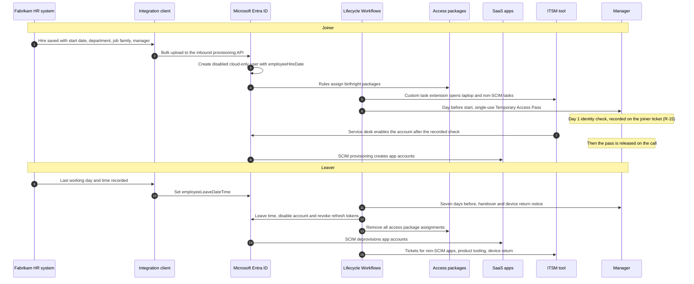

# 07. Identity lifecycle: joiners, movers, and leavers

> **Reference work.** Fictional scenario built for a public portfolio. Not deployed in, derived from, or describing any employer environment. Not professional advice.

## Purpose and scope

This document designs how Fabrikam (fictional) gives, changes, and removes access for people and non-human identities, with Fabrikam's own HR product as the system of record. It covers the HR feed into Microsoft Entra ID, identity verification before a new hire's first credential, joiner, mover, and leaver automation, role-based access, SaaS provisioning, access reviews, contractors and guests, offboarding service levels, and the KPIs that show the design works. Privileged access, Conditional Access, and authentication methods are designed in document [06](06-microsoft-365-security-baseline.md), and the service desk process in document [13](13-it-service-management.md). This document covers Fabrikam staff identities, including staff access to the product's internal tooling; the product platform itself and the customer-facing identities inside it, such as customers' own administrator accounts, belong to Engineering and are out of scope.

## Why this matters

Today People emails IT when someone joins or leaves, accounts are created by hand, offboarding sometimes lags, nobody reviews access, and SaaS access is granted ad hoc (day-1 assumption A-03). Accounts from the acquisitions have unclear owners, and guests have accumulated (A-02). Fabrikam staff can reach sensitive company systems and data, so a former employee who can still sign in is a direct path to it (R-05, R-07, and threat scenario S-07 in document [17](17-threat-profile.md)). The path is just as direct when a fraudulent remote hire passes onboarding and receives credentials (R-15). A late removal is also a SOC 2 exception waiting to happen, because criterion CC6.2 covers removing credentials once access is no longer authorized (R-11). The same weakness costs new hires their first day (KPI-22) and keeps a four-person IT team busy with handoffs (R-14).

| Area | Day 1 | Month 12 (M7) |
|---|---|---|
| Source of truth | Email from People to IT | The HR record drives Microsoft Entra ID |
| Account creation | By hand | From the HR feed, disabled until the verifier records the identity check |
| First sign-in | Password plus push or SMS | Identity checked against a photo ID on video, then a single-use Temporary Access Pass and a passkey |
| Access | Granted ad hoc | Birthright by department and job family; everything else requested, approved, and time-limited |
| Leavers | Sometimes late, not measured | Scheduled and on-demand workflows, measured monthly (KPI-12) |
| Reviews | None | By system and by population, plus one on every move (KPI-13) |
| Contractors and guests | Unclear owners, no end dates | A sponsor and an end date for each one |

## Design principles

1. **HR says who, Microsoft Entra ID says what.** The HR record is authoritative for who works at Fabrikam, in which role, under which manager, and from when to when; Entra ID derives accounts and access from it ([ADR-002](adr/ADR-002-hr-system-of-record-drives-identity.md)).
2. **HR attributes grant birthright access only.** Privileged and sensitive access is always requested, approved, time-limited, and reviewed, so a wrong or tampered HR record cannot make anyone an administrator.
3. **Nothing without an owner and an end.** Every identity has an accountable person; every contractor, guest, and requested access has an end date.
4. **Automate the common path, ticket the rest.** Workflows handle standard cases, the IT service management (ITSM) tool handles exceptions with service levels, and a documented manual path covers outages.
5. **Every event leaves a timestamp,** so KPI-12 and KPI-22 need no manual collection.
6. **The least data leaves HR.** The feed carries identity attributes only, never pay, tax, bank, benefits, or screening data (POL-05, POL-15).

## The source of truth: Fabrikam's own HR system

Fabrikam runs its own product as its HR system, so it is in effect its own first customer. An integration client, a small scheduled job in a corporate Azure subscription kept separate from the product platform, reads Fabrikam's worker records through the product's public customer API, as a customer's integration would. It sends changes to the API-driven inbound provisioning endpoint of Microsoft Entra ID, which creates and updates cloud-only users; no on-premises directory is introduced. The client's credential in the product can read identity fields only; if the customer API cannot scope reads that narrowly, the gap goes to the CTO as an R-08 engineering ask, with the Chief Product Officer deciding any change to the customer API (R-12). Because the client changes nothing in the product, it needs no customer-facing release and can be built during the year-end freeze.

**Microsoft facts (checked 2026-10-13).** API-driven inbound provisioning accepts bulk requests in the SCIM schema (System for Cross-domain Identity Management, the standard for creating and removing accounts) from any system of record, including an HR app. It is available with Microsoft Entra ID P1, P2, and Microsoft Entra ID Governance, and Microsoft 365 E3 includes P1. Every identity sourced through the API needs a license seat, which matters for contractors without a full Microsoft 365 license. On P1 the quota is 100,000 user records per 24 hours and two provisioning apps per flow, with a throttle of 40 API calls in any five-second window, far above Fabrikam's needs. **Status:** generally available since March 2024 (Microsoft Entra release notes); only one capability, clearing attribute values, is labeled preview (preview, as of 2026-10-13).

| HR field | Microsoft Entra ID attribute | Used for |
|---|---|---|
| Worker ID (never reused, kept across rehires and conversions) | employeeId | Matching key between HR and Entra ID |
| Legal and preferred names | givenName, surname, displayName | Directory entry; sign-in name generated by a fixed rule |
| Start date and time | employeeHireDate | Joiner workflows and the day-one pass |
| Last working day and time | employeeLeaveDateTime | Leaver workflows |
| Worker type (employee or contractor) | employeeType, copied to an extension attribute | License groups and workflow scope; dynamic membership rules do not list employeeType as a supported property, so rules read the extension attribute |
| Department | department | Department access packages |
| Job family | Extension attribute | Job-family access packages |
| Job title | jobTitle | Directory; mover trigger |
| Manager (the sponsor, for contractors) | manager | Approvals, notices, delivery of the day-one pass |
| Work country | usageLocation | Licensing: a license needs a location, and group-based licensing otherwise uses the tenant's |
| Legacy company | companyName | Tracks acquired-company populations until consolidation ([ADR-005](adr/ADR-005-acquired-company-consolidation.md)) |

Data-quality rules, owned jointly by People and IT and written into POL-14:

- **Required fields.** Worker ID, start date, worker type, department, manager, and country; contractors also need an end date. The client rejects incomplete records and reports them. No end date, no contractor account.
- **Timeliness (proposals).** Hires are entered at least five business days before the start date and terminations on the day notice is given; urgent leavers are phoned in first. Clean-up requests to People land in November and February, away from open enrollment's close and year-end payroll season.
- **Daily reconciliation.** A report lists active workers without accounts, departed workers with enabled accounts, and enabled accounts with no HR record, sponsor, or named owner. The Service Desk Analyst works it each morning.
- **Run guard.** If one run would set more leave dates than a threshold agreed in Phase 3, the client stops and alerts the IT Operations Manager, so a bad import cannot disable a department.
- **Change visibility.** Edits to leave dates and managers are logged for detection (document [08](08-detection-and-incident-response.md)). The client's credential can create users, so it is one of Fabrikam's most sensitive non-human identities (R-08), managed under document 06.

## Joiner and leaver flow

The [joiner, mover, and leaver checklists](templates/joiner-mover-leaver-checklists.md) give every step an owner role and a system.

## Joiners

| When | What happens | Mechanism and license |
|---|---|---|
| Hire saved in HR, at least five business days ahead | Disabled account created and matched on worker ID; license group and birthright access packages assigned; ITSM tasks opened for the laptop and for apps without SCIM | Inbound provisioning (Entra ID P1); dynamic license group (P1); automatic assignment policies and a custom task extension (Microsoft Entra ID Governance) |
| One day before the start date (Lifecycle Workflows counts calendar days) | Single-use Temporary Access Pass created, valid for two hours from the start time (proposal), and emailed to the manager, who holds it until the identity check below passes | Lifecycle Workflows pre-hire task (Governance), which uses the hire date and time as the pass's start; Microsoft's template default runs seven days ahead, shortened here (proposal) |
| Day 1, at the start time | The identity check below comes first: the account stays disabled until the verifier records the result on the joiner ticket, and the Service Desk Analyst then enables it (R-15). The manager passes on the code and the new hire, still on the call, signs in on an Autopilot laptop or a Mac set up through Apple automated device enrollment, registers a passkey, Windows Hello for Business, or the macOS platform credential, and accepts POL-02 through a terms of use prompt. SCIM-connected apps appear | Service desk enable step after the recorded check, not a workflow task (user management is in every Entra edition, including Free); Teams (E3); Windows Autopilot (auto-enrollment needs P1 or P2); Apple automated device enrollment (Intune Plan 1, in E3); Platform SSO for the macOS platform credential (in every Intune plan; a pass can start its setup); Conditional Access terms of use (P1); SCIM user provisioning (every Entra edition, including Free) |
| Week 1 | Team groups and Teams added; onboarding security training (document [09](09-security-awareness-and-training.md)); the manager confirms readiness, which feeds KPI-22 | Lifecycle Workflows post-onboarding (Governance) |

- **No SMS or voice for new hires.** Microsoft made passkeys the default on 2026-09-01 and retires its own SMS and voice delivery for most users on 2027-02-01 ([ADR-004](adr/ADR-004-phishing-resistant-authentication-rollout.md)). From Phase 3 the service desk creates each pass by hand during the verified call, never by email, until the workflow takes over in Phase 4. A one-time pass must be used to register a method within 10 minutes of signing in, and Microsoft's pass page states no license requirement (as of 2026-10-13).
- **Exceptions go to the service desk.** The workflow's pass task works only for accounts with no existing authentication methods, sign-ins, or Microsoft Entra role assignments. Rehires, conversions, and lost or expired passes go to the service desk, which issues a pass only after the caller verification in document 13 (threat S-03) and, for anyone not yet checked, the identity check below.
- **Requested access** goes through the My Access portal (Entra ID P2 or Governance); managers can request on a new hire's behalf (Governance).

### Identity verification before the first credential (R-15)

Document [11](11-risk-management.md) records R-15 as "A fraudulent remote hire passes onboarding and receives credentials", with the VP of People as its proposed owner. It is a live risk for a remote-first company that hires over video and ships laptops to homes. The FBI warned in 2022 that applicants used deepfakes and stolen personal information to apply for remote technical jobs, some with access to customer data and corporate IT databases, and that pre-employment background checks found some applicants' information belonged to someone else (alert I-062822-PSA). A manager's look on camera proves only that the person on day one is the one who interviewed. So the pass is released only after a check that ties the person to a government-issued photo ID and to the HR record, in the same live session that registers the first method. It is a light form of what NIST SP 800-63A-4 calls remote attended identity proofing, done "through a secure video session with a proofing agent or trusted referee". The steps are proposals, written into POL-14:

- **Before day 1 (People team).** People records the legal name exactly as it appears on the identity document the new hire will show, and confirms that background screening, where the role requires it, raised no identity mismatch.
- **The check (a trained People team member, with the manager or a contractor's sponsor).** On a one-to-one Teams video call with cameras on and no background effects, the new hire holds an unexpired government-issued photo ID beside their face and follows unscripted prompts, such as turning the head or tilting the document. The verifier compares face, name, and date of birth with the document and the HR record, and the manager confirms this is the person they interviewed.
- **Release and record.** Only then does the verifier record the result on the joiner ticket. Either of two gates makes a pass useless without the check: the new account stays disabled until the verifier records the identity check, or the pass is issued during the verified call. Both apply from Phase 3 until the workflow takes over in Phase 4; after that the first applies, so a pass taken from the manager's mailbox cannot be used on its own. The Service Desk Analyst then enables the account, the pass is given, and the new hire registers a method before leaving the call. Result, method, verifier, and time go on the joiner ticket and in the HR system; nobody records the call or keeps an image of the document.
- **Stop on a red flag:** a refused or frozen camera, lips out of step with the audio, a mismatch with HR, a request to send the pass or laptop elsewhere, or pressure to skip the check. No pass is given, the account is disabled, and document 08 handles it as a security event, with People and General Counsel deciding next steps.
- **Scope and evidence.** The check covers employees, contractors, and rehires. Each month, with KPI-22's data, the IT Operations Manager confirms that every first sign-in with a pass matches a recorded check.

## Movers

A mover is any change of department, job family, manager, worker type, or country in HR.

1. **Birthright follows the attributes.** Automatic assignment policies add the new department and job-family packages and remove the old ones after a seven-day handover grace (proposal; Microsoft's own example uses seven days).
2. **Every move triggers an access review.** A mover workflow built from Microsoft's "Employee job profile change" template, triggered by attribute changes, emails the manager and runs a custom task extension (an Azure Logic App) that opens a mover review. The new manager confirms or removes each item of request-based access within 10 business days, and unconfirmed items are removed (proposals). Owners re-approve privileged roles and production access; nothing carries over silently. The review runs in Entra ID access reviews where the resource supports it and as an ITSM review task otherwise (decided in 07.16), and it counts toward KPI-13.
3. **Licenses change without a gap.** The person joins the new license group before leaving the old one, as Microsoft advises.

Workers keep the same worker ID when converting between contractor and employee, so the account follows the person and the conversion runs as a move. The mover templates and the attribute-change trigger carry no preview label (as of 2026-10-13).

## Leavers

Offboarding service levels (proposals, written into POL-03 and POL-14):

| Leaver type | Trigger | Entra ID account disabled, sessions revoked | Apps without SCIM, product tooling, finance systems | Devices and data |
|---|---|---|---|---|
| Standard | People records the last working day and time on the day notice is given | At the end of the last working day | Within one business day | Return starts on the last day; files handed over before the account is deleted 30 days later |
| Urgent or involuntary | People or General Counsel phones the IT Operations Manager or the on-call contact and opens an urgent ticket; the call starts the clock | Within one hour of notice, timed to the conversation | Same hour for production, support tooling, and finance and payroll systems; same day for the rest | Remote lock at once; wipe only on a decision by the Director with General Counsel; General Counsel's holds before any deletion |
| Contractor end | The contract end date in HR, which is mandatory | At the end date; the sponsor is warned 14 days before | Within one business day | Equipment and data returned under the contract (POL-10) |

**Standard path.** Seven days before the last day (Microsoft's template default), a pre-offboarding email asks the manager to arrange handover, transfer of owned groups, Teams, sites, app registrations, and service accounts, and device return through the IT hardware partner. At the leave time, the leaver workflow disables the account, revokes all refresh and browser session tokens, removes all access package assignments at once, cancels pending requests, removes the person from groups and Teams, and opens tickets for apps without SCIM, product tooling, and the device. SCIM deprovisioning follows; Microsoft says app provisioning typically runs every 20 to 40 minutes. Thirty days later (proposal), once the manager confirms handover, a post-offboarding workflow deletes the account; mailbox and OneDrive retention follow POL-15 and document [14](14-business-continuity-and-backup.md).

**Timing, stated plainly.**

- Scheduled workflows are evaluated on an interval with a default of three hours. Fabrikam sets each leave time to the end of the working day and shortens the interval (proposal: hourly). When HR is late, the standard time-based trigger still processes the user if the record arrives within three days of the intended time; the daily reconciliation catches anything later. Fabrikam therefore uses the standard trigger, not "Time based attribute V2" (preview, as of 2026-10-13), which lacks the catch-up.
- Disabling stops new tokens, but issued ones run until they expire: Microsoft's token lifetime page gives access tokens a default lifetime set at random between 60 and 90 minutes (other Microsoft pages say one hour), and applications with their own session tokens keep those sessions until they expire or the app checks back with Entra ID. Continuous Access Evaluation's critical event checks, which Microsoft makes available in any tenant, end sessions sooner in apps that support them: Exchange Online, SharePoint Online, and Teams act on a disable or token revocation within minutes, though Microsoft notes up to 15 minutes for the event to propagate. In those sessions, access tokens can last up to 28 hours, and the critical events revoke them. So every leaver includes deprovisioning, and the one-hour urgent target is measured at Microsoft Entra ID.
- The "remove from all groups" task skips dynamic, mail-enabled, distribution, and role-assignable groups. Dynamic groups update themselves; the checklist covers the rest.

**Urgent path.** Microsoft's "Real-time employee termination" template runs on demand. Fabrikam's version disables instead of deleting and adds token revocation and access package removal. The Service Desk Analyst or IT Operations Manager runs it, disables the person's registered devices, and follows the urgent checklist. An on-demand run ignores the workflow's scope, so a second person confirms the name first (proposal).

**Administrators.** The workflow account tasks (enable, disable, delete) do not support users who hold Microsoft Entra role assignments or belong to or own role-assignable groups. Separate admin accounts record their owner's worker ID in a separate attribute, never in employeeId, so the HR feed cannot match them. The privileged steps in the leaver checklists (L10 and U4) disable them and remove Privileged Identity Management (PIM) assignments, and document 06 validates the emergency access accounts after IT staff changes, as Microsoft advises.

**Devices.** Devices are recovered before any device record is deleted. Deleting the Intune record of a Microsoft Entra joined Windows device removes the BitLocker key protectors on the operating system volume, deleting the device in Microsoft Entra ID loses the LAPS password stored there, and FileVault recovery keys are visible to administrators only for devices marked corporate. Recovered laptops return to service through Windows Autopilot Reset or are sanitized under POL-04, which follows NIST SP 800-88 Rev. 2.

## Role-based access: licenses, birthright, and requests

Licenses come from group-based licensing on dynamic groups keyed to worker type. Microsoft's current group-based licensing page names no separate license for the feature, and dynamic membership needs a Microsoft Entra ID P1 license for each member, which E3 includes. Group-based licensing does not support nested groups, so license groups stay flat.

| Package type | Generic examples | How assigned | Expiry and review |
|---|---|---|---|
| Workforce baseline | Collaboration and intranet, ITSM portal, training platform, self-service in Fabrikam's own HR product | Automatic, by worker type (Governance) | While employed; removed by the leaver workflow |
| Department | Engineering: code hosting and CI/CD (continuous integration and delivery), no production. Customer Support and Success: support platform agent role. Sales and Marketing: CRM and marketing automation | Automatic, by department (Governance) | Follows the attribute, with the seven-day grace on moves |
| Job family | Finance operations, people operations, IT operations | Automatic, by job family (Governance) | Follows the attribute |
| Sensitive, request only | Product production access; customer data in support cases; payment approval; bank-detail maintenance; HR and payroll administration; data export from CRM and the support platform | Requested in My Access; the manager and the resource owner approve (P2 or Governance) | Expires after 180 days for employees, and at contract end or after 90 days for contractors (proposals); reviewed as below |

- **Rule hygiene.** One automatic assignment policy per access package, as Microsoft suggests, using attribute rules only. Rules never use the memberOf operator (preview, as of 2026-10-13): Microsoft is ending its preview and, from 2026-11-03, quarantines automatic assignment policies that use it.
- **Separation of duties** (P2 or Governance). Incompatible packages stop one person from holding both sides of a money movement, such as bank-detail maintenance and payment approval in the finance and accounting system (R-01).
- **Administrator roles** are not in the catalog; document 06 grants them through PIM.

**SaaS provisioning and tickets.** Single sign-on comes first (document [15](15-enterprise-systems-and-saas.md), KPI-07). Where an app supports SCIM, its access package drives provisioning; Microsoft lists automated user provisioning to SaaS apps in every Entra edition including Free, and group provisioning from P1. Where an app has no SCIM, the package or workflow opens an ITSM ticket for the app owner, with proposed service levels of two business days to create and the leaver service level to remove (document 13 sets ticket targets). Account Discovery (Governance) finds accounts with no matching Entra ID user in apps connected to Microsoft Entra provisioning, which helps clean up SaaS left from the acquisitions (R-09).

## Access reviews

Reviews are organized by system, where the risk sits, and by population, and they go to people who can judge them. For request-based access, an unanswered review removes the access (proposal). Access reviews need Microsoft Entra ID Governance for the member users who review or are reviewed, with some capabilities available on P2. Reviews of Microsoft Entra roles run in PIM (P2 or Governance), and guest reviews use monthly active user billing, which requires an Azure subscription.

By system (cadences are proposals):

| System | What is reviewed | Reviewer | Cadence |
|---|---|---|---|
| Microsoft 365 administrator roles | Eligible and active Microsoft Entra and Microsoft 365 admin roles; emergency access accounts are validated separately (document 06) | Director of IT and Security, with the CTO as second reviewer for Global Administrator | Monthly until standing assignments meet the KPI-09 target, then quarterly |
| Product production access, with Engineering | Cloud console roles, production data stores, deployment rights, access to production secrets | Engineering Manager and Site Reliability Engineering (SRE) lead, under the RACI in document [04](04-operating-model-team-and-budget.md) | Quarterly; in Entra ID where access comes through Entra groups, otherwise in Engineering's own process with evidence filed |
| Finance and payroll applications | Roles in the finance and accounting system and in Fabrikam's own payroll and HR administration, with the separation-of-duties pairs | Finance manager; the VP of People's delegate for HR and payroll roles | Quarterly |
| CRM | Standard roles; admin and export roles | CRM system owner in Sales | Every six months; admin and export roles quarterly |
| Support platform | Agent roles that can reach sensitive customer data in cases; admin and export roles | The Chief Customer Officer's delegate | Quarterly, because support cases can hold sensitive customer data (A-06) |

By population:

| Population | What is reviewed | Reviewer | Cadence |
|---|---|---|---|
| Employees | Request-based access that no system review covers | Manager | Every six months, plus a mover review on every change |
| Contractors | All access, the end date, and whether the sponsor is still right | Sponsor | Quarterly, plus the notice 14 days before each end date |
| Guests | Each guest's need, sponsor, and packages, starting with guests from before governance | Sponsor | Quarterly |

The first round is manual and runs in Phase 2 for administrator roles and for finance and payroll. Automated cycles start in April 2027, the first month of the next SOC 2 review period, so the current period's evidence stays intact (M4).

## Contractors and guests

**Contractors** who work inside Fabrikam teams get member accounts from the HR feed, not guest accounts. Each has a sponsor, held in the manager attribute, and a mandatory end date that the leaver workflow enforces; the sponsor gets a notice 14 days before the end (proposal) to extend in HR or let access end. Contractors hold no standing administrator roles, their sensitive packages expire at contract end or after 90 days, whichever comes first (proposal), and the contracting firm's exit follows POL-10.

**Guests** collaborate from their own organization's identity.

- New guests arrive through access packages for connected organizations, approved by a Fabrikam sponsor. As Microsoft recommends for governed invitations, guests cannot invite other guests.
- Every guest has a sponsor. Microsoft allows up to five sponsors at invitation and makes the inviter the sponsor by default (Microsoft's sponsor page states no license requirement, as of 2026-10-13), but guests invited through SharePoint sharing get no sponsor (a known issue Microsoft documents). A monthly report finds unsponsored guests, and a PowerShell script that Microsoft's page points to sets sponsors from the original inviter.
- Guest packages expire after 90 days unless the sponsor renews them (proposal). When a guest's last assignment ends, Microsoft's default blocks sign-in and removes the account 30 days later (P2 or Governance). Existing guests come under this lifecycle once marked as governed (Governance).
- Revoking refresh tokens does not end a guest's sign-in sessions, which live in the guest's home tenant, so guest offboarding relies on blocking and removal.
- Phase 2 clean-up blocks guests with no sponsor response or no sign-in for 90 days, after notice (proposal; Microsoft calls 90 to 180 days a reasonable window). Sign-in dates come from Microsoft Graph, which needs Entra ID P1 or P2.
- Document 06 sets guest Conditional Access and SharePoint external sharing. Microsoft advises keeping the entitlement management app out of guest-blocking policies so that guests can still request access.

## Service accounts, workload identities, and shared devices

- Every service principal, app registration, managed identity, and remaining service account has a named owner and a backup owner in the application inventory (document 15). Accounts without owners (A-02) get one or are disabled after a notice period.
- Owners recertify their non-human identities every six months (proposal), and the leaver and mover checklists transfer ownership before an owner's account is disabled.
- User accounts used for automation move to workload identities: Microsoft's mandatory MFA for Azure management applies to user accounts and does not affect workload identities. Credential and app-consent controls for workload identities are set in document [06](06-microsoft-365-security-baseline.md).
- AI agents and automations that act on Fabrikam's systems are approved through document [16](16-ai-adoption-guardrails.md)'s intake first, then handled like any other non-human identity in this section. A fuller agent standard is a year-two decision (document 16).

## KPIs

Document [12](12-metrics-and-executive-reporting.md) and the [KPI catalog](../data/kpi-catalog.csv) hold the final definitions; these are this design's proposals.

| KPI | Proposed definition | Data | Proposed target | Owner role |
|---|---|---|---|---|
| KPI-12 Leaver access removed within target (%) | Leavers in the month whose Entra ID account was disabled and sessions revoked within their service level, over all leavers; urgent leavers reported separately | HR leave and notice times joined to the Entra audit log and workflow history | At least 98 percent from M6, and every urgent leaver within one hour; each miss reviewed as a possible SOC 2 exception | IT Operations Manager |
| KPI-13 Access reviews completed on time (%) | Review instances, scheduled and mover, closed by the due date with decisions applied, over all instances due | Access review history and ITSM review tasks | 95 percent from the second automated review cycle | Director of IT and Security |
| KPI-22 New hires fully productive on day one (%) | New hires who by the end of day one have signed in with a phishing-resistant method (a passkey, Windows Hello for Business, or the macOS platform credential) on a compliant device and can use their birthright apps, over all new hires (document 07). Hires entered late in the HR system are flagged separately. | Workflow history, Intune compliance, and the manager's day-two confirmation | 90 percent by M6 and 95 percent by M7 | IT Operations Manager |
| KPI-23 Access requests fulfilled automatically (%) | Access grants delivered with no manual IT step (automatic assignment, approved self-service, SCIM), over all grants including ticketed ones | Entitlement management and provisioning logs; ITSM tickets | 60 percent by M6 and 75 percent by M7, depending on SCIM coverage (document 15) | Systems Engineer (Identity and Endpoint) |

Baselines for KPI-12 and KPI-22 come from 07.01. KPI-13 and KPI-23 start near zero, because nothing is reviewed or automated today.

## Phase plan

| Phase | Action ID | Action | Outcome | KPI | Owner role | Workstream |
|---|---|---|---|---|---|---|
| Phase 1 | 07.01 | Map today's joiner, mover, and leaver handoffs with People, managers, and system owners; measure leaver lag and day-one readiness from six months of records | Process map and baselines in the M1 listening report | KPI-12, KPI-22 | IT Operations Manager | WS-1 |
| Phase 1 | 07.02 | Reconcile every enabled account, including acquired-company accounts, to an HR record, a sponsor, or a named owner; disable confirmed leavers at once through the existing offboarding path | Identity inventory v1 (M1); no known leaver still enabled | KPI-12 | IT Operations Manager | WS-1 |
| Phase 1 | 07.03 | Confirm with the SOC 2 audit firm, through the finance manager, how the current period describes onboarding, offboarding, and access reviews; agree which interim changes it accepts and that automated controls start with the next period | Current period protected (M4) | KPI-03 | Director of IT and Security | WS-5 |
| Phase 1 | 07.04 | Assess the HR fields identity needs and whether contractors are recorded; agree data owners with the VP of People before year-end payroll season | Data-quality findings and owners | KPI-22 | Director of IT and Security | WS-1 |
| Phase 2 | 07.05 | Replace email requests with ITSM joiner and leaver forms that People completes, with interim service levels and a phone path for urgent leavers | Every lifecycle event has a timestamped ticket | KPI-12 | IT Operations Manager | WS-6 |
| Phase 2 | 07.06 | Manually review Microsoft 365 administrator roles and finance and payroll application access; file the evidence | Excess access removed; first review evidence | KPI-13, KPI-09 | Director of IT and Security | WS-1 |
| Phase 2 | 07.07 | Guest clean-up, round one: set sponsors from the original inviter, then block guests with no sponsor response or no sign-in for 90 days, after notice | Every remaining guest has a sponsor | KPI-13 | Service Desk Analyst | WS-1 |
| Phase 3 | 07.08 | Executive team approves ADR-002, the lifecycle clauses of POL-03 and POL-14, and the Governance license line in the budget proposal (ADR-001) | Approved at M3 | KPI-12 | Director of IT and Security | WS-1 |
| Phase 3 | 07.09 | Design the attribute mapping, data-quality rules, run guard, and integration client; issue its credential only after document 06's workload identity controls are in place (06.12, first half of January); test with sample records | Feed ready, with no customer-facing change during the freeze | KPI-23 | IT Operations Manager | WS-1 |
| Phase 3 | 07.10 | Move every new hire to Temporary Access Pass onboarding with passkey registration before the 2027-02-01 SMS and voice retirement, keeping each account disabled and each pass unreleased until the identity check is recorded (R-15), and training the People verifiers; the service desk creates passes during the verified call until workflows take over | No new hire registered on SMS or voice, and no first credential without a recorded identity check | KPI-22, KPI-08 | Service Desk Analyst | WS-1 |
| Phase 4 | 07.11 | Month 4 (February 2027): switch on API-driven inbound provisioning (Entra ID P1) for employees; match accounts on worker ID, backfill attributes, create new hires disabled, start the daily reconciliation | HR is the source of truth for employee identities, reported at D120 | KPI-12, KPI-22 | IT Operations Manager | WS-1 |
| Phase 4 | 07.12 | Month 4 (February 2027), once the Governance purchase lands: build dynamic license groups and catalog v1 (birthright by department and job family, sensitive packages request-only, separation-of-duties pairs) | Catalog ready for automatic assignment | KPI-23 | Systems Engineer (Identity and Endpoint) | WS-1 |
| Phase 4 | 07.13 | Month 5 (March 2027): run joiner, leaver, and on-demand urgent leaver workflows in parallel with the ITSM checklist until the SOC 2 period closes | Automation proven against the manual control (M4) | KPI-12, KPI-22 | Systems Engineer (Identity and Endpoint) | WS-1 |
| Phase 4 | 07.14 | Month 6 (April 2027): make automation the control of record for employees, with the POL-03 rewrite that document 10 ties to this cutover approved by the executive team; start the first automated cycle of the system and population reviews above | New-period evidence comes from the system | KPI-13 | Director of IT and Security | WS-1 |
| Phase 4 | 07.15 | Turn on SCIM provisioning for corporate SaaS that supports it, in document 15's order; ticket the rest with service levels | Deprovisioning reaches connected apps with no human step | KPI-23, KPI-07 | Systems Engineer (Identity and Endpoint) | WS-7 |
| Phase 5 | 07.16 | Add mover workflows with the mover access review through a custom task extension | Every move reviewed by the new manager | KPI-13, KPI-23 | Systems Engineer (Identity and Endpoint) | WS-1 |
| Phase 5 | 07.17 | M6 (month 9, July 2027): joiner, mover, and leaver automation live for all employees, with KPI-12 and KPI-22 at target | M6 met | KPI-12, KPI-22 | Director of IT and Security | WS-1 |
| Phase 5 | 07.18 | Put contractors on the HR feed with mandatory end dates and sponsors; move guests to access packages with sponsors and expiry; mark existing guests as governed | Every non-employee has an owner and an end date | KPI-12, KPI-13 | Systems Engineer (Identity and Endpoint) | WS-1 |
| Phase 5 | 07.19 | Extend reviews to product production access (with Engineering), CRM, and contractors; start owner recertification of non-human identities | Every review scope in this document running | KPI-13 | Director of IT and Security | WS-1 |
| Phase 5 | 07.20 | M7 (month 12, October 2027): review KPIs, service levels, and cadences; re-baseline R-05 and R-06 with their owners | Tuned proposals for year two | KPI-12, KPI-13 | Director of IT and Security | WS-5 |

## Resourcing and dependencies

- **Roles.** Phases 1 to 3: the Director of IT and Security (owner, approvals), the IT Operations Manager (process and feed design), and the Service Desk Analyst (tickets, passes, reconciliation). Phases 4 and 5: the Systems Engineer (Identity and Endpoint) builds and runs the feed, workflows, and catalog; the Director of IT and Security personally runs the access reviews and evidence and watches the integration credential and leaver sign-ins, with the MDR provider if it triages custom detections and contracted specialist help for surge and build work. The Director owns the leaver sign-in alerts (checklist U9). Throughout: the People team (HR data accuracy and timeliness, and the identity checks), managers and sponsors, system owners (finance and accounting system, CRM, support platform), and the Engineering Manager and SRE lead (production access, the product API) under the RACI in document 04.
- **Partners.** The SOC 2 audit firm (Phase 1 agreement on timing, Phase 4 walkthrough of the automated controls), the IT hardware partner (Autopilot registration, shipping, returns), and the MDR provider (alerts on disabled accounts and on the integration credential, if the chosen service triages Fabrikam's custom detections; [ADR-003](adr/ADR-003-managed-detection-and-response.md)).
- **Licenses.** Microsoft 365 E3 already covers the HR feed (Entra ID P1), dynamic license groups (P1), SCIM user provisioning, Conditional Access terms of use (P1), Windows Autopilot, Intune Plan 1, and the Teams calls used for identity checks. Microsoft Entra ID Governance is needed from Phase 4 for Lifecycle Workflows, automatic assignment, custom extensions, and access reviews, counted for every member user in scope, in practice the whole workforce including contractors. ADR-001 proposes it as Microsoft Entra ID Governance Step Up for Microsoft Entra ID P2 alongside Microsoft Defender Suite, or, if the executive team does not approve Defender Suite at M3, as the base Governance product on E3. The corporate Azure subscription hosts the integration client from Phase 3, and the Logic Apps behind custom extensions and guest governance billing from Phase 4, all small consumption costs. The largest cost driver is the Governance seat count; the second is engineering time.
- **Depends on.** Documents [01](01-scenario-and-assumptions.md) (assumptions), 04 (operating model, RACI), [05](05-environment-discovery.md) (discovery), 06 (privileged access, authentication, guest access, workload identities), 09 (onboarding training), [10](10-governance-and-compliance-program.md) (POL-03, POL-10, POL-14, POL-15), [11](11-risk-management.md) (owners of R-05, R-06, and R-15), 12 (KPI definitions), 13 (ITSM service levels, caller verification, device lifecycle), 14 (retention), and 15 (app inventory, single sign-on, SCIM order); [ADR-001](adr/ADR-001-microsoft-365-security-licensing.md), ADR-002, ADR-004, and ADR-005. Feeds documents [02](02-first-90-days.md), [03](03-twelve-month-roadmap.md), and 12.
- **Attack disruption.** The feed sets an account's enabled state only when it creates the account (the attribute mapping applies only during creation), and only the service desk enables accounts (a new hire's only after the recorded identity check), so no HR-driven automation re-enables an account that automatic attack disruption or a responder disabled; action 08.11 in document 08 confirms this before attack disruption is switched on.

## Risks and open questions

- **Inbound provisioning status.** Generally available since March 2024; only clearing attribute values is in preview (as of 2026-10-13). Microsoft's status and limits are rechecked before the feed becomes the SOC 2 control of record in April 2027; the ITSM path can carry joiners and leavers at any time.
- **The HR product is both system of record and revenue system.** If the product is unavailable the feed pauses, and a compromise could feed false records. Urgent leavers never depend on the feed, new accounts are created disabled, and HR attributes never grant privileged access.
- **Timing limits.** The workflow interval, the three-day catch-up window, and access token lifetimes mean that "disabled" and "out of every app" are different moments. Deprovisioning closes the gap, and the leaver record states it.
- **Identity checks on video (R-15).** A live check raises the cost of a stand-in or a stolen identity but cannot validate a document's security features; birthright-only access (principle 2) limits what a hire who gets through can reach. Live face and voice overlays are a documented hiring tactic, and this plan assumes they keep improving: the FBI's 2022 alert describes "voice spoofing, or potentially voice deepfakes, during online interviews", and its January 2025 alert (I-012325-PSA) says North Korean IT workers "have been observed using artificial intelligence and face-swapping technology during video job interviews to obfuscate their true identities" and advises identity-verification processes "during interviewing, onboarding, and throughout the employment of any remote worker". So the video check does not stand alone: the screening identity match People confirms before day 1, where the role requires screening, comes first, and sensitive, request-only packages are never part of the day-one grant (a manager may request them before day 1, checklist J6, but the resource owner approves only after the check is on the joiner ticket). That order keeps sensitive access off an unchecked account but does not stop a hire who gets past both the screening match and the check; the resource owner's approval, the separation-of-duties pairs, and the access reviews remain the backstop. KPI-22 counts birthright apps only, so it is unaffected. If attempts appear or hiring grows, Microsoft documents a stronger pattern: an identity verification partner checks the government ID and issues a Verified ID credential (Microsoft states no special licensing requirement for issuing them), which an onboarding portal matches to the HR record before creating the pass. Face Check can add a live selfie match; it is included in Microsoft Entra Suite, which ADR-001 considers only as a conditional line for one application's named group, and otherwise is a Verified ID add-on billed through a linked Azure subscription. That route adds a partner, build work, and a biometric step that General Counsel reviews first (R-12, document 10). General Counsel also confirms how the check fits with People's Form I-9 document review.
- **People's capacity and HR data quality.** People must enter hires and terminations on time, including during open enrollment and year-end payroll. POL-14 makes the duty explicit, and KPI-12 shows the result.
- **Contractors.** Discovery (document 05) confirms whether contractors are recorded in the HR product. If they are not, contractors receive access packages with fixed expiry and sponsor approval until they can be.
- **Production access outside Entra ID.** Some production access may be granted in the cloud provider's own tooling; Engineering then runs those reviews and removals on the same cadence and files evidence. Whether the provider's console uses Entra single sign-on is a discovery question.
- **E-Verify.** If Fabrikam acts as an E-Verify employer agent for customers, the program's memorandum for employer agents (the revision dated 06/01/2013, read for this plan) requires the agent to end an employee's E-Verify access promptly on separation or when no longer needed. Whether Fabrikam is an employer agent is a question for General Counsel; if so, that access joins the leaver checklist.
- **Licensing.** If the executive team funds neither Governance form in ADR-001, the design falls back to the P1 feed, ITSM tickets, and manual reviews: workable, but slower, and KPI-12 and KPI-23 suffer.
- **Review fatigue.** Large reviews get approved unread. Reviews stay small, unanswered request-based access is removed, and completion and removal rates are reported.
- **Acquired-company identities** outside the primary tenant are not covered until consolidation (ADR-005); until then they are a manual item on the leaver checklist.

## Framework mapping

By identifier only, consistent with the [crosswalk](crosswalk/csf2-soc2-crosswalk.md).

| Theme | NIST CSF 2.0 | SOC 2 (2017 TSC) |
|---|---|---|
| HR-driven creation, change, and removal of accounts | GV.RR-04, PR.AA-01 | CC6.2 |
| Role-based access, approvals, separation of duties | PR.AA-05 | CC6.1, CC6.3 |
| Access reviews, including mover reviews | PR.AA-05 | CC6.2, CC6.3, CC4.1 |
| Identity verification before the first credential; onboarding authentication (Temporary Access Pass, passkeys) | PR.AA-02, PR.AA-03, GV.RR-04 | CC6.1, CC6.2 |
| Contractors, guests, and third-party exits | GV.SC-10, PR.AA-05 | CC6.2, CC9.2 |
| Device return and sanitization | ID.AM-08 | CC6.5, C1.2 |
| KPIs and oversight | GV.OV-03 | CC4.1, CC4.2 |

## Sources

- API-driven inbound provisioning concepts. Microsoft Learn. https://learn.microsoft.com/en-us/entra/identity/app-provisioning/inbound-provisioning-api-concepts . Checked 2026-10-13. Primary.
- Configure API-driven inbound provisioning app. Microsoft Learn. https://learn.microsoft.com/en-us/entra/identity/app-provisioning/inbound-provisioning-api-configure-app . Checked 2026-10-13. Primary.
- Archive for Microsoft Entra releases and announcements (March 2024, General Availability - API driven inbound provisioning). Microsoft Learn. https://learn.microsoft.com/en-us/entra/fundamentals/whats-new-archive . Checked 2026-10-13. Primary.
- Microsoft Entra ID Governance licensing fundamentals. Microsoft Learn. https://learn.microsoft.com/en-us/entra/id-governance/licensing-fundamentals . Checked 2026-10-13. Primary.
- Microsoft Entra service description. Microsoft Learn. https://learn.microsoft.com/en-us/office365/servicedescriptions/azure-active-directory . Checked 2026-10-13. Primary.
- Understanding lifecycle workflows. Microsoft Learn. https://learn.microsoft.com/en-us/entra/id-governance/understanding-lifecycle-workflows . Checked 2026-10-13. Primary.
- Lifecycle Workflows templates and categories. Microsoft Learn. https://learn.microsoft.com/en-us/entra/id-governance/lifecycle-workflow-templates . Checked 2026-10-13. Primary.
- Lifecycle Workflows tasks and definitions. Microsoft Learn. https://learn.microsoft.com/en-us/entra/id-governance/lifecycle-workflow-tasks . Checked 2026-10-13. Primary.
- Customize a workflow schedule. Microsoft Learn. https://learn.microsoft.com/en-us/entra/id-governance/customize-workflow-schedule . Checked 2026-10-13. Primary.
- Configure an automatic assignment policy for an access package in entitlement management. Microsoft Learn. https://learn.microsoft.com/en-us/entra/id-governance/entitlement-management-access-package-auto-assignment-policy . Checked 2026-10-13. Primary.
- Govern access for external users in entitlement management. Microsoft Learn. https://learn.microsoft.com/en-us/entra/id-governance/entitlement-management-external-users . Checked 2026-10-13. Primary.
- What are access reviews? Microsoft Learn. https://learn.microsoft.com/en-us/entra/id-governance/access-reviews-overview . Checked 2026-10-13. Primary.
- Add sponsors to a guest user in the Microsoft Entra admin center. Microsoft Learn. https://learn.microsoft.com/en-us/entra/external-id/b2b-sponsors . Checked 2026-10-13. Primary.
- What is automated app user provisioning in Microsoft Entra ID. Microsoft Learn. https://learn.microsoft.com/en-us/entra/identity/app-provisioning/user-provisioning . Checked 2026-10-13. Primary.
- Discover identities in target applications with account discovery. Microsoft Learn. https://learn.microsoft.com/en-us/entra/identity/app-provisioning/how-to-account-discovery . Checked 2026-10-13. Primary.
- Customize Microsoft Entra attribute mappings in Application Provisioning (tutorial). Microsoft Learn. https://learn.microsoft.com/en-us/entra/identity/app-provisioning/customize-application-attributes . Checked 2026-10-13. Primary.
- Revoke user access in an emergency in Microsoft Entra ID. Microsoft Learn. https://learn.microsoft.com/en-us/entra/identity/users/users-revoke-access . Checked 2026-10-13. Primary.
- Configurable token lifetimes (Microsoft identity platform). Microsoft Learn. https://learn.microsoft.com/en-us/entra/identity-platform/configurable-token-lifetimes . Checked 2026-10-14. Primary.
- Continuous access evaluation in Microsoft Entra. Microsoft Learn. https://learn.microsoft.com/en-us/entra/identity/conditional-access/concept-continuous-access-evaluation . Checked 2026-10-14. Primary.
- Manage rules for dynamic membership groups in Microsoft Entra ID. Microsoft Learn. https://learn.microsoft.com/en-us/entra/identity/users/groups-dynamic-membership . Checked 2026-10-13. Primary.
- Assign or unassign licenses to a group in the Microsoft 365 admin center. Microsoft Learn. https://learn.microsoft.com/en-us/microsoft-365/admin/manage/manage-group-licenses . Checked 2026-10-13. Primary.
- How to manage inactive user accounts. Microsoft Learn. https://learn.microsoft.com/en-us/entra/identity/monitoring-health/howto-manage-inactive-user-accounts . Checked 2026-10-13. Primary.
- Configure a Temporary Access Pass in Microsoft Entra ID to register passwordless authentication methods. Microsoft Learn. https://learn.microsoft.com/en-us/entra/identity/authentication/howto-authentication-temporary-access-pass . Checked 2026-10-13. Primary.
- Passkeys by default and retirement of Microsoft-provided SMS and voice authentication. Microsoft Learn. https://learn.microsoft.com/en-us/entra/identity/authentication/concept-sms-voice-retirement . Checked 2026-10-13. Primary.
- Overview of Conditional Access Authentication Strengths (built-in phishing-resistant strength: Windows Hello for Business or platform credential). Microsoft Learn. https://learn.microsoft.com/en-us/entra/identity/authentication/concept-authentication-strengths . Checked 2026-10-14. Primary.
- Onboard new remote employees using ID verification. Microsoft Learn. https://learn.microsoft.com/en-us/entra/verified-id/remote-onboarding-new-employees-id-verification . Checked 2026-10-13. Primary.
- Use Face Check with Microsoft Entra Verified ID (tutorial). Microsoft Learn. https://learn.microsoft.com/en-us/entra/verified-id/using-facecheck . Checked 2026-10-13. Primary.
- Frequently asked questions, Microsoft Entra Verified ID. Microsoft Learn. https://learn.microsoft.com/en-us/entra/verified-id/verifiable-credentials-faq . Checked 2026-10-13. Primary.
- Plan for mandatory Microsoft Entra multifactor authentication (MFA). Microsoft Learn. https://learn.microsoft.com/en-us/entra/identity/authentication/concept-mandatory-multifactor-authentication . Checked 2026-10-13. Primary.
- Manage emergency access admin accounts. Microsoft Learn. https://learn.microsoft.com/en-us/entra/identity/role-based-access-control/security-emergency-access . Checked 2026-10-13. Primary.
- Overview of Windows Autopilot. Microsoft Learn. https://learn.microsoft.com/en-us/autopilot/overview . Checked 2026-10-13. Primary.
- Set up automated device enrollment (ADE) for macOS. Microsoft Learn. https://learn.microsoft.com/en-us/intune/device-enrollment/apple/setup-automated-macos . Checked 2026-10-14. Primary.
- Configure Platform SSO for macOS devices (included with all Intune plans; Secure Enclave setup can start with a Temporary Access Pass). Microsoft Learn. https://learn.microsoft.com/en-us/intune/device-configuration/settings-catalog/configure-platform-sso-macos . Checked 2026-10-14. Primary.
- Microsoft Intune Licensing Plans and Options. Microsoft Learn. https://learn.microsoft.com/en-us/intune/fundamentals/licensing . Checked 2026-10-14. Primary.
- Encrypt Windows devices with BitLocker using Intune. Microsoft Learn. https://learn.microsoft.com/en-us/intune/device-configuration/endpoint-security/encrypt-bitlocker-windows . Checked 2026-10-13. Primary.
- Overview of Windows LAPS with Microsoft Intune. Microsoft Learn. https://learn.microsoft.com/en-us/intune/device-security/laps/overview . Checked 2026-10-13. Primary.
- Encrypt macOS devices with FileVault using Intune. Microsoft Learn. https://learn.microsoft.com/en-us/intune/device-configuration/endpoint-security/encrypt-filevault-macos . Checked 2026-10-13. Primary.
- NIST SP 800-88 Rev. 2, Guidelines for Media Sanitization. NIST. https://csrc.nist.gov/pubs/sp/800/88/r2/final . Checked 2026-10-13. Primary.
- Identity Proofing and Enrollment (NIST SP 800-63A-4, July 2025), HTML edition, identity proofing types. NIST. https://pages.nist.gov/800-63-4/sp800-63a.html . Checked 2026-10-13. Primary.
- The NIST Cybersecurity Framework (CSF) 2.0 (CSWP 29). NIST. https://nvlpubs.nist.gov/nistpubs/CSWP/NIST.CSWP.29.pdf . Checked 2026-10-13. Primary.
- 2017 Trust Services Criteria (With Revised Points of Focus, 2022), download page. AICPA & CIMA. https://www.aicpa-cima.com/resources/download/2017-trust-services-criteria-with-revised-points-of-focus-2022 . Checked 2026-10-13. Primary.
- Deepfakes and Stolen PII Utilized to Apply for Remote Work Positions (Alert I-062822-PSA, June 28, 2022). FBI IC3. https://www.ic3.gov/PSA/2022/PSA220628 . Checked 2026-10-13. Primary.
- North Korean IT Workers Conducting Data Extortion (Alert I-012325-PSA, January 23, 2025). FBI IC3. https://www.ic3.gov/PSA/2025/PSA250123 . Checked 2026-10-14. Primary.
- The E-Verify Memorandum of Understanding for Employer Agents (Revision Date 06/01/2013). DHS, USCIS E-Verify program. https://www.e-verify.gov/sites/default/files/everify/memos/MOUforEVerifyEmployerAgents.pdf . Checked 2026-10-13. Primary (this revision; a newer revision was not ruled out on the check date).
