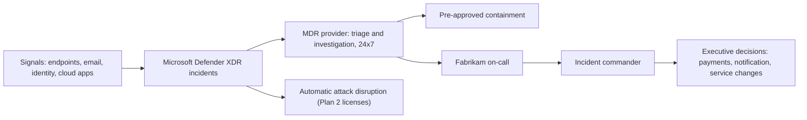
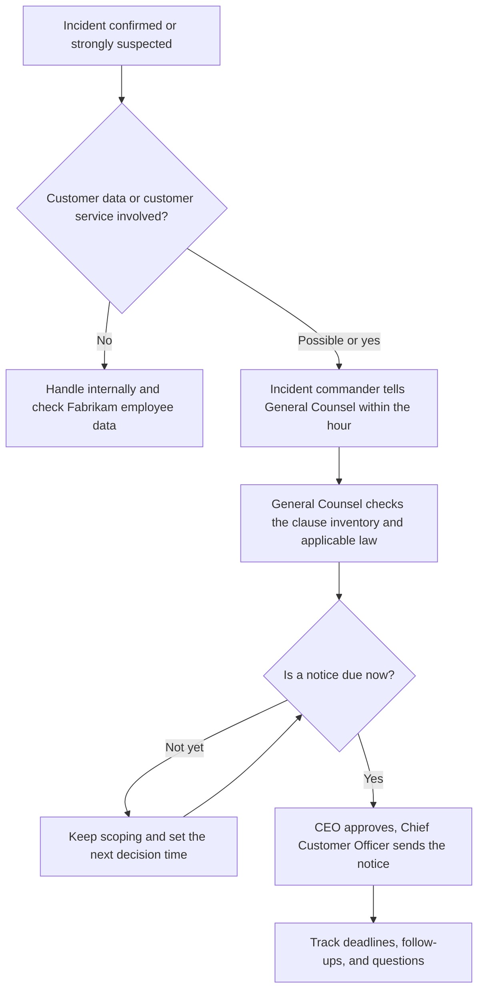

# 08. Detection and incident response

> **Reference work.** Fictional scenario built for a public portfolio. Not deployed in, derived from, or describing any employer environment. Not professional advice.

## Purpose and scope

This document explains how Fabrikam (fictional) finds, contains, and recovers from security incidents with a small IT and security team. A managed detection and response (MDR) provider watches Microsoft Defender XDR around the clock and acts inside limits the executive team approves in advance; an internal on-call rotation and an incident commander handle what needs Fabrikam's own judgment; and named executives make the business decisions. It covers severity and escalation, roles, customer notification readiness, the incident response plan aligned to NIST SP 800-61 Rev. 3, logging, exercises, and the playbook catalog. Every procedure here is reference material with the status "untested template".

## Starting point and goals

At day 1, Defender for Endpoint alerts land in a shared mailbox, nobody covers nights or weekends, and audit logging runs at standard retention (assumption A-07 in document [01](01-scenario-and-assumptions.md)). That is risk R-10: not enough logging or response capacity to investigate an incident in time to meet customer notification commitments. The threats that matter most (document [17](17-threat-profile.md)) are fast and identity-centric: business email compromise (BEC) against finance and HR (R-01), mailbox takeover through stolen session tokens, and ransomware (R-03).

The model is built to five goals:

1. A qualified person looks at every high-severity alert within minutes, at any hour.
2. Obvious containment, such as isolating a laptop or disabling an account, happens at once inside limits approved in advance.
3. Business decisions (stopping a payment, notifying customers, taking a service offline) reach the executive who owns them quickly.
4. Enough log history exists to answer "what did the attacker touch?" before the shortest customer notification clock runs out.
5. It fits a team of about five people and the payroll calendar, with named coverage for year-end and tax form season (mid-December through January).

## The detection and response model

| Layer | Who | What it does | Hours |
|---|---|---|---|
| Detection platform | Microsoft Defender XDR | Correlates endpoint, email, identity, and cloud app alerts into incidents; with Defender for Endpoint Plan 2, automatic attack disruption contains high-confidence attacks on its own | Always on |
| Managed detection and response | MDR provider, chosen in [ADR-003](adr/ADR-003-managed-detection-and-response.md) | Works the incident queue, investigates, hunts, takes pre-approved containment actions, and phones Fabrikam's on-call | 24 hours a day, 7 days a week |
| Fabrikam response | On-call rotation, incident commander, executives | Decisions that change business processes, customer and employee communication, recovery, and lessons learned | On-call outside business hours |

**Licensing is the hinge.** Microsoft 365 E3 gives Fabrikam Defender for Endpoint Plan 1 (antivirus, attack surface reduction, manual device isolation, and portal incidents, but no endpoint detection and response, or EDR), Defender for Office 365 Plan 1 (included in E3 since Microsoft's July 2026 packaging update; to be confirmed in the tenant during discovery), Microsoft Entra ID P1, and Microsoft Purview Audit (Standard). Microsoft's Defender Experts MDR covers Defender for Endpoint P2, Defender for Office 365 P2, Defender for Identity, Defender for Cloud Apps, and Entra ID P2; it needs at least one of them in active mode, and identity coverage needs Entra ID P2. Automatic attack disruption needs a qualifying subscription such as Microsoft 365 E3 with the Microsoft Defender Suite add-on (formerly Microsoft 365 E5 Security). An independent MDR provider meets the same limit: without EDR and the Plan 2 email tools there is little for it to investigate. So [ADR-003](adr/ADR-003-managed-detection-and-response.md) depends on the licensing decision in [ADR-001](adr/ADR-001-microsoft-365-security-licensing.md), and both go to the executive team at M3.

**Until the MDR is live (target: end of Phase 4),** Fabrikam runs a lighter version of the same model. Defender incident email notifications go by severity and service source to a monitored on-call alias and named people instead of a shared mailbox, and the IT service management tool's on-call alerting, or a small paging service if the tool has none, turns high-severity notifications into a phone page to the primary on-call (Phase 1, action 08.01). The page reaches a person at any hour; the response outside business hours is best effort, using the manual actions E3 already includes: device isolation in Defender for Endpoint Plan 1, and disabling accounts and revoking sessions in Microsoft Entra ID. For an active compromise, an incident response retainer, or pre-agreed emergency terms with an incident response firm, is in place before mid-December with the CFO's approval; it folds into the MDR contract only if the chosen provider includes incident response, and otherwise stays beside it (action 08.06). The incident commander calls it in. The remaining gap is recorded under R-10 for its executive owner to accept or treat (document [11](11-risk-management.md)).

### Pre-approved containment

The executive team approves this response authority matrix with POL-08 (Incident Response Policy) at M3. Inside it, the MDR provider and the on-call act without waiting and tell the incident commander afterward. Changes to the call-first groups and to custom detections go through the weekly Change Advisory Board.

| Action | Pre-approved for | Call first | License |
|---|---|---|---|
| Isolate a device (it stays connected to Defender) | All corporate Windows and Mac devices | Devices in the call-first device group | Defender for Endpoint Plan 1 for manual isolation; Plan 2 for MDR and automatic action |
| Quarantine a file; restrict app execution | All corporate devices | None | Defender for Endpoint Plan 2 for MDR action |
| Disable an account; revoke sign-in sessions | All users | Emergency access accounts; named service accounts that run payroll or finance integrations | Microsoft Entra ID (any plan) for manual action; Entra ID P2 for MDR identity coverage |
| Block a sender, domain, or URL; remove a malicious message from mailboxes | All mailboxes | None | Built-in Tenant Allow/Block List for blocking; Defender for Office 365 Plan 2 for fast post-delivery investigation and removal |
| Revoke an OAuth app's consent | Apps implicated in the incident | Apps that run a business process | Microsoft Entra ID; app governance in Defender for Cloud Apps (Defender Suite or E5) |
| Reset a password or authentication methods | Fabrikam staff only, after caller identity verification (document [13](13-it-service-management.md)); never the MDR | Not applicable | Microsoft Entra ID |
| Take a business system, integration, or customer-facing service offline | Not pre-approved | Owning executive decides with the incident commander | Not applicable |

The call-first group stays short. It holds the emergency access accounts, so automation never removes the last way back into the tenant (any sign-in by one raises an Azure Monitor alert that pages the on-call, set up in action 08.03 with document [06](06-microsoft-365-security-baseline.md)), and the identities and devices whose loss would stop payroll or finance processing. For those, the MDR phones the on-call first and acts if nobody answers within an agreed time (proposal: 15 minutes for SEV-1). Defender Experts MDR supports this pattern directly: a customer grants "Respond directly to active threats" (Security Operator access) and excludes device groups and Entra security groups, which then receive remediation guidance instead of action. Its one-click managed actions are isolate device, quarantine file, restrict app execution, their reversals, and disable user; anything else arrives as guidance for Fabrikam to carry out.

Automatic attack disruption can contain a device, contain or suspend a user, and revoke sessions, among other actions. Microsoft says every automatic action can be undone and that exclusions can be set for users, devices, and IP addresses, and it states a confidence level of 99 percent or higher for containment actions (Microsoft's own claim about its product, not independently verified). Automatic device isolation is (preview, as of 2026-10-13). Microsoft warns that automation which keeps accounts enabled can undo disruption, so before attack disruption is switched on, action 08.11 checks the HR-driven account automation designed in document [07](07-identity-lifecycle-joiners-movers-leavers.md) for that behavior.

### On-call rotation and escalation

| Position | Who (proposal) | Duty |
|---|---|---|
| Primary on-call | One IT team member per week: IT Operations Manager, Systems Engineer (Identity and Endpoint), Service Desk Analyst, and the Security Engineer once in post (document [04](04-operating-model-team-and-budget.md)) | Answers MDR calls and Defender notifications; reachable by phone at any hour for SEV-1 and SEV-2 |
| Secondary on-call | Another IT team member | Backup and handoff after a long night |
| Escalation | Director of IT and Security (deputy: IT Operations Manager) | Incident commander for SEV-1 and SEV-2 |

On-call pay or time off is a VP of People decision and a cost driver in document [04](04-operating-model-team-and-budget.md). A rotation this small is also a key-person exposure (R-14), which the MDR reduces.

| Severity | Alert or MDR reaches the on-call (proposal) | Incident commander | Executives told | Updates |
|---|---|---|---|---|
| SEV-1 Critical | Phone call at once on confirmation | Director | CEO, CTO, General Counsel, CFO, and Chief Customer Officer within one hour | Every two hours, or as the incident commander sets |
| SEV-2 High | Phone call within 30 minutes | Director or delegate | Owning executive the same day; General Counsel the same day if any data may be involved | At least daily |
| SEV-3 Medium | Message to the on-call channel and a ticket | Primary on-call | Director next business day | In the ticket |
| SEV-4 Low | Ticket | Service desk | None | In the ticket |

These times are proposals to tune after the first months of MDR data. Fabrikam's severity is a business severity set by the MDR analyst or the incident commander; it is not the alert severity Defender assigns. SEV-1 and SEV-2 incidents, and open exercise actions, go to the monthly IT and Security Steering Group.

## Severity matrix

| Severity | When it applies | Customer data exposure | Payroll disruption | Administrator compromise |
|---|---|---|---|---|
| SEV-1 Critical | Confirmed or highly likely harm to customers, to customer data at scale, or to Fabrikam's ability to operate | Confirmed access to or theft of customer workforce data, for example payroll exports with Social Security numbers and bank details | A security event stops or corrupts customer payroll processing, or redirects customer workers' pay at scale (with Engineering) | An attacker controls a Global Administrator or another tenant-wide privileged account |
| SEV-2 High | Confirmed compromise with impact contained or still being scoped | A compromised mailbox or OneDrive that held customer data, with access not yet ruled out | Fabrikam payroll or a vendor payment diverted with money moved; ransomware activity contained to a few devices | An attacker uses a privileged role of limited scope, or an unexplained privileged role assignment appears |
| SEV-3 Medium | Contained compromise of one non-privileged account or device, no evidence of data access | Customer data found in an unapproved place, such as an "Anyone" sharing link, with no sign of outside access | A fraudulent bank-change request stopped before any change was made | A risky admin sign-in blocked by Conditional Access, with credentials rotated |
| SEV-4 Low | Attempts stopped by controls; policy issues | A phishing message aimed at payroll staff, blocked or reported | A lookalike-domain message impersonating a vendor, quarantined | Failed sign-in attempts against admin accounts |

Escalation rules: any credible sign that customer data left Fabrikam's control is handled as SEV-2 at least until ruled out, and General Counsel hears about it the same day. A loss above a threshold the CFO sets, any incident that touches the payroll path during a processing window (document [13](13-it-service-management.md)'s definition), or any media or regulator inquiry raises severity by one level. The incident commander can raise severity at any time; lowering it needs the incident commander and the Director. "High-severity" in KPI-16 means SEV-1 and SEV-2.

## Roles

| Role | Who | Responsibilities |
|---|---|---|
| Incident commander | Director of IT and Security for SEV-1 and SEV-2 (deputy: IT Operations Manager); primary on-call for SEV-3 | Runs the response, sets severity, assigns work, keeps the timeline, briefs executives, declares the incident closed |
| Engineering lead (product incidents) | Engineering Manager or Site Reliability Engineering (SRE) lead on call | Commands the technical response for product platform incidents under Engineering's incident process; the Director joins as security lead and owns the security investigation and evidence (RACI in document [04](04-operating-model-team-and-budget.md)) |
| Legal | General Counsel | Privilege and legal holds, contract and statutory notification analysis, law enforcement contact, outside counsel; approves every external statement |
| Customer communication | Chief Customer Officer | Customer notices and holding statements, briefing of customer-facing teams, tracking of customer questions |
| Payments and Fabrikam payroll | CFO | Stops or recalls payments, contacts Fabrikam's bank, sets the loss threshold that raises severity |
| Employees | VP of People | Employee communication, Fabrikam's own payroll and employee data, People-side steps in insider cases |
| Technology executive | CTO | Executive sponsor; decisions on product changes and Engineering resources |
| Chief executive | CEO | SEV-1 business decisions; decides what goes to the investor board |
| MDR provider | Provider analysts | Triage, investigation, hunting, pre-approved containment, notification |
| Scribe and evidence keeper | Service Desk Analyst or GRC Analyst | Timeline in UTC, evidence log, action list |

### Decision rights during an incident

| Decision | Decides | Advises |
|---|---|---|
| Containment inside the pre-approved matrix | MDR provider or on-call | Incident commander is told |
| Containment that disrupts a business process, such as disabling a finance integration | Incident commander with the owning executive (CFO, VP of People, or CTO) | Director, MDR provider |
| Change or take offline a customer-facing service | CTO, with the CEO for SEV-1 | Engineering lead, Chief Customer Officer |
| Recall a payment or hold a payroll change | CFO | Incident commander |
| Notify customers, individuals, or regulators | General Counsel, with CEO approval | Incident commander, Chief Customer Officer |
| Report to law enforcement, including the FBI's Internet Crime Complaint Center (IC3) | General Counsel; the CFO for payment fraud reports | Incident commander |
| Respond to an extortion demand | CEO with General Counsel, involving the board as the CEO decides (CISA and its co-authors do not recommend paying ransom) | Director |
| Accept residual risk after the incident | Named risk owner (document [11](11-risk-management.md)) | Director |

## Customer notification readiness

Fabrikam is a service provider: its customers, the employers, own most of the data it processes. A reading of several state breach laws (analysis, not legal advice) points the same way in each: the duty to notify individuals sits with the data owner, and Fabrikam's own statutory duty is to tell the owner fast. In practice, customer contracts and data processing agreements usually set the clock Fabrikam must meet, and it may be shorter than any statute. State laws also vary:

| Law, as read on 2026-10-13 | Duty of a business that holds data it does not own |
|---|---|
| Washington, RCW 19.255.010 | Notify the owner "immediately following discovery" |
| Texas, Business and Commerce Code 521.053 | Notify the owner or license holder "immediately after discovering the breach" |
| New York, General Business Law 899-aa | Notify the owner or licensee "immediately, provided that such notification shall be made within thirty days following discovery" |
| Florida, section 501.171 (2026 edition) | A third-party agent notifies the covered entity "no later than 10 days following the determination" |

For Fabrikam's own employee data, Fabrikam is the owner and the individual notice rules apply to it directly, for example no more than 30 calendar days after discovery in Washington and no later than the 60th day after determining the breach in Texas. General Counsel also answers two open questions: whether Fabrikam acts as an E-Verify employer agent, whose memorandum of understanding (revision dated 06/01/2013) requires notifying DHS "immediately" of a breach of personal information, and whether the FTC Safeguards Rule applies, which would require notice to the FTC as soon as possible and no later than 30 days after discovery when at least 500 consumers are involved.

**Payroll-specific clocks (open questions for General Counsel, logged with document [10](10-governance-and-compliance-program.md)).** If benefits enrollment data and carrier feeds make Fabrikam a business associate of customers' group health plans, HIPAA requires notice to the covered entity without unreasonable delay and no later than 60 calendar days after discovering a breach of unsecured protected health information (45 CFR 164.410(b)). If Fabrikam is a Third-Party Sender or a Third-Party Service Provider under the Nacha Operating Rules, the ACH network's rules, General Counsel checks whether those rules or the bank's agreement set an incident notice duty and clock. If Fabrikam e-files employment tax returns as a reporting agent, which makes it an Authorized IRS e-file Provider, General Counsel confirms the IRS reporting duty: Publication 3112, which covers every Authorized IRS e-file Provider, tells providers to report any suspected data theft or data loss immediately to the appropriate IRS Stakeholder Liaison, and standard 6 of the IRS e-file security standards, which the IRS says is now mandated for all providers, requires reporting security incidents as soon as possible and no later than the next business day after confirmation.

**Contract clause inventory.** General Counsel and the Director build it in Phases 1 to 3: standard customer terms and the largest customers first, then partners such as benefits carriers, background screening providers, and banks.

| Field | What it records |
|---|---|
| Agreement | Customer or partner, template and version |
| Trigger | The contract's definition of a security incident; suspected or confirmed |
| Clock | Hours or days, and from which event (discovery, confirmation, determination) |
| Method and contact | Named recipient and channel |
| Required content | What the notice must say; follow-up duties |
| Cooperation | Investigation support, audit rights, subprocessor flow-down |

The shortest clock in the inventory becomes the planning clock, and readiness for R-10 is measured against it.

**Decision path.**

**Holding statements.** Drafts for General Counsel to approve in Phase 3. They state facts, avoid speculation about cause or scope, and promise a time for the next update.

1. Customer holding notice: "Fabrikam is investigating a security incident that [may affect / affected] [service or data category]. We identified the activity on [date] and have taken steps to contain it. Our investigation is ongoing. We will update you by [date and time], or sooner if we learn anything you need to act on. Your contact for questions is [name and channel]."
2. Service disruption notice: "Since [time], some customers [cannot reach / see delays in] [payroll processing or time tracking]. We are working to restore service and will update you by [time]. For payroll due before then, [continuity guidance from document 14]."
3. Employee notice: "We are responding to a security issue affecting [system]. Please do not discuss it outside Fabrikam or on social media, send any customer or media questions to [contact], and report anything unusual to the service desk."

## Incident response plan aligned to NIST SP 800-61 Rev. 3

NIST SP 800-61 Rev. 3 (April 2025) supersedes the 2012 Rev. 2 guide and its four-phase life cycle. It is written as a CSF 2.0 Community Profile: Govern, Identify, and Protect are preparation; Detect, Respond, and Recover are the response itself; and lessons learned flow through the Improvement category (ID.IM) into every Function. In NIST's words, "All six NIST Cybersecurity Framework (CSF) 2.0 Functions play vital roles in incident response." Fabrikam's plan follows that structure:

| CSF 2.0 Function | Level in SP 800-61 Rev. 3 | What Fabrikam's plan provides | Where |
|---|---|---|---|
| Govern | Preparation | POL-08 (co-owned with Legal), roles, decision rights, response authority matrix, MDR contract and oversight | This document, [ADR-003](adr/ADR-003-managed-detection-and-response.md), document [10](10-governance-and-compliance-program.md) |
| Identify | Preparation | Asset and data inventories, risk register (R-10), contract clause inventory | Documents [05](05-environment-discovery.md) and [11](11-risk-management.md) |
| Protect | Preparation | Baseline controls, role-based training, backups | Documents [06](06-microsoft-365-security-baseline.md), [09](09-security-awareness-and-training.md), [14](14-business-continuity-and-backup.md) |
| Detect | Incident response | Defender XDR detections, MDR monitoring and hunting, custom detections | This document |
| Respond | Incident response | Severity, incident commander, analysis, containment, notification | This document and the playbooks |
| Recover | Incident response | Verified restoration, recovery communication | Document [14](14-business-continuity-and-backup.md) and this document |
| Identify (Improvement) | Lessons learned | After-action reports, exercises, tracked actions (KPI-18) | This document |

The plan adopts these Rev. 3 items explicitly: prioritize incidents by impact rather than first come, first served (RS.MA.R1); name an incident lead for every incident (RS.MA-01.C1); update senior leadership regularly on major incidents (RS.CO-03.R2); check restoration assets for indicators of compromise and integrity before use (RC.RP-03.R1, with document 14); write an after-action report (RC.RP-06.R1); keep business continuity and incident response plans in step (ID.IM-04.R1); and build incident duties into role-based training (PR.AT-02.R1, with document 09). Following CISA's #StopRansomware Guide, the CEO approves the incident response and communications plans in writing, and a hard copy and an offline copy stay where responders can reach them if Microsoft 365 is down. Exercises follow NIST SP 800-84 (September 2006, still the current final on CSRC), which Rev. 3 points to for tests and exercises (ID.IM-02).

## Logging and retention for detection and investigation

Document [06](06-microsoft-365-security-baseline.md) configures the logging baseline and POL-06 (Logging and Monitoring Policy) sets the rules; this section states what the MDR and investigators need from them.

| Source | Answers | Licensed with | Default retention | Plan |
|---|---|---|---|---|
| Microsoft Entra sign-in and audit logs | Who signed in, from where, with which method; changes to users, roles, apps, and authentication methods | Entra ID P1 (E3) | 30 days in Entra with P1 or P2; risky sign-ins 30 days with P1, 90 days with P2 | Archive to an Azure storage account from Phase 1; interactive sign-in and audit logs also go to a Log Analytics workspace for the Azure Monitor alerts in 08.03 |
| Microsoft 365 unified audit log (Purview Audit), including mailbox auditing | Inbox rules and forwarding, which mail items were accessed (MailItemsAccessed), file access and sharing, admin changes | Audit (Standard) in E3; MailItemsAccessed is part of Audit (Standard) and on by default for E3 users | 180 days with Audit (Standard); one year for Entra, Exchange, OneDrive, and SharePoint records with Audit (Premium) | Phase 5 decision: an export path, or Audit (Premium) only if ADR-001's revisit approves Purview Suite or E5 |
| Defender XDR advanced hunting | Endpoint process, file, and network events; email events; cloud app events | Endpoint event data depends on endpoint detection and response, a Defender for Endpoint Plan 2 capability; advanced hunting for email is a Defender for Office 365 Plan 2 feature | 30 days of raw data | Accept 30 days in year one; longer retention needs a Microsoft Sentinel workspace or the Streaming API, neither planned |
| Defender XDR incidents and MDR case records | What was detected, what was done, and when | Defender portal; MDR service | Per provider; Defender Experts keeps reporting and operational data no more than 90 days after a subscription expires | Copy case summaries into the incident register every month |
| Message trace and email investigation | Who sent what to whom, with authentication results | Message trace is built in; Real-time detections with Defender for Office 365 Plan 1; Threat Explorer with Plan 2 | Varies by tool | Used in every email incident |
| Finance system, HR system of record, service desk tool, code hosting | Bank-detail and payment changes, direct-deposit changes, reset tickets, repository access | Each system | Each system | Confirm each audit trail and its retention in discovery (document [05](05-environment-discovery.md)) |

**Retention target (proposal).** At least one year of searchable identity, email, and file activity, in line with CISA's advice to keep logs for critical systems for a minimum of one year if possible, and longer wherever a customer contract requires it. In year one, Entra logs are archived from Phase 1 because 30 days is too short for a BEC found late, the unified audit log keeps 180 days, and the choice between an export path and Audit (Premium), which needs ADR-001's revisit to approve Purview Suite or E5, is made in Phase 5 with the clause inventory in hand. Fabrikam runs no security information and event management (SIEM) system in year one; the Log Analytics workspace in action 08.03 holds only the Entra logs its alerts need. If a SIEM is considered later, Microsoft Sentinel is supported in the Azure portal only until 2027-03-31 and after that only in the Defender portal. Incident timelines use UTC, as advanced hunting does.

## Detection coverage priorities

Techniques are cited to MITRE ATT&CK v20 (Enterprise), current as of 2026-10-13, the day MITRE released it; v19 split the former Defense Evasion tactic into Stealth (TA0005) and Defense Impairment (TA0112).

Priorities and technique IDs follow document [17](17-threat-profile.md).

| Priority | Behavior | ATT&CK v20 | Scenarios | Telemetry and license | Coverage |
|---|---|---|---|---|---|
| 1 | Sign-ins that complete without phishing-resistant authentication; legacy authentication | T1078.004 (Valid Accounts: Cloud Accounts); T1557 (Adversary-in-the-Middle); T1539 (Steal Web Session Cookie); T1550.004 (Use Alternate Authentication Material: Web Session Cookie) | S-02, S-03, S-04 | S-03 and S-04 (workforce accounts): Entra sign-in logs (P1); risk detections need Entra ID P2. S-02: customer administrators sign in to the product, not to Fabrikam's Microsoft Entra tenant, so the evidence is the product's sign-in and audit logs, which Engineering holds | Workforce accounts: [q01](../queries/q01-sign-ins-without-strong-auth.kql) for successful sign-ins that did not require multifactor authentication (it cannot tell which method was used); [q02](../queries/q02-legacy-auth-sign-ins.kql) for legacy authentication; MDR triage of risky sign-ins once P2 is licensed. S-02: Engineering's product telemetry under the shared RACI (document [04](04-operating-model-team-and-budget.md)), as the coverage boundary below states |
| 2 | Inbox forwarding and hiding rules; mailbox delegation | T1114.003 (Email Collection: Email Forwarding Rule); T1564.008 (Hide Artifacts: Email Hiding Rules); T1114.002 (Email Collection: Remote Email Collection) | S-01, S-04 | Unified audit log (E3); Defender for Office 365 and Defender for Cloud Apps signals (Defender Suite or E5) | [q04](../queries/q04-external-mail-forwarding-rules.kql) for external forwarding and redirects, with any hiding actions in the same change; rules that only hide mail through audit log search and the custom detection for finance, payroll, People, and executive mailboxes (08.12; triaged by the internal on-call if Defender Experts MDR is chosen); MDR for built-in detections |
| 3 | OAuth consent grants; new service principal credentials | T1528 (Steal Application Access Token); T1550.001 (Use Alternate Authentication Material: Application Access Token); T1671 (Cloud Application Integration) | S-05, S-08 | Entra audit log (E3); app governance in Defender for Cloud Apps (Defender Suite or E5) | [q05](../queries/q05-app-consent-grants.kql); app governance alerts; MDR |
| 4 | Authentication method and device registration changes, especially after a service desk reset | T1556.006 (Modify Authentication Process: Multi-Factor Authentication); T1098.005 (Account Manipulation: Device Registration); T1684.001 (Social Engineering: Impersonation) | S-03 | Entra audit log (P1), sent to a Log Analytics workspace (08.03); service desk tickets | Azure Monitor alerts on every Temporary Access Pass issued and every authentication method registered or changed, each matched to a service desk ticket or, for self-service registration during the 06.11 campaigns, to the campaign roster; other self-service changes are confirmed with the user through a known contact before the alert is closed (document 13, action 13.07); a custom detection from Phase 4 (08.12) |
| 5 | Mass download, large exports, anonymous sharing links | T1530 (Data from Cloud Storage); T1213.002 (Data from Information Repositories: Sharepoint); T1567.002 (Exfiltration Over Web Service: Exfiltration to Cloud Storage) | S-06, S-07 | Unified audit log (E3); Defender for Cloud Apps (Defender Suite or E5) | [q08](../queries/q08-anonymous-sharing-links.kql); Defender for Cloud Apps policies; MDR |
| 6 | Privileged role changes; standing Global Administrators (KPI-09) | T1098.003 (Account Manipulation: Additional Cloud Roles) | S-03, S-06 | Entra audit log (E3) | [q03](../queries/q03-privileged-role-changes.kql); an alert on every Global Administrator assignment |
| 7 | Mass deletion and endpoint ransomware behaviors | T1485 (Data Destruction); T1486 (Data Encrypted for Impact); T1490 (Inhibit System Recovery); T1685 (Disable or Modify Tools) | S-06 | Defender for Endpoint EDR (Plan 2); unified audit log | Automatic attack disruption (Plan 2); MDR; backup in [ADR-006](adr/ADR-006-microsoft-365-backup.md) |

Two more queries measure posture rather than an attack technique: [q06](../queries/q06-stale-accounts.kql) finds stale accounts (R-05) and [q07](../queries/q07-windows-10-devices.kql) finds remaining Windows 10 devices (A-04). As each query header states, the queries assume Microsoft Defender Suite on E3 (ADR-001), and Microsoft 365 E5 also includes these capabilities; on E3 alone, the same questions are answered more slowly with audit log search, Entra sign-in logs, and message trace.

**Detection engineering, kept lean.** Fabrikam relies first on Microsoft's built-in detections and the MDR's coverage, then adds a small set of custom detections, built from advanced hunting queries, for the top risks: mailbox rule and forwarding changes and risky sign-ins on finance, payroll, People, and executive accounts (R-01), and Temporary Access Pass and authentication method changes (S-03). If Defender Experts MDR is chosen, these custom detections reach the internal on-call, because Microsoft's FAQ places custom detections outside that service. Each custom detection records its purpose, ATT&CK mapping, data source and license, known false positives, tuning settings, status, and validation record. Technique emulation runs only in an isolated lab tenant with lab devices, never in the live tenant: there, the Security Engineer uses an open-source, ATT&CK-mapped test library and records the behavior exercised, the telemetry expected (for example an audit record for a new inbox rule and the alert it should raise), and the result. Twice a year, a benign, change-approved check in the live tenant proves the whole path (action 08.14). In the first leg, a dedicated test mailbox that holds no business data, placed inside the scope of the 08.12 forwarding-rule detection, gets an inbox rule forwarding to an outside address the team controls (action 06.14 still blocks the mail itself), and the team records whether the alert fired, who triaged it, and whether the on-call call happened, then removes the rule. Because custom detections can sit outside the MDR's scope, a second leg, agreed in advance with the MDR provider, uses a vendor-documented benign test alert, such as Microsoft Defender for Endpoint's EDR detection test on a test device enrolled in the live tenant (Plan 2), or the provider's own test procedure; the team records whether the provider triaged it and phoned the on-call. The second leg is a vendor test, not technique emulation, so the lab-only rule stands. This repository contains no attack procedures.

## Exercise program

Cadences are proposals. Each exercise ends with an after-action report and tracked actions (KPI-18), and none is scheduled during the October to December benefits open enrollment season or from mid-December through January.

| Exercise | Who | Proposed cadence | Timing in year one | Scenario |
|---|---|---|---|---|
| Executive tabletop, 90 minutes | CFO, VP of People, General Counsel, Chief Customer Officer, CTO, Director, IT Operations Manager | Twice a year | Late February 2027 (Phase 4); again around month 8 (June 2027) | First: payroll diversion, R-01 ([template](templates/tabletop-payroll-diversion.md)). Second: ransomware (R-03) or customer administrator takeover with Engineering (R-02) |
| Technical tabletop or drill with the MDR provider | IT and security team, MDR analysts; Engineering lead when the product is in scope | Every quarter after MDR go-live | From May 2027 (Phase 5) | Rotates: mailbox takeover, ransomware containment, OAuth consent, lost device |
| Notification drill, 30 minutes | General Counsel, Chief Customer Officer, Director, on-call | Twice a year, one before the year-end peak | April 2027 (08.13) and September 2027 (08.14) | A simulated customer-data incident: find the clause, choose the holding statement, name the sender |
| Detection validation in the lab tenant | Security Engineer | After every detection change, and at least twice a year for the top behaviors | From Phase 4 | Mailbox rules, risky sign-ins, ransomware behaviors |
| End-to-end alert check in the live tenant, change-approved | Security Engineer, on-call, MDR provider | Twice a year | From May 2027 (Phase 5), after MDR go-live | A benign forwarding rule on a test mailbox inside the 08.12 detection's scope, and a vendor-documented test alert agreed with the MDR provider: did the alert, the triage, and the phone call all happen? |

Related tests sit with their owners: emergency access account sign-in checks in document [06](06-microsoft-365-security-baseline.md) and restore tests (KPI-19) in document [14](14-business-continuity-and-backup.md).

## Playbook catalog

Every playbook uses the same skeleton: triggers, immediate actions, investigation steps that reference the queries, decision points, recovery, lessons learned, and an ATT&CK mapping.

| Playbook | Main risks | Status | Lead | Involves | Target |
|---|---|---|---|---|---|
| [Payroll diversion and email compromise](playbooks/payroll-diversion-and-email-compromise.md) | R-01, R-07, R-10 | Written (untested template) | Director of IT and Security | CFO, VP of People, General Counsel, MDR provider | Desk check in Phase 2; tabletop in Phase 4 |
| Ransomware and destructive attack | R-03, R-04 | Planned | Director of IT and Security until the Security Engineer starts (March 2027 in the base case), then the Security Engineer | CTO, General Counsel, document 14 owner, MDR provider | Draft Phase 4 (08.10); exercise Phase 5 (08.15) |
| Compromised customer administrator account in the product | R-02 | Interim escalation card from Phase 2 (08.05); full playbook planned, written with Engineering | Engineering Manager and Director | Chief Customer Officer, Chief Product Officer, General Counsel | Card in Phase 2; playbook in Phase 5 |
| Lost or stolen device: employee devices, plus the app's remote sign-out for customer devices that run it | R-07, R-03 | Planned | IT Operations Manager | Service desk; Customer Support for the app's remote sign-out; General Counsel if data may be exposed | Phase 5 |
| Insider data misuse | R-07, R-12 | Planned | Director of IT and Security | General Counsel, VP of People | Phase 5 |
| Integration credential or partner connection compromise | R-08 | Planned | Director of IT and Security | Engineering Manager, SRE lead, General Counsel | Phase 5 |

**Interim escalation card for a suspected customer administrator takeover (R-02).** Prepared in Phase 2 with the Chief Customer Officer and the Engineering Manager (action 08.05), so the year-end season has a first-hour path before the full playbook exists: verify the reporter through the CRM contacts on file; page Engineering's on-call; stop bank-detail changes for that customer account where the product allows; contact the customer administrator through known contacts; tell General Counsel at once, and send holding statement 1 only with General Counsel's approval.

**Lost devices before the playbook.** Until document 08's lost-device playbook (planned, Phase 5) sets the rule, a wipe is the Director of IT and Security's decision, with General Counsel if data may be exposed.

## KPIs this document feeds

Formulas and targets live in document [12](12-metrics-and-executive-reporting.md) and [kpi-catalog.csv](../data/kpi-catalog.csv); this document produces the data.

| KPI | Data produced here | Source |
|---|---|---|
| KPI-16 Mean time to acknowledge and to contain high-severity incidents | For SEV-1 and SEV-2: incident created, acknowledged by the MDR or on-call, first containment action completed | Defender XDR incident and Action center records, MDR case data, incident register. Values before MDR go-live are labeled interim |
| KPI-17 Security incidents by severity and cause | Severity and one cause per incident: credential phishing or token theft; BEC or payment fraud attempt; malware or ransomware; malicious OAuth app; misconfiguration or oversharing; lost or stolen device; insider misuse; third party or integration; service desk social engineering; other | Incident register in the IT service management tool |
| KPI-18 Exercise and post-incident actions closed on time | Every after-action item with an owner and a due date | Action tracker in the IT service management tool; reviewed at the Quarterly Risk Review |

## Phase plan

| Phase | Action ID | Action | Outcome | KPI | Owner role | Workstream |
|---|---|---|---|---|---|---|
| Phase 1 | 08.01 | Route Defender incident email notifications by severity and service source from the shared mailbox to a monitored on-call alias and named people; turn high-severity notifications into a phone page through the IT service management tool's on-call alerting, or a small paging service if it has none; publish the on-call phone list (A-07) | A high-severity alert pages a person at any hour instead of waiting for business hours | KPI-16 | IT Operations Manager | WS-4 |
| Phase 1 | 08.02 | Start the interim on-call rotation, the incident register in the IT service management tool, and the severity matrix and incident commander rule as interim working practice | Every security incident has an owner, a severity, and a record | KPI-17 | Director of IT and Security | WS-4 |
| Phase 1 | 08.03 | With document 06, confirm the log baseline (unified audit log and mailbox auditing on, Entra retention known) and start archiving Entra sign-in and audit logs; also send interactive sign-in and audit logs to a Log Analytics workspace with Azure Monitor alert rules to the on-call alias for every emergency access sign-in (06.01, paged at once) and, before ADR-004's wave 2 registers in December, every Temporary Access Pass issued and every authentication method registered or changed; change no in-period SOC 2 control without the audit firm's agreement | Investigations can look back further than 30 days for identity events; break-glass use, passes, and method changes raise alerts | KPI-16 | Systems Engineer (Identity and Endpoint) | WS-4 |
| Phase 1 | 08.04 | With General Counsel, start the contract clause inventory (standard terms and largest customers first) and log the open legal questions (E-Verify employer agent status, FTC Safeguards Rule) | The shortest contractual notification clock is known | KPI-01 | Director of IT and Security | WS-4 |
| Phase 2 | 08.05 | Draft the incident response plan content for POL-08 (roles, severity, decision rights, response authority matrix); desk-check the payroll diversion playbook with the CFO and VP of People before the year-end payroll peak; with the Chief Customer Officer and the Engineering Manager, prepare the one-page interim escalation card for R-02 | Plan ready for approval; finance and People know the verification and escalation steps before mid-December; a suspected customer administrator takeover has a first-hour path | KPI-02 | Director of IT and Security | WS-4 |
| Phase 2 | 08.06 | Run the MDR evaluation in ADR-003: Defender Experts MDR Plan 1 and at least two independent providers scored against the criteria, tied to the ADR-001 licensing options; put in place an incident response retainer, or pre-agreed emergency terms with an incident response firm, before mid-December with the CFO's approval; it folds into the MDR contract only if the chosen provider includes incident response, and otherwise stays beside it | A provider recommendation with cost drivers for the M3 budget proposal; incident response help on call through year-end | KPI-16 | Director of IT and Security | WS-4 |
| Phase 2 | 08.07 | Confirm coverage from mid-December through January: on-call roster, executive contact list, a named finance contact for bank recalls, the IC3 reporting path, and the incident response firm's contact | Year-end and tax form season has named responders | KPI-16 | IT Operations Manager | WS-4 |
| Phase 3 | 08.08 | Executive team approves POL-08, the incident response plan, the response authority matrix, and the MDR selection with the ADR-001 licensing decision (M3); General Counsel approves the holding statements and the notification decision path | Approved plan and MDR decision | KPI-02 | Director of IT and Security | WS-4 |
| Phase 4 | 08.09 | Run the first executive tabletop (R-01) in late February 2027 with the payroll diversion template; give every action an owner and a date | First exercise findings with owned actions | KPI-18 | Director of IT and Security | WS-4 |
| Phase 4 | 08.10 | From February 2027, onboard the MDR provider in Defender XDR (permissions, call-first groups, contacts, escalation runbook), run it in parallel with the internal on-call, and agree the monitoring evidence with the SOC 2 audit firm before cutover inside the current period (M4); draft the ransomware playbook with the MDR provider, adding document 14's backup steps (14.11), led by the Director of IT and Security until the Security Engineer starts | Round-the-clock monitoring and containment live by the end of Phase 4; ransomware playbook drafted | KPI-16 | Director of IT and Security | WS-4 |
| Phase 4 | 08.11 | When Defender Suite is live (ADR-001), configure automatic attack disruption prerequisites and exclusions, after confirming that the HR-driven account automation in document 07 cannot re-enable an account that disruption disabled | Automatic containment of high-confidence attacks | KPI-16 | Systems Engineer (Identity and Endpoint) | WS-4 |
| Phase 4 | 08.12 | March to April: build custom detections from advanced hunting queries for R-01 (mailbox rule and forwarding changes, including rules that only hide mail, and risky sign-ins on finance, payroll, People, and executive accounts) and for Temporary Access Pass and authentication method changes (S-03), and validate them in the lab tenant | Top-risk behaviors raise alerts, with false positive notes recorded | KPI-16 | Security Engineer | WS-4 |
| Phase 4 | 08.13 | April: start reporting KPI-16, KPI-17, and KPI-18 from MDR case data, the incident register, and the action tracker; run the first notification drill with General Counsel and the Chief Customer Officer | First detection and response values for the Quarterly Risk Review; the customer notification path tested, with owned actions | KPI-17 | GRC Analyst (reporting); Director of IT and Security (drill) | WS-4 |
| Phase 5 | 08.14 | Run technical exercises with the MDR provider every quarter, the second executive tabletop around month 8, the second notification drill in September 2027, and the twice-yearly end-to-end alert check in the live tenant, with its second leg agreed in advance with the MDR provider (a vendor-documented benign test alert or the provider's own test procedure; record whether the provider triaged it and phoned the on-call); commission one external penetration test, June to August 2027, after the Phase 4 controls land and before the proposed Type 1 date (document 10), scoped with Engineering to the corporate tenant and identity, the customer administrator sign-in and bank-change paths, and integrations | Exercise program running, actions tracked; test findings tracked in KPI-18 and fed into the R-02 and R-08 ratings | KPI-18 | Security Engineer | WS-4 |
| Phase 5 | 08.15 | Exercise the ransomware playbook drafted in Phase 4, and write and exercise the other planned playbooks: compromised customer administrator (with Engineering), lost device, insider data misuse, integration compromise | Playbook catalog covers the top risks | KPI-18 | Director of IT and Security | WS-4 |
| Phase 5 | 08.16 | Decide whether to extend searchable log retention (an export path, or Audit (Premium) through ADR-001's revisit) using the clause inventory and incident experience; review MDR performance and renewal at M7 | Retention and MDR decisions grounded in a year of data | KPI-16 | Director of IT and Security | WS-4 |

## Resourcing and dependencies

- **Roles.** Director of IT and Security: owner and incident commander. IT Operations Manager: alert routing, paging, and on-call lead. Systems Engineer (Identity and Endpoint): log archive and Azure Monitor alerts, containment settings, attack disruption. Service Desk Analyst: caller verification and scribe. Security Engineer: custom detections, lab validation, MDR liaison, and exercises, from March 2027 in the base case, after the M3 budget approval (document [04](04-operating-model-team-and-budget.md)). GRC Analyst, from March 2027 in the base case: KPI reporting, after-action tracking, SOC 2 evidence. Executives: General Counsel, Chief Customer Officer, CFO, VP of People, CTO, and CEO. Engineering: Engineering Manager and SRE lead for product incidents and the R-02 card and playbook.
- **Partners.** MDR provider (onboarding from February 2027, live by the end of Phase 4); an incident response retainer, or pre-agreed emergency terms with an incident response firm, in place before mid-December with the CFO's approval (it folds into the MDR contract only if the chosen provider includes incident response, and otherwise stays beside it); SOC 2 audit firm (agrees monitoring evidence before cutover, M4); penetration testing firm (one external test, June to August 2027, scoped with Engineering and document [17](17-threat-profile.md)).
- **Licenses.** Phases 1 to 3: Microsoft 365 E3 (Defender for Endpoint Plan 1, Defender for Office 365 Plan 1, Entra ID P1, Audit (Standard)). From Phase 4: Microsoft Defender Suite on E3 ([ADR-001](adr/ADR-001-microsoft-365-security-licensing.md)); Defender Experts MDR Plan 1, sold separately, or an independent MDR service ([ADR-003](adr/ADR-003-managed-detection-and-response.md)). Audit (Premium) only if ADR-001's revisit approves Purview Suite or E5. Also an Azure subscription for log archive storage and a Log Analytics workspace with Azure Monitor alert rules (both consumption-based; Microsoft names Microsoft Entra ID P1 or P2, which E3 includes, for analyzing Entra logs in Log Analytics), on-call alerting in the IT service management tool or a small paging service, and licenses for a small isolated lab tenant.
- **Cost drivers.** License uplift, MDR subscription (per user or per device), the incident response retainer or emergency terms, on-call pay or time off, a paging service if the IT service management tool has no on-call alerting, log storage, Log Analytics ingestion and log alert rules, the external penetration test, and the lab tenant. No figures here; document [04](04-operating-model-team-and-budget.md) sizes them.
- **Depends on.** Documents [01](01-scenario-and-assumptions.md), [04](04-operating-model-team-and-budget.md), [05](05-environment-discovery.md), [06](06-microsoft-365-security-baseline.md), [07](07-identity-lifecycle-joiners-movers-leavers.md), [09](09-security-awareness-and-training.md), [10](10-governance-and-compliance-program.md), [11](11-risk-management.md), [12](12-metrics-and-executive-reporting.md), [13](13-it-service-management.md), [14](14-business-continuity-and-backup.md), and [17](17-threat-profile.md); ADR-001, ADR-003, ADR-004, and ADR-006; the queries in `queries/`.

## Risks and open questions

- **Licensing dependency.** Without Plan 2-level licenses (ADR-001), an MDR has too little to work with and investigations on E3 stay slow and manual. If discovery (M1) finds an active compromise or severe exposure, the Director can propose bringing the licensing and MDR decisions forward instead of waiting for M3.
- **SOC 2 period.** Moving monitoring to an MDR inside the current review period (ends month 5) needs the audit firm's agreement on evidence (M4); the parallel run protects continuity.
- **Coverage boundary.** Defender Experts MDR Plan 1 covers Microsoft Defender workloads only, and Microsoft's FAQ limits it to High and Medium severity incidents on Windows, Linux, and macOS devices; incidents from custom detections, data loss prevention, or compliance alerts, and incidents on iOS or Android devices, are outside its scope. If Plan 1 is chosen, the custom detections in 08.12 and phone incidents reach the internal on-call through the 08.01 notification rules. The finance system, the HR system of record, code hosting, and the product cloud also sit outside it, and R-02 depends on Engineering's product telemetry under the shared RACI.
- **MDR is not incident response.** Microsoft states that neither Defender Experts plan is an incident response engagement; the incident response retainer or emergency terms in place before mid-December (action 08.06) cover an active compromise; they fold into the MDR contract only if the chosen provider includes incident response, and stay a separate retainer beside Defender Experts MDR, which excludes it.
- **Unknown clocks.** Until the clause inventory is complete, some customer clocks may be shorter than Fabrikam can meet, and R-10 cannot be sized.
- **Log windows.** Entra keeps 30 days with P1 and advanced hunting keeps 30 days; a compromise found late can outrun the logs until the archive (Phase 1) and the retention decision (Phase 5) are in place.
- **Small rotation.** On-call fatigue and key-person dependency (R-14) stay high until the MDR is live.
- **Legal reading.** The statutes above are examples as read on 2026-10-13, not legal advice, and statutes change; General Counsel rechecks them and answers the E-Verify, Safeguards Rule, and payroll-specific questions (HIPAA, the ACH network's rules, IRS e-file).
- **Time-sensitive Microsoft facts.** Defender Experts plan names (Plan 1 and Plan 2, on Learn pages dated July 2026) and terms (Plan 1's third-party network signal enrichment deprecated from 2026-09-01) changed in 2026, and automatic device isolation is in preview; recheck before relying on them.

## Framework mapping

By identifier only, consistent with the [crosswalk](crosswalk/csf2-soc2-crosswalk.md). This document supports:

| Theme | NIST CSF 2.0 | SOC 2 (2017 TSC) |
|---|---|---|
| Incident response policy, roles, and decision rights | GV.PO-01, GV.RR-02 | CC1.3, CC2.2 |
| MDR provider in incident planning and response | GV.SC-08 | CC9.2 |
| Logging and continuous monitoring | PR.PS-04, DE.CM-01, DE.CM-03, DE.CM-09 | CC7.2 |
| Analysis and incident declaration | DE.AE-02, DE.AE-03, DE.AE-06, DE.AE-08 | CC7.3 |
| Incident management, analysis, and mitigation | RS.MA-01, RS.MA-02, RS.MA-03, RS.MA-04, RS.MA-05, RS.AN-03, RS.AN-06, RS.AN-07, RS.AN-08, RS.MI-01, RS.MI-02 | CC7.4 |
| Notification and communication | RS.CO-02, RS.CO-03, RC.CO-03 | CC2.3, CC7.4 |
| Recovery | RC.RP-01, RC.RP-03, RC.RP-06 | CC7.5 |
| Exercises and improvement | ID.IM-01, ID.IM-02, ID.IM-04, PR.AT-02 | CC4.1, CC7.5 |

## Sources

- Incident Response Recommendations and Considerations for Cybersecurity Risk Management: A CSF 2.0 Community Profile (NIST SP 800-61 Rev. 3, April 2025), publication record. NIST. https://csrc.nist.gov/pubs/sp/800/61/r3/final . Checked 2026-10-13. Primary.
- NIST SP 800-61 Rev. 3 (PDF, Executive Summary, Sections 2 and 3). NIST. https://nvlpubs.nist.gov/nistpubs/SpecialPublications/NIST.SP.800-61r3.pdf . Checked 2026-10-13. Primary.
- The NIST Cybersecurity Framework (CSF) 2.0 (CSWP 29). NIST. https://nvlpubs.nist.gov/nistpubs/CSWP/NIST.CSWP.29.pdf . Checked 2026-10-13. Primary.
- Guide to Test, Training, and Exercise Programs for IT Plans and Capabilities (NIST SP 800-84, September 2006), publication record. NIST. https://csrc.nist.gov/pubs/sp/800/84/final . Checked 2026-10-13. Primary.
- MITRE ATT&CK, Enterprise matrix, v20 (versions list and the technique and tactic pages cited, including T1684, T1098.003, T1114.003, and T1564.008). MITRE. https://attack.mitre.org/resources/versions/ . Checked 2026-10-13. Primary.
- MITRE ATT&CK, Updates: October 2026 (v20 release notes, start date October 13, 2026). MITRE. https://attack.mitre.org/resources/updates/updates-october-2026/ . Checked 2026-10-13. Primary.
- What is Microsoft Defender Experts MDR? Microsoft Learn. https://learn.microsoft.com/en-us/defender-xdr/defender-experts/defender-experts-mdr-overview . Checked 2026-10-13. Primary.
- FAQs related to Microsoft Defender Experts MDR (incident scope by severity, platform, and category). Microsoft Learn. https://learn.microsoft.com/en-us/defender-xdr/defender-experts/defender-experts-mdr-faq . Checked 2026-10-13. Primary.
- Before you begin using the Microsoft Defender Experts MDR service. Microsoft Learn. https://learn.microsoft.com/en-us/defender-xdr/defender-experts/defender-experts-mdr-prerequisites . Checked 2026-10-13. Primary.
- Get started with Microsoft Defender Experts MDR. Microsoft Learn. https://learn.microsoft.com/en-us/defender-xdr/defender-experts/defender-experts-mdr-get-started . Checked 2026-10-13. Primary.
- Microsoft Defender Experts MDR managed detection and response. Microsoft Learn. https://learn.microsoft.com/en-us/defender-xdr/defender-experts/defender-experts-mdr-managed-response . Checked 2026-10-13. Primary.
- Microsoft Defender XDR prerequisites. Microsoft Learn. https://learn.microsoft.com/en-us/defender-xdr/prerequisites . Checked 2026-10-13. Primary.
- Automatic attack disruption in Microsoft Defender. Microsoft Learn. https://learn.microsoft.com/en-us/defender-xdr/automatic-attack-disruption . Checked 2026-10-13. Primary.
- Configure automatic attack disruption in Microsoft Defender XDR. Microsoft Learn. https://learn.microsoft.com/en-us/defender-xdr/configure-attack-disruption . Checked 2026-10-13. Primary.
- Overview of Microsoft Defender for Endpoint Plan 1. Microsoft Learn. https://learn.microsoft.com/en-us/defender-endpoint/defender-endpoint-plan-1 . Checked 2026-10-13. Primary.
- Microsoft Defender service description (Defender for Endpoint Plan 2 capabilities). Microsoft Learn (Service Descriptions). https://learn.microsoft.com/en-us/office365/servicedescriptions/microsoft-365-service-descriptions/microsoft-365-tenantlevel-services-licensing-guidance/microsoft-defender-service-description . Checked 2026-10-13. Primary.
- EDR detection test for verifying device's onboarding and reporting service (a test file on an onboarded Windows, macOS, or Linux device raises an alert within minutes). Microsoft Learn. https://learn.microsoft.com/en-us/defender-endpoint/edr-detection . Checked 2026-10-14. Primary.
- Get incident notifications by email. Microsoft Learn. https://learn.microsoft.com/en-us/defender-xdr/m365d-notifications-incidents . Checked 2026-10-13. Primary.
- Advanced hunting overview in Microsoft Defender XDR. Microsoft Learn. https://learn.microsoft.com/en-us/defender-xdr/advanced-hunting-overview . Checked 2026-10-13. Primary.
- Why do I need Microsoft Defender for Office 365? Microsoft Learn. https://learn.microsoft.com/en-us/defender-office-365/mdo-about . Checked 2026-10-13. Primary.
- Microsoft 365 Pricing and Packaging Updates (effective July 1, 2026). Microsoft. https://www.microsoft.com/en-us/licensing/news/2026-m365-packaging-pricing-updates . Checked 2026-10-13. Primary.
- Security Suites (Microsoft Licensing guidance; Microsoft Defender Suite, previously Microsoft 365 E5 Security). Microsoft. https://www.microsoft.com/licensing/guidance/Security-Suites . Checked 2026-10-13. Primary.
- Microsoft Entra data retention. Microsoft Learn. https://learn.microsoft.com/en-us/entra/identity/monitoring-health/reference-reports-data-retention . Checked 2026-10-13. Primary.
- Manage emergency access admin accounts (monitoring sign-ins with an Azure Monitor alert rule on a Log Analytics workspace). Microsoft Learn. https://learn.microsoft.com/en-us/entra/identity/role-based-access-control/security-emergency-access . Checked 2026-10-13. Primary.
- Integrate Microsoft Entra logs with Azure Monitor logs. Microsoft Learn. https://learn.microsoft.com/en-us/entra/identity/monitoring-health/howto-integrate-activity-logs-with-azure-monitor-logs . Checked 2026-10-13. Primary.
- Analyze activity logs using Log Analytics (prerequisites, including Microsoft Entra ID P1 or P2). Microsoft Learn. https://learn.microsoft.com/en-us/entra/identity/monitoring-health/howto-analyze-activity-logs-log-analytics . Checked 2026-10-13. Primary.
- Logs available for streaming from Microsoft Entra ID (the AuditLogs and SignInLogs categories). Microsoft Learn. https://learn.microsoft.com/en-us/entra/identity/monitoring-health/concept-diagnostic-settings-logs-options . Checked 2026-10-13. Primary.
- Create and manage action groups in Azure Monitor. Microsoft Learn. https://learn.microsoft.com/en-us/azure/azure-monitor/alerts/action-groups . Checked 2026-10-13. Primary.
- Azure Monitor cost and usage (charges for log ingestion and alert rules). Microsoft Learn. https://learn.microsoft.com/en-us/azure/azure-monitor/fundamentals/cost-usage . Checked 2026-10-13. Primary.
- Learn about auditing solutions in Microsoft Purview. Microsoft Learn. https://learn.microsoft.com/en-us/purview/audit-solutions-overview . Checked 2026-10-13. Primary.
- Use MailItemsAccessed to investigate compromised accounts. Microsoft Learn. https://learn.microsoft.com/en-us/purview/audit-log-investigate-accounts . Checked 2026-10-13. Primary.
- Microsoft Sentinel in the Microsoft Defender portal. Microsoft Learn. https://learn.microsoft.com/en-us/azure/sentinel/microsoft-sentinel-defender-portal . Checked 2026-10-13. Primary.
- #StopRansomware Guide (version 3.0, October 2023). CISA, MS-ISAC, NSA, FBI. https://www.cisa.gov/resources-tools/resources/stopransomware-guide . Checked 2026-10-13. Primary.
- Cyber Criminals Impersonating Employee Self-Service Websites to Steal Victim Information and Funds (Alert I-042425-PSA). FBI IC3. https://www.ic3.gov/PSA/2025/PSA250424 . Checked 2026-10-13. Primary.
- RCW 19.255.010, Disclosure, notice. Washington State Legislature. https://app.leg.wa.gov/RCW/default.aspx?cite=19.255.010 . Checked 2026-10-13. Primary.
- Texas Business and Commerce Code, Chapter 521. Texas Legislature. https://tcss.legis.texas.gov/resources/BC/htm/BC.521.htm . Checked 2026-10-13. Primary.
- New York General Business Law section 899-AA. New York State Senate. https://www.nysenate.gov/legislation/laws/GBS/899-AA . Checked 2026-10-13. Primary.
- Florida Statutes section 501.171, Security of confidential personal information (2026 edition). Florida Legislature. https://www.leg.state.fl.us/statutes/index.cfm?App_mode=Display_Statute&URL=0500-0599/0501/Sections/0501.171.html . Checked 2026-10-13. Primary.
- The E-Verify Memorandum of Understanding for Employer Agents (Revision Date 06/01/2013; newest revision found, recheck before relying on it). DHS, USCIS E-Verify program. https://www.e-verify.gov/sites/default/files/everify/memos/MOUforEVerifyEmployerAgents.pdf . Checked 2026-10-13. Primary.
- 16 CFR Part 314, Standards for Safeguarding Customer Information (eCFR, as of 2026-10-01). Office of the Federal Register. https://www.ecfr.gov/api/versioner/v1/full/2026-10-01/title-16.xml?part=314 . Checked 2026-10-13. Primary.
- 45 CFR 164.410, Notification by a business associate (eCFR, as of 2026-10-01; paragraph (b), timeliness of notification). Office of the Federal Register. https://www.ecfr.gov/api/versioner/v1/full/2026-10-01/title-45.xml?part=164&section=164.410 . Checked 2026-10-14. Primary.
- Third Parties in the ACH Network (Third-Party Sender and Third-Party Service Provider). Nacha. https://www.nacha.org/content/third-parties-ach-network . Checked 2026-10-13. Primary.
- About Us (Nacha develops and administers the Nacha Operating Rules). Nacha. https://www.nacha.org/about . Checked 2026-10-13. Primary.
- IRS e-file security, privacy and business standards mandated as of January 1, 2010 (standard 6, reporting security incidents, which the page says is now mandated for all providers, while the first five standards apply to online providers; page last reviewed 2026-08-06). Internal Revenue Service. https://www.irs.gov/e-file-providers/irs-e-file-security-privacy-and-business-standards-mandated-as-of-january-1-2010 . Checked 2026-10-14. Primary.
- IRS e-file Application and Participation (Publication 3112, Rev. 11-2025; Reminder: report any suspected data theft or data loss immediately to the appropriate IRS Stakeholder Liaison; Reporting Agent role). Internal Revenue Service. https://www.irs.gov/pub/irs-pdf/p3112.pdf . Checked 2026-10-14. Primary.
