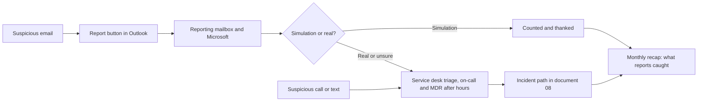

# 09. Security awareness and training

> **Reference work.** Fictional scenario built for a public portfolio. Not deployed in, derived from, or describing any employer environment. Not professional advice.

## Purpose and scope

This document sets out how Fabrikam (fictional) replaces a once-a-year training video with a learning program aimed at the places attacks land: payment and bank-detail requests, calls to the service desk, customer data in support cases, privileged accounts, and the code and secrets Engineering handles. It follows NIST SP 800-50 Rev. 1 and covers onboarding, short recurring modules, role-based tracks, phishing simulation with one Report button, and security champions, and it defines how KPI-14 and KPI-15 are produced. Every cadence, duration, and target here is a proposal to tune after discovery, as document [01](01-scenario-and-assumptions.md) states for the whole plan.

## Starting point and goals

Today, training is an annual video and no phishing simulation has ever run (assumption A-11). Most threats in the [threat profile](17-threat-profile.md) reach Fabrikam through people: business email compromise (BEC) against finance and HR (S-01), callers impersonating employees to the service desk (S-03), adversary-in-the-middle phishing (S-04), consent phishing (S-05), and spoofed Fabrikam mail sent to customers (S-09). Verizon's 2026 Data Breach Investigations Report found the human element in 62 percent of breaches and reports that, in phishing simulations, the median click rate through voice and text was 40 percent higher than through email. Microsoft reports that 93 percent of voice phishing attacks kept the victim on the line long enough to begin social engineering. The program therefore covers calls and texts, not only email.

Goals for year one:

1. Every new hire learns in the first week how to spot and report a lure, and how Fabrikam handles payment and data requests.
2. People who can move money, change bank details, reset accounts, or reach customer data get a track built for that job before they need it, starting with finance and payroll before the year-end peak.
3. Reporting becomes a habit: one Report button, fast feedback, and no blame.
4. Behavior is measured, not only attendance: report rate first and click rate second (KPI-15), with completion (KPI-14) as the floor.
5. The program stays small enough for a team of about five to run, with help from volunteer champions.

## How the program follows NIST SP 800-50 Rev. 1

NIST SP 800-50 Rev. 1, *Building a Cybersecurity and Privacy Learning Program* (September 2024), supersedes the 2003 guide. It treats awareness, training, and practical exercises as one learning program and shows "the key phases of building and managing a learning program: Plan and Strategy, Analysis and Design, Development and Implementation, and Assessment and Improvement," adding that "These phases can occur in sequence or simultaneously."

| NIST phase | What Fabrikam does | When |
|---|---|---|
| Plan and Strategy | A learning plan with goals, audiences, measures, and a calendar that keeps December and January light; training clauses in POL-02 and POL-14 | Phases 1 to 3, approved at M3 |
| Analysis and Design | Baseline from training records and HR job families; one track per high-risk role, built from documents 06, 08, and 17 and the payroll diversion playbook | Phases 1 and 2, refreshed at M7 |
| Development and Implementation | Onboarding module, monthly modules, role tracks, Report button, champions, then simulations | From Phase 2; simulations from Phase 4 |
| Assessment and Improvement | Monthly measures to the IT and Security Steering Group, a quarterly assessment report to the Quarterly Risk Review, and an annual review at M7 | From Phase 4 |

The publication sorts learners into three overlapping segments: all users, privileged access account holders, and staff with significant cybersecurity or privacy responsibilities. At Fabrikam the first segment is everyone with an account, including temporary and contract staff; the IT and service desk track serves the second; and the finance and payroll, People, Customer Support, Engineering, and executive tracks serve the third. NIST also names three kinds of elements (awareness activities, experiential learning and practical exercises, and training), and it is clear on tone: phishing exercises "should not be punitive, nor should any employee be called out for their response," and senior leaders get messaging that avoids harmful language such as calling users the weakest link.

## Governance and ownership

| Who | Part in the program |
|---|---|
| Director of IT and Security | Owns the program (the learning program manager role in NIST's guide): plan, content standards, measures (KPI-14 and KPI-15), simulation design and delivery, report triage, the champions network, the quarterly assessment report, and training evidence for the SOC 2 audit firm |
| VP of People (co-owner) | Onboarding, training records and reminders, the job-family data in the HR system of record that assigns tracks, the POL-14 clauses |
| General Counsel | Reviews simulation lures and rules before launch, as NIST advises for the legal team; privacy of results; the legal questions below |
| CFO, Chief Customer Officer, CTO with the Engineering Manager | Co-own the finance and payroll, Customer Support, and Engineering tracks |
| IT Operations Manager | Delivers the service desk and administrator track with document [13](13-it-service-management.md) |
| IT and Security Steering Group | The senior leadership committee NIST recommends: monthly program report and content priorities |
| Executive team and managers | The executive team approves POL-02, POL-14, and the budget at M3; managers make time for learning and never use simulation results for discipline |

## Onboarding

- **Day 1.** The new hire accepts POL-02 (Acceptable Use Policy) at first sign-in and registers a passkey, Windows Hello for Business, or the macOS platform credential, never SMS or voice (document [07](07-identity-lifecycle-joiners-movers-leavers.md)).
- **Week 1.** An onboarding module of about 30 minutes (proposal) with a short knowledge check, step W2 in the [joiner checklist](templates/joiner-mover-leaver-checklists.md):
  1. How to report: the Report button, the service desk phone line, and what happens after a report.
  2. Sign-in: passkeys, never approving a prompt nobody expected, and why IT never asks for a code.
  3. Money and data requests: no payment or bank-detail change from email, a call, a voice message, a chat message, or a video call alone; call back on a number already on file.
  4. Customer and employee data: where it may be stored and shared, and never in personal tools or loose attachments.
  5. AI use: approved tools and what never goes into them (POL-02 and document [16](16-ai-adoption-guardrails.md)).
  6. Devices: report a lost or stolen device the same day.
- **Within 30 days (proposal).** The role track for the person's job family, assigned from the HR system of record. For admin roles and for roles that reach customer data, the track comes before access, following NIST's example policy of role-based training before access to systems that process sensitive information. A move to a new job family assigns the new track (document 07).

## Recurring modules

Short monthly modules of 5 to 10 minutes (proposal) replace the annual video. Modules are assigned by job family from the HR system of record, and completion is kept with the People team's training records (action 09.01 confirms where those live); Microsoft's training content in Attack simulation training becomes an option once licensed. NIST names Cybersecurity Awareness Month (October) and Data Privacy Week (January) as seasonal hooks.

| Month | Topic | Why then |
|---|---|---|
| November 2026 | Meet the IT and security team; how to report today | Day 1 is 2026-11-02 |
| December 2026 | Payroll, bank-change, and benefits lures; the new Report button | Year-end payroll and open enrollment; button launch (09.05) |
| January 2027 | Register a passkey; never approve an unexpected prompt | Microsoft-provided SMS and voice MFA retire on 2027-02-01 (2027-07-01 for Global Administrators and external users); Data Privacy Week |
| February 2027 | Calls and texts that pretend to be IT | Second-wave enforcement in [ADR-004](adr/ADR-004-phishing-resistant-authentication-rollout.md); S-03 |
| March 2027 | Consent prompts and sharing links | "Anyone" links turned off (document 06, action 06.28); S-05 |
| April 2027 | Using AI at work | POL-02's AI section (document 16) |
| May 2027 | Fake sign-in pages and QR codes | The FBI's 2025 alert on fake self-service portals reached through search ads |
| June 2027 | Customer data in support cases | Support's secure exchange path (action 06.28) |
| July 2027 | Vendor invoices and payment urgency | Mid-year finance cycle |
| August 2027 | Lost devices and working away from home | A remote-first workforce |
| September 2027 | What reports caught this year | Recap before the year-end peak |
| October 2027 | Cybersecurity Awareness Month | Refreshers before year-end payroll |

## Role-based tracks

Technique IDs follow MITRE ATT&CK v20 (Enterprise), as in document 17. Cadences are proposals.

| Track | Who | Threats answered | When | Co-owner |
|---|---|---|---|---|
| Finance and payroll | Accounts payable, payroll, payment approvers | S-01, S-09; T1684.001 (Social Engineering: Impersonation), T1657 (Financial Theft) | Before mid-December 2026, then each May and October | CFO |
| People | People team | S-01, S-07 | Before mid-December 2026, then every six months | VP of People |
| Customer Support | Agents and leads with access to customer data | S-02, S-07, S-09; T1598.003 (Phishing for Information: Spearphishing Link) | Before access, then every six months | Chief Customer Officer |
| Engineering | Engineers, with more for production access | S-08; T1552.001 (Unsecured Credentials: Credentials In Files), T1213.003 (Data from Information Repositories: Code Repositories) | Within 30 days of joining, then yearly and after significant findings | CTO with the Engineering Manager |
| IT administrators and service desk | IT staff with admin roles; Service Desk Analyst | S-03, S-06; T1556.006 (Modify Authentication Process: Multi-Factor Authentication), T1098.003 (Account Manipulation: Additional Cloud Roles) | Before admin access; script briefing before early December 2026; then every six months | IT Operations Manager |
| Executives | Executive team and their assistants | S-01, S-04; T1566.004 (Phishing: Spearphishing Voice) | Briefing in February 2027, then twice a year | CEO |
| AI use | Everyone; more for Copilot pilot users | R-13 | Phase 4 once POL-02's AI section is approved; Phase 5 for the pilot | VP of People |

**Finance and payroll.** The track teaches the verification standard in the [payroll diversion playbook](playbooks/payroll-diversion-and-email-compromise.md): no bank-detail or payment change from email, a call, a voice message, a chat message, or a video call alone, because a familiar voice or face is not verification; a call back on a number already on file; two people for vendor bank changes; a confirmation to the previous contact; a short hold on new bank details unless the CFO approves; and, if money moved, the CFO's call to the bank and a report to the FBI's Internet Crime Complaint Center (IC3). The FBI's payroll diversion advice includes "Apply heightened scrutiny to bank information initiated by employees seeking to update or change direct deposit credentials." The FBI also warns that criminals "can use AI-generated audio to impersonate well-known, public figures or personal relations to elicit payments" and "generate videos for real time video chats with alleged company executives" (PSA I-120324-PSA, December 3, 2024). The first session runs before mid-December with the playbook desk check (action 08.05 in document [08](08-detection-and-incident-response.md)). A verification drill twice a year (proposal), designed with General Counsel and run with the CFO's knowledge, checks that a test request got a recorded call back.

**People.** People staff hold Social Security numbers, bank details, benefits and dependent data, and the Form I-9 records of Fabrikam's own employees. Employees change their own direct deposit in the HR system of record, and People staff never key a change from email. The federal rule for electronically stored Forms I-9 (8 CFR 274a.2(g)) expects a records security program that limits access, trains staff, and keeps a record of who accessed what (paraphrase), so the track covers who may open I-9 records. If General Counsel finds that Fabrikam acts as an E-Verify employer agent, the E-Verify memorandum's user training duties join the track. CISA's phishing-resistant MFA fact sheet names "HR staff, who may have access to personnel records" among high-value targets, and People is in ADR-004's second wave.

**Customer Support.** Customer data sometimes travels by email or sits in OneDrive during cases (assumption A-06). The track teaches the secure exchange path that document [06](06-microsoft-365-security-baseline.md) brings live in Phase 4 (action 06.28), and how to verify a requester before acting on a sensitive support request: call back through contacts already in the CRM, never through details in the request. Agents learn the pattern in the FBI's 2025 alert, criminals using search-engine ads to impersonate employee self-service websites, and its warning that "Multi-factor authentication will not protect you if you land on a fraudulent login page." A suspected compromise noticed during a support case goes straight to the incident path in document 08, with Engineering owning any product-side response. A caller's familiar voice is never verification on its own.

**Engineering.** SSDF 1.1 task PO.2.2 says to "Provide role-based training for all personnel with responsibilities that contribute to secure development." The Engineering Manager owns that content under POL-12 (Secure Development Policy); the Director adds code hosting accounts, secrets kept out of code and files, AI coding assistants under POL-02, AI provider keys treated as secrets, the product AI security requirements in document 16's AI security standard, and the product incident roles in document 08. The SSDF lists security champions among development roles, so Engineering's champions double as the program's champions. SSDF 1.2 (SP 800-218 Rev. 1) is still an initial public draft, so the track cites 1.1.

**IT administrators and service desk.** CISA's #StopRansomware Guide warns that "Ransomware actors have posed as company IT and/or helpdesk staff in phone calls or SMS messages to obtain credentials from employees," and the threat profile adds the reverse, attackers posing as employees to the help desk (S-03). The Service Desk Analyst learns the caller verification script in document 13 before ADR-004's second wave registers in early December, when reset and registration requests are expected to rise. Administrators complete the track before receiving an admin role, and once Microsoft Defender Suite brings PIM (action 06.25), admin role eligibility depends on a current track (proposal).

**Executives.** Attackers impersonate executives to rush payments and target them directly. The briefing covers voice pretexts, the Priority account tag and impersonation protection that document 06 applies to executives, and one commitment from each: never request a payment or bank change by email, text, chat, a call, or a video call alone, and back any employee who calls back to check. The [payroll diversion tabletop](templates/tabletop-payroll-diversion.md) in late February 2027 (action 08.09) is the practice.

**AI use.** The rules belong to POL-02 and document 16; this program teaches them: approved tools, data that never goes into a prompt, and checking outputs before relying on them. Copilot pilot users get a briefing before access (action 06.34). Because AI writes fluent lures, no module treats spelling mistakes as the main warning sign, and Copilot pilot users learn that an AI summary is never verification of a payment or access request.

## Phishing simulation

**Tool and license.** Microsoft's Attack simulation training "requires a Microsoft 365 E5 or Microsoft Defender for Office 365 Plan 2 license," and E3 gets only a trial with a Credential Harvest payload and two training experiences. Microsoft Defender Suite includes Defender for Office 365 Plan 2, so simulations start in Phase 4 if the executive team approves Defender Suite at M3 ([ADR-001](adr/ADR-001-microsoft-365-security-licensing.md)). If it chooses the fallback, the Director brings a costed simulation option to the next Quarterly Risk Review instead of buying a second tool by default.

**Rules of engagement**, approved with POL-14 at M3 after General Counsel's review:

- Everyone is told that simulations happen at random and that results guide learning, as NIST recommends.
- No discipline, no naming, and no rankings of individuals.
- A click leads to a short module through Microsoft's training experience, due 15 days after the simulation ends (proposal; the tool offers 7, 15, or 30 days after the simulation ends).
- People who report get a positive reinforcement notification, a built-in option.
- No lures that promise pay, bonuses, or benefits changes, and no real customer, partner, or bank names (proposal; NIST warns against using legitimate brands).
- No simulations from mid-December through January 31, or during Fabrikam's own benefits enrollment (proposal).
- Each lure is rated with the NIST Phish Scale, which SP 800-50 Rev. 1 points to, so results compare like with like.

**Cadence (proposal).** A baseline round in March 2027, then a round every two months for all staff, rotating techniques the tool supports (Credential Harvest, Link in Attachment, Malware Attachment, OAuth Consent Grant, and QR code payloads), with targeted rounds for finance, payroll, People, and executives in between. Calls and texts are practiced through the verification drills.

**Repeat clicks.** Microsoft's tool flags a "repeat offender" after consecutive compromises, two by default. Fabrikam treats the flag as a request for help: a 15-minute conversation with a champion or the Director of IT and Security, and a check that the person's sign-in method and mail settings protect them. A manager hears about it only after a third consecutive miss, and only to make time for coaching (proposal).

## The Report button and the reporting loop

Microsoft provides a built-in Report button in supported versions of Outlook on virtually all platforms for organizations with Exchange Online mailboxes, so it works on E3. Admins choose in the user reported settings whether reports go to a reporting mailbox, to Microsoft, or both. Fabrikam turns it on in Phase 2 with both (proposal) and removes other reporting add-ins, because Microsoft's simulation reports do not count messages reported through non-Microsoft tools.

The Service Desk Analyst triages reports on the Submissions page in business hours; after hours, the on-call handles anything touching a finance, payroll, People, or executive mailbox, joined once live by the managed detection and response (MDR) provider for incidents inside its scope (document 08). Each month the program shares what reports caught, with no names. Until simulations start, the monthly count of reported messages is the first measure of reporting culture.

## Security champions

Champions are volunteers, about one per department or team of 30 to 50 people, with 1 to 2 hours a month agreed by their managers (both proposals). They share the monthly module, answer first questions, test new content before release (NIST recommends learner testing), help colleagues through passkey registration, and report what confuses people. They are not enforcers and never see individual results. The Director runs the network, and the VP of People decides how champions are recognized, in line with NIST's advice to celebrate the people and teams who build the culture rather than penalize those who struggle.

## Measuring behavior

Document [12](12-metrics-and-executive-reporting.md) and [kpi-catalog.csv](../data/kpi-catalog.csv) hold the authoritative formulas and targets; this is how document 09 produces the data. Report rate comes first because a report lets the team act, and NIST's own example of a behavior-change metric is the share of people who received a phishing test email and reported it.

| Measure | Definition (proposal) | Source | Target (proposal) |
|---|---|---|---|
| KPI-14 Security training completion | Assigned items (onboarding, monthly modules, role tracks, post-simulation modules) completed by their due date, over items due in the period; measured monthly, with new-hire onboarding reported separately | The People team's training records; Attack simulation training reports | 95 percent by due date; new hires in their first week |
| KPI-15 report rate (first) | Users who reported the simulation with the Report button, over users who received it | Simulation report, "Users who reported" | By M7, against the first campaign at comparable difficulty: report rate up by at least half |
| KPI-15 click rate (second) | Users who clicked the payload link or opened the payload, over users who received it | Simulation report, with compromises recorded separately | By M7, against the first campaign at comparable difficulty: click rate down by at least half |
| Time to first report (supporting) | Minutes from delivery to the first report in a round | Report export: delivery and "Phishing Reported On" times | Falling |
| Drill pass rate (supporting) | Test requests verified by call back, and test calls verified with the script, over drills run | Drill records | 100 percent |
| Knowledge retention (supporting) | Check scores before, right after, and three months after a track, the timing NIST suggests | Training records | Rising |

The first campaign sets the KPI-15 baseline, and the M7 targets are confirmed after the second round. The four levels of the Kirkpatrick Model, which NIST uses, give the structure: Reaction (a two-question rating after each module), Learning (knowledge checks), Behavior (report rate, click rate, drills), and Results (fewer credential phishing and BEC incidents in KPI-17, and payment requests stopped by the call back).

Two cautions keep the numbers honest. NIST SP 800-55 Volume 1 warns that "A poorly designed phishing test might show a better success rate while giving less information about the preparedness of the workforce to recognize a well-designed phishing email," so rounds are compared only at similar difficulty. Microsoft notes that non-Microsoft filtering services or email forwarding can produce false clicks, so a click spike is checked before anyone is coached.

**Reporting.** Monthly measures go to the IT and Security Steering Group and an assessment report to each Quarterly Risk Review, as NIST suggests at the end of a campaign and regularly through the year. Document 12 decides whether KPI-14 and KPI-15 appear on the monthly executive scorecard.

**Privacy of results.** NIST notes that training records are often part of employment records and that learning data carries privacy risk. Individual results are visible to the person and the program team; managers see team totals, and their own people's results only for coaching after repeated misses. Department figures appear only for groups of 10 or more, and individual simulation results are kept for 12 months (both proposals, under POL-15).

## Policy hooks

- **POL-02 Acceptable Use Policy** (co-owner People): accepted at first sign-in; carries the AI use rules from document 16.
- **POL-14 Personnel Security Policy** (co-owner People): onboarding in week 1; role tracks before privileged or sensitive-data access; reminders to the manager at 7 days overdue and to the VP of People at 30 days (proposal); no discipline for simulation outcomes; privacy of results.
- **POL-12 Secure Development Policy** (Engineering owner): the Engineering track.
- **POL-08 Incident Response Policy**: incident duties in every role track, as NIST SP 800-61 Rev. 3 recommends: "Role-based training should include incident-related responsibilities."

Document [10](10-governance-and-compliance-program.md) holds the policy set, which the executive team approves at M3.

## Phase plan

| Phase | Action ID | Action | Outcome | KPI | Owner role | Workstream |
|---|---|---|---|---|---|---|
| Phase 1 | 09.01 | With the VP of People, find where training records are kept, baseline video completion, confirm no simulation has run (A-11), and list holders of finance, payroll, People, Support, admin, and executive roles | KPI-14 baseline and track audiences for M1 | KPI-14 | Director of IT and Security | WS-9 |
| Phase 1 | 09.02 | Draft the learning plan (goals, audiences, tracks, measures, calendar); send the November introduction module | Plan ready for M3; everyone knows how to report | KPI-14 | Director of IT and Security | WS-9 |
| Phase 2 | 09.03 | Before mid-December: finance and payroll session on the verification standard with the playbook desk check (08.05); People session on employee data | Payment, payroll, and People staff trained before the year-end peak (R-01) | KPI-14 | Director of IT and Security | WS-9 |
| Phase 2 | 09.04 | Before ADR-004's second wave registers in early December, brief the service desk on the caller verification script (document 13) | Resets issued only after verification (S-03) | KPI-14 | IT Operations Manager | WS-9 |
| Phase 2 | 09.05 | Turn on the built-in Report button (reporting mailbox and Microsoft), remove other reporting add-ins, set the triage path, send the December module | One reporting path; monthly report count starts | KPI-15 | Systems Engineer (Identity and Endpoint) | WS-9 |
| Phase 3 | 09.06 | January module on registering a passkey before 2027-02-01, with action 06.21; nothing else asked of finance and payroll | No one stranded by the SMS and voice retirement | KPI-08 | Service Desk Analyst | WS-9 |
| Phase 3 | 09.07 | Executive team approves POL-02 (with its AI section), the POL-14 training clauses and simulation rules reviewed by General Counsel, and the content build-or-buy choice (M3) | Approved policies and rules | KPI-02 | Director of IT and Security | WS-9 |
| Phase 3 | 09.08 | Recruit security champions; onboarding module live for new hires (joiner checklist step W2) | Champions named; new hires trained in week 1 | KPI-14 | Director of IT and Security | WS-9 |
| Phase 4 | 09.09 | February: with Defender Suite (ADR-001), configure Attack simulation training (target groups from HR data, notifications, due dates) and announce the program | Ready for the first round, staff told in advance | KPI-15 | Systems Engineer (Identity and Endpoint) | WS-9 |
| Phase 4 | 09.10 | February: administrators complete their track before PIM eligible assignments (06.25); executive briefing before the tabletop (08.09) | Admin access tied to a current track; executives prepared | KPI-14 | Director of IT and Security | WS-9 |
| Phase 4 | 09.11 | March: first baseline simulation, rated with the NIST Phish Scale | KPI-15 baseline | KPI-15 | Director of IT and Security | WS-9 |
| Phase 4 | 09.12 | March to April: People, Customer Support (with action 06.28), and Engineering (SSDF 1.1) tracks; AI use module after POL-02 approval | Every high-risk role has its track | KPI-14 | Director of IT and Security | WS-9 |
| Phase 4 | 09.13 | April: first quarterly assessment report to the Quarterly Risk Review | KPI-14 and KPI-15 values with actions | KPI-15 | Director of IT and Security | WS-9 |
| Phase 5 | 09.14 | Simulations every two months with targeted rounds; coaching for repeat clicks; monthly recap | Report rate rising, click rate falling | KPI-15 | Director of IT and Security | WS-9 |
| Phase 5 | 09.15 | Verification drills for finance and payroll and for the service desk in May and October, with actions tracked | Verification holds under pressure | KPI-18 | Director of IT and Security | WS-9 |
| Phase 5 | 09.16 | Train Copilot pilot users before access (action 06.34, document 16) | The pilot starts with trained users | KPI-14 | Director of IT and Security | WS-9 |
| Phase 5 | 09.17 | October 2027: Cybersecurity Awareness Month and the finance and payroll refresher; M7 review of content, cadences, and targets | A tuned program for year two | KPI-14 | Director of IT and Security | WS-9 |

## Resourcing and dependencies

- **Roles.** Director of IT and Security (owner: measures, reports, audit evidence, simulations, triage, champions); VP of People and the People team (delivery and records); IT Operations Manager and Service Desk Analyst (service desk track, triage); Systems Engineer (Identity and Endpoint) (Report button and Attack simulation training setup); the CFO, Chief Customer Officer, CTO, Engineering Manager, and General Counsel as track co-owners and reviewers; the champions.
- **Partners.** None required. The SOC 2 audit firm receives training and simulation evidence, and the MDR provider triages after-hours reports inside its scope once live (document 08, [ADR-003](adr/ADR-003-managed-detection-and-response.md)).
- **Licenses.** Phases 1 to 3: Exchange Online in Microsoft 365 E3 for the Report button, and the existing training records and HR job-family data for assignment and tracking. From Phase 4: Microsoft Defender for Office 365 Plan 2 through Microsoft Defender Suite (ADR-001) for Attack simulation training. No training content vendor is named.
- **Cost drivers.** Staff time first (about 10 minutes a month per person plus role tracks), then content creation or licensing and champions' time. Defender Suite is counted in ADR-001. Document [04](04-operating-model-team-and-budget.md) sizes the rest without figures.
- **Depends on.** Documents 01, 04, 06, 07, 08, 10, 12, 13, 16, and 17; ADR-001, ADR-003, and ADR-004; the payroll diversion playbook and tabletop template.

## Risks and open questions

- **Licensing.** Without Defender Suite there are no simulations and KPI-15 has no data; the report count and drills carry the behavior measures until a decision.
- **Year-end load.** December takes time from finance, payroll, and People at their busiest, so sessions stay short and January asks nothing new of them.
- **Trust.** Tricky lures, too many rounds, or any hint of discipline would hurt reporting, which matters more than clicks; the rules of engagement and General Counsel's review guard against it.
- **Measurement limits.** Rates swing with lure difficulty, false clicks, and small groups, so targets stay proposals until the second round confirms them.
- **Legal questions for General Counsel (analysis, not legal advice).** Whether state notice rules for employers that monitor employees' email or internet use, for example Delaware's (19 Del. C. section 705), reach simulation tracking; whether Fabrikam acts as an E-Verify employer agent; and whether California's cybersecurity audit regulations, which list security awareness and training among the areas an audit assesses, apply to Fabrikam.
- **Content and capacity.** Bought content may not fit Fabrikam's roles, so the role tracks are built in-house at a cost in staff time; champions drift without protected time and recognition.

## Framework mapping

By identifier only, consistent with the [crosswalk](crosswalk/csf2-soc2-crosswalk.md). This document supports:

| Theme | NIST CSF 2.0 | SOC 2 (2017 TSC) |
|---|---|---|
| Awareness and training for everyone | PR.AT-01 | CC1.4, CC2.2 |
| Role-based training for high-risk roles and privileged users | PR.AT-02 | CC1.4, CC2.2 |
| Training built into hiring, moves, and HR practice | GV.RR-04 | CC1.4 |
| Policies communicated and acknowledged (POL-02, POL-14) | GV.PO-01 | CC2.2, CC5.3 |
| Secure development training (the author's own mapping; SSDF 1.1 footnote 2 says its practices do not map to CSF Functions, Categories, or Subcategories, though it lists PR.AT from CSF 1.1, since superseded by CSF 2.0, as a reference for PO.2.2) | PR.AT-02, PR.PS-06 | CC1.4, CC8.1 |
| Measuring and improving the program | GV.OV-03, ID.IM-01 | CC4.1 |

## Sources

- Building a Cybersecurity and Privacy Learning Program (NIST SP 800-50 Rev. 1, September 2024), publication record. NIST. https://csrc.nist.gov/pubs/sp/800/50/r1/final . Checked 2026-10-13. Primary.
- NIST SP 800-50 Rev. 1 (PDF, read in full; Sections 1.3, 1.6.2, 2.2.1, 2.4, 2.5, 2.7, 2.11, 4.1.6, 5.2, and 6). NIST. https://nvlpubs.nist.gov/nistpubs/SpecialPublications/NIST.SP.800-50r1.pdf . Checked 2026-10-13. Primary.
- Measurement Guide for Information Security: Volume 1, Identifying and Selecting Measures (NIST SP 800-55 Vol. 1, December 2024). NIST. https://nvlpubs.nist.gov/nistpubs/SpecialPublications/NIST.SP.800-55v1.pdf . Checked 2026-10-13. Primary.
- Secure Software Development Framework (SSDF) Version 1.1 (NIST SP 800-218, February 2022; tasks PO.2.1 and PO.2.2, the PO.2.2 references, and footnote 2). NIST. https://nvlpubs.nist.gov/nistpubs/SpecialPublications/NIST.SP.800-218.pdf . Checked 2026-10-14. Primary.
- SSDF Version 1.2 (NIST SP 800-218 Rev. 1, initial public draft), publication record. NIST. https://csrc.nist.gov/pubs/sp/800/218/r1/ipd . Checked 2026-10-13. Primary.
- Incident Response Recommendations and Considerations for Cybersecurity Risk Management: A CSF 2.0 Community Profile (NIST SP 800-61 Rev. 3, April 2025). NIST. https://nvlpubs.nist.gov/nistpubs/SpecialPublications/NIST.SP.800-61r3.pdf . Checked 2026-10-13. Primary.
- The NIST Cybersecurity Framework (CSF) 2.0 (CSWP 29). NIST. https://nvlpubs.nist.gov/nistpubs/CSWP/NIST.CSWP.29.pdf . Checked 2026-10-13. Primary.
- Frequently Asked Questions (NIST Cybersecurity Framework; section "Transitioning from CSF v1.1 to CSF v2.0": the "major update to CSF 2.0" and the "withdrawn CSF v1.1 identifiers", the basis for "since superseded"; NIST keeps CSF 1.1 in its CSF 1.1 Archive). NIST. https://www.nist.gov/cyberframework/faqs . Checked 2026-10-14. Primary.
- MITRE ATT&CK, Enterprise matrix, v20 (versions list and the technique pages cited). MITRE. https://attack.mitre.org/resources/versions/ . Checked 2026-10-13. Primary.
- Get started using Attack simulation training. Microsoft Learn. https://learn.microsoft.com/en-us/defender-office-365/attack-simulation-training-get-started . Checked 2026-10-13. Primary.
- Reports for Attack simulation training. Microsoft Learn. https://learn.microsoft.com/en-us/defender-office-365/attack-simulation-training-insights . Checked 2026-10-13. Primary.
- Simulate a phishing attack with Attack simulation training. Microsoft Learn. https://learn.microsoft.com/en-us/defender-office-365/attack-simulation-training-simulations . Checked 2026-10-13. Primary.
- Report phishing and suspicious emails in Outlook for admins. Microsoft Learn. https://learn.microsoft.com/en-us/defender-office-365/submissions-outlook-report-messages . Checked 2026-10-13. Primary.
- Security Suites (Microsoft Licensing guidance; Microsoft Defender Suite, previously Microsoft 365 E5 Security). Microsoft. https://www.microsoft.com/licensing/guidance/Security-Suites . Checked 2026-10-13. Primary.
- Passkeys by default and retirement of Microsoft-provided SMS and voice authentication. Microsoft Learn. https://learn.microsoft.com/en-us/entra/identity/authentication/concept-sms-voice-retirement . Checked 2026-10-13. Primary.
- Cybercriminals Utilize Social Engineering Techniques To Obtain Employee Credentials To Conduct Payroll Diversion (Alert I-091818-PSA, September 18, 2018). FBI IC3. https://www.ic3.gov/PSA/2018/PSA180918 . Checked 2026-10-13. Primary.
- Cyber Criminals Impersonating Employee Self-Service Websites to Steal Victim Information and Funds (Alert I-042425-PSA, April 24, 2025). FBI IC3. https://www.ic3.gov/PSA/2025/PSA250424 . Checked 2026-10-13. Primary.
- Criminals Use Generative Artificial Intelligence to Facilitate Financial Fraud (Alert I-120324-PSA, December 3, 2024). FBI IC3. https://www.ic3.gov/PSA/2024/PSA241203 . Checked 2026-10-14. Primary.
- #StopRansomware Guide (version 3.0, October 2023). CISA, MS-ISAC, NSA, FBI. https://www.cisa.gov/resources-tools/resources/stopransomware-guide . Checked 2026-10-13. Primary.
- Implementing Phishing-Resistant MFA (fact sheet, October 2022). CISA. https://www.cisa.gov/sites/default/files/publications/fact-sheet-implementing-phishing-resistant-mfa-508c.pdf . Checked 2026-10-13. Primary.
- 2026 Data Breach Investigations Report, Executive Summary. Verizon Business. https://www.verizon.com/business/resources/executivebriefs/2026-dbir-executive-summary.pdf . Checked 2026-10-13. Primary (vendor research; primary for what Verizon reports).
- 2026 Microsoft Digital Defense Report, Executive Summary. Microsoft. https://cdn-dynmedia-1.microsoft.com/is/content/microsoftcorp/microsoft/msc/documents/presentations/CSR/2026-Microsoft-DDR-Exec-Summary.pdf . Checked 2026-10-13. Primary (vendor research; primary for what Microsoft reports).
- 8 CFR 274a.2, Verification of identity and employment authorization (eCFR, as of 2026-10-01). Office of the Federal Register. https://www.ecfr.gov/api/versioner/v1/full/2026-10-01/title-8.xml?part=274a&section=274a.2 . Checked 2026-10-13. Primary.
- The E-Verify Memorandum of Understanding for Employer Agents (Revision Date 06/01/2013; newest revision found, recheck before relying on it). DHS, USCIS E-Verify program. https://www.e-verify.gov/sites/default/files/everify/memos/MOUforEVerifyEmployerAgents.pdf . Checked 2026-10-13. Primary.
- Delaware Code, Title 19, Chapter 7, section 705. State of Delaware. https://delcode.delaware.gov/title19/c007/sc01/index.html . Checked 2026-10-13. Primary.
- Text of approved regulations: CCPA updates, cybersecurity audits, risk assessments, and automated decisionmaking technology. California Privacy Protection Agency. https://cppa.ca.gov/regulations/pdf/ccpa_updates_cyber_risk_admt_appr_text.pdf . Checked 2026-10-13. Primary.
