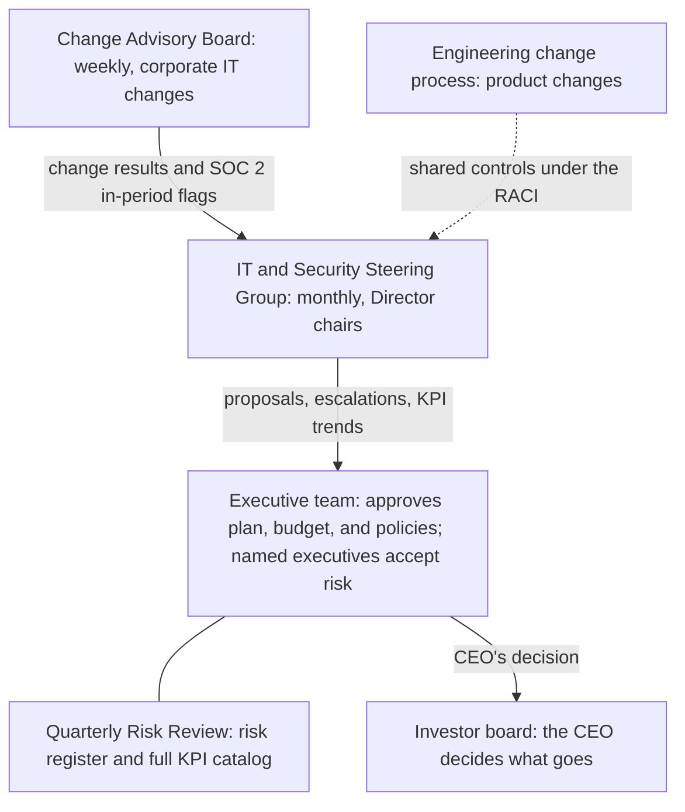
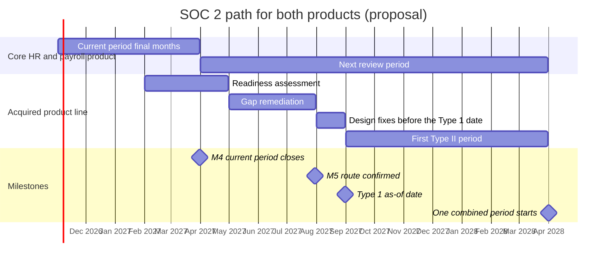

# 10. Governance and compliance program

> **Reference work.** Fictional scenario built for a public portfolio. Not deployed in, derived from, or describing any employer environment. Not professional advice.

## Purpose and scope

This document sets how Fabrikam (fictional) governs IT and security: who proposes and who decides, how the NIST Cybersecurity Framework (CSF) 2.0 current and target Organizational Profiles are built, and how the SOC 2 program protects the review period in progress and brings the acquired product line into scope. It also sets the policy set POL-01 to POL-15, third-party risk management, privacy coordination with the General Counsel, and the process for customer assurance requests. The risk method and register are in document [11](11-risk-management.md), KPI definitions and reporting in document [12](12-metrics-and-executive-reporting.md), and the framework relationships in the [CSF 2.0 and SOC 2 crosswalk](crosswalk/csf2-soc2-crosswalk.md). Reference tables, including the phase plan by action, are in the appendices.

## 1. Governance model

The Director of IT and Security proposes the plan, the budget, and the policies, owns execution, and is accountable for the program. The executive team approves the plan, the budget, and policies. Named executives own business risks and decide whether to accept them; the Director never accepts risk on Fabrikam's behalf. Document [04](04-operating-model-team-and-budget.md) describes the team and the RACI with Engineering. In the base case the GRC Analyst starts in March 2027, after the executive team approves the budget at M3 (Thursday 2027-01-28); until then the Director, with the outside audit-readiness consultant, covers that role's duties in this document.

Four forums carry the decisions (Appendix: Governance and Profile tables gives members, cadences, a diagram, and the full decision rights table): the executive team; the Quarterly Risk Review of the risk register and the full KPI catalog in January 2027 (with M3), April, July (M5), and October (M7); the monthly IT and Security Steering Group, which the Director chairs from November 2026; and the weekly Change Advisory Board, which flags corporate IT changes that touch a control the SOC 2 audit firm is testing. The executive team decides the plan, the budget, the Target Profile, policies, SOC 2 scope, and any risk above appetite; the named risk owner accepts risk within appetite and decides time-bound policy exceptions (document 11); a change to a tested control waits for the audit firm's agreement; and the CEO decides what reaches the investor board. Conflicts the Steering Group cannot settle go to the executive team with options and a recommendation; urgent risk decisions between meetings go to the named risk owner and the CTO the same day.

## 2. NIST CSF 2.0 Organizational Profiles

CSF 2.0 has three parts: the Core (a taxonomy of outcomes), Organizational Profiles, and Tiers. NIST defines the two kinds of Organizational Profile: "A Current Profile specifies the Core outcomes that an organization is currently achieving (or attempting to achieve) and characterizes how or to what extent each outcome is being achieved," and "A Target Profile specifies the desired outcomes that an organization has selected and prioritized for achieving its cybersecurity risk management objectives." Fabrikam chose CSF 2.0 as its hub framework but has no Profile yet. The Director builds both with NIST's five steps: scope the Profile and gather its evidence in Phase 1 (10.06); draft the Current Profile in Phase 2 at Category level, the 22 CSF 2.0 Categories (10.07); build the Target Profile and gap action plan at the same level in Phase 3 (10.13), linking each gap to a plan action, a risk (R-01 to R-15), and a KPI; and review gap status at each Quarterly Risk Review, with Subcategory detail added by M7, when the Current Profile is reassessed (10.28). Both go to the executive team at M3: the Current Profile records where Fabrikam stands, and the Target Profile is the decision. Appendix: Governance and Profile tables details each step and the Categories expected to show the largest gaps, from the day-1 assumptions in document [01](01-scenario-and-assumptions.md).

Status is qualitative, so the Profile carries no single score and the KPIs (document 12) measure progress; Tiers inform one line of the Profile's executive summary, with Repeatable (Tier 3) proposed for Govern by the end of year two. Every control in the SOC 2 control list carries its CSF 2.0 Subcategories from the crosswalk, so one piece of evidence serves both frameworks. The appendix gives the status scale, the Tier reasoning, and how a Community Profile and supplier expectations feed the Target Profile.

## 3. SOC 2 program

### 3.1 Starting point

Fabrikam holds a SOC 2 Type II report on the core HR and payroll product for the Security, Availability, and Confidentiality categories. The current review period ends on 2027-03-31, month 5 of the Director's tenure (M4). An acquired product line is outside the report, and enterprise customers ask for it (R-11). Evidence is gathered by hand near audit time, control owners are unclear, and a finance manager coordinates SOC 2 part time with an outside audit-readiness consultant (A-10). For Security alone the applicable criteria are the common criteria CC1.1 to CC9.2; Availability adds A1.1 to A1.3 and Confidentiality adds C1.1 to C1.2. AICPA's guide calls the two report types type 1 (design as of a point in time) and type 2 (design and operating effectiveness over a period); this plan writes Type 1 and Type II.

### 3.2 Protecting the current period (to M4)

1. **Owners first, and an exception forecast.** Every control in the current report gets a named owner role, an evidence source, and a frequency in Phase 1 (10.01). With the readiness consultant, the Director also forecasts exceptions inherited from before day 1: controls the system description promises that did not operate, and which of them can still operate correctly before March 31. Management responses are drafted in Phase 3 (10.16), and the CFO and the Sales leader are briefed before the report issues (10.25). M4 counts only new exceptions caused by the Director's changes, so the report may still carry inherited ones.
2. **No surprise changes.** No change that would break evidence for the current period happens without the audit firm's agreement. A change that touches an in-scope control carries a SOC 2 flag in its Change Advisory Board record; the GRC Analyst (until that role starts, March 2027 in the base case, the Director with the finance manager) describes it to the audit firm, and it proceeds once the firm agrees it will not disrupt testing or says how it will test both versions. Evidence for the old and the new control is kept.
3. **Urgent fixes, disclosed.** The urgent Phase 1 risk reductions (emergency access accounts, multifactor authentication (MFA) on every administrator, alert routing, and confirming that critical data can be recovered) are prepared and described to the audit firm in week 1 (05.01), applied at the first Change Advisory Board in week 2, and recorded as dated changes. Emergency changes follow document 13's emergency path; the week-1 sample restore (14.01) is the one exception and runs in week 1.
4. **Redesigns at the boundary.** Redesigned controls start with the next period on 2027-04-01 where possible, so each period tests one design: HR-driven identity lifecycle as the control of record (07.14), managed detection and response (MDR) monitoring (08.10), and platform-collected evidence ([ADR-007](adr/ADR-007-compliance-automation-platform.md)).
5. **Policies mid-period.** The policy set is approved at M3, inside the period; new versions carry effective dates, and prior versions stay on file so the audit firm can test what applied when.

### 3.3 Evidence calendar to the period end

The current report's control list sets the final items; Appendix: SOC 2 program detail gives the proposed month-by-month calendar. Complete populations (joiners, leavers, access changes, corporate IT changes, incidents) are exported monthly from the systems of record, fourth-quarter controls finish before the mid-December freeze where possible, the period closes on March 31 with management's written assertion (10.21), and bridge letters go out on request from April 1.

### 3.4 Control ownership by role

Appendix: SOC 2 program detail maps each control area to its criteria, owner role, evidence, and plan document. Most corporate controls sit with the IT Operations Manager and the Systems Engineer (Identity and Endpoint), product controls with the Engineering Manager and the SRE lead, data center controls with the carved-out cloud provider (section 3.9), and governance, risk, monitoring, and vendor controls with the Director and the GRC Analyst. Until the Security Engineer and the GRC Analyst start (March 2027 in the base case; document 04), the Director covers their control ownership.

### 3.5 Evidence

Evidence follows these rules (proposals), whatever tool holds it. It comes from the system that runs the control (Entra audit records, IT service management (ITSM) tickets, workflow history, and code review approvals), not from screenshots assembled months later. All joiners, leavers, changes, and incidents for a period are exported from the system of record, so completeness can be shown, and samples come from those populations. Each control in the list has an owner role, an evidence source, a frequency, and a retention period, and evidence is kept for at least the current and previous review periods, longer where General Counsel or a contract requires it. Customer workforce data is never copied into evidence; where a record contains it, the evidence points to the record instead. Microsoft Secure Score is a tracking input, not audit evidence (document [06](06-microsoft-365-security-baseline.md)). From the period starting 2027-04-01, a compliance automation platform collects evidence and runs scheduled control tests ([ADR-007](adr/ADR-007-compliance-automation-platform.md)); until then the current method continues, so no evidence moves mid-period.

### 3.6 The audit firm relationship

The Director owns the relationship; the GRC Analyst becomes the day-to-day contact on starting (March 2027 in the base case), and the finance manager supports through M4. Management prepares the system description and a written assertion, proposed to be signed by the CTO and the CEO with General Counsel confirming. The firm tests but does not design or run Fabrikam's controls, and it is asked to disclose any arrangement with the platform chosen under ADR-007. Appendix: SOC 2 program detail sets the meeting rhythm, the independence reasoning, what the firm is told promptly, and the fit review at M7.

### 3.7 Report distribution and bridge letters

Because AICPA's SOC 2 guide restricts the report to specified parties who understand the system and treats a SOC 3 report as the general-use version (paraphrased in Appendix: SOC 2 program detail), Fabrikam shares the SOC 2 report only with customers and prospects covered by a non-disclosure agreement (NDA) or a contract confidentiality clause, through the request process in section 7, and logs each release. A SOC 3 report issued alongside the SOC 2 is an option to discuss with the audit firm at M7 for prospects early in a sale; it is not proposed for year one.

**Bridge letters.** Between the end of a review period and the next report, customers ask whether anything has changed. Fabrikam answers with a bridge letter signed by its management, not by the audit firm. No AICPA definition or template for bridge letters was found for this plan, and a CPA firm describes them as a service organization's letter giving interim, unverified assurance, so the wording stays factual and narrow. General Counsel approves the template in Phase 2 (10.11), and Appendix: SOC 2 program detail lists its contents. Fabrikam assumes no maximum period for a bridge letter; each customer's own policy decides how long it accepts one.

### 3.8 Complementary user entity controls

AICPA's guide lists complementary user entity controls (CUECs) and complementary subservice organization controls (CSOCs), and how they work with the service organization's own controls, among the knowledge report readers are expected to have. In this plan a CUEC is a control Fabrikam's system design assumes each customer operates, and a CSOC is a control it assumes a subservice organization, such as the cloud provider or the banking partner, operates. That is a working meaning; AICPA's formal definitions were not read for this plan.

The current report already lists CUECs; in Phase 2 the Director compares them with the proposal in Appendix: SOC 2 program detail, which runs from customers' administrator roles and bank-detail change checks to the shared phones and tablets customers buy and manage at their work sites, and agrees changes for the next period with the Chief Customer Officer and the Chief Product Officer. CUECs appear in the system description, the customer admin guide, and customer onboarding, and the Chief Customer Officer owns how they are communicated. Where a product default can make a CUEC unnecessary (for example, MFA required for customer administrators by default), the default is the better control, and the Director raises it with the Chief Product Officer.

### 3.9 Subservice organizations: the cloud provider and the banking partner

AICPA's guide describes two ways to treat a subservice organization: include its services and controls in the description (inclusive method), or exclude them (carve-out method). Fabrikam has two known subservice organizations. It presents the cloud provider that hosts its product as carved out, and Phase 1 confirms that the current report does the same; Appendix: SOC 2 program detail lists the controls the report assumes the provider runs and the yearly review of its SOC 2 Type II report. Discovery also confirms whether other parties belong in the description, for example a partner that prints and mails tax forms for customers.

**The banking partner.** Payroll and tax funds move through a banking partner, which is a subservice organization for SOC purposes (document [01](01-scenario-and-assumptions.md)). Phase 1 confirms how the current report presents it (inclusive or carve-out method), which of its controls the report relies on as CSOCs, and whether its own assurance reports cover the services Fabrikam uses (10.01). Its yearly review follows the same steps, led by the GRC Analyst with the CFO's team. Because payroll funds move through it, it is a main input to the M7 decision on a SOC 1 report or the Processing Integrity category (section 3.11).

### 3.10 Bringing the acquired product line into scope (M5)

The proposed route is a Type 1 report on controls as of 2027-08-31, issued in the second half of 2027, then a Type II period to 2028-03-31; the executive team confirms it at M5. Appendix: SOC 2 program detail compares it with three other routes and charts the dates. It reaches the same Type II date as adding the product to the core product's next period in April 2027, adds an independent report on design in 2027, and keeps any early exceptions out of the core product's opinion. AICPA's guide also says a service auditor is engaged for either a type 1 or a type 2 examination and cannot give a design-only opinion on some controls and an operating-effectiveness opinion on others in one engagement, so the new product's design-stage report has to be its own engagement.

1. **Readiness, February to April 2027 (Phase 4; 10.19 with 05.14):** boundary, data flows, shared and product-specific controls, subservice organizations and CUECs, and gaps with owners.
2. **Remediation to M5 (May to July 2027):** Engineering and the IT team close the gaps, the GRC Analyst retests, and at M5 the executive team confirms the route (10.23).
3. **Type 1 as of 2027-08-31 (10.24),** shared under NDA through the request process once issued.
4. **First Type II period, 2027-09-01 to 2028-03-31,** seven months if the audit firm agrees this gives enough evidence.
5. **From 2028-04-01, one period for both products,** and one system description if the audit firm agrees the combined boundary is coherent.

The Director proposes the route at M5 with two inputs from the Sales leader and the Chief Customer Officer: which waiting deals accept a Type 1, and how much business is waiting. The executive team confirms it, including the added audit cost in the budget; the CTO and the Chief Product Officer commit Engineering time; the Chief Customer Officer owns what customers are told. If readiness shows the product's controls already operate well, the executive team can skip the Type 1 and start the Type II period sooner; the recommendation stays Type 1 first because it surfaces design problems before the operating period starts.

### 3.11 Processing Integrity, Privacy, or a SOC 1 later

Year one keeps Security, Availability, and Confidentiality for both products. Three additions are possible later: Processing Integrity (PI1.1 to PI1.5), a SOC 1 report, and Privacy (P1.1 to P8.1), compared in Appendix: SOC 2 program detail. The CTO, the Chief Product Officer, and the General Counsel recommend, with the CFO on cost, using the assurance request log (section 7) as evidence of demand; the executive team decides at M7 (10.27), because a change of report scope and its audit cost are its decisions (section 1). Proposal: decide on Processing Integrity or a SOC 1 at M7 from the evidence in the log, with readiness in year two if approved, and do not add Privacy unless General Counsel's position or customer contracts call for it.

## 4. Policy set (POL-01 to POL-15)

Policies are short statements of requirement: purpose, scope, roles, requirements, exceptions (through document 11's exception process), enforcement, the yearly owner review and the rewrite cycle, and version history. Standards and procedures live in the depth documents (06, 07, 08, 13, 14, 15, 16), so a procedure can change without a policy approval. The AI security standard under POL-01 (document [16](16-ai-adoption-guardrails.md)) is approved with the policy set; it sets how POL-01's requirements apply to AI tools, their connections to Fabrikam's systems, and AI features in the product. It adds no policy ID, so the set stays POL-01 to POL-15; the Director drafts it in Phase 3 (16.16), the executive team approves it in the same M3 consent item, and it is reviewed six months after approval and again at M7 with POL-02's AI section (16.15). The readiness consultant redrafts the whole set in Phase 2 for the Director's review; co-owners and the Steering Group clear it in January, and the executive team approves it at M3 as one consent item. POL-02 is accepted at first sign-in (document [07](07-identity-lifecycle-joiners-movers-leavers.md)) and again with training (document 09); the others are published on the intranet with change notices to the roles they affect. Every policy gets a yearly owner review with a recorded sign-off, and substantive rewrites follow the cycle in the policy table. Those rewrite cycles are proposals and differ on purpose; each is written into the policy itself, because the audit firm tests the cycle the policy states. Appendix: Policy set gives each policy's owners, approver, rewrite cycle and its reason, and primary SOC 2 criteria and CSF 2.0 Categories.

## 5. Third-party risk management (POL-10)

**Intake.** Every new vendor, SaaS tool, integration partner, staffing or consulting firm, and AI tool enters through one intake form in the ITSM tool before a contract is signed or a card is charged, and Finance pays a new vendor only when an intake record exists, which turns the accounts payable step into the control. The intake records the business owner and purpose, the data the vendor will hold or reach (by POL-05 class), how it connects (user accounts, API integration, file transfer), what happens to payroll or customer service if it fails, whether it becomes a subprocessor of customer data (customer contracts may require notice, checked against the clause inventory in document 08), and whether it duplicates a tool Fabrikam already has (document 15). AI tools also follow the approval path in document 16 and the vendor terms in its AI security standard. The first inventory comes from accounts payable, contracts, and the application inventory (10.04, with 05.08).

**Due diligence in proportion.** Two questions set the depth of review: what data the vendor can reach, and how much Fabrikam or its customers would be hurt if it failed. Vendors that hold or can reach customer workforce data (Social Security numbers, bank details, Form I-9 and E-Verify data, background check results, location data), and vendors a payroll run depends on, such as the cloud provider, background screening partners, and the MDR provider with its privileged access, get the full review, and the Director and General Counsel sign off before data flows. A tool that touches no personal or confidential data, and whose loss would be an inconvenience, needs only single sign-on, MFA, data export, and standard terms, signed off by the business owner and the GRC Analyst. Between the two, the GRC Analyst scales the review to the data and the dependency and writes one or two sentences in the vendor record explaining the depth chosen; that written reason, not a label, is what the audit firm and the Steering Group see. Appendix: Third-party review detail sets out the full review, the contract clauses General Counsel approves in Phase 3 (10.17), and how vendors' SOC reports and CUECs are read.

**Monitoring and offboarding.** Third parties with customer or employee data are reviewed at least every 12 months and after a material change; others at renewal. At exit, access is revoked and data is returned or its deletion confirmed in writing, and a third party stays in the KPI-05 population until that is done, so an unfinished exit counts against the KPI (Appendix: Third-party review detail).

**Roles.** The GRC Analyst runs the program; the business owner owns the relationship; the CFO's team gates payment; General Counsel owns contract terms; the Director signs off security for third parties with customer data; the Engineering Manager is consulted for product subprocessors. NIST SP 800-161 Rev. 1 and the CSF 2.0 supply chain Quick-Start Guide (SP 1305) are the reference depth for this work.

## 6. Privacy coordination with the General Counsel

The General Counsel owns privacy (POL-15) and every legal reading; the Director owns the security controls that carry privacy commitments, the data inventories, and the evidence. Privacy is a standing item at a monthly working session of the General Counsel, the Director, and a Product delegate (proposal), not a new forum, and open questions sit in the legal questions log started with the contract clause inventory (08.04, extended in 10.05). Fabrikam holds customer workforce data as a service provider to the employers who are its customers, and its own employees' data as their employer; many duties differ between the two roles, so each question asks which role applies. Nothing here is legal advice: the plan names questions for the General Counsel and does not answer them. For each topic below, Appendix: Privacy and legal readings gives the readings as of 2026-10-13, the full questions, and the interim position.

### 6.1 The CCPA and the regulations effective 2026-01-01

The questions are Fabrikam's role under the California Consumer Privacy Act (CCPA) for its own and its customers' workforce data, and whether any product AI feature or internal HR tool is automated decisionmaking technology (ADMT) for a significant decision. The ADMT question is answered in Phase 2, before the 2027-01-01 compliance date (10.12).

### 6.2 Proposed voice verification and biometric laws

Product has proposed voice verification for customers' administrators who call Fabrikam's support line. The proposal is held at the privacy review gate (section 6.7) and is not live; nothing is built before the gate decides, and the Chief Product Officer owns the product decision. The questions are how state biometric laws treat a voiceprint, and whether Fabrikam would collect voiceprints in its own right, as the operator of its support line, rather than as a service provider.

### 6.3 Location data and electronic monitoring notices

The questions are what the product must support for the notices customers give their workers, and which notice duties Fabrikam's own offices create. Meanwhile, clock-in location is classified as restricted data under POL-05, with short retention under POL-15.

### 6.4 Electronic Form I-9 and E-Verify (product requirements)

The question is whether Fabrikam is an E-Verify employer agent. Meanwhile, the federal rules for electronic Form I-9 records are treated as product requirements for the I-9 module.

### 6.5 Background screening partners and the FCRA

The question is whether any planned feature would make Fabrikam a consumer reporting agency under the Fair Credit Reporting Act (FCRA). Meanwhile, screening partners get the full third-party review (section 5), and results are restricted data.

### 6.6 The Federal Trade Commission (FTC) Safeguards Rule (an open question)

The question is whether Fabrikam is a financial institution under the rule, and which partner contracts flow its duties down; the IRS e-file question in section 6.8 may settle it. The plan assumes no answer either way, and document 08 keeps the possible FTC clock in its notification decision path.

### 6.7 Privacy and security review gate for product changes

Product changes that add a category of personal data, a new use of data (including AI features and automated decisions), biometrics, a new use of location, or new sharing with partners get a short review by the General Counsel, the Director, and a delegate of the Chief Product Officer before they are built (proposal: a decision within ten business days). The Chief Product Officer owns the gate inside the product process; AI features also follow the product AI security requirements in document 16's AI security standard and its launch checklist (16.17).

### 6.8 Payroll-specific obligations (open questions)

Three regimes may apply to a payroll and benefits provider, and each is an open question with an interim position only: the Automated Clearing House (ACH) network's operating rules, set by Nacha, if Fabrikam sends payroll entries for customers; the Health Insurance Portability and Accountability Act (HIPAA), if benefits enrollment data and carrier feeds make Fabrikam a business associate of customers' group health plans; and Internal Revenue Service (IRS) e-file duties, if Fabrikam files employment tax returns as a reporting agent. Document 08 carries their notice clocks as open questions, and document [11](11-risk-management.md) links the ACH fraud-monitoring rule to the R-01 and R-02 treatments.

## 7. Customer assurance requests

Customer and prospect requests for security information go through one process with Sales and Legal, built around the SOC 2 report under NDA (each step is in Appendix: SOC 2 program detail). Sales or Customer Success logs the request; General Counsel's team confirms confidentiality terms; the GRC Analyst releases the report, with a bridge letter after the period end, within two business days of a confirmed NDA, and answers questionnaires from the SOC 2 report and the published policies within ten business days, with the Director approving (service levels are proposals). Security terms beyond Fabrikam's standard terms need General Counsel and the Director to agree before signature and join the contract clause inventory (document 08). Until the acquired product line has its own report, the answer is plain: it is outside the current report's scope; here are the route and the dates confirmed at M5; the Type 1 report follows when issued. The request log shows volume by product and topic, an input to the decision in section 3.11 and to R-11.

## 8. KPIs this document owns

Document 12 and the [KPI catalog](../data/kpi-catalog.csv) are the single authority for definitions, data sources, and targets; the targets below repeat the catalog's wording. Until the GRC Analyst starts (March 2027 in the base case), the Director holds that role's KPIs.

| KPI | Target (proposal) | Owner role |
|---|---|---|
| KPI-01 Top risks with an owner and an approved treatment plan (%) | Every top risk has a named owner by M2; 100 percent by M3 and every month after | Director of IT and Security |
| KPI-02 Policies reviewed within their cycle (%) | 100 percent from M3, when the executive team approves the policy set; no policy overdue by more than 30 days | GRC Analyst |
| KPI-03 SOC 2 controls operating without exceptions (%) | No new exceptions caused by the Director's changes in the review period closing at M4 (end of March 2027); management testing at 95 percent or better from Phase 4 and 98 percent by M7 | GRC Analyst |
| KPI-04 Open audit exceptions and their median age | Every exception has an owner and a committed remediation date within 10 business days of being raised; median age under 60 days from Phase 4; none open past its committed date | GRC Analyst |
| KPI-05 Third parties handling customer or employee data with a current review (%) | 100 percent of third parties with customer data access by month 9 (July 2027); 90 percent of all in-scope third parties by M7 | GRC Analyst |

## Phase plan

Summary by phase and owner role; every action, 10.01 to 10.28, is in Appendix: Phase plan by action.

| Phase | Action ID | Action | Outcome | KPI | Owner role | Workstream |
|---|---|---|---|---|---|---|
| Phase 1 | 10.01 to 10.06 | Control owners, exception forecast, evidence calendar, change rules, forums, vendor inventory, legal questions log, Profile scope | Current period protected; forums running | KPI-01, KPI-03, KPI-05 | Director of IT and Security | WS-5 |
| Phase 2 | 10.07 to 10.12 | Category-level Current Profile, policy redraft, December and January evidence, vendor reviews, assurance process, ADMT position | Current period on track at M2 | KPI-01, KPI-02, KPI-03, KPI-05 | Director of IT and Security | WS-5 |
| Phase 3 | 10.13 to 10.17 | Target Profile, policy approval with the AI security standard, platform evaluation, SOC 2 coordination and draft management responses, contract templates | Profiles and policies approved at M3 | KPI-01, KPI-02, KPI-03, KPI-05 | Director of IT and Security | WS-5 |
| Phase 4 | 10.18, 10.19, 10.21 | Next-period planning, acquired product line readiness, KPI-01 to KPI-05 reported at the Day 120 readout (end of February 2027), period close | Next period planned before D120; readiness findings by the end of April; M4 met | KPI-03, KPI-04 | Director of IT and Security (10.19 with the readiness consultant) | WS-5 |
| Phase 4 | 10.20, 10.22 | Platform connection, wider vendor reviews | Platform live from 2027-04-01; KPI-05 coverage rising | KPI-03, KPI-05 | Director of IT and Security, then the GRC Analyst (10.20); GRC Analyst (10.22) | WS-5 |
| Phase 5 | 10.23, 10.26, 10.27 | Route confirmed at M5, privacy conclusions, year-two report scope | M5 met; year-two scope decided | KPI-02, KPI-03 | Director of IT and Security | WS-5 |
| Phase 5 | 10.24, 10.25, 10.28 | Type 1 examination, management responses, M7 Profile reassessment | First independent report on the acquired product line; inputs to M7 | KPI-01, KPI-02, KPI-03, KPI-04 | GRC Analyst | WS-5 |

## Resourcing and dependencies

- **Roles, Phases 1 to 3.** The Director of IT and Security carries most governance and compliance work with the finance manager who coordinates SOC 2 and the outside audit-readiness consultant, who drafts the policy set and the evidence calendar for the Director's review; the Director takes over SOC 2 coordination in Phase 3 (10.16). The General Counsel reviews POL-05, POL-08, POL-10, and POL-15, answers the legal questions log, owns the NDA check and the contract templates, and approves the bridge letter; the VP of People reviews POL-02 and POL-14; the CFO's team gates vendor payments; the Sales leader and the Chief Customer Officer run assurance intake and CUEC communication; the Engineering Manager and SRE lead own product controls, POL-09, POL-11, and POL-12, and the cloud provider review; and the IT Operations Manager owns most corporate controls.
- **Roles, Phases 4 and 5.** Recruiting is prepared in Phase 3. Offers go out after the executive team approves the budget at M3 (Thursday 2027-01-28), so in the base case the GRC Analyst and the Security Engineer start in March 2027. As an option, the executive team can pre-approve both roles at M2 so offers go out in January and both start in February (document 04). The GRC Analyst then runs SOC 2 coordination, the third-party program, the Profiles, the policy calendar, and the platform. The Security Engineer reviews the platform's connector permissions (until that role starts, the Director with the Systems Engineer (Identity and Endpoint)). The Chief Product Officer owns the acquired product line's scope and the product privacy review gate.
- **Partners.** The SOC 2 audit firm: the current period, the next period, the acquired product line's Type 1 and Type II, and the fit review at M7. The readiness consultant stays until the GRC Analyst starts and at least through M4, then is reassessed with the CFO. The MDR provider and the penetration testing firm are third parties under POL-10 and sources of evidence.
- **Licenses and tools.** No new Microsoft licenses for this document. SharePoint (Microsoft 365 E3) hosts the policy site with version history, and POL-02 acceptance at first sign-in uses the Conditional Access terms of use (Microsoft Entra ID P1, included in Microsoft 365 E3) that document 07 sets up. From April 2027, a compliance automation platform subscription ([ADR-007](adr/ADR-007-compliance-automation-platform.md)). Cost drivers are platform scope (employees, products, frameworks, and integrations), audit fees (two products, an added Type 1, and the categories in scope), and outside counsel hours if General Counsel needs them; document 04 sizes the categories, with no prices here.
- **Depends on.** Documents 04 (team, hiring, RACI), 05 (discovery, including the acquired product line in 05.14), 06 and 07 (most corporate controls and their evidence), 08 (clause inventory, POL-08, notification path), 09 (training and POL-02 acknowledgment), 11 (risk method, appetite, exception process, R-11 and R-12 owners), 12 (KPI definitions and the scorecard), 13 (Change Advisory Board and change records), 14 (continuity, POL-09, restore tests), 15 (application inventory and SaaS), 16 (AI tool approvals and the AI security standard), and 17 (threats); [ADR-001](adr/ADR-001-microsoft-365-security-licensing.md), [ADR-002](adr/ADR-002-hr-system-of-record-drives-identity.md), [ADR-003](adr/ADR-003-managed-detection-and-response.md), and ADR-007. It feeds documents [02](02-first-90-days.md), [03](03-twelve-month-roadmap.md), 04, and 12, the crosswalk, and the [crosswalk data](../data/csf2-soc2-crosswalk.csv).

## Risks and open questions

- **Stabilization against the current period.** Some urgent fixes touch in-scope controls. The change protocol reduces the risk of an exception, but the audit firm may still report a deviation, and the plan says so rather than delaying a fix that protects customers.
- **GRC Analyst timing.** In the base case the analyst starts in March 2027, after the M3 budget approval; pre-approval at M2 would allow a February start. If the hire slips beyond March, the Director and the consultant carry the evidence calendar and the platform work slips (R-14); the consultant, who stays until the GRC Analyst starts and at least through M4, is the buffer.
- **Type 1 acceptance.** Some enterprise buyers accept only Type II reports. Before M5 the Sales leader and the Chief Customer Officer confirm which waiting deals accept a Type 1; the route gives the others a dated Type II path, and the residual sales effect sits with R-11's executive owner.
- **First period length.** No AICPA minimum length for a type 2 period was found in the AICPA text read for this plan; the audit firm decides whether seven months is enough, and a longer first period moves the combined period later.
- **Limits of the AICPA reading.** No AICPA definition or template for bridge letters was found, so their wording rests on General Counsel and the audit firm, and a letter adds no assurance from the audit firm. AICPA's formal definitions of CUECs and CSOCs were not read; the working meanings above are labeled as such. The AICPA guide material read for this plan is the 2018 edition's first chapter, and the current guide is updated as of 2022-10-15, so this document cites no paragraph numbers.
- **Unanswered legal questions.** CCPA role and ADMT, the Safeguards Rule, E-Verify employer agent status, state readings on location data, monitoring, and the proposed voice verification, and the payroll-specific questions in section 6.8 stay open until General Counsel answers them. If Fabrikam is a CCPA business in the top revenue band, its first audited period may already start on 2027-01-01, and risk assessments for processing that began before 2026 are due by 2027-12-31.
- **Platform and independence.** A compliance platform is a new third party with broad read access, and AICPA's ethics staff have flagged arrangements between CPA firms and SOC tool providers; ADR-007 sets the guardrails.
- **Contracts ahead of controls.** Customer contracts may already promise controls Fabrikam does not run. The clause inventory surfaces them, and General Counsel and the Director decide whether to change the control or the contract.

## Framework mapping

By identifier only, consistent with the [crosswalk](crosswalk/csf2-soc2-crosswalk.md), which is this plan's own analysis; no official AICPA mapping between the Trust Services Criteria and CSF 2.0 was found.

| Theme | NIST CSF 2.0 | SOC 2 (2017 TSC) |
|---|---|---|
| Organizational context and legal and contractual requirements | GV.OC-01, GV.OC-02, GV.OC-03, GV.OC-04, GV.OC-05 | CC2.1, CC2.3, CC3.1 |
| Governance forums, roles, and decision rights | GV.RR-01, GV.RR-02, GV.RR-03 | CC1.1, CC1.3 |
| Oversight, Profiles, and program review | GV.OV-01, GV.OV-02, GV.OV-03, ID.IM-01 | CC1.2, CC4.1, CC4.2 |
| Policy set | GV.PO-01, GV.PO-02 | CC1.1, CC2.2, CC5.3 |
| Personnel security | GV.RR-04 | CC1.4, CC1.5 |
| Changes that affect controls (the in-period protocol, a new product in scope) | ID.RA-07 | CC3.4 |
| Third-party risk management | GV.SC-01, GV.SC-02, GV.SC-04, GV.SC-05, GV.SC-06, GV.SC-07, GV.SC-08, GV.SC-10, ID.AM-04, ID.RA-10 | CC9.2, CC2.3 |
| Customer assurance, CUECs, and subservice organizations | GV.SC-02, GV.OC-02 | CC2.3, CC9.2 |
| Privacy coordination and data handling | GV.OC-03, ID.AM-07, ID.AM-08 | C1.1, C1.2, CC2.3 |

## Appendix: Governance and Profile tables

### Forums (section 1)

| Forum | Members | Cadence (proposal) | What it does |
|---|---|---|---|
| Executive team | CEO, CFO, CTO, Chief Product Officer, Chief Customer Officer, VP of People, General Counsel | Its normal schedule; plan approval at M3 | Approves the plan, the budget, the Target Profile, policies, and SOC 2 scope changes; named executives accept risk |
| Quarterly Risk Review | The executive team, with the Director presenting | January 2027 (with M3), then April, July (M5), and October (M7) | Reviews the risk register (document 11) and the full KPI catalog; risk owners approve treatments and acceptances |
| IT and Security Steering Group | Director (chair), CTO, CFO, VP of People, leaders from Customer and Product | Monthly from November 2026 | Sets priorities inside the approved plan, reviews the monthly executive scorecard and SEV-1 and SEV-2 incidents (document [08](08-detection-and-incident-response.md)), clears cross-team blockers, and decides what goes to the executive team |
| Change Advisory Board | IT team and business owners as needed (document [13](13-it-service-management.md)) | Weekly | Approves corporate IT changes and flags any change that touches a control the SOC 2 audit firm is testing; product changes follow Engineering's change process |

### Decision rights (section 1)

| Decision | Proposes | Decides | Consulted | Recorded in |
|---|---|---|---|---|
| The 12-month plan, the budget, and the Target Profile | Director of IT and Security | Executive team | CTO first, then the Steering Group | Executive team minutes (M3) |
| A new policy, or a change to what a policy requires | Policy owner | Executive team | Co-owners; General Counsel for legal content; the Steering Group | Policy version history |
| An editorial policy update that changes no requirement | Policy owner | Policy owner, reported to the Steering Group | GRC Analyst | Policy version history |
| Accepting a risk within the approved appetite | Director (analysis and options) | The named executive who owns the risk | General Counsel where law or contracts are involved | Risk register (document 11) |
| Accepting a risk above appetite, or one that spans several owners | Director | Executive team at the Quarterly Risk Review | Risk owners | Risk register |
| A time-bound exception to a policy | Requesting manager | The named executive who owns the affected risk, through document 11's exception process | Director | Exception log |
| SOC 2 scope and report route, such as the acquired product line's Type 1 | Director | Executive team | CFO for cost; Chief Customer Officer for customer impact | Executive team minutes |
| Adding Processing Integrity, Privacy, or a SOC 1 report | CTO, Chief Product Officer, and General Counsel recommend, with the Director's analysis | Executive team, at M7 | CFO; Chief Customer Officer | Executive team minutes (M7) |
| A change to a control the audit firm is testing in the current period | Control owner | Director, after the audit firm agrees | SOC 2 audit firm | Change Advisory Board record with a SOC 2 flag |
| A new third party that will hold or reach customer or employee data | Business owner | The business owner's executive, after the security and legal review | Director; General Counsel; the CFO's team | Vendor record |
| Release of the SOC 2 report or a bridge letter | Sales or Customer Success | GRC Analyst, once General Counsel's team confirms confidentiality terms | Chief Customer Officer for escalations | Release log |
| Security commitments in a customer contract beyond standard terms | Sales leader | General Counsel with the Director | Chief Customer Officer | Contract clause inventory (document 08) |
| What reaches the investor board | Director prepares material | CEO | CTO | CEO's board materials |

### Profile steps (section 2)

| NIST step | At Fabrikam | When | Owner role |
|---|---|---|---|
| "Scope the Organizational Profile" | One Profile for Fabrikam: corporate IT, company-wide governance, and the product security duties shared with Engineering under the RACI (document 04). Product-only outcomes name Engineering as owner | Phase 1 (10.06) | Director of IT and Security, with the CTO |
| "Gather needed information" | Discovery evidence, inventories v1, the SOC 2 report, the findings log, and the stakeholder conversations (document [05](05-environment-discovery.md)) | Phase 1 | Director of IT and Security |
| "Create the Organizational Profile" | Current Profile at Category level: each of the 22 Categories gets a status, evidence references, and an owner role. Subcategory detail (106 Subcategories, by count of CSF 2.0 Appendix A) follows by M7 | Phase 2 (10.07); draft at M2 | Director, with Category owners |
| "Analyze gaps and create an action plan" | Target Profile: a target status per Category for M7 and for the end of year two, prioritized by the risk register and by customer and legal requirements. Each gap links to a plan action, a risk (R-01 to R-15), and a KPI. The 12-month plan is the action plan | Phase 3 (10.13); approved at M3 | Director of IT and Security |
| "Implement action plan and update Profile" | Gap status reviewed at each Quarterly Risk Review; Subcategory detail added, and the Current Profile reassessed at that level, by M7 | Phases 4 and 5 (10.28) | GRC Analyst |

### Status, Tiers, and Community Profiles (section 2)

**How status is recorded.** Each Category at M3, and each Subcategory by M7, is rated Not achieved, Partly achieved, Largely achieved, or Achieved, or marked Not applicable with a reason (proposal). These are qualitative assessment results, not measurements: NIST SP 800-55 Vol. 1 states that qualitative and semi-quantitative assessments are not considered measurements. So the Profile carries no single score, and progress is measured by the KPIs (document 12). The Core is loaded from NIST's CSF 2.0 Reference Tool, which exports the Core in machine-readable formats, so the Subcategory text is never retyped.

**Tiers.** NIST says an organization "can choose to use the Tiers to inform its Current and Target Profiles." Fabrikam uses them for one line in the executive summary of the Profile, not as a score. Given the day-1 assumptions, governance is expected to sit near Partial (Tier 1) or Risk Informed (Tier 2); the proposal is Repeatable (Tier 3) for Govern by the end of year two, when policies are approved, owned, and reviewed on cycle and supplier risk is handled through written agreements.

**Community Profiles.** NIST SP 800-61 Rev. 3, NIST's incident response recommendations, is written as a CSF 2.0 Community Profile, and NIST notes that an organization can use a Community Profile as the basis for its own Target Profile. Document 08 uses its priorities for the Detect, Respond, and Recover targets.

**The hub in practice.** Every control in the SOC 2 control list carries its CSF 2.0 Subcategories from the crosswalk, so one piece of evidence shows both that a SOC 2 control operated and that a Profile outcome is progressing. NIST also notes that a Target Profile can express expectations to suppliers, which the third-party program in section 5 uses for the vendors with the most access.

### Expected gaps in the Current Profile (section 2)

Where the Current Profile is expected to show the largest gaps (from the day-1 assumptions in document 01; discovery confirms or corrects each):

| Categories | Expected state at day 1 | Target by M7 (proposal) | Main actions |
|---|---|---|---|
| GV.PO | Policies written for the first audit are out of date (A-10) | POL-01 to POL-15 approved at M3 and inside their yearly owner review and rewrite cycles | 10.08, 10.14 |
| GV.RM, ID.RA | No formal risk register | Register v1 at M2, appetite statement approved at M3, Quarterly Risk Review running | Document 11 |
| GV.SC | Vendor reviews are ad hoc (A-10) | Intake for every new vendor; a current review for every third party with customer or employee data | 10.04, 10.10, 10.22 |
| ID.AM | No application inventory; duplicate tools from the acquisitions (A-08) | Device, application, vendor, and data inventories maintained | 05.08; document [15](15-enterprise-systems-and-saas.md) |
| PR.AA | Multifactor authentication (MFA) mostly by push or SMS, standing Global Administrators (A-01); manual joiners and leavers (A-03) | Phishing-resistant MFA for administrators and most users, and HR-driven lifecycle automation (M6) | 06.09, 06.32, 07.17 |
| PR.DS | "Anyone" links, no labels, payroll exports in mail (A-06) | No "Anyone" links; labels; data loss prevention for payroll identifiers | 06.28 |
| DE.CM, RS.MA | Alerts go to a shared mailbox with no after-hours coverage (A-07) | Managed detection and response (MDR) around the clock by the end of Phase 4 | 08.10 |
| RC.RP, PR.DS | No Microsoft 365 backup beyond retention settings (A-09) | Tested backup and restore | Document [14](14-business-continuity-and-backup.md); [ADR-006](adr/ADR-006-microsoft-365-backup.md) |
| PR.AT | Annual training video only (A-11) | Role-based training and phishing simulation | Document [09](09-security-awareness-and-training.md) |

## Appendix: SOC 2 program detail

### Evidence calendar by month (section 3.3)

The current report's control list sets the final items; this calendar is the proposed structure.

| Month | Evidence work | Lead role |
|---|---|---|
| November 2026 (Phase 1) | Map every control to an owner and evidence source, and forecast inherited exceptions (10.01); agree in-period change rules with the audit firm (10.02); export the month's populations (joiners, leavers, access changes, corporate IT changes, incidents) from the systems of record; record the urgent Phase 1 changes as dated change tickets | Director of IT and Security, with the finance manager and the readiness consultant |
| December 2026 (Phase 2) | Monthly populations; any quarterly controls the report defines for the fourth quarter (for example access reviews or restore tests, if the report includes them), finished before the mid-December freeze where possible; freeze-period exceptions recorded through the Change Advisory Board | Control owners; Director |
| January 2027 (Phase 3) | Monthly populations; mid-period check with the audit firm on changes planned for the next period; policy versions approved at M3 published with effective dates; management responses drafted for the forecast exceptions; SOC 2 coordination passes from the finance manager to the Director, ready for the GRC Analyst in March (10.16) | Director of IT and Security, with the finance manager and the readiness consultant |
| February 2027 (Phase 4) | Monthly populations; the MDR service runs in parallel with the internal on-call (08.10) and HR-driven provisioning is switched on (07.11), each evidenced alongside the current control; the audit firm's request list received and owners assigned (10.18) | Director of IT and Security, with the readiness consultant; control owners |
| March 2027 (Phase 4, M4) | Final populations and any quarterly items; the HR-driven joiner and leaver workflows run in parallel with the ITSM checklist (07.13), evidenced alongside it; the period closes on March 31; management's written assertion prepared for the audit firm (10.21) | Director of IT and Security, with the GRC Analyst |
| April 2027 until the report is issued | The audit firm tests the closed period on its schedule; control owners finalize the management responses drafted in Phase 3; the CFO and the Sales leader are briefed before the report issues (10.25); bridge letters issued on request from April 1 | GRC Analyst; control owners; Director |

### Control owners by area (section 3.4)

| Control area | Main criteria | Control owner role | Evidence source (examples) | Plan document |
|---|---|---|---|---|
| Governance, policies, and oversight | CC1.1 to CC1.3, CC2.2, CC5.3 | Director of IT and Security | Approved policies with versions; Steering Group and Quarterly Risk Review records | 10 |
| Risk assessment and fraud risk | CC3.1 to CC3.4, CC9.1 | Director of IT and Security (the GRC Analyst runs it) | Risk register and review records | 11 |
| Monitoring and deficiency tracking | CC4.1, CC4.2 | GRC Analyst | Internal test records; exception tracker | 10, 12 |
| People: screening, onboarding duties, training | CC1.4, CC1.5, CC2.2 | VP of People (screening and HR records); Director (training) | HR records; training completion | 09; POL-14 |
| Corporate identity and access | CC6.1 to CC6.3 | IT Operations Manager; Systems Engineer (Identity and Endpoint) | Microsoft Entra audit records; workflow history; access review results | 06, 07 |
| Product production access | CC6.1 to CC6.3 | Engineering Manager | Cloud console and pipeline access records; review evidence | 04 (RACI), 07 |
| Physical access | CC6.4 | Cloud provider for data centers (carved out, section 3.9); IT Operations Manager for the two offices | Review of the provider's SOC report; office access records | 05, 10 |
| Asset disposal and media sanitization | CC6.5, C1.2 | IT Operations Manager | Sanitization records under NIST SP 800-88 Rev. 2; vendor deletion confirmations | 07, 13 |
| Boundary, transmission, and malware protection | CC6.6 to CC6.8 | Systems Engineer (Identity and Endpoint) for corporate IT; SRE lead for the product | Configuration records; Defender and Intune reports | 06 |
| Vulnerability and configuration management | CC7.1 | Security Engineer (corporate); Engineering Manager (product) | Update compliance; scan results; remediation tickets | 06; POL-07; POL-12 |
| Monitoring and incident response | CC7.2 to CC7.4 | Security Engineer; the Director as incident commander; the MDR provider operates monitoring | Incident register; MDR case records | 08 |
| Recovery, backup, and capacity | CC7.5, A1.1 to A1.3 | SRE lead (product); IT Operations Manager (Microsoft 365 and corporate systems) | Backup status; restore and disaster recovery test records; capacity reviews | 14 |
| Change management | CC8.1 | IT Operations Manager (corporate, through the Change Advisory Board); Engineering Manager (product) | Change records and approvals; code review and deployment records | 13 |
| Vendors and business partners | CC9.2 | GRC Analyst, with Finance and General Counsel | Intake records; vendor reviews; contracts | 10 |
| Confidential information | C1.1, C1.2 | Director (classification) with data owners; General Counsel (retention) | Label and data loss prevention records; retention and deletion records | 06; POL-05; POL-15 |

### Audit firm relationship (section 3.6)

- **Who.** The Director owns the relationship. The GRC Analyst is the day-to-day contact once that role starts (March 2027 in the base case); the finance manager supports through M4.
- **Rhythm (proposal).** A planning meeting before each period (February 2027 for the period that starts in April), a mid-period check-in on planned changes, testing after period end on the firm's schedule, an exceptions discussion with control owners, and management responses approved by the Director and the owning executive.
- **Management's role.** Management prepares the system description and gives the audit firm a written assertion. The proposal is that the CTO and the CEO sign it; General Counsel confirms.
- **Independence.** The audit firm tests; it does not design or run Fabrikam's controls, and readiness help comes from the consultant or Fabrikam's own team. AICPA's ethics staff noted in April 2026 that business arrangements between CPA firms and SOC tool providers can raise significant threats to compliance with the AICPA Code of Professional Conduct, so Fabrikam asks the firm to disclose any arrangement with the platform chosen under ADR-007.
- **Told promptly.** Changes to in-scope controls, the system boundary, or subservice organizations, and significant security incidents, because they can affect the system description and the testing.
- **Fit review at M7.** Whether the firm suits two products, a Type 1 engagement, and possible new categories. Any change of firm goes into the budget the executive team approves.

### Report distribution (section 3.7)

AICPA's SOC 2 guide says a SOC 2 report is meant for readers who understand the service, the system, and matters such as complementary user entity controls and subservice organizations, and that the service auditor's report is restricted to such specified parties. It notes that prospective customers doing due diligence may have that knowledge, that distributing a SOC 2 report for general marketing is likely inappropriate, and that a SOC 3 report is the general-use version, without the system description or the tests and results (paraphrased). Each release of Fabrikam's report is logged with the recipient, the report and version, the confidentiality reference, and the date.

### Bridge letter contents (section 3.7)

The template General Counsel approves in Phase 2 (10.11) states:

- the report it follows (product, categories, period end) and the dates it covers;
- whether management knows of material changes to the system or its controls since the period end, and what they are;
- whether management knows of incidents or control failures that would affect the report's conclusions, worded as General Counsel advises;
- when the next report is expected and what period it will cover;
- that the letter is management's statement, that the audit firm has not examined the dates it covers, and that it carries no assurance from the audit firm;
- the signer, an executive General Counsel names, and the same confidentiality terms as the report.

### Proposed CUECs (section 3.8)

| What customers do (proposal) | Why the report relies on it | How Fabrikam helps | Risk |
|---|---|---|---|
| Grant administrator and payroll-approval roles in the product only to authorized staff, remove them promptly when those people leave or change jobs, and review the list periodically | Fabrikam cannot know who has left a customer's company | Admin user reports and clear role descriptions in the product (a Chief Product Officer decision); onboarding guidance from Customer Success | R-02 |
| Use the strongest sign-in protection the product offers for administrators, such as multifactor authentication or single sign-on with the customer's own identity provider where available | Takeover of a customer administrator account is the top product threat (scenario S-02 in document [17](17-threat-profile.md)) | Stronger defaults are a product roadmap decision; Customer Success promotes them | R-02 |
| Confirm workers' bank-detail changes through the customer's own out-of-band check before payroll runs | The FBI has warned about payroll diversion through phished credentials (2018) and fake employee self-service sites (2025) | Change notifications and audit trails in the product (product decision) | R-02 |
| Protect, rotate, and revoke the API keys and connector credentials the customer creates for its ERP and accounting systems | A stolen integration credential looks like authorized traffic (S-08) | Key management features and guidance (product decision) | R-08 |
| Check payroll inputs and approve each payroll run before it is processed | Customers own the accuracy of the data they enter | Pre-run reports in the product | Not in the register; accuracy is a Processing Integrity topic (section 3.11) |
| Protect reports and exports once downloaded from the product | Data outside the product is outside Fabrikam's control | Export controls and an export audit trail (product decision) | R-07 |
| Tell Fabrikam promptly about suspected account compromise or unexpected changes | Containment and notice depend on it | A published support escalation path into document 08 | R-10 |
| As the employer, give workers the notices that employment and privacy laws require for location capture at clock-in | The employer carries these duties (section 6) | Product support for notices (product decision; General Counsel reviews) | R-12 |
| Secure and manage the shared phones and tablets the customer buys for its work sites: keep them physically secure, locked, and updated | Fabrikam controls its app on those devices, not the devices themselves; lost or stolen customer devices running the app (S-10) | The app itself: what it keeps on a device, session length, and remote sign-out of a lost device (Engineering and Product decide) | R-07 |

### Cloud provider CSOCs and the yearly review (section 3.9)

| Area | What Fabrikam's report assumes the cloud provider does (CSOCs, working meaning) | What Fabrikam does in its own cloud environment | Criteria |
|---|---|---|---|
| Data centers | Restricts physical access to authorized people | Nothing physical; chooses regions | CC6.4 |
| Environment and hardware | Environmental protections, power, and hardware redundancy | Designs for availability across the provider's facilities (Engineering) | A1.2 |
| Storage media | Sanitizes media before reuse or disposal | Deletes data and keys it controls at end of use | CC6.5, C1.2 |
| Underlying infrastructure | Patches and monitors its own hosts and services | Configures accounts, identity and access, network rules, encryption, logging, and backups in its own environment | CC6.1, CC6.6, CC7.1, CC7.2, A1.2 |

Each year the GRC Analyst and the SRE lead read the provider's SOC 2 Type II report: whether its scope covers the services Fabrikam uses, whether its period overlaps Fabrikam's, its opinion, its exceptions and whether they matter to Fabrikam, and the provider's own CUECs, each mapped to the Fabrikam control that meets it. A gap between the provider's period end and Fabrikam's is covered by the provider's bridge letter. The review goes into the vendor record (KPI-05).

### Routes and dates for the acquired product line (section 3.10)

| Route | What customers get, and when | Main risk | Verdict |
|---|---|---|---|
| Add it to the core product's next period from 2027-04-01 | A Type II report covering both products after March 2028 | Its controls are unassessed in April 2027, so exceptions could land in the core product's report (R-11) | Rejected |
| Type 1 first, then a first Type II period aligned to the core product's period end | A Type 1 report in the second half of 2027, and a Type II report after March 2028 | An added engagement, and some buyers will want Type II only | **Recommended** |
| Wait for the core product's period that starts 2028-04-01 | Nothing independent until after that period ends in 2029 | Enterprise deals stall for more than a year (R-11) | Rejected |
| Readiness assessment only, shared as a letter | No independent assurance | Does not answer enterprise buyers | Kept as step one only |

**Readiness scope.** Which corporate controls the product already shares (identity, devices, the HR-driven lifecycle, policies, vendor management) and which product controls it needs (change, production access, backup and recovery, monitoring, capacity). Whether it runs on the same cloud accounts, delivery pipeline, and support tooling as the core product decides how much it can share. **First Type II period.** No AICPA minimum period length was found in the AICPA text read for this plan, and the audit firm decides whether seven months is enough.

### Report scope options (section 3.11)

| Option | What it would cover | For | Against | Input before deciding |
|---|---|---|---|---|
| Add Processing Integrity (PI1.1 to PI1.5) | Whether processing is complete, valid, accurate, timely, and authorized: for Fabrikam, payroll calculations, withholding, and pay files | Speaks to what payroll customers care about most; AICPA's guide notes that service commitments can include how a calculation works | AICPA's guide notes that a processing integrity system boundary can extend into other operations, such as risk management, internal audit, IT, or customer support; Engineering's calculation testing and reconciliation controls must be ready | Requests in the log; accuracy promises in contracts; readiness of calculation controls |
| A SOC 1 report, instead or as well | Controls relevant to customers' internal control over financial reporting, under AT-C section 320 | AICPA's guide says service organizations often receive SOC 1 requests because customers' financial statement auditors need them, and payroll feeds customers' financial statements | A separate engagement with its own criteria; useful only if customers' auditors ask | Requests from customers' auditors in the log; the audit firm's view |
| Add Privacy (P1.1 to P8.1) | Notice, choice, collection, use, retention, disclosure, access, data quality, and monitoring for personal information | Fabrikam holds sensitive workforce data | Fabrikam mostly acts as a service provider. AICPA's guide notes the privacy criteria may not be useful where the service organization makes no commitments to users on matters such as notice, choice, and access, and that the confidentiality criteria may give readers what they need. A large audit firm's summary of the 2022 revisions reports that the revised points of focus distinguish data controllers from data processors | General Counsel's position on the California Consumer Privacy Act (CCPA), section 6; customer contracts |

### Customer assurance steps (section 7)

1. **Intake.** Sales or Customer Success logs each request (SOC 2 report, bridge letter, security questionnaire, or contract security terms) in one place, proposed as a case on the deal in the CRM, with the customer, the product, and the deadline.
2. **Confidentiality.** General Counsel's team confirms that an NDA or the contract's confidentiality clause covers the report.
3. **Release.** The GRC Analyst sends the current report, and a bridge letter if the period end has passed, logs the release, and reminds the recipient of the use restrictions. Proposed service level: within two business days of a confirmed NDA.
4. **Questionnaires.** The GRC Analyst answers with references to the SOC 2 report and the published policies wherever they cover the question. The Director approves the answers, and anything that would become a contractual commitment goes to General Counsel. Proposed service level: ten business days.
5. **Commitments.** Security terms beyond Fabrikam's standard terms (shorter notice clocks, audit rights, penetration test summaries, data location) need General Counsel and the Director to agree before signature, and are added to the contract clause inventory (document 08).
6. **The acquired product line.** Until it has its own report, the answer is plain: it is outside the current report's scope; here is the route and the dates confirmed at M5; the Type 1 report follows when issued.
7. **What the log shows.** Request volume by product and topic, an input to the decision in section 3.11 and to R-11.

## Appendix: Policy set

Owner roles, approvers, and rewrite cycles are proposals (section 4). Every policy also gets a yearly owner review with a recorded sign-off; approval at M3 counts as the first, and KPI-02 measures both cycles. The AI security standard under POL-01 (document [16](16-ai-adoption-guardrails.md)) is a standard, not a policy, so it has no row here and no KPI-02 count of its own.

| ID | Policy | Owner role (co-owner) | Approver | Substantive rewrite cycle (proposal) | Primary SOC 2 criteria | CSF 2.0 Categories |
|---|---|---|---|---|---|---|
| POL-01 | Information Security Policy | Director of IT and Security | Executive team | Yearly at the M7 program review: it anchors the set and keeps executive sponsorship visible | CC1.3, CC2.2, CC5.3 | GV.PO, GV.RR, GV.OC |
| POL-02 | Acceptable Use Policy (includes AI use) | Director of IT and Security (VP of People) | Executive team | Every six months in year one, because the AI section follows fast-changing tools and guidance (document [16](16-ai-adoption-guardrails.md)); yearly after that | CC1.1, CC1.5, CC2.2 | GV.PO, PR.AT |
| POL-03 | Identity and Access Management Policy | Director of IT and Security | Executive team | Yearly, and when HR-driven automation becomes the control of record (April 2027) | CC6.1, CC6.2, CC6.3 | PR.AA |
| POL-04 | Asset and Device Management Policy | Director of IT and Security | Executive team | Every two years, and when the endpoint standard changes ([ADR-008](adr/ADR-008-endpoint-management-standard.md)) | CC6.1, CC6.5, CC6.8 | ID.AM, PR.PS |
| POL-05 | Data Classification and Handling Policy | Director of IT and Security (General Counsel) | Executive team | Yearly, and when a new data type or privacy rule appears (section 6) | C1.1, C1.2, CC6.7 | ID.AM, PR.DS |
| POL-06 | Logging and Monitoring Policy | Director of IT and Security | Executive team | Every two years, and when the MDR provider or log retention changes (documents 06 and 08) | CC7.2, CC7.3 | DE.CM, PR.PS |
| POL-07 | Vulnerability and Patch Management Policy | Director of IT and Security (Engineering Manager) | Executive team | Yearly, so remediation targets follow KPI-11 data | CC7.1, CC8.1 | ID.RA, PR.PS |
| POL-08 | Incident Response Policy | Director of IT and Security (General Counsel) | Executive team; the CEO approves the incident response plan in writing (document 08) | Yearly, and after any SEV-1 incident or exercise finding that changes roles or clocks | CC7.3, CC7.4, CC7.5, CC2.3 | RS.MA, RS.CO, ID.IM |
| POL-09 | Business Continuity and Disaster Recovery Policy | Director of IT and Security (SRE lead, for Engineering) | Executive team | Yearly, each September, so it is current before open enrollment and year-end payroll | A1.2, A1.3, CC7.5, CC9.1 | RC.RP, PR.IR, PR.DS |
| POL-10 | Third-Party Risk Management Policy | Director of IT and Security (CFO for Finance; General Counsel for Legal) | Executive team | Yearly in year one while the program is new; then every two years, and when contract templates change | CC9.2, CC2.3 | GV.SC |
| POL-11 | Change Management Policy | Director of IT and Security (Engineering Manager) | Executive team | Every two years, and when the freeze calendar or delivery tooling changes | CC8.1, CC3.4 | PR.PS, ID.RA |
| POL-12 | Secure Development Policy | Engineering Manager (owner), under the CTO; the Director is consulted | Executive team | Yearly, and when NIST finalizes version 1.2 of its Secure Software Development Framework (an initial public draft as of 2026-10-13) | CC8.1, CC7.1 | PR.PS, ID.RA |
| POL-13 | Risk Management Policy | Director of IT and Security | Executive team | Yearly, with the risk appetite statement at M7 (document 11) | CC3.1, CC3.2, CC3.3, CC3.4, CC9.1 | GV.RM, ID.RA |
| POL-14 | Personnel Security Policy | Director of IT and Security (VP of People) | Executive team | Every two years, and when HR processes or the identity feed change (document 07, [ADR-002](adr/ADR-002-hr-system-of-record-drives-identity.md)) | CC1.4, CC1.5, CC6.2 | GV.RR, PR.AT |
| POL-15 | Privacy and Data Retention Policy | General Counsel (owner); the Director co-owns the security retention controls | Executive team | Yearly, and when a privacy law, regulation, or counsel's position changes (section 6) | C1.1, C1.2, CC2.3 | GV.OC, PR.DS |

## Appendix: Third-party review detail

**Full review (section 5).** A current SOC 2 Type II report or an equivalent independent assessment, read in full; follow-up questions only where the report leaves gaps; the vendor's breach notice terms checked against Fabrikam's shortest customer clock; data location and subprocessors; continuity commitments that fit the payroll calendar; and exit terms.

**Contract clauses.** General Counsel owns the templates, approved in Phase 3 (10.17). CISA's #StopRansomware Guide puts it plainly: "Use contract language to formalize your security requirements as a best practice." Clauses cover security requirements in proportion to the data; breach notice to Fabrikam fast enough for Fabrikam to meet its own shortest customer clock; delivery of the vendor's SOC 2 report each year, plus bridge letters; notice of new subprocessors and flow-down of these terms; limits on data location and use, including no use of Fabrikam or customer data to train models without written approval (for AI tools, the AI security standard in document 16 allows none without an exception under document 11); cooperation with investigations and with customers' audits where customer contracts require it; continuity commitments for payroll-critical services; and return or deletion of data at exit, confirmed in writing (NIST's SP 800-88 Rev. 2 materials describe certificates of sanitization).

**Monitoring.** Third parties with customer or employee data are reviewed at least every 12 months and after a material change, such as a new service, new data, a change of ownership, a breach, or a missed commitment. Others are reviewed at renewal. Vendor incidents enter the incident register (document 08), and the MDR provider and other suppliers take part in incident planning and exercises where relevant (GV.SC-08).

**Offboarding.** NIST's GV.SC-10 outcome is that "Cybersecurity supply chain risk management plans include provisions for activities that occur after the conclusion of a partnership or service agreement." At exit: single sign-on, accounts, API keys, and integration credentials are revoked (documents 07 and 15); data is returned or its deletion confirmed in writing; the vendor and subprocessor lists are updated; and Finance closes the vendor. A third party stays in the KPI-05 population until all of this is done, so an unfinished exit counts against the KPI.

**Reading SOC reports, including the vendor's CUECs.** For each report the GRC Analyst checks the report type, whether the period overlaps Fabrikam's own (a gap needs the vendor's bridge letter), whether the scope covers the service Fabrikam uses, the opinion, each exception and the vendor's response, carved-out subservice organizations (for the vendors with the most access, their own reports too), and the vendor's CUECs. Each vendor CUEC is mapped to the Fabrikam control that meets it: for example, "the customer manages its own users" maps to POL-03 and the access reviews in document 07. A vendor CUEC with no matching Fabrikam control is a gap, fixed or entered in the risk register.

## Appendix: Privacy and legal readings

For each topic in section 6: the readings as of 2026-10-13, the questions for the General Counsel, and the interim position. Nothing here is legal advice.

**6.1 The CCPA and the regulations effective 2026-01-01.** *Readings.* Since 2023-01-01 the CCPA exemption for employee and applicant data no longer operates, and the California Attorney General has said covered businesses must give employee data the Act's protections. The California Privacy Protection Agency's regulations on cybersecurity audits, risk assessments, and automated decisionmaking technology (ADMT) took effect on 2026-01-01. ADMT requirements apply from 2027-01-01; risk assessment attestations and summaries are due by 2028-04-01; and audit certifications are due from 2028-04-01, 2029-04-01, or 2030-04-01 depending on revenue. Service providers must cooperate with a business's cybersecurity audit and risk assessment. A business may use an audit prepared for another purpose, for example one "that uses the National Institute of Standards and Technology Cybersecurity Framework 2.0 and meets all of the requirements of this Article." (section 7123(f)) *Questions.* Is Fabrikam a "business" for its own workforce data, and only a service provider for customer workforce data? Does data it handles only as a service provider count toward its own audit and risk assessment thresholds? Before 2027-01-01, does any product AI feature or internal HR tool count as ADMT for a significant decision, and who is the business for it? *Meanwhile.* The CSF 2.0 Profile and SOC 2 evidence are kept in a form an audit could reuse; service provider cooperation terms are recorded in the clause inventory; and the ADMT question is answered in Phase 2, before the compliance date (10.12).

**6.2 Voice verification and biometric laws.** *Readings.* Illinois's Biometric Information Privacy Act (BIPA) lists a "voiceprint" among biometric identifiers, as the Illinois Supreme Court quotes it, and before collecting one a private entity must inform the person in writing of the collection, its purpose, and its term, and receive a written release. Illinois amended the Act in 2024 so that repeated collection from the same person by the same method is a single violation, and a federal appeals court held in April 2026 that the change applies to cases pending when it was enacted. Texas Business and Commerce Code section 503.001 also lists a voiceprint, requires notice and consent before capture for a commercial purpose, and is enforced by the attorney general. Washington's RCW 19.375.010 lists a voiceprint but excludes audio recordings and data generated from them, and RCW 19.375.020(7) requires no notice or consent for a security purpose, which the statute defines to include preventing fraud and protecting the security of accounts. Colorado's 2024 amendment to its privacy act (House Bill 24-1130, effective 2025-07-01) lists a voiceprint, applies to a controller that processes any amount of biometric identifiers, and requires a written retention and deletion policy, notice, and consent before collection (C.R.S. 6-1-1303, 6-1-1304, and 6-1-1314). *Questions.* Would a voiceprint made from a support call be a biometric identifier in each state, and do Washington's exclusion for audio recordings and its security-purpose exception change the answer there? Would Fabrikam collect voiceprints in its own right, as the operator of its support line, rather than as a service provider to customers? Do Colorado's provisions reach customers' administrators acting for their employers? What notice, consent, retention, and deletion would each state require? *Meanwhile (analysis for counsel to confirm).* Nothing is built before the gate decides, and Support keeps verifying administrators who call against the CRM contacts on file (document 09). Any design reviewed at the gate starts from optional enrollment, a stated purpose and retention period, and deletion when the purpose ends, set under POL-15.

**6.3 Location data and electronic monitoring notices.** *Readings.* Precise geolocation is sensitive personal information under the CCPA, and the regulations name geofencing and location trackers as examples of systematic observation. Electronic monitoring notice laws bind employers. New York requires employers with a place of business there to give prior written notice at hiring, acknowledged by the employee, before monitoring employees' telephone, email, or internet use. Connecticut replaced its law through Public Act 26-73, effective 2026-10-01, adding notice of the specific locations where monitoring happens and a plain-language statement for new hires. Delaware requires a daily electronic notice or a one-time notice the employee acknowledges. *Questions.* For customers' workers the customer is the employer: what must the product support? For Fabrikam's own staff, do its offices create these duties, and do they reach Fabrikam's own monitoring (email security, data loss prevention, endpoint detection, and the MDR service)? *Meanwhile.* Clock-in location is classified as restricted data under POL-05, with short retention under POL-15. Notices to Fabrikam staff go into POL-02 and its first sign-in acceptance where counsel says they are required. Product support for customers' notices is a Chief Product Officer decision.

**6.4 Electronic Form I-9 and E-Verify.** *Readings.* Federal rules for keeping Form I-9 electronically (8 CFR 274a.2(e) to (g)) require integrity and accuracy controls; prevention and detection of unauthorized or accidental changes; an inspection and quality assurance program; indexing; legible hardcopies; documentation of the business processes and audit trails; and a records security program: access for authorized staff only, backup and recovery, staff training, and a permanent record of who accessed each record, when, and what they did. Employers keep each form for "three years after the date of the hire or one year after the date the individual's employment is terminated, whichever is later." The E-Verify memorandum of understanding for employer agents (revision dated 06/01/2013) requires prompt removal of an employee's access on separation and immediate notice to the Department of Homeland Security (DHS) of a breach of personal information. *Question.* Is Fabrikam an E-Verify employer agent? *Meanwhile.* The Chief Product Officer and Engineering treat these rules as product requirements for the I-9 module, described in the system description against the SOC 2 criteria they support (CC6.1, CC6.2, CC7.2, A1.2, C1.1), with retention defaults that support the federal periods. If counsel confirms employer agent status, E-Verify access joins the leaver checklist (document 07) and the DHS notice joins the incident plan (document 08).

**6.5 Background screening partners and the FCRA.** *Readings.* Under the Fair Credit Reporting Act (FCRA), a consumer reporting agency assembles or evaluates consumer information to furnish consumer reports to third parties. An employer that uses a report must give a stand-alone disclosure, get written authorization, and follow adverse action steps (15 U.S.C. 1681b(b)). The Consumer Financial Protection Bureau's 2024 circular on background dossiers and algorithmic scores was withdrawn effective 2025-05-12. *Question.* Would any planned feature, such as a score built from several sources, make Fabrikam a consumer reporting agency? *Meanwhile (analysis for counsel to confirm).* The screening provider is the consumer reporting agency and the customer is the user of the report; Fabrikam passes orders and results between them. Screening partners get the full third-party review (section 5), results are restricted data, and any feature that evaluates screening data passes the review gate first.

**6.6 The FTC Safeguards Rule.** *Readings.* The rule covers "financial institutions", defined by reference to activities that are financial in nature under the Bank Holding Company Act. The rule's text, as read, does not mention payroll. Where the rule applies, the institution must notify the FTC "as soon as possible, and no later than 30 days after discovery" of a notification event involving the information of at least 500 consumers (16 CFR 314.4(j), effective 2024-05-13), and it must oversee its service providers, so banks and benefits carriers may pass duties down by contract. *Question.* Is Fabrikam a financial institution under the rule, and which partner contracts flow Safeguards duties down to it? *Meanwhile.* The plan assumes no answer either way. Document 08 keeps the possible FTC clock in its notification decision path, and the clause inventory records any flow-down terms.

**6.8 Payroll-specific obligations.** *Readings.* Nacha sets the ACH network's operating rules. It describes a Third-Party Service Provider as a party that provides ACH processing services on behalf of another party, and a Third-Party Sender as a type of Third-Party Service Provider that transmits entries for an Originator with no direct agreement between the Originator and its originating bank (ODFI). Participating banks and third-party service providers and senders conduct an annual rules compliance audit; a Third-Party Sender also conducts a risk assessment; and Originators and third parties above a volume threshold render stored account numbers unreadable. A fraud-monitoring rule, phased in on 2026-03-20 and 2026-06-19, requires non-consumer Originators, Third-Party Service Providers, and Third-Party Senders to run risk-based processes reasonably intended to identify entries initiated due to fraud. Under HIPAA, a business associate notifies the covered entity of a breach of unsecured protected health information without unreasonable delay and no later than 60 calendar days after discovery (45 CFR 164.410). IRS Publication 3112 describes Reporting Agents as companies that perform payroll services and file employment tax returns electronically for clients under a Form 8655 authorization, and counts those accepted into IRS e-file as Authorized IRS e-file Providers; it requires Providers to safeguard taxpayer information, states that the FTC's rules under the Gramm-Leach-Bliley Act apply to Providers, and asks them to report suspected data theft or loss to the IRS immediately. *Questions.* Is Fabrikam a Third-Party Sender or a Third-Party Service Provider for customers' payroll entries, and does paying its own staff make it a non-consumer Originator? Do benefits enrollment data and carrier feeds make Fabrikam a business associate of customers' group health plans? Does Fabrikam file employment tax returns as a Reporting Agent, and if so, does that settle the Safeguards Rule question in 6.6? *Meanwhile.* Bank account numbers and benefits data stay Restricted data under POL-05, and Engineering confirms how the product stores account numbers. Document 08 keeps these notice clocks in its decision path as open questions, and document 11 links the ACH fraud-monitoring rule to the R-01 and R-02 treatments.

## Appendix: Phase plan by action

| Phase | Action ID | Action | Outcome | KPI | Owner role | Workstream |
|---|---|---|---|---|---|---|
| Phase 1 | 10.01 | Read the current SOC 2 report and the readiness consultant's tracker (with 05.04); list every control with an owner role, evidence source, and frequency; review the evidence calendar to 2027-03-31 that the consultant drafts; with the consultant, forecast exceptions inherited from before day 1 and which controls can still operate correctly before March 31 | Control owner list, evidence calendar v1, and exception forecast | KPI-03 | Director of IT and Security | WS-5 |
| Phase 1 | 10.02 | With the finance manager, agree with the SOC 2 audit firm how in-period control changes are proposed, documented, and evidenced, including the urgent Phase 1 changes (05.01) | No surprise exceptions in the current period | KPI-03 | Director of IT and Security | WS-5 |
| Phase 1 | 10.03 | Write the forum charters and the decision rights table; hold the first IT and Security Steering Group; agree the Quarterly Risk Review calendar with the CEO's office | Forums running; decision rights written down | KPI-01 | Director of IT and Security | WS-5 |
| Phase 1 | 10.04 | Build vendor inventory v1 from accounts payable, contracts, and the application inventory (with 05.08), marking data access and payroll dependence; agree with Finance that new vendors are paid only after intake | Vendor list with data access; intake started | KPI-05 | Director of IT and Security | WS-5 |
| Phase 1 | 10.05 | Extend the legal questions log from 08.04 with General Counsel: CCPA role and ADMT, Safeguards Rule, E-Verify employer agent status, monitoring notices for Fabrikam staff, location data and the proposed voice verification, screening features, and the payroll-specific questions in section 6.8 (the ACH network's rules, HIPAA business associate status, IRS e-file duties) | Every privacy question has an owner and a target date | KPI-01 | Director of IT and Security | WS-5 |
| Phase 1 | 10.06 | Scope the NIST CSF 2.0 Organizational Profile with the CTO and gather its evidence through discovery (document 05) | Profile scope agreed; evidence gathered | None (input to M3) | Director of IT and Security | WS-5 |
| Phase 2 | 10.07 | Draft the Current Profile at Category level: a status, evidence references, and an owner role for each of the 22 Categories, with Subcategory detail to follow by M7 (10.28); review it with the Steering Group | Current Profile draft by M2 | None (input to M3) | Director of IT and Security | WS-5 |
| Phase 2 | 10.08 | The readiness consultant redrafts POL-01 to POL-15 in the short format, with owners and co-owners, for the Director's review; General Counsel reviews POL-05, POL-08, POL-10, and POL-15; the VP of People reviews POL-02 and POL-14; Engineering drafts POL-12 | Policy set ready for M3 | KPI-02 | Director of IT and Security | WS-5 |
| Phase 2 | 10.09 | Run the evidence calendar for December and January, including any fourth-quarter controls before the mid-December freeze; record freeze-period changes through the Change Advisory Board | Current period on track at M2 | KPI-03 | Director of IT and Security | WS-5 |
| Phase 2 | 10.10 | Review the third parties that hold customer workforce data or that payroll runs depend on: current SOC reports, exceptions, and their CUECs mapped to Fabrikam controls; contract gaps go to General Counsel | First full reviews done | KPI-05 | Director of IT and Security | WS-5 |
| Phase 2 | 10.11 | Set up the customer assurance request process with Sales and General Counsel; General Counsel approves the bridge letter template; compare the current report's CUECs with section 3.8 | No report leaves without confirmed confidentiality terms; bridge letter ready before 2027-04-01 | None (process evidence) | Director of IT and Security | WS-5 |
| Phase 2 | 10.12 | With General Counsel, settle before 2027-01-01 whether any product AI feature or internal HR tool is ADMT for a significant decision under the CCPA regulations, and which party is the business | ADMT position before the compliance date | KPI-01 | Director of IT and Security | WS-5 |
| Phase 3 | 10.13 | Build the Target Profile and gap action plan: a target per Category for M7 and year two, each gap linked to an action, a risk, and a KPI; the executive team approves both Profiles with the plan | Profiles approved (M3) | KPI-01 | Director of IT and Security | WS-5 |
| Phase 3 | 10.14 | Co-owners and the Steering Group clear POL-01 to POL-15 in January, and the executive team approves them, with the AI security standard under POL-01 (16.16), as one consent item (M3); publish them with effective dates and keep prior versions on file for the audit firm; POL-02 acceptance at first sign-in and with training (documents 07 and 09) | Policy set approved and in force | KPI-02 | Director of IT and Security | WS-5 |
| Phase 3 | 10.15 | Evaluate compliance automation platforms against the ADR-007 criteria, including a POL-10 review of each vendor and a check that the audit firm can use the evidence; put the subscription in the M3 budget proposal | Platform choice ready to contract | KPI-03 | Director of IT and Security | WS-5 |
| Phase 3 | 10.16 | Take over SOC 2 coordination from the finance manager, who supports through M4, with the readiness consultant kept until the GRC Analyst starts and at least through M4; draft management responses to the forecast exceptions; prepare the handover to the GRC Analyst, who starts in March 2027 in the base case; control owners confirm their control design for the next period | One accountable coordinator; next-period design known; responses ready before the report | KPI-03 | Director of IT and Security | WS-5 |
| Phase 3 | 10.17 | General Counsel approves the POL-10 contract clause templates; Finance pays new vendors only after intake | Every new vendor reviewed before it gets data | KPI-05 | Director of IT and Security | WS-5 |
| Phase 4 | 10.18 | Month 4 (February 2027): plan the next period with the audit firm (scope; new controls of record from April under 07.14 and 08.10; walkthrough of platform evidence); sign the platform contract; report KPI-01 to KPI-05 against their Phase 1 baselines at the Day 120 readout (end of February 2027) | Next period planned before D120 | KPI-03 | Director of IT and Security | WS-5 |
| Phase 4 | 10.19 | Month 4 (February 2027): start the readiness assessment of the acquired product line with Engineering (with 05.14): boundary, data flows, shared and product-specific controls, subservice organizations, CUECs, and gaps with owners | Readiness findings by the end of April | KPI-03 | Director of IT and Security, with the readiness consultant | WS-5 |
| Phase 4 | 10.20 | Months 4 and 5: connect the platform to Microsoft Entra ID and Intune, the cloud provider, the HR system of record, the ITSM tool, and code hosting; load the crosswalk; give control owners their recurring tasks | Platform live for the period starting 2027-04-01 | KPI-03 | Director of IT and Security, then the GRC Analyst | WS-5 |
| Phase 4 | 10.21 | Month 5 (March 2027): close the current period with final evidence and management's written assertion; start the next period on 2027-04-01 with no gap; issue bridge letters on request from April 1 | M4 met | KPI-03, KPI-04 | Director of IT and Security | WS-5 |
| Phase 4 | 10.22 | Month 6 (April 2027): extend reviews to every third party with customer or employee data; start the review calendar and the offboarding checklist | KPI-05 coverage rising | KPI-05 | GRC Analyst | WS-5 |
| Phase 5 | 10.23 | Close the acquired product line's gaps with Engineering; the Sales leader and the Chief Customer Officer confirm which waiting deals accept a Type 1 and how much business is waiting; at M5 (month 9, July 2027) the executive team confirms the route: a Type 1 report as of 2027-08-31, first Type II period 2027-09-01 to 2028-03-31, one combined period from 2028-04-01 | M5 met | KPI-03 | Director of IT and Security | WS-5 |
| Phase 5 | 10.24 | Type 1 examination of the acquired product line as of 2027-08-31; share the report under NDA through the request process once issued | First independent report on the acquired product line | KPI-03 | GRC Analyst | WS-5 |
| Phase 5 | 10.25 | Before the report for the period that ended 2027-03-31 issues, brief the CFO and the Sales leader on the expected exceptions; receive it and finalize management responses to any exceptions, each with an owner and a date | Exceptions tracked to closure; no surprise for Finance or Sales | KPI-04 | GRC Analyst | WS-5 |
| Phase 5 | 10.26 | Put counsel's privacy conclusions into effect: monitoring notices for Fabrikam staff where required (POL-02), retention defaults for location data (POL-15), and the product review gate with the Chief Product Officer | Privacy positions in policy and product | KPI-02 | Director of IT and Security | WS-5 |
| Phase 5 | 10.27 | At M7, the CTO, Chief Product Officer, and General Counsel recommend whether to add Processing Integrity, Privacy, or a SOC 1 report for year two, using the request log and readiness facts; the executive team decides | Report scope for year two decided | KPI-03 | Director of IT and Security | WS-5 |
| Phase 5 | 10.28 | M7 (month 12, October 2027): reassess the Current Profile with Subcategory detail; review policy cycles, the third-party program, the audit firm's fit, and KPI-01 to KPI-05 against targets; recheck the crosswalk against the current CSF and Trust Services Criteria editions and any official mapping published since; propose the next Target Profile | Inputs to the first annual program review | KPI-01, KPI-02 | GRC Analyst | WS-5 |

## Sources

- The NIST Cybersecurity Framework (CSF) 2.0 (CSWP 29, February 26, 2024). NIST. https://nvlpubs.nist.gov/nistpubs/CSWP/NIST.CSWP.29.pdf . Checked 2026-10-13. Primary.
- NIST Cybersecurity Framework 2.0: Quick-Start Guide for Creating and Using Organizational Profiles (SP 1301, February 26, 2024). NIST. https://csrc.nist.gov/pubs/sp/1301/final . Checked 2026-10-13. Primary.
- NIST Cybersecurity Framework 2.0: Quick-Start Guide for Using the CSF Tiers (SP 1302, October 2024). NIST. https://csrc.nist.gov/pubs/sp/1302/final . Checked 2026-10-13. Primary.
- NIST Cybersecurity Framework 2.0: Quick-Start Guide for Cybersecurity Supply Chain Risk Management (C-SCRM) (SP 1305, October 2024). NIST. https://csrc.nist.gov/pubs/sp/1305/final . Checked 2026-10-13. Primary.
- Cybersecurity Supply Chain Risk Management Practices for Systems and Organizations (SP 800-161 Rev. 1, May 2022, includes updates as of 11-01-2024). NIST. https://csrc.nist.gov/pubs/sp/800/161/r1/upd1/final . Checked 2026-10-13. Primary.
- Measurement Guide for Information Security: Volume 1, Identifying and Selecting Measures (SP 800-55 Vol. 1, December 2024). NIST. https://csrc.nist.gov/pubs/sp/800/55/v1/final . Checked 2026-10-13. Primary.
- Incident Response Recommendations and Considerations for Cybersecurity Risk Management: A CSF 2.0 Community Profile (SP 800-61 Rev. 3, April 2025). NIST. https://csrc.nist.gov/pubs/sp/800/61/r3/final . Checked 2026-10-13. Primary.
- Frequently Asked Questions for NIST SP 800-88r2, Guidelines for Media Sanitization (published July 16, 2026). NIST. https://csrc.nist.gov/files/pubs/sp/800/88/r2/final/docs/sp800-88r2-faq.pdf . Checked 2026-10-13. Primary.
- Secure Software Development Framework (SSDF) Version 1.2 (SP 800-218 Rev. 1, initial public draft, December 17, 2025). NIST. https://csrc.nist.gov/pubs/sp/800/218/r1/ipd . Checked 2026-10-13. Primary.
- 2017 Trust Services Criteria (With Revised Points of Focus, 2022), download page. AICPA & CIMA. https://www.aicpa-cima.com/resources/download/2017-trust-services-criteria-with-revised-points-of-focus-2022 . Checked 2026-10-13. Primary.
- SOC 2 Reporting on an Examination of Controls at a Service Organization Relevant to Security, Availability, Processing Integrity, Confidentiality, or Privacy (guide updated as of October 15, 2022), product page. AICPA & CIMA. https://www.aicpa-cima.com/cpe-learning/publication/soc-2-reporting-on-an-examination-of-controls-at-a-service-organization-relevant-to-security-availability-processing-integrity-confidentiality-or-privacy . Checked 2026-10-13. Primary.
- SOC 2 Reporting on Controls at a Service Organization, Chapter 1 (2018 edition: type 1 and type 2 examinations, intended users and restricted use, system boundaries, SOC 1 and SOC 3, complementary controls, subservice organizations, service commitments). AICPA, excerpt hosted by Wiley. https://catalogimages.wiley.com/images/db/pdf/9781945498602.excerpt.pdf . Checked 2026-10-13. Primary (AICPA text on a third-party host).
- Ethics Staff Insights: Business arrangements with SOC tool providers (April 13, 2026). AICPA & CIMA. https://www.aicpa-cima.com/resources/article/esi-soc . Checked 2026-10-13. Primary.
- Understanding Bridge Letters for SOC 2: What They Are and Why They Matter (August 14, 2024). Sensiba. https://sensiba.com/resources/insights/understanding-bridge-letters-for-soc-2/ . Checked 2026-10-13. Secondary.
- To the Point No. 2022-13 (November 2, 2022), a summary of AICPA's 2022 revisions to the Trust Services Criteria points of focus and the SOC 2 description criteria guidance. Ernst & Young LLP. https://ey.com/content/dam/ey-unified-site/ey-com/en-us/technical/accountinglink/documents/ey-ttp17549-221us-11-02-2022.pdf . Checked 2026-10-13. Secondary.
- #StopRansomware Guide (version 3.0, October 2023). CISA, MS-ISAC, NSA, FBI. https://www.cisa.gov/resources-tools/resources/stopransomware-guide . Checked 2026-10-13. Primary.
- Cybercriminals Utilize Social Engineering Techniques To Obtain Employee Credentials To Conduct Payroll Diversion (Alert I-091818-PSA, September 18, 2018). FBI IC3. https://www.ic3.gov/PSA/2018/PSA180918 . Checked 2026-10-13. Primary.
- Cyber Criminals Impersonating Employee Self-Service Websites to Steal Victim Information and Funds (Alert I-042425-PSA, April 24, 2025). FBI IC3. https://www.ic3.gov/PSA/2025/PSA250424 . Checked 2026-10-13. Primary.
- California Consumer Privacy Act of 2018, statute text (posted January 2025). California Privacy Protection Agency. https://cppa.ca.gov/regulations/pdf/ccpa_statute.pdf . Checked 2026-10-13. Primary.
- Attorney General Bonta Seeks Information from California Employers on Compliance with California Consumer Privacy Act (July 14, 2023). California Department of Justice, Office of the Attorney General. https://www.oag.ca.gov/news/press-releases/attorney-general-bonta-seeks-information-california-employers-compliance . Checked 2026-10-13. Primary.
- CCPA updates, cybersecurity audit, risk assessment, and automated decisionmaking technology regulations (rulemaking page). California Privacy Protection Agency. https://cppa.ca.gov/regulations/ccpa_updates.html . Checked 2026-10-13. Primary.
- California Finalizes Regulations to Strengthen Consumers' Privacy (September 23, 2025). California Privacy Protection Agency. https://www.cppa.ca.gov/announcements/2025/20250923.html . Checked 2026-10-13. Primary.
- Text of approved regulations: CCPA updates, cybersecurity audits, risk assessments, ADMT. California Privacy Protection Agency. https://cppa.ca.gov/regulations/pdf/ccpa_updates_cyber_risk_admt_appr_text.pdf . Checked 2026-10-13. Primary.
- Opinion, 2019 IL 123186 (January 25, 2019), quoting 740 ILCS 14/10 and 14/15. Supreme Court of Illinois. https://www.illinoiscourts.gov/resources/f71510f1-fb2a-43d8-ba14-292c8009dfd9/file . Checked 2026-10-13. Primary.
- Opinion, Nos. 25-2185, 25-2761, 25-2762 (April 1, 2026). US Court of Appeals for the Seventh Circuit, via GovInfo. https://www.govinfo.gov/content/pkg/USCOURTS-ca7-25-02185/pdf/USCOURTS-ca7-25-02185-0.pdf . Checked 2026-10-13. Primary.
- Texas Business and Commerce Code, Chapter 503, Biometric Identifiers. Texas Legislature. https://tcss.legis.texas.gov/resources/BC/htm/BC.503.htm . Checked 2026-10-13. Primary.
- RCW 19.375.010, Definitions (biometric identifiers). Washington State Legislature. https://app.leg.wa.gov/RCW/default.aspx?cite=19.375.010 . Checked 2026-10-13. Primary.
- RCW 19.375.020, Enrollment, disclosure, and retention of biometric identifiers (subsection (7), security purpose). Washington State Legislature. https://app.leg.wa.gov/RCW/default.aspx?cite=19.375.020 . Checked 2026-10-13. Primary.
- House Bill 24-1130, Concerning Protecting the Privacy of an Individual's Biometric Data (signed act, approved May 31, 2024; effective July 1, 2025; adds C.R.S. 6-1-1314 and amends 6-1-1303 and 6-1-1304). Colorado General Assembly. https://content.leg.colorado.gov/sites/default/files/2024a_1130_signed.pdf . Checked 2026-10-13. Primary.
- Third Parties in the ACH Network. Nacha. https://www.nacha.org/content/third-parties-ach-network . Checked 2026-10-13. Primary.
- ACH Rules Compliance Audit Requirements (effective January 1, 2019). Nacha. https://www.nacha.org/rules/ach-rules-compliance-audit-requirements . Checked 2026-10-13. Primary.
- Third-Party Sender Roles and Responsibilities (effective September 30, 2022). Nacha. https://www.nacha.org/rules/third-party-sender-roles-and-responsibilities . Checked 2026-10-13. Primary.
- Supplementing Data Security Requirements (phase 1 June 30, 2021; phase 2 June 30, 2022). Nacha. https://www.nacha.org/rules/supplementing-data-security-requirements . Checked 2026-10-13. Primary.
- Risk Management Topics (Fraud Monitoring Phase 1), with phase 2 dates. Nacha. https://www.nacha.org/rules/risk-management-topics-fraud-monitoring-phase-1 . Checked 2026-10-13. Primary.
- 45 CFR 164.410, Notification by a business associate (eCFR, as of 2026-10-01). Office of the Federal Register and GPO. https://www.ecfr.gov/api/versioner/v1/full/2026-10-01/title-45.xml?part=164&section=164.410 . Checked 2026-10-13. Primary.
- IRS e-file Application and Participation (Publication 3112, Rev. 11-2025), Provider Options, Safeguarding Taxpayer Information, and Reporting Agent. Internal Revenue Service. https://www.irs.gov/pub/irs-pdf/p3112.pdf . Checked 2026-10-13 (PDF read in full). Primary.
- Set Up Microsoft Entra Terms of Use with Conditional Access (ms.date 2026-03-24), prerequisites. Microsoft Learn. https://learn.microsoft.com/en-us/entra/identity/conditional-access/terms-of-use . Checked 2026-10-13. Primary.
- New York Civil Rights Law section 52-C*2 (electronic monitoring of employees). New York State Senate. https://www.nysenate.gov/legislation/laws/CVR/52-C%2A2 . Checked 2026-10-13. Primary.
- Public Act 26-73, An Act Concerning the Electronic Surveillance of Employees. Connecticut General Assembly. https://prdext3.cga.ct.gov/2026/ACT/PA/PDF/2026PA-00073-R00SB-00472-PA.PDF . Checked 2026-10-13. Primary.
- Delaware Code, Title 19, Chapter 7, section 705 (electronic monitoring notice). State of Delaware. https://delcode.delaware.gov/title19/c007/sc01/index.html . Checked 2026-10-13. Primary.
- 8 CFR 274a.2, Verification of identity and employment authorization (eCFR, as of 2026-10-01). Office of the Federal Register and GPO. https://www.ecfr.gov/api/versioner/v1/full/2026-10-01/title-8.xml?part=274a&section=274a.2 . Checked 2026-10-13. Primary.
- The E-Verify Memorandum of Understanding for Employer Agents (Revision Date 06/01/2013). DHS, USCIS E-Verify program. https://www.e-verify.gov/sites/default/files/everify/memos/MOUforEVerifyEmployerAgents.pdf . Checked 2026-10-13. Primary.
- 15 U.S.C. 1681a, Definitions (United States Code, 2023 edition). GovInfo. https://www.govinfo.gov/content/pkg/USCODE-2023-title15/html/USCODE-2023-title15-chap41-subchapIII-sec1681a.htm . Checked 2026-10-13. Primary.
- 15 U.S.C. 1681b, Permissible purposes of consumer reports (United States Code, 2023 edition). GovInfo. https://www.govinfo.gov/content/pkg/USCODE-2023-title15/html/USCODE-2023-title15-chap41-subchapIII-sec1681b.htm . Checked 2026-10-13. Primary.
- Interpretive Rules, Policy Statements, and Advisory Opinions; Withdrawal (90 FR 20084, May 12, 2025). Consumer Financial Protection Bureau, via GovInfo. https://www.govinfo.gov/content/pkg/FR-2025-05-12/html/2025-08286.htm . Checked 2026-10-13. Primary.
- 16 CFR Part 314, Standards for Safeguarding Customer Information (eCFR, as of 2026-10-01). Office of the Federal Register and GPO. https://www.ecfr.gov/api/versioner/v1/full/2026-10-01/title-16.xml?part=314 . Checked 2026-10-13. Primary.
