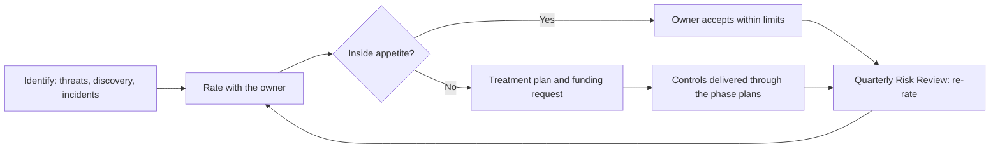
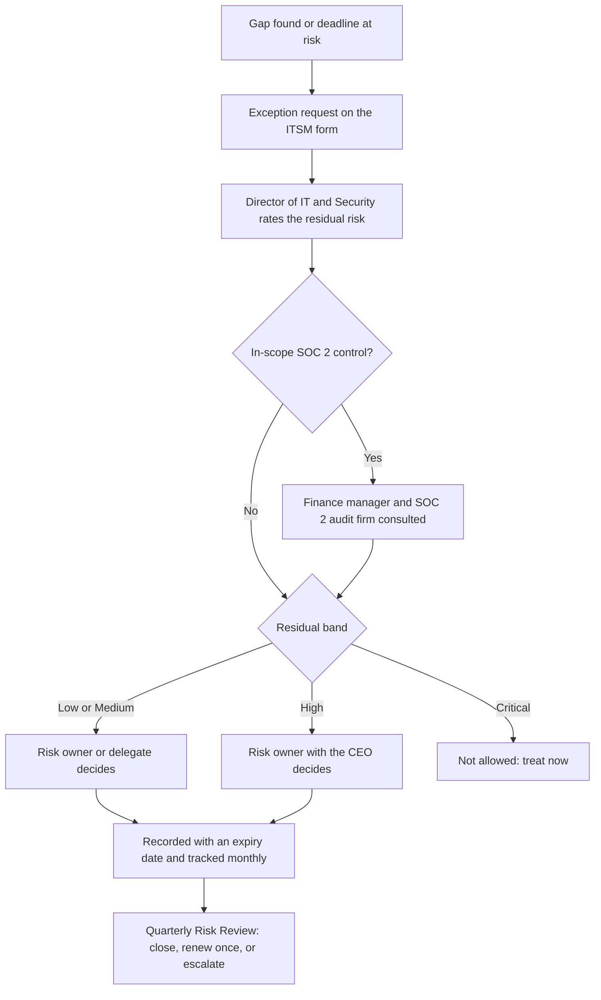

# 11. Risk management

> **Reference work.** Fictional scenario built for a public portfolio. Not deployed in, derived from, or describing any employer environment. Not professional advice.

## Purpose and scope

This document sets how Fabrikam (fictional) rates, treats, accepts, and reviews its top IT and security risks. It states the scoring method first, then a risk appetite statement for the executive team to approve at M3, the treatment options, the exception process, and a summary of R-01, R-03, and R-05 to R-15 with owners, scores, treatments, targets, threats, controls, and KPIs. Business executives own the risks; the Director of IT and Security owns the controls and runs the process. Every score here is illustrative until the owners rate their risks at M2, and the register itself is [`data/risk-register.csv`](../data/risk-register.csv).

## Method

CSF 2.0 asks for "A standardized method for calculating, documenting, categorizing, and prioritizing cybersecurity risks" (GV.RM-06). Fabrikam's method is kept simple so that an executive can rate a risk in a 30-minute conversation and get the same answer next quarter; teams that need more depth can use NIST SP 800-30 Rev. 1, Guide for Conducting Risk Assessments, still the current revision. Scales, bands, durations, and cadences are proposals (document [01](01-scenario-and-assumptions.md)).

**What is scored.** Each risk is written as cause, event, and consequence. It is scored for its most credible scenario in the plan year (November 2026 to October 2027): how likely it is to happen, and its business impact if it does. When two scenarios compete, for example a late leaver found in the SOC 2 audit and a late leaver who misuses customer data, both are scored and the higher one counts.

**Three ratings per risk.**

- **Inherent:** with only the controls Fabrikam had on day 1 (assumptions A-01 to A-12 in document [01](01-scenario-and-assumptions.md)), before this plan's treatments. CSF 2.0 ID.RA-05 uses threats, vulnerabilities, likelihoods, and impacts "to understand inherent risk and inform risk response prioritization". A rating that assumes no controls at all adds little for executives, so it is not used.
- **Current:** re-rated at each Quarterly Risk Review as treatments land; kept in the review pack.
- **Target residual:** what the funded treatment plan aims for by M7 (month 12).

**Inputs.** Likelihood ratings from the [threat profile](17-threat-profile.md), discovery evidence (document [05](05-environment-discovery.md)), incident and exercise history (document [08](08-detection-and-incident-response.md)), the business impact analysis (document [14](14-business-continuity-and-backup.md)), KPI data (document [12](12-metrics-and-executive-reporting.md)), and the MDR provider's view once it is live.

### Likelihood

| Score | Label | Meaning for the plan year |
|---|---|---|
| 1 | Rare | Not expected within three years |
| 2 | Unlikely | Plausible within three years; not expected this year |
| 3 | Possible | Could happen this year; similar companies report it |
| 4 | Likely | Expected this year without more treatment, or already seen at Fabrikam |
| 5 | Almost certain | Happening now, or expected more than once this year |

The threat profile's qualitative ratings are the starting point: High maps to 4, Medium to High to 3 or 4 depending on how directly a day-1 condition enables the threat, and Medium to 3.

### Impact

Five business dimensions; the highest one sets the score. There are no dollar figures: financial impact is tied to thresholds the CFO sets, including the loss threshold that raises incident severity in document 08.

| Score | Payroll disruption for customers | Exposure of customer or employee data | Financial loss | Contractual or regulatory consequences | Sales and reputation |
|---|---|---|---|---|---|
| 1 Minimal | None | No personal data involved | Absorbed in normal operations | None | Not visible outside Fabrikam |
| 2 Minor | Hours of delay for a few customers, recovered inside the processing window | Internal data, or a few people's personal data with no sign of misuse | Below the CFO's severity threshold | A customer inquiry or an extra audit request | One customer concerned |
| 3 Moderate | Some customers miss a processing window and recover within the pay cycle | One customer's workers or a group of employees, contained | Above the CFO's threshold, within the quarter's budget tolerance | A SOC 2 exception, or contractual notice to a few customers | Several customers concerned, or one enterprise deal delayed |
| 4 Major | Many customers miss a pay date, or any customer misses one during year-end and tax form season | Restricted data (Social Security numbers, bank details, background check results) of many workers or several customers | Material to the quarter, as the CFO defines it | Notice to many customers or to a regulator; contract penalties; a qualified SOC 2 opinion | Loss of key customers or enterprise deals; trade press coverage |
| 5 Severe | Widespread missed payrolls over more than one pay cycle, with customers on manual workarounds | Restricted data at scale across many customers, or confirmed misuse such as redirected pay | Material to the year or to financing | Regulatory action or litigation; a SOC 2 report customers will not accept | Sustained churn; broad public coverage |

The payroll column follows document 14's business impact analysis. Year-end appears at level 4 because mid-December through January is when customers have the least room for error.

### Score and bands

Score = likelihood × impact, from 1 to 25. Bands: **Low** 1 to 4, **Medium** 5 to 9, **High** 10 to 16, **Critical** 20 to 25.

| Impact (rows) by likelihood (columns) | 1 Rare | 2 Unlikely | 3 Possible | 4 Likely | 5 Almost certain |
|---|---|---|---|---|---|
| 5 Severe | 5 Medium | 10 High | 15 High | 20 Critical | 25 Critical |
| 4 Major | 4 Low | 8 Medium | 12 High | 16 High | 20 Critical |
| 3 Moderate | 3 Low | 6 Medium | 9 Medium | 12 High | 15 High |
| 2 Minor | 2 Low | 4 Low | 6 Medium | 8 Medium | 10 High |
| 1 Minimal | 1 Low | 2 Low | 3 Low | 4 Low | 5 Medium |

### Limits of the method

- **The numbers rank; they do not measure.** NIST SP 800-55 Vol. 1 says semi-quantitative assessments "use numbers, but those numbers do not maintain their value outside of the assessment context", and it does not treat them as measurements. The score orders the conversation; the KPIs linked to each risk are the measurements, and they serve as its key risk indicators (SP 800-55 defines a key risk indicator as "A metric used to measure risk").
- **Ratings are judgments.** The Director facilitates every rating; the executive team rates two reference risks together first (R-01 and R-03), and the M7 review compares a year of ratings with what actually happened.
- **Risks interact.** Standing privileged access (R-06) makes ransomware (R-03) and payment fraud (R-01) worse. They are rated separately; the links table shows where one treatment reduces several risks.
- **No enterprise risk function is described in the scenario.** The Quarterly Risk Review plays that role in year one, and the register's fields are chosen so it can later roll up into enterprise risk management, the integration that NIST's IR 8286 series (revised in 2025) and the CSF 2.0 Enterprise Risk Management Quick-Start Guide (SP 1303) address.

## Who owns what

| Role | Does | Does not |
|---|---|---|
| Risk owner (a named executive) | Rates the risk with the Director; approves the treatment plan and brings its funding request to the budget; accepts residual risk within the limits below; decides exceptions linked to the risk; reports on it at the Quarterly Risk Review | Build or run controls |
| Executive team | Approves the appetite statement, POL-13 (Risk Management Policy), and treatment budgets; decides on every risk outside appetite | Delegate decisions on Critical risks |
| Director of IT and Security | Runs the method and the register; keeps the exception records, schedules the reviews, and prepares the Quarterly Risk Review pack, with the outside audit-readiness consultant; proposes treatments and budget; owns and reports on controls; challenges ratings; escalates any acceptance that conflicts with the appetite | Accept risk on Fabrikam's behalf or approve exceptions |
| Control owners (IT team, Engineering Manager, SRE lead, business system owners) | Operate controls and report their health through the KPIs | Decide that a gap is acceptable |

NIST CSF 2.0 holds organizational leadership "responsible and accountable for cybersecurity risk" (GV.RR-01). Executives own the risks because they control the trade-offs: the CFO decides how payments are verified, and the VP of People decides how quickly HR records reach IT.

## Risk appetite statement (draft for executive approval at M3)

CSF 2.0 GV.RM-02 calls for risk appetite and tolerance statements that are "established, communicated, and maintained". The Director drafts this with the CFO and General Counsel; the executive team edits and approves it at M3 with the 12-month plan and reviews it at M7.

**Statement.** Fabrikam's customers rely on it to pay their workers on time and to protect the workforce data they hand over. Fabrikam accepts risk to grow, to ship product, and to adopt new tools, including AI, but not at the expense of those two promises. When a risk sits outside the appetite below, its owner brings a funded treatment plan or an explicit, time-bound acceptance to the executive team. The executive team also weighs opportunities, such as SOC 2 coverage that wins enterprise deals or AI that saves time, in line with CSF 2.0 GV.RM-07: "Strategic opportunities (i.e., positive risks) are characterized and are included in organizational cybersecurity risk discussions".

Appetite levels: **Minimal** means avoid wherever possible and fund treatment first; a Medium residual is within Minimal appetite only with funded treatment and a quarterly owner review, and a High residual never is; **Low** means accept only with treatments in place and a residual of Medium or lower; **Moderate** means accept a Medium residual, or a High one for a set period, when the business benefit is clear.

| Area (risks) | Appetite | Signals that Fabrikam is outside appetite (proposals) |
|---|---|---|
| Corporate systems and data availability (R-03) | Low | Internal operations stopped by a security or IT cause; corporate backup and restore not tested against its targets (KPI-19) |
| Restricted customer and employee data (R-05, R-07, R-12, R-13) | Minimal | Restricted data in open links or unapproved AI tools; leaver removal below target (KPI-12); an exception touching Restricted data older than 90 days |
| Payment and payroll fraud (R-01) | Minimal | A bank-detail or payment change made without out-of-band verification; any loss above the CFO's threshold |
| Identity and privileged access (R-06, R-15) | Low | An administrator without phishing-resistant MFA after Phase 2, or standing privileged assignments above target (KPI-08, KPI-09); a new hire given credentials before the identity verification in document [07](07-identity-lifecycle-joiners-movers-leavers.md) |
| Customer commitments and compliance (R-10, R-11) | Low | A new SOC 2 exception caused by the program's changes; notification readiness slower than the shortest contract clock |
| Third parties and SaaS (R-08, R-09) | Low where customer or employee data is involved; Moderate otherwise | Third parties with that data lacking a current review (KPI-05) |
| New technology and productivity, including AI (R-13, R-07) | Moderate, within the guardrails and the AI security standard in document [16](16-ai-adoption-guardrails.md) | AI use outside approved tools; any request to relax the Restricted-data rule |
| IT and security operating capacity (R-14) | Moderate | A critical administrative task that only one person can perform |

### Who may accept residual risk

| Residual band | Who accepts | Limits |
|---|---|---|
| Low | Risk owner | Recorded; revisited at M7 |
| Medium | Risk owner | Recorded with a review date; revisited at every Quarterly Risk Review |
| High | Risk owner with the CEO (the executive team when the CEO owns the risk) | Up to six months, with a dated treatment plan; reported at every Quarterly Risk Review |
| Critical | Executive team only | Outside appetite: treat now. An acceptance lasts at most 30 days and is minuted; the CEO decides whether the board hears of it |

The Director never accepts risk and never approves an exception. A risk owner may name a business delegate for Low and Medium decisions, but never someone in IT and security.

## Treatment options

CSF 2.0 (section 5) describes handling a negative risk by mitigating, transferring, avoiding, or accepting it. At Fabrikam:

| Option | Meaning | Example |
|---|---|---|
| Mitigate | Add or strengthen controls to lower likelihood or impact | Phishing-resistant MFA for payment approvers (R-01) |
| Avoid | Stop the activity or stop holding the data | Sensitive company and employee data kept out of mailboxes and OneDrive (R-07); duplicate SaaS retired (R-09) |
| Transfer or share | Move part of the impact to another party through contract terms, insurance, or a service | Partner contract terms under POL-10 (R-08); an MDR provider for after-hours coverage (R-10, R-14). Accountability for customer data never moves |
| Accept | The owner accepts the residual within the limits above, with a review date | A Medium residual for R-09 after consolidation |

Every treatment plan names actions from the phase plans of the linked documents, the KPIs that show progress, the funding request, and the target residual.

## Exception process

An exception is an approved, time-limited departure from a policy (POL-01 to POL-15) or from a standard set in this plan. CSF 2.0 ID.RA-07 reads: "Changes and exceptions are managed, assessed for risk impact, recorded, and tracked".

| Step | Who | What happens | Timing (proposal) |
|---|---|---|---|
| 1. Request | Control owner or requester | ITSM form: the requirement and policy, the reason, the scope (systems, people, data), compensating controls, a requested end date, and the plan to close the gap | Before a deadline is missed, or within two business days of finding a gap |
| 2. Assess | Director of IT and Security | Checks completeness, rates the residual risk with this method, and checks SOC 2 impact | Five business days |
| 3. Decide | Owner of the linked risk (a delegate for Low and Medium) | Approves, approves with changes, or rejects; a High residual also needs the CEO; a Critical residual cannot be excepted | Five business days |
| 4. Record | Director of IT and Security | Exception ID, linked risk, expiry date, compensating controls, and the accountable person | Same day |
| 5. Track | Director of IT and Security | Reminder 30 days before expiry; open and overdue exceptions reported monthly to the IT and Security Steering Group | Monthly |
| 6. Review | Quarterly Risk Review | Every open exception is reviewed; a renewal needs fresh approval and is allowed once; after that the executive team funds the fix or changes the policy | Quarterly |

**Durations.** Up to 180 days when the residual is Low or Medium; up to 90 days when it is High or when Restricted data is involved; none when it is Critical.

**Not open to exception.** Conditional Access policies (the emergency access group is the only exclusion, built into the policies by design in document [06](06-microsoft-365-security-baseline.md); any other account that cannot meet a policy is changed, for example moved to a workload identity, not excluded); out-of-band verification of bank-detail and payment changes; help desk caller verification for password and MFA resets, meaning the service desk's identity verification before a password reset, a sign-in method change, or a Temporary Access Pass (document [13](13-it-service-management.md), [ADR-004](adr/ADR-004-phishing-resistant-authentication-rollout.md)); removal of a leaver's access; turning off audit logging; and the rule that Restricted data never goes into unapproved AI tools (document 16).

**Typical first-year exceptions.** A Windows 10 device on a short Extended Security Updates bridge until it is replaced, a device or application still sending mail through SMTP AUTH Basic authentication while its fix is in flight, and a missed vulnerability remediation target, all from document 06; a SaaS application that cannot use single sign-on until it is replaced (document [15](15-enterprise-systems-and-saas.md)).

**Policy exceptions and SOC 2 exceptions are different things.** A policy exception is a decision Fabrikam makes in advance. A SOC 2 exception is a deviation the audit firm finds when it tests a control (KPI-04). An approved policy exception on an in-scope control can still produce an audit exception, so the Director brings in the finance manager who coordinates SOC 2, and through them the SOC 2 audit firm, before the decision. Until the current review period closes at M4, no exception may change how an in-scope control produces evidence without the audit firm's agreement (document [10](10-governance-and-compliance-program.md)).

## Reviews and the Quarterly Risk Review

- **Monthly.** The IT and Security Steering Group sees the status of Critical and High risks, treatment progress, and open and expiring exceptions.
- **Quarterly.** At the Quarterly Risk Review the executive team re-rates each risk with its owner, reviews the full KPI catalog and every open exception, and decides on risks outside appetite. The CEO chairs, the Director presents and records decisions, and the register is updated within five business days. Proposed dates: M3 (late January 2027, with plan approval), month 6 (late April 2027), month 9 (late July 2027), and M7 (late October 2027, the annual re-baseline). The [month 6 sample](templates/quarterly-risk-review-sample.md) shows the pack.
- **On an event.** A SEV-1 or SEV-2 incident, a failed exercise or restore test, an acquisition, a change in how employee data is collected, monitored, or retained, a new law or contract clause, or an answer from General Counsel on an open question triggers a re-rating within two weeks.

## Register summary: R-01, R-03, and R-05 to R-15

**Illustrative.** Fabrikam is fictional. These ratings show how the method works on the day-1 assumptions; discovery (M1) and the owners (M2) replace them. Owners are proposals, confirmed at M2. Every Critical and High risk also gets a monthly status at the IT and Security Steering Group, so the last column lists only the extra triggers.

| ID | Risk | Proposed owner | Inherent (likelihood × impact) | Treatment | Target residual by M7 (likelihood × impact) | Review timing beyond the Quarterly Risk Review |
|---|---|---|---|---|---|---|
| R-01 | Payroll diversion or payment fraud against Fabrikam's own finance and HR through business email compromise | CFO | 16 High (4 × 4) | Mitigate | 8 Medium (2 × 4) | After any payment-fraud attempt and after the February 2027 tabletop |
| R-03 | Ransomware or destructive attack on corporate endpoints and Microsoft 365 data | CEO | 15 High (3 × 5) | Mitigate | 8 Medium (2 × 4) | After each restore test and when MDR coverage starts |
| R-05 | Former employees or contractors keep access after they leave | VP of People | 12 High (4 × 3) | Mitigate | 6 Medium (2 × 3) | With KPI-12 each month; after any late leaver |
| R-06 | Excessive, stale, or standing privileged access | CTO | 20 Critical (4 × 5) | Mitigate | 5 Medium (1 × 5) | With KPI-09 each month until it meets its target |
| R-07 | Customer and employee data exposed through oversharing in Microsoft 365, made worse by AI assistants | Chief Customer Officer (VP of People consulted for employee data) | 16 High (4 × 4) | Mitigate and avoid | 8 Medium (2 × 4) | At the Copilot pilot decision and before each expansion wave |
| R-08 | Compromise of an integration credential or partner connection | CTO | 15 High (3 × 5) | Mitigate and transfer | 10 High (2 × 5) | When an integration, partner, or credential owner changes |
| R-09 | Unmanaged and duplicate SaaS left over from acquisitions | CFO | 12 High (4 × 3) | Mitigate and avoid | 6 Medium (2 × 3) | At each consolidation milestone ([ADR-005](adr/ADR-005-acquired-company-consolidation.md)) |
| R-10 | Not enough logging or response capacity to investigate an incident in time to meet customer notification commitments | General Counsel | 16 High (4 × 4) | Mitigate and share | 8 Medium (2 × 4) | After each SEV-1 or SEV-2 incident and each exercise; when the planning clock changes |
| R-11 | A SOC 2 exception or a qualified opinion | CFO | 16 High (4 × 4) | Mitigate | 6 Medium (2 × 3) | At M4 (end of March 2027) |
| R-12 | Privacy non-compliance for employee or workforce data under state law | General Counsel | 12 High (3 × 4) | Mitigate | 8 Medium (2 × 4) | When General Counsel answers an open question; whenever a change to how employee data is collected, monitored, or retained reaches privacy review |
| R-13 | Confidential data leaks through unsanctioned AI tools | VP of People | 16 High (4 × 4) | Mitigate | 8 Medium (2 × 4) | At the Copilot pilot decision; when discovery shows new AI use |
| R-14 | Key-person dependency in a small IT team | CTO | 12 High (4 × 3) | Mitigate and share | 6 Medium (2 × 3) | After each joiner or leaver in the IT team |
| R-15 | A fraudulent remote hire passes onboarding and receives credentials | VP of People | 12 High (3 × 4) | Mitigate | 8 Medium (2 × 4) | After any suspected fraudulent hire or failed identity check; when the onboarding steps in document 07 change |

**One target stays above appetite.** In this illustration R-08 remains High at M7, because its strongest treatments sit with Engineering's secure-development roadmap and with partners' own controls; every other target is Medium, which the appetite levels allow once its treatment is funded and its owner reviews it each quarter. The plan puts R-08 to the executive team at M3 with engineering asks for the CTO: fund the treatments; because the target stays High even when funded, the owner with the CEO also accepts the remaining residual for a set period, within the High acceptance limit above.

| ID | Threats (document 17) | Linked controls and documents | KPIs |
|---|---|---|---|
| R-01 | S-01, S-03, S-04, S-09, S-11 | Impersonation protection, DMARC enforcement, no external forwarding, phishing-resistant MFA for payment approvers ([06](06-microsoft-365-security-baseline.md), [ADR-004](adr/ADR-004-phishing-resistant-authentication-rollout.md)); separation of duties in finance roles ([07](07-identity-lifecycle-joiners-movers-leavers.md)); out-of-band verification of bank changes ([13](13-it-service-management.md), [playbook](playbooks/payroll-diversion-and-email-compromise.md)); finance and payroll training ([09](09-security-awareness-and-training.md)); detections and MDR ([08](08-detection-and-incident-response.md)); [tabletop](templates/tabletop-payroll-diversion.md); the Automated Clearing House (ACH) network's fraud-monitoring rule, if counsel confirms it applies ([10](10-governance-and-compliance-program.md), section 6.8); cloned-voice and video requests verified by the same call-back, and an AI assistant's summary of a payment request never counted as verification (AIC-05 and AIC-06 in [16](16-ai-adoption-guardrails.md)) | KPI-08, KPI-15, KPI-16, KPI-18, plus the supporting checks on recorded call-backs and sending domains at p=reject (document 12) |
| R-03 | S-03, S-06, S-10 | Attack surface reduction, legacy authentication blocked, patching ([06](06-microsoft-365-security-baseline.md)); endpoint detection and response, attack disruption, MDR ([08](08-detection-and-incident-response.md), [ADR-003](adr/ADR-003-managed-detection-and-response.md), [ADR-001](adr/ADR-001-microsoft-365-security-licensing.md)); Microsoft 365 backup and restore tests ([14](14-business-continuity-and-backup.md), [ADR-006](adr/ADR-006-microsoft-365-backup.md)); endpoint standards ([13](13-it-service-management.md), [ADR-008](adr/ADR-008-endpoint-management-standard.md)) | KPI-10, KPI-11, KPI-16, KPI-19 |
| R-05 | S-07 | HR-driven joiner, mover, and leaver automation with an urgent leaver path ([07](07-identity-lifecycle-joiners-movers-leavers.md), [ADR-002](adr/ADR-002-hr-system-of-record-drives-identity.md), [checklists](templates/joiner-mover-leaver-checklists.md)); service desk leaver handling ([13](13-it-service-management.md)); single sign-on and SCIM deprovisioning ([15](15-enterprise-systems-and-saas.md)); access reviews ([07](07-identity-lifecycle-joiners-movers-leavers.md)) | KPI-12, KPI-13 |
| R-06 | S-03, S-07 | Emergency access, fewer than five Global Administrators, separate admin accounts, Privileged Identity Management from Phase 4 ([06](06-microsoft-365-security-baseline.md), [ADR-001](adr/ADR-001-microsoft-365-security-licensing.md)); phishing-resistant MFA for administrators ([ADR-004](adr/ADR-004-phishing-resistant-authentication-rollout.md)); admin role reviews ([07](07-identity-lifecycle-joiners-movers-leavers.md)) | KPI-09, KPI-08, KPI-13 |
| R-07 | S-04, S-05, S-06, S-07, S-08, S-10, S-11 | Sharing limits, labels, DLP for payroll identifiers, the support data path ([06](06-microsoft-365-security-baseline.md)); Copilot readiness, AI rules, and the AI security controls AIC-02, AIC-03, AIC-05, and AIC-11 ([16](16-ai-adoption-guardrails.md)); POL-05 ([10](10-governance-and-compliance-program.md)); collaboration governance ([15](15-enterprise-systems-and-saas.md)) | KPI-17, KPI-14, plus the supporting check on open links to sensitive content (document 12) |
| R-08 | S-05, S-08 | Integration and application inventory with owners, secret management ([15](15-enterprise-systems-and-saas.md)); third-party reviews and contract terms under POL-10 ([10](10-governance-and-compliance-program.md)); non-human identity ownership ([07](07-identity-lifecycle-joiners-movers-leavers.md)); app consent and workload identities ([06](06-microsoft-365-security-baseline.md)); engineering asks for the CTO's decision (single sign-on and MFA on code hosting, secret scanning that blocks credentials at commit, protected branches, pipeline secrets in a vault, and dependency alerts); RACI ([04](04-operating-model-team-and-budget.md)) | KPI-05, KPI-07 |
| R-09 | S-08 | Application portfolio, discovery, and consolidation ([15](15-enterprise-systems-and-saas.md), [ADR-005](adr/ADR-005-acquired-company-consolidation.md)); vendor review under POL-10 ([10](10-governance-and-compliance-program.md)) | KPI-07, KPI-05 |
| R-10 | S-01, S-02, S-04, S-06, S-08 | MDR and on-call, the contract clause inventory, the incident response plan, and exercises ([08](08-detection-and-incident-response.md), [ADR-003](adr/ADR-003-managed-detection-and-response.md)); log archive and retention ([06](06-microsoft-365-security-baseline.md)); licensing ([ADR-001](adr/ADR-001-microsoft-365-security-licensing.md)) | KPI-16, KPI-18 |
| R-11 | S-02 | Protecting the current SOC 2 period, control owners, and evidence ([10](10-governance-and-compliance-program.md)); compliance automation ([ADR-007](adr/ADR-007-compliance-automation-platform.md)); reporting ([12](12-metrics-and-executive-reporting.md)) | KPI-03, KPI-04, KPI-02 |
| R-12 | S-02, S-07, S-09, S-10, S-11 | Privacy coordination and POL-15, with privacy review before any change to how employee data is collected, monitored, or retained ([10](10-governance-and-compliance-program.md)); data inventories and only identity attributes leaving the HR system ([07](07-identity-lifecycle-joiners-movers-leavers.md)); employee monitoring notices where required; the POL-02 AI rules for AI applied to workforce data ([16](16-ai-adoption-guardrails.md)) | KPI-02, KPI-05 |
| R-13 | S-05 | The AI security controls AIC-01, AIC-02, AIC-04, and AIC-07: approved tools, data rules, prompt DLP (preview, as of 2026-10-14), intake, consent limits, discovery where licensed, and vendor terms ([16](16-ai-adoption-guardrails.md)); training ([09](09-security-awareness-and-training.md)); application intake and consent ([15](15-enterprise-systems-and-saas.md), [06](06-microsoft-365-security-baseline.md)); POL-02 ([10](10-governance-and-compliance-program.md)) | KPI-14, KPI-17, KPI-07 |
| R-14 | None directly; it weakens the response to every scenario | MDR for after-hours detection ([08](08-detection-and-incident-response.md), [ADR-003](adr/ADR-003-managed-detection-and-response.md)); knowledge base and runbooks ([13](13-it-service-management.md)); automation of routine work ([07](07-identity-lifecycle-joiners-movers-leavers.md)); cross-training, named deputies, and contracted specialist help for surge and build work ([04](04-operating-model-team-and-budget.md)) | KPI-20, KPI-23 |
| R-15 | S-07 (once inside, a fraudulent hire acts as an insider with legitimate access) | Identity verification recorded before first credentials are released, with the joiner checklist ([07](07-identity-lifecycle-joiners-movers-leavers.md), [checklists](templates/joiner-mover-leaver-checklists.md)); pre-hire screening under POL-14 with the VP of People ([10](10-governance-and-compliance-program.md)); birthright access limited to the role, and access reviews ([07](07-identity-lifecycle-joiners-movers-leavers.md)); sign-in and data access monitoring with the MDR provider ([08](08-detection-and-incident-response.md)) | KPI-13, KPI-16 |

KPI-01 (top risks with an owner and an approved treatment plan) covers the whole register. Definitions and targets are in document 12 and the [KPI catalog](../data/kpi-catalog.csv).

Where the risks sit on day 1 (inherent) and at M7 (target), illustrative:

| Impact (rows) by likelihood (columns) | 1 Rare | 2 Unlikely | 3 Possible | 4 Likely | 5 Almost certain |
|---|---|---|---|---|---|
| 5 Severe | Target: R-06 | Target: R-08 | Day 1: R-03, R-08 | Day 1: R-06 | |
| 4 Major | | Target: R-01, R-03, R-07, R-10, R-12, R-13, R-15 | Day 1: R-12, R-15 | Day 1: R-01, R-07, R-10, R-11, R-13 | |
| 3 Moderate | | Target: R-05, R-09, R-11, R-14 | | Day 1: R-05, R-09, R-14 | |
| 2 Minor | | | | | |
| 1 Minimal | | | | | |

## The register file

[`data/risk-register.csv`](../data/risk-register.csv) is UTF-8 CSV with one header row and one row per risk; text fields are quoted. It is reference data for a fictional company, and every score in it is illustrative. Its header is documented here:

| Column | Meaning | Format |
|---|---|---|
| id | Risk identifier, R-01, R-03, and R-05 to R-15, fixed across the plan | Text |
| title | Risk name as used throughout the plan | Text |
| description | Cause, event, and consequence in business terms, with the day-1 conditions | Text |
| owner_role | Proposed executive owner, confirmed at M2 | Text |
| likelihood | Inherent likelihood | Integer, 1 to 5 |
| impact | Inherent impact (the highest of the five dimensions) | Integer, 1 to 5 |
| inherent_score | likelihood × impact | Integer, 1 to 25 |
| treatment | Treatment option and the main actions | Text |
| linked_documents | Repository paths of the documents that carry the treatment, separated by semicolons; the document 17 entry lists the threat scenarios | Text |
| kpis | KPI IDs from the KPI catalog, separated by semicolons | Text |
| target_residual | Target score for M7 (target likelihood × target impact; the summary above shows both factors) | Integer, 1 to 25 |
| review_cadence | Review rhythm and event triggers | Text |
| status | Draft (illustrative) until M2; then Open, In treatment, Accepted (with an expiry date), or Closed | Text |

Current ratings live in each Quarterly Risk Review pack, so the file keeps the inherent baseline and the target. It is held in a restricted SharePoint list or the ITSM tool on existing licenses, or in the compliance automation platform if [ADR-007](adr/ADR-007-compliance-automation-platform.md) approves one.

## Phase plan

| Phase | Action ID | Action | Outcome | KPI | Owner role | Workstream |
|---|---|---|---|---|---|---|
| Phase 1 | 11.01 | Draft the method (scales, bands, appetite levels) and test it on R-01, R-03, and R-05 to R-15 against the threat profile and the day-1 assumptions | Method ready for the owners | KPI-01 | Director of IT and Security | WS-5 |
| Phase 1 | 11.02 | Record each executive's risk tolerance and proposed ownership from the stakeholder conversations in document 05 | A proposed owner for every risk in the M1 top risks draft | KPI-01 | Director of IT and Security | WS-5 |
| Phase 2 | 11.03 | Rate the two reference risks with the whole executive team, then each remaining risk with its proposed owner in a 30-minute session; confirm ownership; publish the register | Risk register v1 at M2 | KPI-01 | Director of IT and Security | WS-5 |
| Phase 2 | 11.04 | Before the mid-December freeze, review R-01 and R-03 with their owners for year-end and tax form season: payment verification, on-call coverage, and backup and restore readiness | Year-end exposure checked before the busiest season | KPI-01 | Director of IT and Security | WS-5 |
| Phase 2 | 11.05 | Start the exception process with an ITSM form and a simple record; first cases are the SMTP AUTH and Windows 10 items from document 06 | Every known deviation has an owner, a decision, and an expiry | KPI-01 | Director of IT and Security | WS-5 |
| Phase 3 | 11.06 | Draft the appetite statement and POL-13 with the CFO and General Counsel; the executive team approves both at M3 | Approved appetite and acceptance limits (M3) | KPI-02 | Director of IT and Security | WS-5 |
| Phase 3 | 11.07 | First Quarterly Risk Review at M3: approve treatment plans for every Critical and High risk, including the CTO's decision on the R-08 engineering asks, and tie each treatment to a gap in the NIST CSF 2.0 target Profile (document 10) | Treatment plans approved; register and Profiles aligned | KPI-01 | Director of IT and Security | WS-5 |
| Phase 4 | 11.08 | February 2027: start monthly risk status at the IT and Security Steering Group; re-rate R-06 and R-01 after the Phase 2 and 3 changes for the Day 120 readout (end of February 2027) | Monthly rhythm running; first rating changes shown at D120 | KPI-01 | Director of IT and Security | WS-5 |
| Phase 4 | 11.09 | Month 6 Quarterly Risk Review (late April 2027), after the SOC 2 period closes at M4: re-rate every risk, review exceptions, record owner decisions | Current ratings and decisions for the second half | KPI-01 | Director of IT and Security | WS-5 |
| Phase 5 | 11.10 | Month 9 Quarterly Risk Review (late July 2027): re-rate with the M5 and M6 results (R-11, R-05, R-06) and early Copilot pilot findings (R-07, R-13) | Ratings reflect the year's largest changes | KPI-01 | Director of IT and Security | WS-5 |
| Phase 5 | 11.11 | M7 annual re-baseline (late October 2027): compare a year of ratings with incidents and KPIs, recalibrate the scales, refresh the appetite statement, retire or add risks | Re-baselined register for the next-year plan (M7) | KPI-01 | Director of IT and Security | WS-5 |

## Resourcing and dependencies

- **Roles.** The Director of IT and Security runs the process throughout, with the outside audit-readiness consultant and contracted specialist help for surge and build work (document 04); the Director keeps the register and exceptions (11.08). Each executive owner gives about 30 minutes per risk at M2 and at each Quarterly Risk Review, plus the M3 approval. The finance manager who coordinates SOC 2 joins exception decisions on in-scope controls until M4. General Counsel shapes the appetite statement and the legal side of R-10 and R-12. The Engineering Manager and the SRE lead rate and treat the product-side risk (R-08) under the RACI in document 04.
- **Partners.** The SOC 2 audit firm (risk assessment is part of what it examines, and it is consulted on exceptions to in-scope controls); the MDR provider (threat and incident input from Phase 4); the penetration testing firm (findings feed likelihood ratings).
- **Licenses.** None new. The register and exception records run on Microsoft 365 E3 and the existing ITSM tool, or move to the compliance automation platform if ADR-007 approves one.
- **Depends on.** Documents [01](01-scenario-and-assumptions.md) (assumptions and proposals), [04](04-operating-model-team-and-budget.md) (forums, RACI, operating model), [05](05-environment-discovery.md) (top risks draft at M1), [10](10-governance-and-compliance-program.md) (POL-13, the NIST CSF 2.0 Profiles, the SOC 2 program), [12](12-metrics-and-executive-reporting.md) (KPI definitions and the [monthly executive scorecard](templates/monthly-executive-scorecard.md)), [17](17-threat-profile.md) (threats), and the treatment documents 06, 07, 08, 09, 13, 14, 15, and 16. It feeds documents [00](00-executive-summary.md), [02](02-first-90-days.md), and [03](03-twelve-month-roadmap.md).

## Risks and open questions

- **Executive time in December.** Rating sessions compete with year-end and open enrollment. Short sessions in early December and two jointly rated reference risks keep the load small.
- **Acceptance as a way to avoid funding.** An owner can accept rather than fund. The acceptance limits make that a recorded, time-bound choice that the executive team sees each quarter, and the Director escalates any acceptance that conflicts with the appetite.
- **Product-side dependencies.** R-08 depends in part on Engineering's roadmap and evidence; corporate IT sees only part of it. The R-08 engineering asks are recommendations; the CTO decides.
- **Legal questions.** R-12 and the clocks behind R-10 wait on General Counsel's answers (documents 08 and 10).
- **False precision.** A 5 × 5 grid invites more confidence than it deserves. The KPIs carry the measurement, and the M7 review recalibrates the scales against what happened.
- **Board reporting.** Whether and how risk reaches the investor board is the CEO's decision; the Director prepares material only when asked.
- **Owner names are proposals.** A reorganization or a new executive changes them; the register records the change at the next Quarterly Risk Review.

## Framework mapping

By identifier only, consistent with the [crosswalk](crosswalk/csf2-soc2-crosswalk.md). The relationships are this plan's own analysis; no official AICPA mapping between the Trust Services Criteria and CSF 2.0 was found.

| Theme | NIST CSF 2.0 | SOC 2 (2017 TSC) |
|---|---|---|
| Method, appetite, and response strategy | GV.RM-01, GV.RM-02, GV.RM-03, GV.RM-04, GV.RM-06, GV.RM-07 | CC3.1, CC3.2 |
| Ownership and accountability | GV.RR-01, GV.RR-02 | CC1.3 |
| Risk identification and analysis, with document 17 | ID.RA-03, ID.RA-04, ID.RA-05 | CC3.2, CC3.3, CC3.4 |
| Treatment and exceptions | ID.RA-06, ID.RA-07 | CC5.1, CC9.1 |
| Third-party risks in the register (R-08, R-09) | GV.RM-05, GV.SC-07 | CC9.2 |
| Oversight and review | GV.OV-01, GV.OV-02, GV.OV-03 | CC4.1, CC4.2 |
| Risk Management Policy (POL-13) | GV.PO-01, GV.PO-02 | CC5.3 |

## Sources

- The NIST Cybersecurity Framework (CSF) 2.0 (CSWP 29, February 26, 2024), sections 3.1, 5, and 5.1 and Appendix A. NIST. https://nvlpubs.nist.gov/nistpubs/CSWP/NIST.CSWP.29.pdf . Checked 2026-10-13. Primary.
- Measurement Guide for Information Security: Volume 1, Identifying and Selecting Measures (SP 800-55 Vol. 1, December 2024), sections 2.2 and 2.4 and Appendix A. NIST. https://csrc.nist.gov/pubs/sp/800/55/v1/final . Checked 2026-10-13. Primary.
- Guide for Conducting Risk Assessments (SP 800-30 Rev. 1, September 2012), publication record. NIST. https://csrc.nist.gov/pubs/sp/800/30/r1/final . Checked 2026-10-13. Primary.
- Integrating Cybersecurity and Enterprise Risk Management (ERM) (IR 8286 Rev. 1, December 2025), publication record. NIST. https://csrc.nist.gov/pubs/ir/8286/r1/final . Checked 2026-10-13. Primary.
- NIST Cybersecurity Framework 2.0: Enterprise Risk Management Quick-Start Guide (SP 1303, October 2024), publication record. NIST. https://csrc.nist.gov/pubs/sp/1303/final . Checked 2026-10-13. Primary.
- 2017 Trust Services Criteria (With Revised Points of Focus, 2022), download page. AICPA & CIMA. https://www.aicpa-cima.com/resources/download/2017-trust-services-criteria-with-revised-points-of-focus-2022 . Checked 2026-10-13. Primary.
- Risk Management Topics (Fraud Monitoring Phase 1), with phase 2 dates (the ACH network's fraud-monitoring rule linked to R-01). Nacha. https://www.nacha.org/rules/risk-management-topics-fraud-monitoring-phase-1 . Checked 2026-10-13. Primary.
