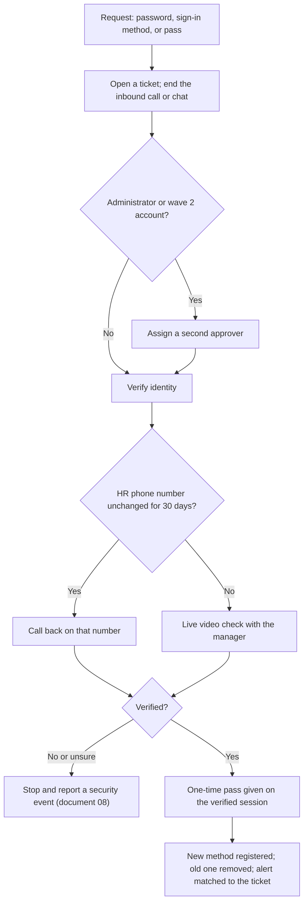

# 13. IT service management

> **Reference work.** Fictional scenario built for a public portfolio. Not deployed in, derived from, or describing any employer environment. Not professional advice.

## Purpose and scope

This document sets out how Fabrikam (fictional) runs IT as a service for about 450 remote-first employees: the service desk, priorities and service levels, the request catalog and what gets automated, help desk identity verification, change and problem management, the device lifecycle from purchase to disposal, endpoint standards, the knowledge base, employee experience, staffing, and tools. It covers corporate IT only. Product changes follow Engineering's process, and support for customers' administrators belongs to Customer Support. KPI-20 to KPI-24 measure it.

## Starting point and goals

On day 1 an IT Operations Manager and three IT generalists run the service desk, devices, and Microsoft 365 administration. Onboarding and offboarding arrive as email from People (assumption A-03), there is no after-hours coverage (A-07), duplicate tools remain from the acquisitions (A-08), and service targets may not exist yet (document [05](05-environment-discovery.md)). Fabrikam already owns an IT service management (ITSM) tool, and Microsoft 365 E3 now includes Intune Plan 2 with Remote Help and Intune Advanced Analytics, at their defaults today.

Goals for year one:

1. Every contact becomes a ticket with a priority, an owner, and a target.
2. Nobody gets a password, sign-in method, or Temporary Access Pass on their word alone.
3. Common requests fulfill themselves; people handle the exceptions.
4. Corporate IT changes are planned, recorded, and reversible, and they respect the year-end calendar.
5. A new hire works on day one, a leaver's laptop comes back, and every disposed drive has a record.

## Service desk model

### Channels

| Channel | Use | Rule |
|---|---|---|
| ITSM portal | Requests from the catalog, ticket status, knowledge base | The default for anything that can wait |
| Microsoft Teams | Quick questions and issues; a Teams entry point that opens a ticket if the ITSM tool supports one (document [15](15-enterprise-systems-and-saas.md) confirms), otherwise a monitored channel where the analyst opens it | Never used to deliver a password, recovery key, or pass |
| Email | Accepted and turned into a ticket | Never accepted as proof of identity |
| Phone line, staffed hours | People who cannot sign in, and suspicious calls or texts (document [09](09-security-awareness-and-training.md)) | The analyst ends any credential request and calls back (see verification) |
| After-hours urgent line | Urgent issues only, answered by the on-call rotation in document [08](08-detection-and-incident-response.md) | Same verification rules at any hour |

Both offices are small and Fabrikam is remote-first, so there is no walk-up desk.

### Hours and the after-hours urgent line

**Staffed hours (proposal):** 8:00 a.m. Eastern to 5:00 p.m. Pacific on business days, in two staggered shifts: early, 8:00 a.m. to 4:30 p.m. Eastern; late, 8:30 a.m. to 5:00 p.m. Pacific. The midday overlap covers peak volume and handover. In this document, "business hours" means staffed hours.

**After hours,** one phone number rings the primary on-call in document 08's rotation. It covers:

- suspected security incidents, which the MDR provider also covers once live;
- urgent leavers, phoned in by People or General Counsel (document [07](07-identity-lifecycle-joiners-movers-leavers.md));
- lost or stolen devices;
- P1 outages;
- a lockout that stops a time-critical role, such as a payroll specialist on a pay run day.

Everything else waits for the next business day. The on-call calls back within 30 minutes for a P1 (proposal), the same window document 08 sets for SEV-2.

### Who the service desk serves

Fabrikam employees and contractors, including the managers and sponsors who act for them. Customers' administrators and hourly workers are supported by Customer Support under the Chief Customer Officer. Support verifies them through CRM contacts already on file (document 09), and their account security is a product matter owned by Engineering. Product incidents go to Engineering's incident process, with the Director joining as security lead when security is involved (document 08).

## Priorities and service levels (proposals)

| Priority | Meaning | Examples | First response | Resolve or workaround | Updates |
|---|---|---|---|---|---|
| P1 Critical | Many people cannot work, a business-critical service is down, or a security incident is suspected | Support agents cannot reach the support platform; sign-in failing for a department; ransomware signs on a laptop | 15 minutes in business hours; 30 minutes after hours through the on-call | 4 hours, clock running around the clock | Every hour |
| P2 High | One team, or one person in a time-critical role, cannot work | A payroll specialist locked out on a pay run day; an executive's laptop dead before a board meeting | 1 business hour | 1 business day | Every 4 business hours |
| P3 Normal | One person degraded, or blocked with a workaround | Printing fails; an app crashes intermittently | 4 business hours | 3 business days | When status changes |
| P4 Request | A catalog request | Software, access, hardware | 1 business day | The catalog item's target | When status changes |

- **Calendar urgency.** An issue affecting Support, Finance, or People during a payroll processing window, or from mid-December through January, moves up one priority. A payroll processing window means a Fabrikam payroll run. Document 08 uses this definition for a narrower severity rule: any incident that touches the payroll path during a processing window rises one severity level.
- **Security events.** A ticket that looks like a security event moves to document 08's path, which sets its severity. SEV-1 and SEV-2 tickets run as P1, and SEV-4 items stay with the service desk.
- **Clock rules.** P2 to P4 clocks pause outside business hours and while waiting on the requester. Every P1 gets a short review afterward, and its cause feeds problem management.

## Request catalog and automation

Document 07's targets are used here unchanged where it set them.

| Request | How people ask | How it is fulfilled | Target (proposal) | Automation and phase | License |
|---|---|---|---|---|---|
| Access to an app, group, or site | My Access portal | Access packages approved by the manager and resource owner; SCIM provisioning where the app supports it; ticket to the app owner where it does not | On approval; non-SCIM apps 2 business days (document 07) | Phase 4 with actions 07.12 to 07.15; birthright access needs no request | Microsoft Entra ID P2 or Microsoft Entra ID Governance for requests and approvals; automatic assignment needs Governance ([ADR-001](adr/ADR-001-microsoft-365-security-licensing.md)) |
| Software | Company Portal; portal request for anything not listed | Apps the Systems Engineer (Identity and Endpoint) has packaged and approved are published for self-install. New software goes to application intake (document 15), and AI tools to document [16](16-ai-adoption-guardrails.md) | Listed apps immediately; packaging 5 business days after intake approval | Phase 4, once self-install is confirmed in the tenant on Windows and macOS (13.16); until then, listed apps go through a portal request | Intune Plan 1 (E3) |
| Password reset | Self-service password reset | Self-service for anyone with registered methods; assisted reset only after verification (below) | Immediate; assisted: P3 | Phase 4. Microsoft lists "Enable self-service password reset" among its generally available Microsoft Entra recommendations | Microsoft Entra ID P1 (included in Microsoft 365 E3) |
| New, lost, or replaced sign-in method | Self-service while a method still works; phone otherwise | Users with a working method add or replace their own (document 06's CA-10 requires MFA to register). Anyone who lost every method gets assisted recovery: verification, then a one-time Temporary Access Pass ([ADR-004](adr/ADR-004-phishing-resistant-authentication-rollout.md)) | Assisted: P2 | Self-service from Phase 2; the 2027-02-01 surge in Phase 4 | Microsoft Entra ID |
| Local admin elevation | Portal or phone | The analyst runs the install in a Remote Help session with the Windows LAPS password, which the user never sees, then rotates it. Macs use their LAPS-managed account (ADR-008) | Start within 2 business hours | Phase 3 (January), as standing admin rights end (06.17), and February for finance and payroll; Engineering exceptions through the Change Advisory Board, with expiry | Intune Plan 1; Remote Help (E3 since July 2026) |
| Disk recovery key | Phone | BitLocker key read out only on a verified session, then rotated remotely. Mac users retrieve their FileVault key from the Company Portal website | P2 | Phase 2 | Intune Plan 1 |
| Hardware: replacement, accessory, administrator phone | Portal | IT hardware partner ships to the home address in the HR system | Broken laptop: replacement ships next business day from the spare pool | Phase 2 | Not applicable |
| Lost or stolen device | Phone, same day (after hours too) | Remote lock and session revocation at once. Until document 08's lost-device playbook (planned, Phase 5) sets the rule, a wipe is the Director of IT and Security's decision, with General Counsel if data may be exposed. Logged as a security event | P1 | Phase 1 | Intune Plan 1 |
| Joiner, mover, leaver | People's ITSM forms (07.05), then HR-driven workflows | [Checklists](templates/joiner-mover-leaver-checklists.md); the service desk owns laptops, day-one support, and device returns | Document 07's service levels | Phase 4 with document 07 | Per document 07 |
| Team, site, or shared mailbox | Portal | Created with a named owner and purpose under document 15's collaboration rules | 2 business days | Phase 5: approval workflow in the ITSM tool | E3 |
| Restore a file or mailbox item | Portal | Document [14](14-business-continuity-and-backup.md)'s restore procedure | P3 | Not applicable | Per document 14 |
| Suspicious email, call, or text | Report button in Outlook; phone | Document 09's reporting loop; incidents to document 08 | Triage the same business day | Phase 2 | E3 |

**Requests the service desk never fulfills.** Payroll, direct-deposit, and vendor bank-detail changes. Employees change their own direct deposit in the HR system of record, and finance follows the [payroll diversion playbook](playbooks/payroll-diversion-and-email-compromise.md). If such a request reaches IT, the analyst points the person to the right path and reports it as a possible lure (threat S-01 in document [17](17-threat-profile.md)). No IT change ticket alters payment or bank data. Changes to the finance system's roles or approval settings go through the Change Advisory Board with the CFO's delegate as business approver.

**Licensing notes (Microsoft, as of 2026-10-13).** Remote Help and Intune Advanced Analytics joined E3 with Intune Plan 2 in Microsoft's July 2026 packaging update, with rollout complete by August 1, 2026. Remote Help requires Intune Plan 1. No built-in Intune role includes the "Rotate Local Admin Password" task, so Fabrikam creates a custom role for the analysts. Reading a BitLocker key needs a role such as Helpdesk Administrator, and Microsoft states: "All BitLocker recovery key accesses are audited." FileVault keys are visible to administrators only for Macs marked corporate.

## Help desk identity verification

Callers who pose as employees to get a reset (S-03) defeat MFA without touching it. CISA's #StopRansomware Guide records the mirror image: "Ransomware actors have posed as company IT and/or helpdesk staff in phone calls or SMS messages to obtain credentials from employees." CISA's phishing-resistant MFA fact sheet suggests help desk and IT administrators as an early rollout phase. [ADR-004](adr/ADR-004-phishing-resistant-authentication-rollout.md) depends on this procedure, and this document owns it.

A familiar voice or a face on a video call is not verification on its own: the FBI warns that criminals use AI-generated audio and real-time video to impersonate people (IC3 PSA I-120324-PSA, December 3, 2024). So neither path rests on a face or voice alone: the callback goes to the HR number on file, unchanged for 30 days, and the live video check adds the employee's manager, with any doubt stopping the request (the flowchart's "No or unsure" branch and rule 7). Against a convincing real-time deepfake, the video check is the weaker of the two paths.

**The rules:**

1. **No action on the inbound contact.** No reset, pass, or method change on the caller's word, or to contact details the caller supplies. Email and chat never prove identity.
2. **Verification.** The analyst calls back on the phone number held in the HR system of record, or runs a live video check that includes the employee's manager. For contractors, the sponsor joins instead.
3. **A recently changed number does not count.** If the HR number changed in the last 30 days (proposal), the video check is required. An attacker who controls an employee's HR self-service account could otherwise redirect the callback. The service desk reads the number and its last-changed date directly in the HR system. The identity feed does not carry phone numbers, which keeps document 07's least-data rule.
4. **Second approver.** Administrator accounts and the wave 2 group (finance, payroll, People, Support staff with customer data access, executives, and IT staff daily accounts) need one. If an administrator has lost both methods, a second administrator approves the pass and the Director of IT and Security is told. Emergency access accounts are never recovered through the service desk (ADR-004).
5. **The pass.** A pass the service desk issues is a one-time Temporary Access Pass with a one-hour lifetime, given only on the verified callback or video session, never on the inbound call, by email, or in chat. That covers recovery, rehires, failed or expired joiner passes, and, from Phase 3 until the workflow takes over in Phase 4, the manual joiner pass, which the Service Desk Analyst creates during document 07's identity-check call. Joiner passes follow document 07's gating: the new account stays disabled until the verifier records the identity check, or the pass is issued during the verified call. The manual pass is given on that call only after the check is recorded, and the pass that Lifecycle Workflows emails to the manager cannot be used until the service desk enables the account after the recorded check (checklist step D1). Microsoft allows one pass per user. A one-time pass must be used to register a method within 10 minutes of sign-in, and "a TAP doesn't replace a user's password". The old method is removed once the new one works.
6. **The trail.** The ticket records the request, verification method, approver, and times. Every pass and method change raises an alert (document 08), and the analyst confirms it matches a ticket or, for self-service registration during the 06.11 campaigns, the campaign roster; other self-service changes are confirmed with the user through a known contact before the alert is closed. An unmatched change, or one the user does not confirm, is a security event.
7. **Red flags.** Urgency, name-dropping, refusal of a callback, requests to send a code to a new number or a personal address, or a caller who cannot be reached on the HR number. The analyst stops and reports it, and KPI-17 records "service desk social engineering" as the cause. Nobody is blamed for slowing down a real request.
8. **The same rules at night.** The on-call follows this procedure and may delay any non-urgent reset to business hours.

Staff learn the script before ADR-004's second wave registers in early December (action 09.04), and document 09 drills it each May and October (action 09.15). The knowledge base tells staff that IT never asks for a code, never contacts them from an external Teams account, and starts a remote session only in Remote Help from a ticket they opened.

## Change management

### Scope and the boundary with Engineering

Corporate IT changes go through this process: Microsoft 365 and Microsoft Entra settings (Conditional Access included), Intune policies, DNS and email authentication records, office network equipment, admin settings in corporate SaaS, identity automation, and the ITSM tool itself. Product changes follow Engineering's change process under POL-11 (Change Management Policy, co-owned with Engineering).

A change that touches both sides, such as DNS for a domain the product sends mail from, single sign-on for a production console, or the HR integration client in document 07, goes to the Change Advisory Board with the Engineering Manager or SRE lead present and is also recorded in Engineering's process.

### Change types

| Type | What qualifies | Approval | Record |
|---|---|---|---|
| Standard | Low-risk, repeatable, with a written procedure the Change Advisory Board has approved, such as an approved app update to the pilot ring, routine update rings, or a DKIM record for a known sender category | Pre-approved | Ticket from the standard template. A standard change that causes an incident becomes normal until reviewed |
| Normal | Everything else | The weekly Change Advisory Board; the owning executive's delegate when a business process changes | Full record (below), result logged within two business days |
| Emergency | Fixing or preventing an active incident, or a vulnerability under active exploitation; this is the path document 06's 72-hour emergency patching uses | The incident commander for a declared incident, otherwise the Director with the IT Operations Manager; the business owner when a business process changes | Recorded within one business day, reviewed at the next meeting |

NIST SP 800-40 Rev. 4 separates routine patching, emergency patching, emergency mitigation, and unpatchable assets. Routine rings are standard changes, and the other three take the emergency or normal path.

### The Change Advisory Board

The Change Advisory Board meets weekly for 30 minutes (proposal), chaired by the IT Operations Manager, from week 2. Phase 1's urgent changes (emergency access, MFA on every administrator, discovery roles, alert routing) are prepared and disclosed in week 1 and applied at the first meeting. A change that fixes or prevents an active incident takes the emergency path above. The week-1 sample restore (14.01), which changes no control, is the one exception and runs in week 1.

- **Members:** the Systems Engineer (Identity and Endpoint), the Service Desk Analyst (user impact and notices), and the Director of IT and Security, with the outside audit-readiness consultant for SOC 2 change evidence (document 04).
- **Joining when needed:** the Director of IT and Security; the Engineering Manager or SRE lead for shared changes; business system owners when their system changes.

Each normal change record holds:

- what changes and why;
- risk rating, affected users and services, and test evidence;
- implementation steps, a written rollback, and the user notice;
- the window, the approver, and the result: success, incident, or rollback.

The meeting also reviews last week's results and any change found in admin audit logs without a record.

### Freeze and the business calendar

From mid-December through January 31, Fabrikam freezes customer-facing changes (the business confirms the start date each year). In corporate IT this means:

- **No changes customers would notice,** such as DNS for sending domains, DMARC policy, mail customers receive, or links they open (document 06).
- **No new enforcement on finance and payroll staff or their devices** (document 06 and ADR-004).
- **No changes to the finance system or the HR integration during a payroll processing window.**
- **Every other freeze-period change** needs the Director's approval as well as the Change Advisory Board's.
- **A customer-facing change during the freeze** needs the CTO and the Chief Customer Officer (proposal), unless it is an emergency.

The board publishes the year-end calendar before mid-December, with the freeze dates, payroll windows, benefits open enrollment (October to December), and named approvers.

### SOC 2 change criteria

The SOC 2 scope covers change management. Criterion CC8.1 expects changes to be authorized, tested, and approved before they are put in place (paraphrase). CC3.4 asks that changes able to affect internal control be identified and assessed. CC7.1 covers detecting configuration changes that introduce vulnerabilities. The change record above carries that evidence, and the audit log comparison covers CC7.1.

The process starts in Phase 1 because documents 05, 06, and 08 route their early changes through it. Until the current review period closes at M4, how in-scope changes produce evidence is agreed with the SOC 2 audit firm through the finance manager who coordinates SOC 2 (document [10](10-governance-and-compliance-program.md)). From April 2027 the full process is the control of record.

## Problem management

- **What opens a problem record (proposal):** the same cause behind three or more incidents in 30 days, any P1, an after-action item with a technical root cause (document 08, KPI-18), or a trend in ticket categories.
- **The monthly review.** The IT Operations Manager runs a 30-minute problem review. Fixes go through change management, and workarounds become known-error articles in the knowledge base.
- **A possible input.** Intune Advanced Analytics, in E3 since July 2026, is evaluated in Phase 4 as a source of device health trends. The aim is fewer tickets, not faster closure of the same ones.

## Asset lifecycle

NIST CSF 2.0 ID.AM-08 reads: "Systems, hardware, software, services, and data are managed throughout their life cycles." POL-04 (Asset and Device Management Policy) carries these rules.

### Procurement and delivery to homes

- **Standard models.** Fabrikam buys a short list through the IT hardware partner: a standard Windows laptop, an Engineering and Design Mac, and a company-owned phone for administrators (ADR-004). Replacement is due at about four years or on failure (proposal).
- **Zero-touch registration.** The partner registers Windows laptops for Windows Autopilot and Macs for Apple automated device enrollment at purchase ([ADR-008](adr/ADR-008-endpoint-management-standard.md)), then ships to the address in the HR system. Microsoft describes Autopilot as transforming the manufacturer's Windows installation instead of re-imaging it, joining Microsoft Entra ID, and enrolling in Intune. Auto-enrollment needs Microsoft Entra ID P1 or P2 for configuration, which E3 includes. Microsoft's newer Autopilot device preparation makes users standard, non-administrator users by default.
- **Spare pool.** The partner holds a small pool of registered laptops for next-business-day replacement (proposal).
- **Partner requirements:** Autopilot and Apple registration, tracked delivery, prepaid returns, secure storage, and sanitization with certificates. The partner handles devices that may hold Restricted data, so its review under POL-10 goes deeper than a supplier of accessories would get.

### Asset register

The ITSM tool holds one asset record per device: serial, model, owner, status, purchase date, warranty end, operating system, enrollment, encryption, and return or disposal references. It is reconciled monthly with Intune, Microsoft Entra device records, Defender, and the partner's purchase and return records, which sets KPI-06's denominator (document 05).

### Recovery when people leave

Document 07's leaver checklist starts the return on the last day with a prepaid return kit.

- **Reminders and escalation.** The service desk sends reminders on days 3, 7, and 14 (proposal). After 14 days the manager and People are told and the device is locked remotely. Any further step is for the VP of People and General Counsel.
- **Recover before deleting.** No device record is deleted before the device is back. Deleting the Intune record of a Microsoft Entra joined device removes the BitLocker key protectors on its operating system volume, and deleting the device in Microsoft Entra ID loses its Windows LAPS password.
- **Redeploy.** A laptop staying in the fleet is redeployed with Windows Autopilot Reset, which Microsoft describes as preparing an existing device for a new user. Macs are wiped and re-enrolled.

### Sanitization and disposal (NIST SP 800-88 Rev. 2)

NIST SP 800-88 Rev. 2 (September 2025) replaced Rev. 1's media-specific technique tables with a sanitization program. NIST's FAQ (July 2026) describes:

- **Methods:** three methods, clear, purge, and destroy, aligned with data confidentiality;
- **Evidence:** "certificates of sanitization";
- **Verification and validation:** verification checks that a technique completed, and validation is the organization's formal approval that accepts its residual risk.

The FAQ also states: "Revision 2 clarifies that multi-pass overwriting is unnecessary." Rev. 2 points to industry standards such as IEEE 2883 for techniques. Do not cite Rev. 1's tables as current.

Fabrikam's proposed rules:

- **Purge or destroy.** Any corporate laptop or phone may have held Restricted data, so a device leaving Fabrikam's control is purged by a method the partner documents against those standards. A device is destroyed when purge cannot be verified.
- **Validation and verification.** Verification happens for every device, through the partner's certificate. Validation happens once per method, and again when the method or partner changes: the IT Operations Manager reviews a sample of the partner's verification records against the data's sensitivity, and the executive team's approval of POL-04 accepts the residual risk.
- **The disposal record:** serial, method, date, who performed it, certificate reference, and the closed asset record. The record is kept under POL-15 and reconciled each quarter.
- **SaaS exits.** For cloud storage, the FAQ notes that "Cryptographic Erase (CE) is often the only viable purge method". Document 15 applies this when a SaaS contract ends.

## Endpoint standards

Controls live in document [06](06-microsoft-365-security-baseline.md) and the standard in ADR-008. This table is the supported-device statement the service desk works from.

| Class | Standard | Versions | Enrollment |
|---|---|---|---|
| Windows laptops | Windows 11 on hardware that meets Microsoft's minimums (TPM 2.0, Secure Boot capable UEFI firmware, and the rest) | As set by document 06's update rings | Autopilot, Microsoft Entra joined |
| Windows 10 | Not supported. Windows 10 reached end of support on 2025-10-14. Commercial Extended Security Updates Year 1 ended 2026-10-13 and Year 2 ends 2027-10-12, and ESU is sold by the year and is cumulative. Microsoft 365 Apps on Windows 10 stay on Version 2608 with security updates only until 2028-10-10. Document 06 decides each device in Phase 1 (06.07): upgrade where the hardware qualifies, otherwise replace, with Year 2 ESU only as a short bridge the CFO approves and a recorded exception (document [11](11-risk-management.md)). Target: none by the end of Phase 4 (06.30) | Not applicable | Not applicable |
| Macs (Engineering and Design) | Corporate Macs only | The three most recent major macOS releases, the range Defender for Endpoint supports (document 06). Never below what Platform SSO needs: macOS 13 or newer, with Microsoft recommending macOS 14, plus Company Portal version 5.2404.0 or newer | Apple automated device enrollment |
| Personal phones | Not enrolled; Intune app protection, required by CA-07 | Operating system versions their makers still update; the knowledge base lists them | None; the Company Portal app on Android |
| Company-owned phones | Administrators (ADR-004) | As for personal phones | Enrolled in Intune |
| Anything else | Blocked by CA-08 | Not applicable | Not applicable |

The shared phones and tablets at customers' work sites are outside this statement. Customers buy and manage them (document [01](01-scenario-and-assumptions.md)), and securing them is a complementary user entity control in document 10. Fabrikam controls only its app on those devices: what it keeps on a device, session length, and remote sign-out of a lost device. Windows 10 replacements go to the front of the hardware queue.

## Knowledge base and self-service

- **What the portal holds.** The portal hosts the catalog, user articles, known errors with workarounds, the supported-device statement, and plain explanations of why IT calls back before resets.
- **Article standard.** Every article has an owner, an audience, tested steps, and a review date six months out (proposal). Closing a change includes updating the articles it affects.
- **Runbooks for the IT team.** By M6, every critical administrative task has a tested runbook and a second trained person. This treats R-14 (key-person dependency), which document 11 links to this knowledge base.
- **Supporting measures.** Self-service share and first-contact resolution are tracked, not targeted.

## Employee experience

- **Ready to work on day one (KPI-22).** People enters hires at least five business days ahead (document 07). The partner ships the laptop to arrive at least one business day before the start date (proposal). From Phase 3 (07.10), on each start day the new hire joins the one-to-one identity-check call in document 07. Once the verifier records the check, the Service Desk Analyst enables the account and, until the workflow takes over, creates and gives the pass (rule 5 above), then stays on standby while the new hire registers a passkey, Windows Hello for Business, or the macOS platform credential. A 30-minute service desk welcome session in Teams follows, and the manager's day-two check closes the loop.
- **Satisfaction (KPI-21).** A one-question survey goes out at ticket closure. A short pulse survey on the overall IT experience follows each March and September. The IT Operations Manager follows up any low score within two business days.
- **Notices.** Users hear about a change before it affects them, and about a major incident at the update intervals above.

## Practice names

The practices in this document carry ITIL® names: service desk, incident management, service request management, problem management, change enablement, IT asset management, knowledge management, and service level management. ITIL® is a registered trademark of the PeopleCert group. Fabrikam uses the names as a shared vocabulary only. This plan reproduces no ITIL content and implies no endorsement.

## Staffing, coverage, and when to hire

- **Assumed staffing.** This document assumes the three IT generalists take the Service Desk Analyst and Systems Engineer (Identity and Endpoint) roles, with at least two sharing the two shifts. The Systems Engineer is backup on the queue at peaks, and the IT Operations Manager handles escalations. Document [04](04-operating-model-team-and-budget.md) confirms the mapping.
- **Two known peaks.** The 2027-02-01 retirement of Microsoft-provided SMS and voice MFA brings a blocking registration prompt for anyone left on those methods. The acquired-device waves and Windows 10 replacements land in Phases 4 and 5. Both are covered by contracted surge support before any permanent hire.
- **On-call.** The same few people staff long shifts and the on-call rotation, so after-hours calls are tracked. On-call pay or time off is the VP of People's decision (document 08).

**Hiring triggers (proposals).** The Director proposes a hire in the budget when any of these holds:

1. KPI-20 stays below target for two consecutive months after the backlog is cleared, and automation or problem fixes cannot recover it.
2. A shift is regularly covered by one person alone, or a business day has nobody available (R-14).
3. Tickets per analyst run well above the Phase 1 baseline for a quarter.
4. Project waves leave the queue short in two consecutive months.
5. Headcount grows by acquisition.

The executive team decides on the budget.

## Tools

| Category | Tool | Use | License |
|---|---|---|---|
| IT service management | Fabrikam's existing ITSM tool (kept unless document 15's review finds it falls short) | Tickets, portal, catalog, knowledge base, surveys, change and problem records, asset register, document 08's incident register and action tracker, document 11's exception forms. Needs Microsoft Entra single sign-on, an API for document 07's custom task extensions, and audit trails | Existing subscription |
| Endpoint management | Microsoft Intune, with the Company Portal | Enrollment, compliance, app delivery, LAPS, encryption keys | Intune Plan 1 (E3) |
| Remote assistance | Remote Help | Support sessions on corporate devices. Remote Help is the standard, so Quick Assist is removed by uninstalling it from managed Windows devices in 06.17 (January; finance and payroll in February), once Remote Help is confirmed in 13.09, and the Microsoft Store restriction (the "Turn off the Store application" policy, Windows Enterprise through Microsoft 365 E3) blocks reinstalling it; an App Control for Business rule denying the package is the alternative if the winget command-line tool proves a gap (document 06). The Quick Assist endpoint is not blocked, because Microsoft says that also breaks Remote Help. Remote-access tools left from the acquisitions are listed in Phase 2 and retired (R-09) | E3 since July 2026; requires Intune Plan 1; the Store restriction needs Windows Enterprise (in Microsoft 365 E3) |
| Device insight | Intune Advanced Analytics | Problem management input, evaluated in Phase 4 | E3 since July 2026 (Intune Plan 2) |
| Zero-touch setup | Windows Autopilot; Apple automated device enrollment | Ship-to-home provisioning | Microsoft Entra ID P1 for Autopilot auto-enrollment |
| Identity self-service | Self-service password reset, security information registration, My Access, Temporary Access Pass | Resets, method changes, access requests | Microsoft Entra ID P1 (included in Microsoft 365 E3) for self-service password reset; Microsoft's Temporary Access Pass page states no license requirement (as of 2026-10-13); My Access needs P2 or Governance |
| Collaboration | Microsoft Teams | Contact channel, notices, welcome sessions | E3 |

## KPIs

Document [12](12-metrics-and-executive-reporting.md) and the [KPI catalog](../data/kpi-catalog.csv) hold the final definitions. KPI-22 and KPI-23 repeat document 07's proposals.

| KPI | Proposed definition | Source | Baseline | Proposed target | Owner role |
|---|---|---|---|---|---|
| KPI-20 Service desk tickets resolved within target (%) | Tickets closed in the month within their priority or catalog target, with paused time excluded, over all tickets closed; reported by priority, with every P1 reviewed | ITSM tool | 90 days of history (05.10) | 85 percent from Phase 3, once service levels are published, and 90 percent by M7 | IT Operations Manager |
| KPI-21 Employee satisfaction with IT support (CSAT) | Share of closure-survey responses rating IT support 4 or 5 on a five-point scale, over all responses in the month, with the response rate reported beside it; small monthly counts use a three-month rolling value and show the count (n), as document 12 sets | ITSM tool survey | Existing survey data or a first pulse (document 05) | 90 percent by M7, with the response rate shown | IT Operations Manager |
| KPI-22 New hires fully productive on day one (%) | New hires who by the end of day one have signed in with a phishing-resistant method (a passkey, Windows Hello for Business, or the macOS platform credential) on a compliant device and can use their birthright apps, over all new hires (document 07). Hires entered late in the HR system are flagged separately | Workflow history, Intune compliance, manager's day-two check | Six months of hires (07.01) | 90 percent by M6 and 95 percent by M7 | IT Operations Manager |
| KPI-23 Access requests fulfilled automatically (%) | Access grants delivered with no manual IT step (automatic assignment, approved self-service, SCIM), over all grants including ticketed ones (document 07) | Entitlement management and provisioning logs; ITSM tickets | Near zero | 60 percent by M6 and 75 percent by M7, depending on SCIM coverage (documents 07 and 15) | Systems Engineer (Identity and Endpoint) |
| KPI-24 Corporate IT changes completed without incident or rollback (%) | Share of corporate IT changes reviewed by the Change Advisory Board that were completed without causing an incident and without being rolled back, over corporate IT changes closed in the month; product changes follow Engineering's change process and are out of scope | Change records; incident links | First month of Change Advisory Board records | 95 percent from Phase 3 and 97 percent by M7; emergency changes reported separately | IT Operations Manager |

Supporting measures, without targets: first-contact resolution, self-service share, backlog age, after-hours calls, elevation requests and response time, device return rate, standard change count, and drill pass rate (document 09).

## Phase plan

| Phase | Action ID | Action | Outcome | KPI | Owner role | Workstream |
|---|---|---|---|---|---|---|
| Phase 1 | 13.01 | Baseline the desk from 90 days of ITSM data: volumes by channel and category, resolution times, after-hours contacts, survey results, existing change records (with 05.10) | KPI-20, KPI-21, and KPI-24 baselines for M1 | KPI-20 | IT Operations Manager | WS-6 |
| Phase 1 | 13.02 | Start the weekly Change Advisory Board in week 2 with a minimal change record; agree with the SOC 2 audit firm, through the finance manager, how in-period change evidence stays intact | Phase 1's urgent changes (emergency access, MFA on every administrator, discovery roles, alert routing), prepared and disclosed in week 1, then approved, applied, and recorded at the first board | KPI-24 | IT Operations Manager | WS-6 |
| Phase 1 | 13.03 | Put the interim verification procedure in force for every password, method, and pass request; stop resets by email and chat; confirm the service desk can see HR phone numbers and their last-changed date | No reset on the caller's word (S-03) | KPI-17 | IT Operations Manager | WS-1 |
| Phase 1 | 13.04 | Publish the after-hours urgent line on document 08's on-call rotation, with a one-page guide to what counts as urgent | Urgent calls reach a person at any hour | KPI-20 | IT Operations Manager | WS-6 |
| Phase 1 | 13.05 | Asset register v1 from the device reconciliation (05.06); confirm the IT hardware partner's registration, shipping, return, and sanitization practices; send Windows 10 facts to 06.07 | One device list with owners; partner gaps known | KPI-06 | Service Desk Analyst | WS-2 |
| Phase 2 | 13.06 | Publish priorities, service levels, catalog v1, and the portal; route Teams and email into tickets; start the closure survey | Every contact has a priority and a target | KPI-20, KPI-21 | IT Operations Manager | WS-6 |
| Phase 2 | 13.07 | Before ADR-004's wave 2 registers in early December, finalize the script with the second-approver rule (training through 09.04) and, with document 08, match every pass and method change to a ticket or, for self-service registration during the 06.11 campaigns, to the campaign roster; other self-service changes are confirmed with the user through a known contact before the alert is closed | Verified resets only, with an alert trail | KPI-17 | IT Operations Manager | WS-1 |
| Phase 2 | 13.09 | Publish the year-end calendar and freeze rules before mid-December; confirm Remote Help in the tenant; list other remote-access tools for retirement | No surprise changes in year-end season | KPI-24 | IT Operations Manager | WS-6 |
| Phase 2 | 13.10 | Draft the lifecycle clauses of POL-04: standard models, ship-to-home, returns, recovery before record deletion, sanitization under SP 800-88 Rev. 2 | Rules ready for M3 | KPI-06 | IT Operations Manager | WS-2 |
| Phase 2 | 13.11 | Day-one readiness: laptop arrives a business day before the start date; from Phase 3 (07.10), on document 07's identity-check call, the Service Desk Analyst enables the account once the check is recorded, creates the pass until the workflow takes over, and stands by during registration; a welcome session on each start day; the manager's day-two check | New hires ready on day one | KPI-22 | IT Operations Manager | WS-6 |
| Phase 3 | 13.08 | January: elevation service (LAPS in Remote Help sessions, rotation through a custom Intune role, expiring Engineering exceptions) as 06.17 removes standing admin rights from all except finance and payroll, who join in February, weeks 2 to 3 (06.24) | Admin rights removed without blocking work | KPI-20 | Systems Engineer (Identity and Endpoint) | WS-2 |
| Phase 3 | 13.12 | Work down the list of users still on SMS or voice with 06.21; publish the registration article; book surge cover from Friday 2027-01-29 through the first week of February, once M3 approves it, so help is in place Monday 2027-02-01 | No user stranded on 2027-02-01 | KPI-08 | Service Desk Analyst | WS-1 |
| Phase 3 | 13.13 | Executive team approves POL-11 (with Engineering: board charter, change types, standard list, freeze rules) and POL-04's lifecycle clauses at M3 | Approved policy | KPI-02 | Director of IT and Security | WS-5 |
| Phase 3 | 13.14 | M3 budget proposal: surge support, the spare pool, partner terms, and the hiring triggers; agree the surge support terms in January, and train surge staff on the caller verification script on 28 and 29 January, after the M3 approval | Capacity decisions funded or declined | KPI-20 | Director of IT and Security | WS-6 |
| Phase 4 | 13.15 | February: surge cover in the first week; self-service password reset for all employees; self-service method changes published | Forced registration absorbed; resets move to self-service | KPI-20 | Service Desk Analyst | WS-1 |
| Phase 4 | 13.16 | February to March: confirm Company Portal self-install in the tenant on Windows and macOS, then package standard apps into the Company Portal; route other software to intake (documents 15 and 16) | Most software requests need no ticket | KPI-20 | Systems Engineer (Identity and Endpoint) | WS-6 |
| Phase 4 | 13.17 | With 07.12 to 07.14, move access requests to My Access; retire the manual form for packaged apps | Access fulfilled on approval | KPI-23 | Systems Engineer (Identity and Endpoint) | WS-1 |
| Phase 4 | 13.18 | Start monthly problem reviews and known-error articles; evaluate Intune Advanced Analytics; send the first pulse survey in March | Repeat incidents fixed at the cause | KPI-20, KPI-21 | IT Operations Manager | WS-6 |
| Phase 4 | 13.19 | April: the full change process becomes the control of record for the new SOC 2 period; monthly sampling and audit log comparison | Change evidence from the system | KPI-24 | Director of IT and Security | WS-5 |
| Phase 4 | 13.20 | Logistics for 06.30's Windows 10 removal and the acquired-device waves (ADR-008, document 15), each wave sized to KPI-20 | No Windows 10; consolidation without a service collapse | KPI-06 | Service Desk Analyst | WS-2 |
| Phase 5 | 13.21 | A tested runbook and a second trained person for every critical administrative task by M6 | No single person holds a critical task (R-14) | KPI-20 | IT Operations Manager | WS-6 |
| Phase 5 | 13.22 | Reconcile sanitization certificates to disposal records each quarter for Fabrikam's own devices | Disposal evidence complete | KPI-06 | IT Operations Manager | WS-2 |
| Phase 5 | 13.23 | Check the hiring triggers at the month 9 Quarterly Risk Review and propose any hire | Staffing grounded in data | KPI-20 | Director of IT and Security | WS-6 |
| Phase 5 | 13.24 | M7: review service levels, catalog, satisfaction, and change data; re-baseline KPI-20 to KPI-24; bring elevation volume to ADR-001's M7 review | Tuned proposals for year two | KPI-21 | Director of IT and Security | WS-6 |

## Resourcing and dependencies

- **Roles.**
  - Phases 1 to 3: the IT Operations Manager (owner of the desk, the Change Advisory Board, and lifecycle), the Service Desk Analyst (queue, verification, returns), the Systems Engineer (Identity and Endpoint) (elevation, packaging, self-service), and the Director of IT and Security (policy and budget proposals).
  - The Director of IT and Security, with the outside audit-readiness consultant, covers SOC 2 change evidence on the Change Advisory Board (document 04).
  - Business partners: the VP of People (HR data, on-call compensation, device return follow-up), the CFO (finance system changes, any ESU spend), the Chief Customer Officer (Support's boundary, freeze exceptions), the CTO and Engineering Manager (shared changes, Mac exceptions), and General Counsel (disposal record retention, unreturned devices).
- **Partners.**
  - The IT hardware partner: registration, shipping, spare pool, returns, sanitization certificates.
  - The SOC 2 audit firm: change evidence before M4.
  - The MDR provider: after-hours security calls once live.
  - Contracted surge support from Friday 2027-01-29 through the first week of February 2027 (13.12), and for the consolidation waves.
- **Licenses.**
  - Microsoft 365 E3: Intune Plans 1 and 2 with Remote Help and Intune Advanced Analytics, Microsoft Entra ID P1, Autopilot, and Teams.
  - Microsoft Entra ID P2 or Microsoft Entra ID Governance for My Access from Phase 4 (ADR-001).
  - Windows 10 ESU only as a bridge.
  - The existing ITSM tool subscription.
- **Cost drivers.**
  - People: analyst time, surge support, and on-call compensation.
  - Hardware: laptops, the spare pool, and administrators' phones.
  - Partner fees for logistics and sanitization.
  - Any ITSM tool change.
- **Depends on.**
  - Documents 01, 04 (staffing), 05 (baselines), 06 (controls, Windows 10 decision, CA policies), 07 (lifecycle and the HR feed), 08 (on-call, severity, alerts), 09 (training and drills), 10 (POL-04, POL-11, the SOC 2 period), 11 (exceptions), 12 (KPI definitions), 14 (restores), 15 (ITSM tool review, intake, consolidation), 16 (AI tool intake), and 17 (S-01, S-03, S-06, S-10).
  - ADR-001, [ADR-002](adr/ADR-002-hr-system-of-record-drives-identity.md), ADR-004, [ADR-005](adr/ADR-005-acquired-company-consolidation.md), and ADR-008.
  - Feeds documents [02](02-first-90-days.md) and [03](03-twelve-month-roadmap.md).

## Risks and open questions

- **Thin baselines.** Ticket data may be incomplete, so the first KPI-20 and KPI-24 values may be proxies (document 05).
- **A small team over long hours.** Twelve staffed hours a day, plus on-call, rest on three or four people. Holidays and sickness hit coverage first (R-14), so the hiring triggers above matter.
- **Verification friction.** Callbacks and video checks slow resets, and senior staff may ask for exceptions. Document 11 lists this procedure among the controls that are not open to exception.
- **The HR phone number is part of the control.** Whether the HR system shows when a number last changed is a discovery question. If it cannot, the video check applies to every administrator and wave 2 account.
- **Self-service after 2027-02-01.** Which self-service password reset methods remain useful once Microsoft-provided SMS and voice retire is checked in the tenant before Phase 4. Company Portal self-install is confirmed in the tenant on Windows and macOS before 13.16 relies on it; where it falls short, listed apps go through a portal request.
- **ITSM tool limits.** A Teams entry point, an API for document 07's extensions, and surveys depend on the tool. Document 15's review decides whether to keep it.
- **Unreturned devices.** What Fabrikam may do about them is for General Counsel and the VP of People. This plan assumes no pay deduction.
- **ITIL names.** ITIL (Version 5) may name practices differently from earlier guidance. The names here are vocabulary only.

## Framework mapping

By identifier only, consistent with the [crosswalk](crosswalk/csf2-soc2-crosswalk.md). The relationships are this plan's own analysis; no official AICPA mapping between the Trust Services Criteria and CSF 2.0 was found.

| Theme | NIST CSF 2.0 | SOC 2 (2017 TSC) |
|---|---|---|
| Help desk identity verification and resets | PR.AA-01, PR.AA-02 | CC6.1, CC6.2 |
| Change management and the freeze | PR.PS-01, ID.RA-07 | CC8.1, CC3.4, CC7.1 |
| Asset register and lifecycle | ID.AM-01, ID.AM-08, PR.PS-03 | CC6.1 |
| Software and Windows 10 retirement | ID.AM-02, PR.PS-02 | CC7.1, CC8.1 |
| Sanitization and disposal | ID.AM-08, PR.PS-03 | CC6.5, C1.2 |
| IT hardware partner | GV.SC-05 | CC9.2 |
| Problem management and improvement | ID.IM-01, ID.IM-03 | CC4.1 |
| Staffing and service desk training | GV.RR-03, PR.AT-02 | CC1.4 |
| Knowledge base and notices | GV.RR-02 | CC2.2 |

## Sources

- Microsoft 365 Pricing and Packaging Updates. Microsoft (Licensing news). https://www.microsoft.com/en-us/licensing/news/2026-m365-packaging-pricing-updates . Checked 2026-10-13. Primary.
- Microsoft 365 Packaging and Pricing Updates Public FAQ. Microsoft (Licensing news). https://www.microsoft.com/en-us/licensing/news/2026-m365-packaging-pricing-updates-faq . Checked 2026-10-13. Primary.
- Microsoft Intune Licensing Plans and Options. Microsoft Learn. https://learn.microsoft.com/en-us/intune/fundamentals/licensing . Checked 2026-10-13. Primary.
- Microsoft Intune plans and pricing. Microsoft. https://www.microsoft.com/en-us/security/business/microsoft-intune-pricing . Checked 2026-10-13. Primary.
- Use Quick Assist to help users (disabling or removing Quick Assist). Microsoft Learn. https://learn.microsoft.com/en-us/windows/client-management/client-tools/quick-assist . Checked 2026-10-13. Primary.
- Add Microsoft Store Apps to Microsoft Intune (the "Turn off the Store application" policy and its effect on Intune deployments and winget). Microsoft Learn. https://learn.microsoft.com/en-us/intune/app-management/deployment/add-microsoft-store . Checked 2026-10-14. Primary.
- ADMX_WindowsStore Policy CSP (RemoveWindowsStore: Enterprise and Education editions, not Pro). Microsoft Learn. https://learn.microsoft.com/en-us/windows/client-management/mdm/policy-csp-admx-windowsstore . Checked 2026-10-14. Primary.
- Microsoft 365 for enterprise overview (Windows 11 Enterprise as a component). Microsoft Learn. https://learn.microsoft.com/en-us/microsoft-365/enterprise/microsoft-365-overview . Checked 2026-10-14. Primary.
- Manage packaged apps with App Control (deny rules for a packaged app). Microsoft Learn. https://learn.microsoft.com/en-us/windows/security/application-security/application-control/app-control-for-business/design/manage-packaged-apps-with-appcontrol . Checked 2026-10-14. Primary.
- Overview of Windows Autopilot. Microsoft Learn. https://learn.microsoft.com/en-us/autopilot/overview . Checked 2026-10-13. Primary.
- Overview of Windows Autopilot device preparation. Microsoft Learn. https://learn.microsoft.com/en-us/autopilot/device-preparation/overview . Checked 2026-10-13. Primary.
- Overview of Windows LAPS with Microsoft Intune. Microsoft Learn. https://learn.microsoft.com/en-us/intune/device-security/laps/overview . Checked 2026-10-13. Primary.
- Encrypt Windows devices with BitLocker using Intune. Microsoft Learn. https://learn.microsoft.com/en-us/intune/device-configuration/endpoint-security/encrypt-bitlocker-windows . Checked 2026-10-13. Primary.
- Encrypt macOS devices with FileVault using Intune. Microsoft Learn. https://learn.microsoft.com/en-us/intune/device-configuration/endpoint-security/encrypt-filevault-macos . Checked 2026-10-13. Primary.
- Configure Platform SSO for macOS devices. Microsoft Learn. https://learn.microsoft.com/en-us/intune/device-configuration/settings-catalog/configure-platform-sso-macos . Checked 2026-10-13. Primary.
- Configure a Temporary Access Pass in Microsoft Entra ID to register passwordless authentication methods. Microsoft Learn. https://learn.microsoft.com/en-us/entra/identity/authentication/howto-authentication-temporary-access-pass . Checked 2026-10-13. Primary.
- License self-service password reset. Microsoft Learn. https://learn.microsoft.com/en-us/entra/identity/authentication/concept-sspr-licensing . Checked 2026-10-13. Primary.
- Passkeys by default and retirement of Microsoft-provided SMS and voice authentication. Microsoft Learn. https://learn.microsoft.com/en-us/entra/identity/authentication/concept-sms-voice-retirement . Checked 2026-10-13. Primary.
- What are Microsoft Entra recommendations? Microsoft Learn. https://learn.microsoft.com/en-us/entra/identity/monitoring-health/overview-recommendations . Checked 2026-10-13. Primary.
- Microsoft Entra ID Governance licensing fundamentals. Microsoft Learn. https://learn.microsoft.com/en-us/entra/id-governance/licensing-fundamentals . Checked 2026-10-13. Primary.
- Windows 10 Enterprise and Education (Microsoft Lifecycle). Microsoft Learn. https://learn.microsoft.com/en-us/lifecycle/products/windows-10-enterprise-and-education . Checked 2026-10-13. Primary.
- Extended Security Updates (ESU) program for Windows 10. Microsoft Learn. https://learn.microsoft.com/en-us/windows/whats-new/extended-security-updates . Checked 2026-10-13. Primary.
- Product Lifecycle FAQ, Extended Security Updates. Microsoft Learn. https://learn.microsoft.com/en-us/lifecycle/faq/extended-security-updates . Checked 2026-10-13. Primary.
- Windows 11 requirements. Microsoft Learn. https://learn.microsoft.com/en-us/windows/whats-new/windows-11-requirements . Checked 2026-10-13. Primary.
- Windows 10 end of support and Microsoft 365 Apps. Microsoft Learn. https://learn.microsoft.com/en-us/microsoft-365-apps/end-of-support/windows-10-support . Checked 2026-10-13. Primary.
- Update history for Microsoft 365 Apps (listed by date). Microsoft Learn. https://learn.microsoft.com/en-us/officeupdates/update-history-microsoft365-apps-by-date . Checked 2026-10-13. Primary.
- Guidelines for Media Sanitization (SP 800-88 Rev. 2, September 2025), publication record. NIST. https://csrc.nist.gov/pubs/sp/800/88/r2/final . Checked 2026-10-13. Primary.
- Frequently Asked Questions for NIST SP 800-88r2 (July 16, 2026). NIST. https://csrc.nist.gov/files/pubs/sp/800/88/r2/final/docs/sp800-88r2-faq.pdf . Checked 2026-10-13. Primary.
- Guide to Enterprise Patch Management Planning: Preventive Maintenance for Technology (SP 800-40 Rev. 4, April 2022). NIST. https://csrc.nist.gov/pubs/sp/800/40/r4/final . Checked 2026-10-13. Primary.
- The NIST Cybersecurity Framework (CSF) 2.0 (CSWP 29, February 26, 2024). NIST. https://nvlpubs.nist.gov/nistpubs/CSWP/NIST.CSWP.29.pdf . Checked 2026-10-13. Primary.
- 2017 Trust Services Criteria (With Revised Points of Focus, 2022), download page. AICPA & CIMA. https://www.aicpa-cima.com/resources/download/2017-trust-services-criteria-with-revised-points-of-focus-2022 . Checked 2026-10-13. Primary.
- #StopRansomware Guide (version 3.0, October 2023). CISA, MS-ISAC, NSA, FBI. https://www.cisa.gov/resources-tools/resources/stopransomware-guide . Checked 2026-10-13. Primary.
- Implementing Phishing-Resistant MFA (fact sheet, October 2022). CISA. https://www.cisa.gov/sites/default/files/publications/fact-sheet-implementing-phishing-resistant-mfa-508c.pdf . Checked 2026-10-13. Primary.
- Criminals Use Generative Artificial Intelligence to Facilitate Financial Fraud (Alert I-120324-PSA, December 3, 2024). FBI Internet Crime Complaint Center (IC3). https://www.ic3.gov/PSA/2024/PSA241203 . Checked 2026-10-14. Primary.
- News and announcements (ITIL Version 5 items from February 2026). PeopleCert. https://www.peoplecert.org/news-and-announcements . Checked 2026-10-13. Primary.
- ITIL Foundation (Version 5), what's new? PeopleCert. https://www.itil.com/Itil-News-and-Announcements/itil-version-5-foundation-whats-new-guide . Checked 2026-10-13. Primary.
- Acknowledgements (PeopleCert registered trademarks). PeopleCert. https://www.peoplecert.org/acknowledgements . Checked 2026-10-13. Primary.
