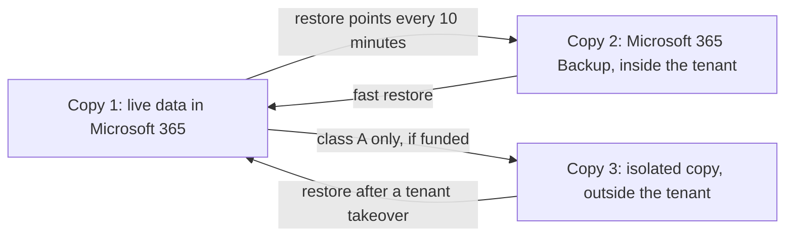
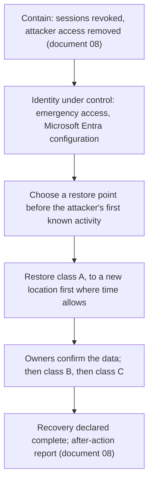

# 14. Business continuity and backup

> **Reference work.** Fictional scenario built for a public portfolio. Not deployed in, derived from, or describing any employer environment. Not professional advice.

## Purpose and scope

This document sets how Fabrikam (fictional) keeps its corporate IT working through an outage and gets its data back after a loss: a business impact analysis (BIA), three recovery classes with proposed objectives, backup for Microsoft 365 data ([ADR-006](adr/ADR-006-microsoft-365-backup.md)), corporate continuity, copies that survive ransomware, and a restore testing program measured by KPI-19. The Director of IT and Security owns corporate continuity and Microsoft 365 backup; disaster recovery for the product platform is owned by Engineering and is out of scope here. Every objective here is a proposal for the owning executive to confirm or change, and the backup design follows the confirmed numbers rather than the other way round.

## Starting point

On day 1, Microsoft 365 data has no backup beyond retention settings and the corporate continuity plan is out of date (assumption A-09 in document [01](01-scenario-and-assumptions.md)). One risk rests on this: R-03, ransomware or a destructive attack on corporate endpoints and Microsoft 365 data (owner: CEO). The [threat profile](17-threat-profile.md) rates ransomware against Microsoft 365 data (S-06) Medium to High: attackers take data, then encrypt or mass-delete SharePoint, OneDrive, and mailbox content and try to block recovery.

| Term | Meaning |
|---|---|
| Recovery time objective (RTO) | The longest a system or data set can stay unavailable before the harm becomes unacceptable, counted from the decision to restore |
| Recovery point objective (RPO) | How recent restored data must be: the most work, measured in time, that the business can afford to redo or lose |
| Maximum tolerable downtime (MTD) | How long a business function can run on workarounds before the damage becomes severe |
| Recovery class | A, B, or C: the group that sets a system's objectives, restore order, and test cadence |
| Isolated copy | A backup that someone in full control of Fabrikam's Microsoft 365 tenant still cannot change or delete |

## Business impact analysis

### Method

The BIA asks each function leader four questions: what stops when a system is down, when it hurts most, how long workarounds hold, and how much recent work could be re-created. First answers come from the Phase 1 stakeholder conversations (document [05](05-environment-discovery.md)). In Phase 2 the Director holds a one-hour session with each function leader using the Business Impact Analysis template NIST publishes with SP 800-34 Rev. 1, its contingency planning guide, which works with the same measures: maximum tolerable downtime, RTO, and RPO. Impact is scored on the five-level scale in document [11](11-risk-management.md), whose payroll column comes from this analysis, so the results feed the rating of R-03 directly; NIST IR 8286D (update 1, February 2025) describes the same use of a BIA to inform risk prioritization and response.

Two kinds of disruption are kept apart because they need different answers:

- **A provider's service is down** (Microsoft 365 or a software as a service (SaaS) application). Fabrikam cannot restore someone else's service, so the MTD and the workaround matter most.
- **Fabrikam's data is destroyed or corrupted** (ransomware, a malicious or mistaken deletion, a bad sync). Fabrikam restores from its own copies, so the RTO and RPO apply to its restore.

### Functions

| Function | What a disruption stops | Most sensitive periods | Depends on | One-day outage at peak (document 11 impact) | Proposed MTD |
|---|---|---|---|---|---|
| Support for customers' payroll | Help for customers fixing or submitting a pay run, so pay dates can slip | Customers' processing days (weekly and every two weeks); mid-December through January | Support platform, the product, Microsoft 365, sign-in through Microsoft Entra ID | 4 Major: any missed pay date in year-end season | 4 hours on a processing day |
| Support (other cases) | Case handling and customer questions | Benefits open enrollment, October to December | Support platform, customer relationship management (CRM) system, Microsoft 365 | 2 Minor | 1 business day |
| Finance, including Fabrikam's own payroll and payments | Fabrikam's pay run, vendor payments, bank-detail checks, close | Fabrikam's pay dates; month-end and year-end close | Finance system, HR system of record, bank portals, Microsoft 365 | 4 Major on a Fabrikam pay date; 2 otherwise | 1 business day near a pay date; 3 otherwise |
| Sales and renewals | Pipeline, quotes, renewal contacts | Quarter-end | CRM, Microsoft 365 | 2 Minor | 3 business days |
| People | Onboarding, employee questions, leavers | Start dates; open enrollment | HR system of record, Microsoft 365 | 2 Minor; urgent leavers are disabled directly in Microsoft Entra ID (document [07](07-identity-lifecycle-joiners-movers-leavers.md)) | 2 business days |
| IT service desk and incident response | Resets, requests, incident coordination | Any incident; year-end | IT service management (ITSM) tool, Microsoft 365, Microsoft Entra ID | 4 Major during an incident; 2 otherwise | 1 hour for incident coordination (out-of-band channel); 1 business day for requests |

Fabrikam runs its own product as its HR system of record (document 07), so if the product is unavailable Fabrikam's own HR work, and its own pay run if that runs in the product too (discovery confirms), stops as well. Recovery of the product platform itself is owned by Engineering and is out of scope here.

### Systems

| System | Business owner | Run by | Class (proposal) | RTO and RPO (proposal) | Recovery path |
|---|---|---|---|---|---|
| Microsoft Entra ID: sign-in, Conditional Access, groups, applications | Director of IT and Security | IT | A | 4 hours; 24 hours, an exception to class A's 1-hour RPO because Microsoft backs up Microsoft Entra objects once a day; tighter for settings exported after each approved change | Emergency access accounts (document [06](06-microsoft-365-security-baseline.md)); soft-deleted objects restorable for 30 days; Microsoft Entra Backup and Recovery; Fabrikam's dated configuration export |
| Exchange Online mailboxes | Each function | IT | A for finance, People, executive, General Counsel, and Support shared mailboxes; B for the rest | By class | Microsoft 365 Backup; the isolated copy for class A |
| SharePoint and OneDrive, including Teams channel files | Site owners | IT | A for finance, People, executive, legal, and Support payroll-day sites; B for other sites and OneDrive accounts; C for archives | By class | Microsoft 365 Backup; the isolated copy for class A |
| Teams chat, channel messages, meetings | Director of IT and Security | Microsoft | B as a service | No restore path for messages | Out-of-band channel during an outage; messages kept for compliance only where a retention policy covers them |
| Support platform (SaaS) | Chief Customer Officer | Vendor | A | 4 hours; 1 hour, asked of the vendor, with Fabrikam's own export as the fallback | Vendor resilience reviewed under POL-10; daily export of open case summaries; fallback contact path |
| Finance and accounting system (SaaS) | CFO | Vendor | A | 4 hours; 1 hour, asked of the vendor, with Fabrikam's own export as the fallback | Vendor resilience under POL-10; export after each close and pay run; bank portal fallback with out-of-band verification ([playbook](playbooks/payroll-diversion-and-email-compromise.md)) |
| HR system of record (Fabrikam's product) | VP of People | Engineering | B for HR work; A if Fabrikam's own pay run depends on it | The product's objectives | Product disaster recovery; worker list exported after each pay run |
| CRM (SaaS) | Sales leader | Vendor | B | 1 business day; 24 hours | Vendor resilience under POL-10; weekly export of accounts, renewals, and administrator contacts |
| ITSM tool (SaaS) | IT Operations Manager | Vendor | B | 1 business day; 24 hours | Vendor resilience under POL-10; weekly export of the incident register and asset list; offline incident log |
| Marketing automation (SaaS) | Marketing leader | Vendor | C | 5 business days; 1 week | Vendor resilience; export of lists and consent records |
| Code hosting and CI/CD | CTO | Engineering | Set by Engineering | Set by Engineering | Engineering's plan |
| Laptops | IT Operations Manager | IT | C for the fleet | 5 business days for a fleet rebuild; single replacements follow document [13](13-it-service-management.md)'s service levels | Rebuilt through Windows Autopilot or Apple automated device enrollment, not restored; work files are expected to live in OneDrive rather than only on the device, so a rebuilt laptop gets them back when its user signs in |

For SaaS, a system's class becomes a resilience requirement in that vendor's review under POL-10 (Third-Party Risk Management Policy, document [10](10-governance-and-compliance-program.md)). Fabrikam's own exports are a fallback with a looser recovery point, kept in a restricted class A SharePoint site so they inherit its backups. Acquired-company file stores that still sit outside Microsoft 365 are listed in Phase 1 and either moved in under [ADR-005](adr/ADR-005-acquired-company-consolidation.md) or given an interim backup until they are.

## Recovery classes

Fabrikam calls these recovery classes, not tiers, so they are not confused with the NIST CSF 2.0 Tiers, which describe the rigor of an organization's risk governance and management.

| Class | What belongs here | RTO (proposal) | RPO (proposal) | Restore order | Restore tests (proposal) |
|---|---|---|---|---|---|
| A | Loss stops Fabrikam's own payroll or payments, the customer support desk, or incident response | 4 hours | 1 hour | First, once identity is under control | A quarterly scenario, plus monthly spot checks |
| B | Work slows; workarounds hold for a few days | 1 business day | 24 hours | Second | Twice a year |
| C | Inconvenience; workarounds hold for a week or more | 5 business days | 1 week | Last | A sample twice a year, with class B |

- **The clock starts at the decision to restore.** Restoring into a tenant an attacker still controls repeats the damage, so containment comes first (document [08](08-detection-and-incident-response.md)) and the RTO runs from the incident commander's order to restore.
- **Classes are business decisions.** Each business owner confirms the class and objectives of their systems in Phase 2, and the executive team approves the set with POL-09 (Business Continuity and Disaster Recovery Policy) at M3. Any owner can ask for a tighter objective and sees its cost first.
- **One tension to test.** Microsoft's fastest SharePoint and OneDrive restores use its roughly daily "express" restore points, and a restore point that is not an express point, such as a recent 10-minute point, can be significantly slower. Class A asks for both a 4-hour RTO and a 1-hour RPO, so tests time both paths before Fabrikam promises both; in a real event the incident commander and the data owner choose between a newer point and a faster restore.

## Microsoft 365 backup

### Why retention settings are not a backup

Microsoft is plain about who owns the data. Its shared responsibility guidance says: "For all cloud deployment types, you own your data and identities. You're responsible for protecting the security of your data and identities, on-premises resources, and the cloud components you control." Microsoft adds that the page is illustrative guidance, not a legal conclusion. Its Microsoft 365 Backup FAQ says its stance on shared responsibility for data protection has not changed: "No, we still have the same point of view, but are now offering more tools to help organizations achieve those goals and responsibilities."

The same FAQ explains why the features Fabrikam relies on today are not a backup:

| Built-in feature | What it is for | Microsoft's own words on its limit |
|---|---|---|
| Microsoft's disaster recovery copies | Keep the service running if a Microsoft data center fails | "A DR copy with Microsoft 365 maintains the current state of content, not any historical versions from prior points in time." |
| Versions | Let a user roll back one file | "that kind of recovery method doesn't scale well for large-scale ransomware attacks where an admin needs to orchestrate the recovery. Versions might also be exhausted depending on the version limit set by the admin." |
| Legal holds | Keep content for legal and compliance needs | "Legal holds retain data, but that feature is optimized for export (for example, via eDiscovery), not for mass restore." |

Retention policies serve the same compliance purpose as holds, so Fabrikam treats them the same way: they stay under POL-15 (Privacy and Data Retention Policy) for compliance and are not counted as a recovery path. Microsoft keeps the two apart as well: retention and deletion policies "don't affect the backup recovery window, which remains fully isolated from those policies."

### What Fabrikam adopts

[ADR-006](adr/ADR-006-microsoft-365-backup.md) chooses Microsoft 365 Backup for every Exchange mailbox, OneDrive account, and SharePoint site that holds business data, plus an isolated copy of class A data in a third-party service if the executive team funds it at M3. Microsoft facts, checked on Microsoft Learn on 2026-10-13:

| Microsoft 365 Backup | What it means for Fabrikam |
|---|---|
| Backs up "all or select SharePoint sites, OneDrive accounts, and Exchange mailboxes": user and shared mailboxes, not room or group mailboxes; a few SharePoint site templates are unsupported | Teams chat and channel messages, group mailboxes, and Microsoft Entra ID sit outside it |
| Restore points every 10 minutes for the last two weeks, then weekly back to 52 weeks (OneDrive and SharePoint); every 10 minutes for 52 weeks (Exchange) | Class A's 1-hour RPO is within reach for this data |
| A recovery window set per policy: 3 months, 6 months, 1 year, or 2 years | Proposal: 1 year for every class; General Counsel confirms it against POL-15 |
| Rolls a whole site or OneDrive account back to a point in time, in place or to a new URL, and restores mailbox items to the same or a new folder. The feature table marks file restore through versions "(coming soon)", while the performance notes describe a granular folder and file restore option | Tests restore to new locations so live data is untouched; the first spot test confirms which file option the tenant has |
| Microsoft's published median expectations for a normally distributed tenant: about 30 minutes for one site or OneDrive account from an express restore point, about 2 hours for one mailbox, and about 3 to 4 hours for 250 of either | A targeted class A restore fits a 4-hour RTO; a tenant-wide event needs the class order; Fabrikam measures its own times |
| Append-only storage: "The backups are immutable unless expressly deleted by the Backup tool admin via product offboarding." Offboarding starts a 90-day grace period | The service cannot encrypt or alter existing backups; an administrator can delete them only slowly and visibly (next section) |
| "Microsoft 365 Backup is a pay-as-you-go offering that charges based on consumption, unlike traditional user-based licenses": metered on the volume of protected data each month and billed through an Azure subscription; Microsoft states that restores are free | No per-user license; cost grows with data volume; the billing subscription becomes a control |
| Setup needs a SharePoint Administrator or Global Administrator; a dedicated Microsoft 365 Backup Administrator role runs the tool | Day-to-day work never needs Global Administrator |
| Status: Microsoft's Learn pages carry no preview label | Fabrikam relies on it and rechecks anything marked "coming soon" before depending on it |

**Scope and order.** Class A goes under protection in Phase 2, before the mid-December freeze, with the CFO approving the consumption spend ahead of the M3 budget; class B follows in Phase 3 as an internal change; class C and anything left over follow in February 2027. Each private and shared Teams channel has its own SharePoint site, so a team's backup policy has to include those channel sites as well as its main site. New mailboxes, OneDrive accounts, and sites join the right policy when they are created (a step in the joiner and site request processes, documents 07 and [15](15-enterprise-systems-and-saas.md)), and a monthly check compares policy membership with the inventories.

**Deleted data lives on in backups.** Microsoft keeps the backup of a removed or deleted user's mailbox or OneDrive account "for one year from the date the backup was created", so backups outlive deletions. General Counsel sets backup retention in POL-15, and Microsoft's offboarding feature deletes the backups of specific sites, mailboxes, or users when a privacy request needs it.

**Identity.** Microsoft Entra Backup and Recovery "takes backups of supported objects automatically, once a day, retaining up to seven days of backup history": users, groups, applications, service principals, Conditional Access policies, named locations, the authentication method policy, and selected authorization policy properties. It needs Microsoft Entra ID P1 or P2 (P1 comes with E3), and "No signed-in user or application, even with the highest admin privileges, can turn off, delete, or modify backups in the tenant." It does not recover hard-deleted objects. Microsoft's June 2026 release note announces general availability (its body still says "At preview"), the overview page carries no preview label, and Microsoft 365 roadmap item 567885 says the 7-day recovery is already generally available (as of 2026-10-13); Phase 1 confirms it in the tenant (14.01), and 14.08 rechecks its status in Phase 3 before Fabrikam relies on it. A compromise found more than seven days after it began is beyond that window, so Fabrikam also exports its Conditional Access, named location, and authentication method settings after every change the Change Advisory Board approves, and keeps the dated export with the continuity kit, outside the tenant.

### Ransomware-resilient copies

A backup that an attacker can reach, change, or delete with the same stolen credentials is not a recovery path. CISA's #StopRansomware Guide (version 3.0, October 2023) asks organizations to "Maintain offline, encrypted backups of critical data, and regularly test the availability and integrity of backups in a disaster recovery scenario", and, for cloud services "such as Microsoft Office 365", to "Backup data often; offline or leverage cloud-to-cloud backups." Fabrikam adapts the 3-2-1 rule (three copies, two media, one off-site) to SaaS: three copies (live data, Microsoft 365 Backup, and an isolated copy of class A data); two independent control planes in place of two media (Fabrikam's tenant, and a separate backup account the tenant's credentials cannot open); and one copy that even a full tenant compromise cannot change or delete. The behaviors this guards against are, in MITRE ATT&CK v20, T1486 (Data Encrypted for Impact), T1485 (Data Destruction), and T1490 (Inhibit System Recovery).

| Protection | Microsoft 365 Backup | Isolated copy (if funded) |
|---|---|---|
| Changing existing restore points | Not possible: append-only storage | Immutable retention, required |
| Deletion by an administrator | Possible through offboarding, followed by a 90-day grace period during which Microsoft says repaired billing or a support request reverses it without losing backups. Cutting the period to seven days needs two approvers, each past a two-day aging window, and is blocked while fewer than two are set up | A deletion delay no single Fabrikam administrator can shorten, required |
| Who controls it | The Microsoft 365 Backup Administrator role and Global Administrators for every workload; SharePoint Administrators and SharePoint Backup Administrators for OneDrive and SharePoint; Exchange Administrators and Exchange Backup Administrators for Exchange | Separate accounts that do not sign in through Fabrikam's Microsoft Entra ID |
| Warnings | Multi-admin email notifications of potentially harmful events, sent as a daily digest; backup actions are auditable | Vendor alerts to addresses outside the tenant |
| Other ways to lose copies | An unhealthy billing state on the Azure subscription starts offboarding | An unpaid subscription, on the contract's terms |

Fabrikam's settings:

- **Separate administration.** Two named people, the IT Operations Manager and the Systems Engineer (Identity and Endpoint), hold the Microsoft 365 Backup Administrator role, so one absence never blocks a restore. They use separate cloud-only admin accounts with device-bound phishing-resistant methods (document 06, [ADR-004](adr/ADR-004-phishing-resistant-authentication-rollout.md)), and from Phase 4 the role becomes eligible through Privileged Identity Management with approval ([ADR-001](adr/ADR-001-microsoft-365-security-licensing.md)). SharePoint Administrator, Exchange Administrator, SharePoint Backup Administrator, and Exchange Backup Administrator assignments also manage backups for their workloads (Microsoft's setup page and built-in roles list), so they get the same treatment: few holders, separate admin accounts, and Privileged Identity Management from Phase 4.
- **Someone else hears about it.** The notification list holds the Director and the on-call alias, neither a backup administrator. Notices arrive as a daily digest, so from February 2027 action 14.11 turns Microsoft 365 Backup's audit log events (offboarding, paused or deleted policies, removed items) into an alert for the on-call, and for the managed detection and response (MDR) provider only if the chosen service triages Fabrikam's custom detections ([ADR-003](adr/ADR-003-managed-detection-and-response.md)), and gives document 08's owner the backup steps for the ransomware playbook.
- **Billing as a control.** The Azure subscription that pays for backup has a short owner list (a delegate of the CFO, and the Director), budget alerts, and a monthly billing health check.
- **No faster deletion by default.** Fabrikam names no approvers for shortening the grace period unless General Counsel needs it for a privacy request; until two approvers have aged in, Microsoft blocks it.
- **The isolated copy.** Its console accounts sit outside Fabrikam's Microsoft Entra ID, belong to two named people, and use hardware security keys stored like the emergency access keys (document 06). The service's application identity in Fabrikam's tenant can read every protected mailbox and site, and write to them during restores, so it is governed as one of Fabrikam's most sensitive non-human identities (R-08). Someone in control of the tenant can remove that access and stop new backups, but cannot reach copies already stored.

**Restoring after an attack.** NIST SP 800-61 Rev. 3 asks responders to check restoration assets "for indicators of compromise, file corruption, and other integrity issues before use" (RC.RP-03.R1). Fabrikam's order:

## Corporate continuity

A short plan built from the BIA replaces the out-of-date one: for each class A function, the trigger, the workaround, who decides, how long the workaround holds, and the return to normal. It stays in step with the incident response plan, as NIST asks: "Synchronize business continuity plans with incident response plans since incidents can undermine business resilience." (SP 800-61 Rev. 3, ID.IM-04.R1).

| Function | Workaround | Decides | Holds for |
|---|---|---|---|
| Support for customers' payroll | A fallback phone and email path for the support team | Chief Customer Officer | Hours |
| Finance and Fabrikam's own payroll | Urgent payments through the bank portal under dual approval and out-of-band verification (playbook); a manual pay run fallback the CFO defines | CFO | One pay cycle |
| People | Urgent leavers disabled directly in Microsoft Entra ID (document 07); onboarding paused | VP of People | Days |
| Sales and renewals | The latest CRM export for open deals and renewals | Sales leader | Days |
| IT service desk and incident response | Requests by phone and the out-of-band channel; an offline incident log | Director of IT and Security | Days |

### Out-of-band communication

If Microsoft 365 is down, Fabrikam loses email, Teams, and single sign-on together; if it is compromised, the attacker may be reading mail and chats. Either way, responders need channels that do not depend on Fabrikam's tenant, and the incident commander (document 08) decides when to switch.

| Need | Normal channel | Fallback independent of the tenant | Owner |
|---|---|---|---|
| Incident team and executives | Teams and email | A standing phone bridge and a messaging group on a separate service, with accounts that do not sign in through Fabrikam's Microsoft Entra ID | IT Operations Manager |
| Employees | Email and Teams | Text alerts or a manager phone tree, using personal numbers People holds with employees' consent | VP of People |
| Customers | Email from Fabrikam's domains; in-product notices | The customer status page, hosted apart from Fabrikam's Microsoft 365 and product; the Support phone line | Chief Customer Officer |
| Providers and partners | Email and portals | Phone numbers and account references in the offline contact list | IT Operations Manager |

### Emergency contacts and the continuity kit

The emergency contact list names the incident and continuity leads, the executive team, the Engineering Manager and the Site Reliability Engineering (SRE) lead on call, the MDR provider, Microsoft support, the support platform, finance system, CRM, and ITSM vendors, Fabrikam's bank contacts (kept by the CFO's team), and the IT hardware partner. It travels in a continuity kit with the incident response plan (document 08), this plan, the restore runbooks, the dated identity configuration export, and a note of where the emergency access keys are kept, never the keys themselves. CISA's guide says: "Ensure a hard copy of the plan and an offline version is available." The kit therefore exists as printed copies with two named holders and as an encrypted offline copy. It holds personal data, so it follows POL-05 (Data Classification and Handling Policy) and is refreshed every quarter, after staff changes, and before mid-December.

### Payroll-season considerations

- **Before mid-December:** class A backups live and tested; the kit and contact list refreshed; the out-of-band channel checked; provider support contacts confirmed; on-call coverage named (document 08); R-03 reviewed with its owner (document 11); Fabrikam's own payroll fallback desk-checked with the CFO.
- **Mid-December through January:** no exercises that pull in business teams; monthly spot restores continue because they touch no live data; backup changes go through the Change Advisory Board with care; Fabrikam's pay dates and bank cut-off times sit in the continuity plan.
- **Before October:** benefits open enrollment keeps Support and People busy from October to December, so the yearly mass restore exercise lands in the summer.

## Product disaster recovery is out of scope

Disaster recovery for the product platform, including its availability and recovery objectives against customers' processing windows, is owned by Engineering under the CTO and stays there. Corporate IT does not become the product's recovery backstop: a small IT team quietly holding product recovery would be a key-person risk (R-14) with no budget behind it, so any change of ownership is a CTO decision recorded in the RACI (responsible, accountable, consulted, informed) in document [04](04-operating-model-team-and-budget.md).

**SOC 2 availability criteria.** Fabrikam's SOC 2 report covers Availability. This document produces the corporate evidence for the availability criteria of the 2017 Trust Services Criteria that fall inside the corporate system boundary: A1.2 (backup processes and recovery infrastructure are in place and monitored) and A1.3 (recovery plans are tested). A1.1 (capacity is watched and managed against demand) falls to the product platform and Engineering. A recovery test without written evidence counts as no test. Until the current review period closes at M4, any change to how the corporate availability controls produce evidence is agreed with the audit firm first, through the finance manager who coordinates SOC 2.

Fabrikam applies the same thinking to its own pay run: the CFO defines a manual fallback and desk-checks it before mid-December.

## Restore testing program

A backup nobody has restored from is unverified. Tests restore to new locations so live data is never touched; Microsoft says in-place restores are the fastest, so test times are conservative. Cadences are proposals.

| Test | Scope | Cadence | Pass when | Owner |
|---|---|---|---|---|
| Spot restore | One file, folder, or mailbox item, rotating across classes and workloads | Monthly | Within the class RTO; the owner confirms the content | IT Operations Manager (either backup administrator runs it) |
| Class A scenario | A class A site or OneDrive account and a class A mailbox, alternating express and 10-minute restore points | Quarterly: early December, March, June, September | Within 4 hours; within 1 hour of the chosen point when a 10-minute point is used; the owner confirms | IT Operations Manager |
| Class B and C sample | A department site, a mailbox, and an archive | Twice a year, May and November | Within the class RTO | IT Operations Manager |
| Identity configuration | A difference report in Microsoft Entra Backup and Recovery against a recent backup, and a check that the dated export is current | Quarterly, with the emergency access test (document 06) | Backup present; export matches the live settings | Systems Engineer (Identity and Endpoint) |
| SaaS exports | Open the latest exports from the support platform, finance system, CRM, and ITSM tool | Quarterly | Current and readable | IT Operations Manager with each system owner |
| Isolated copy | A class A sample restored with the separate credentials | Twice a year once live | Within the class A RTO, or the gap recorded | Director of IT and Security |
| Mass restore exercise | At least 25 sites, accounts, and mailboxes restored to new locations, starting from choosing a clean restore point | Yearly, August or September | Class A within its RTO; throughput recorded | IT Operations Manager |
| Continuity drill | Out-of-band channel, contact list, call tree | Twice a year, one before mid-December | Every class A contact reached within an hour | IT Operations Manager |

**Test records.** Each record holds the date, scope, restore point chosen, start and finish times, the recovery time and point achieved against the class objective, the owner's check that the data is complete and usable, issues, actions, and sign-off. The records serve as SOC 2 evidence for A1.3 wherever corporate systems sit inside the system boundary (document 10) and feed KPI-19.

**KPI-19, restore tests meeting target recovery times.** Document [12](12-metrics-and-executive-reporting.md) and the [KPI catalog](../data/kpi-catalog.csv) define it: tests that met their class RTO divided by tests run, with skipped tests listed. The proposed target, in the catalog's words: every scheduled test run; 90 percent meet their recovery time objective from Phase 4; every miss gets a tracked action (KPI-18). A restore counts as met only when the owner confirms the data. The continuity drill is not a restore test, so its findings go to KPI-18.

## Phase plan

| Phase | Action ID | Action | Outcome | KPI | Owner role | Workstream |
|---|---|---|---|---|---|---|
| Phase 1 | 14.01 | Confirm what can be recovered today, one of the urgent Phase 1 items: restore a sample finance file and mailbox item to a new location with the tools that exist, read the retention settings, confirm that Microsoft Entra Backup and Recovery shows backups in the tenant | Recovery gaps known before anything changes; KPI-19 baseline | KPI-19 | IT Operations Manager | WS-8 |
| Phase 1 | 14.02 | Ask the BIA questions in the stakeholder conversations (document 05); list class A candidates, SaaS export options, and acquired-company file stores outside Microsoft 365 | First draft of classes and objectives | KPI-01 | Director of IT and Security | WS-8 |
| Phase 1 | 14.03 | Ask the CFO to approve the consumption spend for class A Microsoft 365 Backup ahead of the M3 budget, and to start at once if 14.01 finds class A data that cannot be recovered at all | Class A protection funded before the freeze | KPI-19 | Director of IT and Security | WS-8 |
| Phase 2 | 14.04 | Early December: set up Microsoft 365 Backup billing (named owners, budget alerts), class A policies, the two backup administrators, and harmful-event notifications; tell the SOC 2 audit firm, through the finance manager who coordinates SOC 2, that a control is added and none changed | Class A data protected before mid-December (an M2 quick win) | KPI-19 | Systems Engineer (Identity and Endpoint) | WS-8 |
| Phase 2 | 14.05 | First class A restore test, timed and confirmed by the data owner, before the freeze | The new restore path proven before year-end | KPI-19 | IT Operations Manager | WS-8 |
| Phase 2 | 14.06 | Continuity kit, emergency contact list, and out-of-band channel, version 1; desk-check Fabrikam's own payroll fallback with the CFO | Year-end continuity basics in place | KPI-18 | IT Operations Manager | WS-8 |
| Phase 2 | 14.07 | BIA sessions with each function leader; draft POL-09 | Draft classes, objectives, and policy | KPI-02 | Director of IT and Security | WS-8 |
| Phase 3 | 14.08 | Extend Microsoft 365 Backup to class B (an internal change, allowed during the freeze with care); start monthly spot restores and the dated identity configuration export; recheck the status of Microsoft Entra Backup and Recovery, first confirmed in 14.01, before relying on it | Most business data protected; identity settings recoverable beyond seven days | KPI-19 | Systems Engineer (Identity and Endpoint) | WS-8 |
| Phase 3 | 14.09 | The executive team approves the BIA, classes, objectives, and POL-09, and decides ADR-006 and the isolated copy with the M3 budget; each owner signs off their objectives | Approved recovery targets (M3) | KPI-02 | Director of IT and Security | WS-5 |
| Phase 4 | 14.10 | February 2027: protect class C and the remaining stores, or move them in under ADR-005; start KPI-19 reporting; put the backup role under Privileged Identity Management once the ADR-001 licenses arrive | All in-scope data protected; KPI-19 reported | KPI-19 | IT Operations Manager | WS-8 |
| Phase 4 | 14.11 | February 2027: with document 08's owner, alert the on-call on Microsoft 365 Backup administration events (offboarding, paused or deleted policies, removed items), and the MDR provider too if it triages custom detections (ADR-003); give document 08 the backup steps for the ransomware playbook | Tampering with backups raises an alert | KPI-16 | Systems Engineer (Identity and Endpoint) | WS-8 |
| Phase 4 | 14.12 | March 2027: quarterly class A scenario test, identity difference report, and SaaS export checks; add recovery and export terms to vendor reviews under POL-10 | Restore times measured against objectives | KPI-19 | IT Operations Manager | WS-8 |
| Phase 4 | 14.14 | April 2027: continuity drill of the out-of-band channel, contact list, and call tree | Channels proven before they are needed | KPI-18 | IT Operations Manager | WS-8 |
| Phase 5 | 14.15 | If funded: evaluate isolated copy services against ADR-006's criteria, review the chosen one under POL-10, set up the separate credentials, and restore a class A sample from it | One copy beyond the tenant's reach | KPI-19 | Director of IT and Security | WS-8 |
| Phase 5 | 14.17 | Yearly mass restore exercise in August or September, feeding the ransomware playbook exercise in document 08 | Throughput known; playbook tested | KPI-19 | IT Operations Manager | WS-8 |
| Phase 5 | 14.18 | Readiness review for the next year-end in September and October; refresh the BIA for the annual program review (M7) | The next season starts from tested recovery | KPI-01 | Director of IT and Security | WS-8 |

## Resourcing and dependencies

| Phase | Roles | Partners | Licenses and services |
|---|---|---|---|
| Phase 1 | Director of IT and Security (BIA); IT Operations Manager (recoverability check); CFO (spend approval) | SOC 2 audit firm, told of planned changes | Microsoft 365 E3 only |
| Phase 2 | IT Operations Manager and Systems Engineer (Identity and Endpoint) as backup administrators; CFO (billing owners, own payroll fallback) | IT hardware partner (security keys) | Microsoft 365 Backup: pay-as-you-go through an Azure subscription, no per-user license; an out-of-band messaging service and phone bridge |
| Phase 3 | Executive team (M3 approval); General Counsel (backup retention in POL-15) | SOC 2 audit firm (evidence) | Microsoft Entra ID P1, included in E3, for Microsoft Entra Backup and Recovery |
| Phase 4 | Systems Engineer (Identity and Endpoint) for 14.11 in February; Director of IT and Security (detection and test evidence), with contracted specialist help for surge and build work | MDR provider (backup tampering alerts, if it triages custom detections) | Microsoft Entra ID P2 or Microsoft Entra ID Governance for Privileged Identity Management ([ADR-001](adr/ADR-001-microsoft-365-security-licensing.md)) |
| Phase 5 | Director of IT and Security (isolated copy), with contracted specialist help | A third-party backup service, if funded, reviewed under POL-10 | The isolated copy subscription, if funded |

- **Cost drivers.** The monthly volume of protected data and its growth; the isolated copy subscription, sized to class A; the out-of-band tools; and about one working day a month of team time for tests once the routine settles. No figures here; document [04](04-operating-model-team-and-budget.md) sizes them.
- **Depends on.** Documents [01](01-scenario-and-assumptions.md) (assumptions), [04](04-operating-model-team-and-budget.md) (RACI, budget), [05](05-environment-discovery.md) (discovery), [06](06-microsoft-365-security-baseline.md) (admin accounts, emergency access, Privileged Identity Management), [07](07-identity-lifecycle-joiners-movers-leavers.md) (joiners and leavers), [08](08-detection-and-incident-response.md) (containment, playbooks, clause inventory, exercises), [10](10-governance-and-compliance-program.md) (POL-05, POL-09, POL-10, POL-15, the SOC 2 program), [11](11-risk-management.md) (R-03, the impact scale), [12](12-metrics-and-executive-reporting.md) (KPI-19), [13](13-it-service-management.md) (change management, endpoint standard), [15](15-enterprise-systems-and-saas.md) (SaaS inventory, site requests), and [17](17-threat-profile.md) (S-06); [ADR-001](adr/ADR-001-microsoft-365-security-licensing.md), [ADR-003](adr/ADR-003-managed-detection-and-response.md), [ADR-004](adr/ADR-004-phishing-resistant-authentication-rollout.md), [ADR-005](adr/ADR-005-acquired-company-consolidation.md), and [ADR-006](adr/ADR-006-microsoft-365-backup.md). It feeds documents [02](02-first-90-days.md), [03](03-twelve-month-roadmap.md), and 11.

## Risks and open questions

- **Objectives are proposals.** Owners may want tighter objectives that cost more, or accept looser ones. If the confirmed objectives differ from these, ADR-006 is revisited before more is built.
- **The in-tenant backup shares the tenant's control plane.** Global Administrator and Microsoft 365 Backup Administrator act on every workload's backups, SharePoint Administrator and SharePoint Backup Administrator on OneDrive and SharePoint backups, and Exchange Administrator and Exchange Backup Administrator on Exchange backups. Because Microsoft lets a SharePoint Administrator set up the tool itself, Fabrikam treats that role as able to switch it off for every workload. Someone who holds one of these roles, or breaks billing, and goes unnoticed past the grace windows could still destroy what that access reaches. The isolated copy covers class A only, and only if funded; otherwise the CEO, as owner of R-03, accepts the residual within document 11's limits.
- **Coverage gaps.** Teams chat and channel messages, group and room mailboxes, and a few site templates are outside Microsoft 365 Backup; Microsoft's pages differ on file-level restore; Microsoft Entra Backup and Recovery keeps seven days and its status needs confirming.
- **Restore speeds are Microsoft's published medians,** not commitments; a single site can take 10 to 120 minutes. Fabrikam's own tests set the real numbers.
- **Backups keep deleted data** for the recovery window, which POL-15 and privacy requests must account for.
- **SaaS recovery depends on vendors.** Fabrikam cannot restore a vendor's service; exports cover part of the data, and some vendors may offer no usable export.
- **Product recovery stays with Engineering.** Disaster recovery for the product platform is Engineering's, under the CTO, and out of scope for this plan.
- **Plans decay.** Contact lists, out-of-band accounts, and the kit go stale unless they are drilled.
- **Time-sensitive Microsoft facts.** Microsoft changed the backup billing setup for customers onboarding after April 1, 2026 and marks some features "coming soon"; recheck before relying on them.
- **Open questions.** Does Fabrikam run its own payroll in its product? Which acquired-company file stores sit outside Microsoft 365? Do SaaS contracts give Fabrikam a usable export and data return at exit (POL-10)?

## Framework mapping

By identifier only, consistent with the [crosswalk](crosswalk/csf2-soc2-crosswalk.md). The relationships are this plan's own analysis; no official AICPA mapping between the Trust Services Criteria and CSF 2.0 was found.

| Theme | NIST CSF 2.0 | SOC 2 (2017 TSC) |
|---|---|---|
| Business impact analysis and recovery classes | GV.OC-04, GV.OC-05, ID.AM-05, ID.RA-04 | CC3.2, CC9.1 |
| Backups and resilience mechanisms | PR.DS-11, PR.IR-03 | A1.2, CC9.1 |
| Separate administration of backups | PR.AA-05 | CC6.1, CC6.3 |
| SaaS and cloud providers in recovery planning | GV.SC-05, GV.SC-08 | CC9.2 |
| Recovery execution and integrity | RC.RP-01, RC.RP-02, RC.RP-03, RC.RP-04, RC.RP-05, RC.RP-06 | CC7.5 |
| Recovery communication | RC.CO-03, RC.CO-04 | CC2.3, CC7.4 |
| Testing and plan improvement | ID.IM-02, ID.IM-04 | A1.3, CC4.1 |
| Capacity of the product platform (Engineering) | PR.IR-04 | A1.1 |
| Business Continuity and Disaster Recovery Policy (POL-09) | GV.PO-01 | CC5.3 |

## Sources

- Overview of Microsoft 365 Backup. Microsoft Learn. https://learn.microsoft.com/en-us/microsoft-365/backup/backup-overview . Checked 2026-10-13. Primary.
- Frequently asked questions about Microsoft 365 Backup. Microsoft Learn. https://learn.microsoft.com/en-us/microsoft-365/backup/backup-faq . Checked 2026-10-13. Primary.
- Set up Microsoft 365 Backup. Microsoft Learn. https://learn.microsoft.com/en-us/microsoft-365/backup/backup-setup . Checked 2026-10-14. Primary.
- Offboarding in Microsoft 365 Backup. Microsoft Learn. https://learn.microsoft.com/en-us/microsoft-365/backup/backup-offboarding . Checked 2026-10-13. Primary.
- Audit log activities (Microsoft 365 Backup activities). Microsoft Learn. https://learn.microsoft.com/en-us/purview/audit-log-activities . Checked 2026-10-14. Primary.
- Microsoft Entra built-in roles (Exchange Backup Administrator, SharePoint Backup Administrator). Microsoft Learn. https://learn.microsoft.com/en-us/entra/identity/role-based-access-control/permissions-reference . Checked 2026-10-13. Primary.
- Shared responsibility in the cloud. Microsoft Learn. https://learn.microsoft.com/en-us/azure/security/fundamentals/shared-responsibility . Checked 2026-10-13. Primary.
- Microsoft Entra Backup and Recovery overview. Microsoft Learn. https://learn.microsoft.com/en-us/entra/backup/overview . Checked 2026-10-13. Primary.
- Microsoft Entra releases and announcements (June 2026 entry on Microsoft Entra Backup and Recovery). Microsoft Learn. https://learn.microsoft.com/en-us/entra/fundamentals/whats-new . Checked 2026-10-13. Primary.
- Microsoft 365 roadmap item 567885, Microsoft 365: Entra ID Backup & Recovery (release communications record). Microsoft. https://www.microsoft.com/releasecommunications/api/v1/m365/567885 . Checked 2026-10-13. Primary.
- Teams and SharePoint integration. Microsoft Learn. https://learn.microsoft.com/en-us/sharepoint/teams-connected-sites . Checked 2026-10-13. Primary.
- Redirect and move Windows known folders to OneDrive. Microsoft Learn. https://learn.microsoft.com/en-us/sharepoint/redirect-known-folders . Checked 2026-10-13. Primary.
- The NIST Cybersecurity Framework (CSF) 2.0 (CSWP 29, February 26, 2024). NIST. https://nvlpubs.nist.gov/nistpubs/CSWP/NIST.CSWP.29.pdf . Checked 2026-10-13. Primary.
- Contingency Planning Guide for Federal Information Systems (NIST SP 800-34 Rev. 1, May 2010, updated November 11, 2010), publication record with the Business Impact Analysis template. NIST. https://csrc.nist.gov/pubs/sp/800/34/r1/upd1/final . Checked 2026-10-13. Primary.
- Incident Response Recommendations and Considerations for Cybersecurity Risk Management: A CSF 2.0 Community Profile (NIST SP 800-61 Rev. 3, April 2025). NIST. https://nvlpubs.nist.gov/nistpubs/SpecialPublications/NIST.SP.800-61r3.pdf . Checked 2026-10-13. Primary.
- Using Business Impact Analysis to Inform Risk Prioritization and Response (NIST IR 8286D, update 1, February 2025), publication record. NIST. https://csrc.nist.gov/pubs/ir/8286/d/upd1/final . Checked 2026-10-13. Primary.
- #StopRansomware Guide (version 3.0, October 2023). CISA, MS-ISAC, NSA, FBI. https://www.cisa.gov/resources-tools/resources/stopransomware-guide . Checked 2026-10-13. Primary.
- 2017 Trust Services Criteria (With Revised Points of Focus, 2022), download page. AICPA & CIMA. https://www.aicpa-cima.com/resources/download/2017-trust-services-criteria-with-revised-points-of-focus-2022 . Checked 2026-10-13. Primary.
- MITRE ATT&CK, Enterprise matrix, v20 (the T1490 page, which names T1485 and T1486). MITRE. https://attack.mitre.org/techniques/T1490/ . Checked 2026-10-13. Primary.
- MITRE ATT&CK updates, October 2026 (the ATT&CK v20 release notes, October 13, 2026). MITRE. https://attack.mitre.org/resources/updates/updates-october-2026/ . Checked 2026-10-13. Primary.