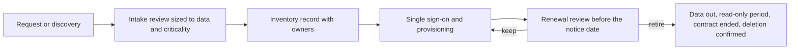

# 15. Enterprise systems and SaaS

> **Reference work.** Fictional scenario built for a public portfolio. Not deployed in, derived from, or describing any employer environment. Not professional advice.

## Purpose and scope

This document sets how Fabrikam (fictional) knows, admits, connects, governs, and retires the business applications its people use: the application portfolio, SaaS discovery, intake, single sign-on and provisioning coverage, license management, Teams and SharePoint governance, email domains, the consolidation of systems left by the two acquisitions ([ADR-005](adr/ADR-005-acquired-company-consolidation.md)), and the automation platform. It leads workstream WS-7. Security settings are in document [06](06-microsoft-365-security-baseline.md), the identity lifecycle in document [07](07-identity-lifecycle-joiners-movers-leavers.md), and the AI rules in document [16](16-ai-adoption-guardrails.md); Fabrikam's product platform and its customer-facing integrations belong to Engineering under the RACI in document [04](04-operating-model-team-and-budget.md). Reference tables and per-action detail are in the appendices.

## Starting point

At day 1 the acquisitions have left duplicate tools, there is no application inventory, and single sign-on covers only some applications (A-08 in document [01](01-scenario-and-assumptions.md)). Users can consent to third-party apps, acquired accounts have unclear owners (A-02), and Teams and SharePoint have sprawled with "Anyone" links (A-06). Of the two older brand domains from the acquisitions, one no longer sends mail but publishes no SPF or DMARC record, and the other sends only through a marketing service and has no DMARC record (A-05). The matching risks in document [11](11-risk-management.md) are unmanaged and duplicate SaaS (R-09), unwatched integration credentials (R-08), leavers who keep application access (R-05), and oversharing (R-07); in the [threat profile](17-threat-profile.md), consent phishing (S-05) and integration compromise (S-08) exploit applications and connections nobody owns or watches, and insider misuse (S-07) is harder to contain when SaaS access is ungoverned.

| Area | Day 1 | Month 12 (M7) |
|---|---|---|
| Inventory | None | Every application has owners, data classification, sign-in method, contract dates, and integrations on record |
| New applications | Bought by teams on their own | Requested through intake and reviewed in proportion to data and criticality |
| Sign-in | Single sign-on for some applications | KPI-07 at its proposed targets; exceptions accepted by a named executive |
| Provisioning | By hand | SCIM where the application supports it, tickets with service levels elsewhere (document 07) |
| Teams and SharePoint | Sprawl and open links | Labeled, owned, expiring workspaces |
| Acquired systems | Separate or duplicated | Consolidated into the primary tenant and Fabrikam standards (ADR-005) |
| Older brand domains | One no longer sends mail but publishes no SPF or DMARC record; the other sends only through a marketing service and has no DMARC record | Enforced, redirected, or retired, with registrations kept |
| Automation | Ad hoc | Named owners, least privilege, change control |

## Principles

1. **One inventory, one accountable owner per application.** An application not in the inventory is not approved.
2. **Reuse before buying.** Intake first asks whether an approved tool already does the job.
3. **Review in proportion** to the data an application holds and how much the business depends on it.
4. **Single sign-on is the front door; provisioning is the back door.** Only SCIM, or a ticket with a service level, removes a leaver's account.
5. **Retire on purpose.** The survivor goes live first, the data comes out, the old tool stays readable for one business cycle, and the contract ends at its notice date with deletion confirmed.
6. **Calendar first.** Customer-facing changes wait until after the mid-December to January 31 freeze; systems in the current SOC 2 system description change after M4 or with the SOC 2 audit firm's agreement.
7. **No change without a way back.** Every change to mail flow, DNS, sign-in, or access carries a written rollback and a communication plan before the Change Advisory Board approves it (document [13](13-it-service-management.md)).

## Application portfolio

The inventory lives in the IT service management (ITSM) tool as application records beside the request catalog and the change records (document 13), so intake, renewals, and changes point to the same entry. The IT Operations Manager reconciles it monthly (proposal) against Microsoft Entra enterprise applications and consent grants, the finance system's vendor and card spend, and the discovery sources below. Appendix: Application portfolio template lists the record fields and each core system's owner, data, target sign-in, and year-one direction. Year one replaces no core platform except acquisition duplicates; any replacement proposal goes into the next-year plan at M7.

The business owner decides whether an application is needed and approves seats and renewals with the CFO. IT owns sign-in, provisioning, and the record, and the GRC Analyst keeps vendor review records under POL-10. The Director of IT and Security proposes the application rules, the executive team approves them with the policy set at M3 (document [10](10-governance-and-compliance-program.md)), and the executive accountable for an application accepts any residual risk through the exception process in document 11.

## SaaS discovery

No single source sees everything, so discovery combines several and repeats monthly (proposal): Entra enterprise applications, sign-in logs, and OAuth consent grants; finance and procurement data; Cloud App Discovery log uploads from the two offices; team tool lists and intake requests; and, from Phase 4, endpoint-based discovery with app governance (if Microsoft Defender Suite is approved at M3) and Account Discovery. Appendix: Discovery, intake, and sign-on reference gives each source's findings, license, phase, and limits.

**Triage.** Each newly found application is known (the record is updated), wanted (it goes to intake, with an approved alternative offered), or unwanted (the owner is contacted and, once Microsoft Defender Suite is in place (Defender for Cloud Apps with Defender for Endpoint Plan 2, from Phase 4 if approved at M3), the app is blocked through Defender for Endpoint network protection after notice). Usage is reported by team, not by person, except in an investigation under document [08](08-detection-and-incident-response.md).

## New application intake

Intake covers buying or trialing software that will hold Fabrikam data, connecting an application to Microsoft 365 or another system, browser extensions or add-ins that read work data, and new AI features in approved tools, including agent features that act on Fabrikam's systems (document 16 adds its AI questions at whatever depth the data calls for). A renewal with a material change (new data, integration, or owner) comes back through intake. Requests start in the ITSM portal, and review depth follows data and criticality:

- **Public or Internal data only, and no business process depends on the tool:** a light check of terms, Entra single sign-on support, admin controls, and data location, decided in about three business days (proposal). The Director of IT and Security runs it until the Security Engineer starts.
- **Confidential data, or a business process would stop without the tool:** the full review under POL-10. The GRC Analyst records it once in post (March 2027 in the base case, document 04; until then the Director, with the outside audit-readiness consultant), and Finance confirms the budget.
- **Restricted data (customer payroll registers and exports, Social Security numbers, bank details, Form I-9 and E-Verify data, background check results, benefits data, clock-in location, or Fabrikam employees' HR records), money movement, or a connection to the product platform:** the full review, plus the data owner and General Counsel. Customer contracts decide whether customers must hear about a new subprocessor first (document 10), and Engineering reviews any connection to the product.

The full review's scope and the approval requirements (proposals) are in Appendix: Discovery, intake, and sign-on reference. Where single sign-on or SCIM sits only in a higher-priced plan, intake records a cost driver; for Confidential and Restricted applications the higher plan is the default proposal, and the business owner and the CFO decide the spend. An application that cannot meet a requirement goes to document 11's exception process with compensating controls (for example a vaulted credential, document 06) and a review date, and its accountable executive accepts the residual risk.

## Single sign-on and provisioning coverage (KPI-07)

**KPI-07.** Document [12](12-metrics-and-executive-reporting.md) and the [KPI catalog](../data/kpi-catalog.csv) hold the definition, formula, and targets; this document sets the order. KPI-07 is the share of SaaS applications in the inventory that sign users in through Microsoft Entra single sign-on, reported for all inventoried applications and for those that hold customer or employee data. The M1 baseline divides applications on Entra single sign-on by application inventory v1 (document 05). **Targets (proposals):** by M7, 90 percent of applications that hold customer or employee data and 70 percent of all inventoried applications. Separately, action 15.14's outcome puts every application holding Restricted data behind single sign-on by the end of April.

**Licensing.** Microsoft 365 E3 includes Microsoft Entra ID P1, so this work needs no new Microsoft license; the cost drivers are vendor plan tiers and engineering time (Microsoft facts in Appendix: Discovery, intake, and sign-on reference).

**Pattern for every application.** One enterprise application per SaaS app, with assignment required and granted to flat groups fed by document 07's access packages (nested groups do not carry assignment); document 06's Conditional Access on every sign-in; SCIM where supported, otherwise a ticket with the leaver service level; local passwords off wherever the application allows, except one break-glass admin account in the enterprise password vault (document 06); and an owner and expiry date in the inventory for each SAML signing certificate, because an expired certificate stops sign-in.

| Order | Application | When | Why in this position |
|---|---|---|---|
| 1 | ITSM tool | Phase 3 (January) | IT-owned and internal, so it proves the pattern without customer impact; its SCIM connection follows in action 07.15 |
| 2 | Finance and accounting system | February, after year-end close and 06.24's identity and endpoint changes | Restricted data and money movement (R-01); the wave 2 group is already on phishing-resistant MFA (CA-04) |
| 3 | Customer support platform | February to March, mid-week and outside payroll peaks | Restricted data in cases (A-06); timed with the Chief Customer Officer |
| 4 | Code hosting and CI/CD | March | Source code and pipeline secrets (R-08); through Engineering's change process with the Engineering Manager |
| 5 | CRM and marketing automation | April | Confidential customer and prospect data |
| 6 | Remaining applications | Phase 5 | By data classification, then by user count |
| None | Applications retiring under ADR-005 | Not applicable | Access is cleaned up and the application retired instead |

Applications named in the current SOC 2 system description change their sign-in path before M4 only with the SOC 2 audit firm's agreement; otherwise they move in April.

## License management

- **Microsoft 365.** Licenses come from group-based licensing on dynamic groups keyed to worker type (document 07), and a leaver's license returns when the account is deleted 30 days after the leave date. Mail that POL-15 must keep is held by a Microsoft 365 retention policy applied before the account is deleted, which turns the mailbox into an inactive mailbox; Microsoft states that inactive mailboxes don't require a usage license, and Phase 1 confirms which retention features E3 covers (document 06). Microsoft warns against changing the user principal name (UPN) or primary SMTP address before deleting an account whose mailbox should become inactive, so leavers are excluded from consolidation UPN changes. A restored user gets back the licenses held at deletion even when none are free, so every restore is checked against the license count.
- **SaaS seats and renewals (proposals).** SCIM deprovisioning frees seats in applications that bill by active account; elsewhere the leaver ticket includes reclaiming the seat. Each month the IT Operations Manager compares paid seats with last sign-in from Entra sign-in data and each application's admin reports. About 120 days before each notice date, the business owner, IT, and Finance record in the inventory whether the application is still needed or duplicated, whether seats are right-sized, whether single sign-on and SCIM are in the plan, whether the assurance report is current, and whether its AI features have changed.
- **Duplicates from the acquisitions.** Duplicate subscriptions in one category, people licensed in two tenants, and separate device management and file storage contracts each end at their notice dates, after the survivor is live and the data is out (ADR-005). Finance owns contracts and dates, IT owns assignment and reconciliation, and business owners own seat requests. Savings go to the IT and Security Steering Group monthly in relative terms and offset part of the plan's cost in document 04.

## Collaboration governance: Teams and SharePoint

Document 06 sets the tenant sharing levels and guest settings. This section governs the workspaces themselves, where R-07 lives and where an AI assistant would surface overshared files (document 16).

**Creation stays open to employees.** A remote-first company works in Teams every day, and a request queue would push work into unsanctioned tools and load a small IT team, so guardrails replace gatekeeping (Microsoft's guidance is quoted in Appendix: Collaboration controls). If sprawl continues after Phase 4, creation narrows to employees who complete a short workspace-owner module.

| Control | Design in brief (proposals) | Phase | KPI |
|---|---|---|---|
| Container sensitivity labels | Internal, Confidential, and Restricted labels set privacy, guests, and sharing; required at creation | 4, after 06.28 | KPI-17 |
| Naming | A department prefix and blocked words for names that imitate official channels | 4 | KPI-01 |
| Two owners | At least two per team and group; a monthly report finds gaps | Report 2; enforced 4 | KPI-01 |
| Guests | Added only where the label allows; sponsors, expiry, and reviews (documents 06 and 07) | 4 | KPI-13 |
| Expiry | One announced 180-day group expiration policy, after the owner clean-up | 4 | KPI-01 |
| Restricted workspace reviews | Owners confirm membership every six months through Entra access reviews | 4, from April (07.14) | KPI-13 |
| Clean-up | Inactive and ownerless workspaces archived or deleted after notice, before the Copilot pilot and at M7 | 5 | KPI-01 |

Appendix: Collaboration controls has the full design, licenses, and Microsoft behaviors.

## Email domains

Fabrikam runs its main domain and the older brand domains from the two acquisitions in its primary tenant. The email authentication subsection of document 06 sets SPF, DKIM, and DMARC enforcement for every one of them; this section decides each domain's future. For the older brand domains, document 06 starts early: the one that no longer sends gets parked-domain records in Phase 2 (06.16), a non-disruptive quick win (SPF with -all and DMARC at p=reject, plus a null MX only if it receives no mail either), and the one that sends only through a marketing service gets a DMARC record with reporting in Phase 1 (06.06), then either follows the path to enforcement or moves its mail to a subdomain of the main brand (06.27).

| Path | When it applies | What happens |
|---|---|---|
| Keep | The main domain, and any older brand domain that still sends | Enforced on document 06's path (06.27); bulk mail from subdomains |
| Redirect | An older brand domain that no longer needs to send | Senders moved to the main brand; old addresses kept as aliases; parked-domain records; MX left alone |
| Retire | No legitimate inbound mail for 90 days (proposal) and no contract or customer template names it | Removed from the tenant; null MX; registration kept |

Retired domains stay registered because someone else could otherwise register one to impersonate Fabrikam to customers, or to capture password-reset mail for SaaS accounts still tied to old addresses. Appendix: Email domain paths gives the full actions and rollbacks.

Decisions draw on DMARC aggregate reports, message trace, General Counsel (contracts that name old-brand notice addresses), the Chief Customer Officer (customer-facing links and templates), and the inventory (SaaS accounts registered with old addresses). Registrar and DNS host accounts get named owners, MFA, transfer lock, and auto-renewal, with renewal notices going to a monitored role mailbox. The FBI recommends domain protection services that flag lookalike domain registrations; a monitoring service is a Phase 4 cost driver, and takedown requests go through General Counsel. Customer-facing changes land after the freeze, and retirements land in Phase 5.

## Acquisition consolidation

[ADR-005](adr/ADR-005-acquired-company-consolidation.md) decides to consolidate acquired-company identities, devices, files, and SaaS into the primary tenant and Fabrikam standards in phases: preparation in Phases 1 to 3, waves from late February 2027, and decommissioning by M7. Mail already runs in the primary tenant, and the older brand domains follow the email domains section above. The acquired product line's own platform is Engineering's (document 04); this plan covers the corporate IT of the acquired product line's team, which must be on standard controls before M5. If a leftover Microsoft 365 tenant holds files, Microsoft's cross-tenant OneDrive and SharePoint migration tools apply; their licenses, preview status, and one-way limits are set out in ADR-005. Applications on servers in the inherited offices follow document 06's remote access path: retire them, or publish them through application proxy (Microsoft Entra ID P1, included in E3; action 06.31).

Each acquired person moves in the order identity (matched to the HR record by worker ID through the HR feed, 07.11), device (ADR-008's order), files, then SaaS. No Conditional Access exclusions ease the move: acquired teams join the managed-device rings (CA-06) only after their device wave. Appendix: Consolidation streams gives each stream's steps and rollback point.

**Communication and support.** Each wave gets notices two weeks and two days ahead from the team's leader and the VP of People, covering the user communication points in Microsoft's cross-tenant SharePoint migration overview, plus champions and one Teams channel. The IT Operations Manager sizes waves to service desk capacity, books device resets, uses Remote Help (in E3), and holds the next wave if KPI-20, KPI-21, or KPI-24 slip. Nobody is promised zero downtime: OneDrive moves go read-only for minutes, a device reset takes a working session, and UPN changes break links (Risks below).

**What usually goes wrong, most likely first.**

1. **Unmapped users or groups, or oversharing carried across.** Owners check the identity map, and Anyone links come off before any move.
2. **A target OneDrive already exists, so a cross-tenant OneDrive move fails.** This is likely here, because acquired staff already sign in to the primary tenant; those users copy through the OneDrive sync app with service desk help.
3. **Known Folder Move still points at the old organization, so the desktop looks empty.** It is turned off first.
4. **Paths over 400 characters, holds, or Customer Key block moves.** The Phase 3 scans find them.
5. **Device records deleted early.** Microsoft documents that deleting the device in Microsoft Entra loses the LAPS password stored there, and that deleting its Intune object leaves BitLocker suspended on the operating system volume. No Microsoft Entra or Intune deletes outside ADR-008's order.

## Automation platform

Automation is how a small IT team keeps up (R-14), and every automation is also an identity with access (R-08), so each one has a named owner, the least privilege it needs, and change control.

| Need | Tool | License | Rule |
|---|---|---|---|
| Personal productivity on the maker's own data | Power Automate cloud flows with standard connectors | Included with Microsoft 365 licenses, which Microsoft lists with standard connectors only (no premium or custom connectors, no on-premises data gateway) | Allowed under the data policy; never Restricted data |
| A process another team relies on | Power Automate in a dedicated environment, inside a solution, with a co-owner | Premium or custom connectors need Power Automate Premium per user or a Power Automate Process license per flow (cost driver) | Recorded in the inventory; change control |
| IT and identity automation (Lifecycle Workflows custom task extensions, reconciliation, reports, ticket creation) and scheduled scripts against Microsoft Graph | Azure Logic Apps and scripts in the corporate Azure subscription, authenticating with a managed identity or service principal, never a user account (document 06) | Azure consumption; Microsoft lists no Entra license requirement for managed identities | Change control; least-privilege Microsoft Graph permissions |

**Rules.** One tenant-level Power Platform data policy covers every environment; Microsoft Graph application permissions take the narrowest scope through document 06's admin consent workflow; managed identities come first; every automation identity has an owner and a backup owner; and automation that changes access, licenses, or Restricted data goes through the Change Advisory Board (KPI-24). Appendix: Automation rules gives the detail and what is out of scope.

## Phase plan

Each action in full is in Appendix: Phase plan action detail.

| Phase | Action ID | Action | Outcome | KPI | Owner role | Workstream |
|---|---|---|---|---|---|---|
| Phase 1 | 15.01 | Set inventory fields; build application inventory v1 | Application inventory v1 at M1; KPI-07 baseline | KPI-07 | IT Operations Manager | WS-7 |
| Phase 1 | 15.02 | Map acquisition leftovers; close admin and leaver gaps | Consolidation scope known; no unwatched admin path or leaver account | KPI-12, KPI-09 | Systems Engineer (Identity and Endpoint) | WS-7 |
| Phase 1 | 15.03 | Build the domain table | A proposed keep, redirect, or retire path for every domain | KPI-24 | Systems Engineer (Identity and Endpoint) | WS-7 |
| Phase 2 | 15.04 | Open intake, with an interim review rule | No new application reaches Fabrikam data unreviewed | KPI-05 | Director of IT and Security | WS-7 |
| Phase 2 | 15.06 | Choose surviving tools; lock retiring applications | Survivor list with retirement dates tied to contracts | KPI-07 | IT Operations Manager | WS-7 |
| Phase 2 | 15.08 | Start the monthly two-owner report | Fewer orphaned workspaces before labels and expiry arrive | KPI-01 | Service Desk Analyst | WS-3 |
| Phase 3 | 15.05 | Review consent grants and enterprise apps; revoke orphans | Ownerless application access removed (S-05) | KPI-07 | Systems Engineer (Identity and Endpoint) | WS-1 |
| Phase 3 | 15.07 | Scan inherited file servers read-only; remove Anyone links | File stores sized and cleaned before any move | KPI-01 | Systems Engineer (Identity and Endpoint) | WS-7 |
| Phase 3 | 15.09 | Executive approval of ADR-005, application rules, survivors, and budget lines | Approved at M3 | KPI-01 | Director of IT and Security | WS-7 |
| Phase 3 | 15.10 | Rehearse consolidation on IT's own accounts; write runbooks | A proven runbook before the first business wave | KPI-24 | IT Operations Manager | WS-7 |
| Phase 3 | 15.11 | ITSM tool behind Entra single sign-on | Sign-on pattern proven on an IT-owned application | KPI-07 | Systems Engineer (Identity and Endpoint) | WS-7 |
| Phase 3 | 15.12 | Set automation guardrails | Automation visible, owned, and change-controlled | KPI-24 | Systems Engineer (Identity and Endpoint) | WS-7 |
| Phase 3 | 15.13 | Approve domain paths; secure registrar and DNS accounts | Every domain has an approved path; no unowned registrar account | KPI-24 | Systems Engineer (Identity and Endpoint) | WS-7 |
| Phase 4 | 15.14 | Single sign-on cutovers in the set order | Every application holding Restricted data behind single sign-on by the end of April | KPI-07, KPI-23 | Systems Engineer (Identity and Endpoint) | WS-7 |
| Phase 4 | 15.15 | Endpoint-based discovery and app governance, if approved at M3 | Unsanctioned SaaS visible wherever managed devices go | KPI-07 | Security Engineer | WS-7 |
| Phase 4 | 15.16 | First consolidation waves from late February | Acquired teams on Fabrikam standards, wave by wave | KPI-06, KPI-20 | IT Operations Manager | WS-7 |
| Phase 4 | 15.17 | Retire duplicate SaaS | Duplicate tools and their access paths gone (R-08, R-09) | KPI-05 | IT Operations Manager | WS-7 |
| Phase 4 | 15.18 | Collaboration governance live | Labeled, owned, expiring workspaces | KPI-13 | Security Engineer | WS-3 |
| Phase 4 | 15.19 | Older brand domains redirected or enforced (06.27); lookalike domain monitoring live | No unmanaged sending domain | KPI-24 | Systems Engineer (Identity and Endpoint) | WS-7 |
| Phase 4 | 15.20 | Harden automation identities and Graph permissions | Least-privilege, monitored automation | KPI-24 | Security Engineer | WS-7 |
| Phase 4 | 15.21 | Start renewal reviews and monthly seat reconciliation | Seats and duplicates trimmed at every renewal | KPI-05 | IT Operations Manager | WS-7 |
| Phase 5 | 15.22 | Remaining consolidation waves | Acquired staff ready for M5 and M6 | KPI-06, KPI-12 | IT Operations Manager | WS-7 |
| Phase 5 | 15.23 | Decommission acquisition leftovers | No acquisition leftovers at M7 | KPI-24 | Systems Engineer (Identity and Endpoint) | WS-7 |
| Phase 5 | 15.24 | Long tail behind single sign-on | KPI-07 at its proposed targets by M7 | KPI-07 | Systems Engineer (Identity and Endpoint) | WS-7 |
| Phase 5 | 15.25 | Workspace clean-up before the Copilot pilot and at M7 | Less to overshare before Copilot | KPI-01 | Security Engineer | WS-3 |
| Phase 5 | 15.26 | Re-baseline inventory, KPI-07, and license spend | Next-year enterprise systems decisions made on evidence | KPI-07 | Director of IT and Security | WS-7 |

## Resourcing and dependencies

- **Roles.** The Director of IT and Security owns this document and proposes the application rules and the budget lines. The IT Operations Manager runs the inventory, renewals with Finance, and the consolidation waves. The Systems Engineer (Identity and Endpoint) builds single sign-on and SCIM, domain changes, migration tooling, and automation guardrails. The Service Desk Analyst supports waves, device resets, and owner reports from Phase 2. The Security Engineer and the GRC Analyst start in March 2027 in the base case, after the executive team approves the budget at M3 (Thursday 2027-01-28), or in February if the executive team pre-approves both roles at M2 (hiring sequence in document 04). From then the Security Engineer runs discovery, intake reviews, container labels, and Graph permission reviews, and the GRC Analyst keeps vendor review records, system description changes, and exceptions; until then the Director and the outside audit-readiness consultant cover the GRC Analyst's duties, and the Director (decisions and reviews) and the Systems Engineer (Identity and Endpoint) (hands-on work) cover the Security Engineer's (document 03).
- **Business owners.** The CFO (contracts, renewals, the finance system), the Chief Customer Officer (the support platform and the timing of customer-facing changes), the Sales and Marketing leaders (CRM and marketing automation), the VP of People (wave communications and HR data under POL-14), General Counsel (contracts, notice addresses, data processing terms, deletion), the CTO with the Engineering Manager and the SRE lead (Engineering's tools and the product boundary), and the Chief Product Officer (identity features in the product).
- **Partners.** The IT hardware partner (Autopilot registration and replacement devices for acquired staff, sanitization records), the SOC 2 audit firm (agreement on in-period cutovers and system description changes), and the MDR provider (watching sign-ins and new app registrations during waves).
- **Licenses and cost drivers.**
  - Phases 1 to 3: Microsoft 365 E3 covers what this document needs: Entra ID P1 (group-based app assignment, Conditional Access, group provisioning, group naming and expiration policies, container label enablement, and user synchronization if a temporary cross-tenant bridge is needed), SCIM user provisioning, Cloud App Discovery log upload, SharePoint and Teams, and Power Automate with standard connectors. Migration Manager carries no separately named license.
  - Phase 4: Microsoft Defender Suite for endpoint-based discovery and app governance, if approved at M3 (ADR-001); Microsoft Entra ID Governance for access reviews and Account Discovery (document 07); Azure consumption for Logic Apps; Power Automate Premium or Process licenses only for named business flows that need premium or custom connectors. Cross-tenant migration add-ons only if a leftover Microsoft 365 tenant holds files: Cross Tenant User Data Migration (per user, one-time) and Cross-Tenant Shared Data Migration (per 100 GB moved; private preview, as of 2026-10-13), both through the Microsoft account team for Enterprise Agreement customers (ADR-005).
  - Phase 5: SharePoint Advanced Management only through the Copilot pilot license (document 16), its Plan 1 add-on, or E7.
  - Other cost drivers: staff time, vendor plan upgrades where single sign-on or SCIM sits in a higher tier, a lookalike domain monitoring service (Phase 4), continued registration of retired domains, and media sanitization for retired file servers. Offsets: duplicate SaaS, device management, and storage contracts retired at their notice dates.
- **Depends on.** Documents [01](01-scenario-and-assumptions.md), [04](04-operating-model-team-and-budget.md), [05](05-environment-discovery.md), [06](06-microsoft-365-security-baseline.md), [07](07-identity-lifecycle-joiners-movers-leavers.md), [08](08-detection-and-incident-response.md), [10](10-governance-and-compliance-program.md), [11](11-risk-management.md), [12](12-metrics-and-executive-reporting.md), [13](13-it-service-management.md), [14](14-business-continuity-and-backup.md), [16](16-ai-adoption-guardrails.md), and [17](17-threat-profile.md); [ADR-001](adr/ADR-001-microsoft-365-security-licensing.md), [ADR-002](adr/ADR-002-hr-system-of-record-drives-identity.md), [ADR-005](adr/ADR-005-acquired-company-consolidation.md), [ADR-006](adr/ADR-006-microsoft-365-backup.md), [ADR-007](adr/ADR-007-compliance-automation-platform.md), and [ADR-008](adr/ADR-008-endpoint-management-standard.md). It feeds documents [02](02-first-90-days.md), [03](03-twelve-month-roadmap.md), and 12.

## Risks and open questions

- **Discovery is partial.** On E3, unsanctioned SaaS shows up only in office logs, finance data, and consent grants. Defender Suite closes much of the gap for managed devices, but not for personal devices or applications outside Microsoft's catalog.
- **Vendor plan tiers.** Single sign-on and SCIM sometimes cost a higher plan, and some applications offer neither; exceptions with compensating controls cover them, and if the M1 inventory shows many, any change to KPI-07's proposed targets is made in document 12 and the catalog.
- **SOC 2 timing.** Systems in the current system description wait for M4 or the audit firm's agreement, which may push some cutovers into May.
- **A crowded Phase 4.** Forced registration after 2027-02-01, document 06's Conditional Access and attack surface reduction rings, Mac enrollment, sign-on cutovers, and consolidation waves all draw on the same small team. The IT and Security Steering Group sets the order if they collide, and consolidation waves yield first.
- **Cross-tenant tooling.** The add-ons are Enterprise Agreement offers, and the SharePoint tool is in private preview (as of 2026-10-13). If either is unavailable, user-led copies take longer and need more service desk help.
- **Links break.** UPN changes and moves break saved links, shared OneDrive links, and some flows. Batching, notices, and champions reduce the pain; they do not remove it.
- **Conflicting Microsoft licensing text.** The Purview service description lists manual labeling for E3 in its table but has one sentence saying labeling needs E5, so Phase 1 confirms container labeling in the tenant before Phase 4 depends on it.
- **Personal flows.** Flows that run on a maker's own connections stay partly invisible; the data policy limits what they can combine, not whether they exist.
- **Open questions for discovery and counsel.** Is there a leftover Microsoft 365 tenant, another identity provider, or only file servers and cloud storage? Is Fabrikam an Enterprise Agreement customer? Which acquired applications are in the SOC 2 system description? Which customer contracts name old-brand notice addresses? Does the HR product support single sign-on for Fabrikam staff?

## Framework mapping

By identifier only, consistent with the [crosswalk](crosswalk/csf2-soc2-crosswalk.md). The relationships are this plan's own analysis; no official AICPA mapping between the Trust Services Criteria and CSF 2.0 was found.

| Theme | NIST CSF 2.0 | SOC 2 (2017 TSC) |
|---|---|---|
| Application, service, and data inventories | ID.AM-02, ID.AM-04, ID.AM-07 | CC2.1, CC6.1 |
| Intake and supplier review | GV.SC-04, GV.SC-05, GV.SC-06, GV.SC-07, ID.RA-07, ID.RA-10 | CC3.4, CC9.2 |
| Single sign-on, provisioning, and application assignment | PR.AA-01, PR.AA-03, PR.AA-05 | CC6.1, CC6.2, CC6.3 |
| Teams and SharePoint governance | PR.AA-05, PR.DS-01 | CC6.1, CC6.3, C1.1 |
| Email domains | PR.PS-01 | CC6.6, CC8.1 |
| Consolidation, retirement, and supplier exit | ID.AM-08, PR.PS-02, PR.PS-03, GV.SC-10 | CC6.5, CC8.1, C1.2 |
| Automation platform | PR.AA-05, PR.PS-01 | CC6.1, CC6.3, CC8.1 |
| KPIs and oversight | GV.OV-03 | CC4.1 |

## Appendix: Application portfolio template

Each application record in the ITSM tool holds:

- the category and, for acquisition leftovers, the legacy company, so duplicates show (R-09);
- a business owner accountable for use, seats, and renewal (the executive above them accepts residual risk), and a system owner who administers it;
- the most sensitive data held, on POL-05's labels (Public, Internal, Confidential, Restricted), and the recovery class (A, B, or C) from document [14](14-business-continuity-and-backup.md);
- the sign-in method and the provisioning path (SCIM, ticket, or manual), with the time it takes to remove a leaver (KPI-07, KPI-12, KPI-23);
- integrations, with each API key, service principal, app registration, or managed identity assigned an owner and a backup owner (R-08);
- renewal and notice dates, seats paid against seats used, and assurance (SOC 2 report or equivalent, data processing terms, breach notice clause, subprocessors, last review date; KPI-05, POL-10);
- SOC 2 relevance (M4 timing), AI features and intake status (document 16), and export and deletion terms.

### Core systems

Rows describe target states; day-1 status comes from discovery (action 05.08 in document [05](05-environment-discovery.md)).

| System | Business owner | Most sensitive data | Sign-in and provisioning (target) | Year-one direction |
|---|---|---|---|---|
| Microsoft 365 | Director of IT and Security | Restricted (customer exports reach mail and OneDrive today, A-06) | Native Entra sign-in; licenses by group (document 07) | Container labels and expiry (Appendix: Collaboration controls), Copilot readiness (document 16), and backup ([ADR-006](adr/ADR-006-microsoft-365-backup.md)); [ADR-001](adr/ADR-001-microsoft-365-security-licensing.md) decisions land before the agreement anniversary |
| Fabrikam's own HR product (system of record) | VP of People for data; the CTO and the Chief Product Officer for the product | Restricted | A source, not a target: it feeds Entra ID ([ADR-002](adr/ADR-002-hr-system-of-record-drives-identity.md)); staff sign in through Entra where the product supports it | Integration client built in Phase 3 and live in Phase 4; data-quality rules (POL-14). As its own first customer, Fabrikam passes identity integration needs (for example single sign-on and SCIM for customers' administrators) to Product, where the decision sits |
| Finance and accounting system | CFO | Restricted (bank details, payroll journals) | Single sign-on with phishing-resistant MFA for the wave 2 group (document 06); SCIM if offered, otherwise a ticket | Sign-on in February, after year-end close and 06.24's identity and endpoint changes; separation-of-duties roles (document 07); bank-detail changes verified out of band ([payroll diversion playbook](playbooks/payroll-diversion-and-email-compromise.md)); audit trail retention confirmed for investigations (document 08); no platform change |
| Customer support platform | Chief Customer Officer | Restricted (payroll exports in cases, A-06) | Single sign-on and SCIM | Process in Phase 2 and controls in Phase 4: a secure exchange path for customer payroll files (action 06.28) and attachment retention under POL-15; AI features off until intake (document 16) |
| CRM | Sales leader, with the CFO for spend | Confidential | Single sign-on and SCIM | Sign-on in April; one CRM by M7 as acquired duplicates end at their notice dates; export and admin roles reviewed (document 07); CRM mail aligned (document 06) |
| Marketing automation | Marketing leader | Confidential (prospect contacts) | Single sign-on; SCIM if offered | Sign-on in April; plan tier checked for single sign-on; sends from a marketing subdomain (document 06) |
| ITSM tool | IT Operations Manager, with the Director of IT and Security | Confidential | First in the sign-on order (section Single sign-on and provisioning coverage); SCIM | Phases 2 to 4: request catalog including intake; change, asset, and application records; tickets from Lifecycle Workflows (document 07); acquired service desks consolidated |
| Engineering's tools (code hosting and CI/CD, cloud console, monitoring and on-call, secrets store) | CTO, with the Engineering Manager and the SRE lead | Confidential (source code, and secrets if misused) | Entra single sign-on where supported; SCIM for code hosting | Phases 4 to 5: production access reviews (document 07) and workload identities for pipelines (document 06); product platform security stays with Engineering (document 04) |
| Acquisition leftovers (file storage, device management, duplicate tools) | Matching business owner | Often Restricted in old file shares | Not onboarded; locked down until retired | Retired under ADR-005 |

## Appendix: Discovery, intake, and sign-on reference

### SaaS discovery sources

| Source | What it finds | License | Phase |
|---|---|---|---|
| Entra enterprise applications and sign-in logs | Applications already using Entra sign-in, who uses them, last use | Entra ID P1 (in E3); sign-in logs keep 30 days and are archived from Phase 1 (document 06) | 1 |
| OAuth consent grants | Applications users connected to mail, files, or calendars | Microsoft Entra ID; reviewed with action 06.12 | 1, then 3 |
| Finance and procurement data | Vendors in payables, corporate card and expense lines, app store purchases | Finance system (the CFO's team) | 1, then monthly |
| Cloud App Discovery log upload | Cloud apps seen in uploaded firewall or proxy logs | Included with Microsoft 365 E3 and Entra ID P1; manual or automatic log upload only | 1 (offices only) |
| Defender for Cloud Apps through Defender for Endpoint, with app governance | Cloud apps used from managed Windows and Mac devices wherever staff work, assessed against Microsoft's app catalog; permissions and behavior of OAuth apps | Defender for Cloud Apps (app governance included) and Defender for Endpoint Plan 2, both in Microsoft Defender Suite (formerly Microsoft 365 E5 Security), proposed from Phase 4 in ADR-001 | 4 |
| Account Discovery | Local or orphaned accounts inside applications connected to Entra ID | Microsoft Entra ID Governance (document 07) | 4 |
| People | Team tool lists, intake requests, the Phase 1 conversations | None | 1 onward |

**Limits.** Microsoft says that by default Defender for Cloud Apps "cannot discover apps that aren't in the catalog". Endpoint-based discovery on Macs needs network protection turned on and does not cover UDP traffic. Personal devices and home networks stay invisible, finance data misses free tools, and on E3 alone the log-upload route sees only traffic that passes through the two offices of a remote-first company.

### Intake approval requirements

The full review under POL-10 covers an independent assurance report such as a SOC 2 Type II, data processing terms, breach notice, subprocessors, single sign-on and SCIM support, admin audit logs, export and deletion at exit, and the plan tier those features need.

**Requirements for approval (proposals).**

| Requirement | Applies to | Why |
|---|---|---|
| Entra single sign-on through SAML or OpenID Connect | Confidential and Restricted; preferred for all | KPI-07, R-05 |
| SCIM, or a documented removal path within the leaver service level | All | KPI-12 |
| Admin audit logs Fabrikam can export | Confidential and Restricted | R-10 |
| Independent assurance report | Confidential and Restricted | KPI-05, CC9.2 |
| Export and deletion confirmation at exit | All | Clean retirement |
| Breach notice to Fabrikam within a stated time | Restricted | Customer notice duties (document 08) |
| No shared accounts | All | CC6.1 |

### Microsoft facts for single sign-on and provisioning

**Microsoft facts (checked 2026-10-13).** Microsoft Entra ID supports federation-based single sign-on with SAML 2.0 and OpenID Connect. Group-based assignment of applications requires Entra ID P1 or P2, and nested group membership is not supported for assignment. Conditional Access requires Entra ID P1. Microsoft's Entra licensing page lists automated user provisioning to SaaS apps in every edition including Free, group provisioning from P1, and Account Discovery with Microsoft Entra ID Governance; neither that page nor the single sign-on overview names a separate license for SAML or OpenID Connect sign-on. Microsoft 365 E3 includes P1, so this work needs no new Microsoft license; the cost drivers are vendor plan tiers and engineering time.

## Appendix: Collaboration controls

Microsoft's current Teams governance guidance warns that "Limiting group and team creation can slow your users' productivity, because many Microsoft 365 and Office 365 services require that groups be created for the service to function" (checked 2026-10-13), so guardrails replace gatekeeping. If creation later narrows to employees who complete the workspace-owner module, naming the allowed creator group is a Microsoft Entra ID P1 setting, which E3 includes.

| Control | Design (proposals) | License | Phase | KPI |
|---|---|---|---|---|
| Container sensitivity labels | Internal, Confidential, and Restricted, matching document 06's file labels, set each workspace's privacy, guest access, external sharing from its SharePoint site, private-team discoverability, and shared channel invitations. Restricted: private, no guests, sharing only inside Fabrikam, hidden from private-team discovery. Confidential: private, sharing only with existing guests. Internal: privacy left to the owner, who may add guests. The label policy requires a label when a team, group, or site is created; container labels do not label the files inside | Manual labeling is listed for Microsoft 365 E3 in Microsoft's Purview licensing table, though one sentence on the same page says labeling needs E5, so Phase 1 confirms in the tenant. Enabling labels for groups needs at least one active Entra ID P1 license | 4, after document 06 publishes labels (06.28) | KPI-17 |
| Naming | A prefix from the creator's Department attribute (reliable once the HR feed runs, action 07.11) and a short blocked-word list for names that imitate official channels, such as Payroll, HR, IT Support, and Security. Microsoft exempts Global Administrators and User Administrators | Entra ID P1 for each member of a Microsoft 365 group (held, not necessarily assigned) | 4 | KPI-01 |
| Two owners | Every team and group keeps at least two owners. Microsoft does not enforce this at creation, so a monthly report lists workspaces with fewer than two, and the remaining owner names a second within 14 days; the leaver workflow asks the manager to transfer ownership (document 07) | A Microsoft Graph report from the automation platform | Report 2; enforced 4 | KPI-01 |
| Guests | Owners add guests only where the label allows; guests are reviewed under document 07 with sponsors and expiry, and SharePoint and OneDrive guest access expires after 90 days (document 06). Relabeling a workspace as Restricted includes removing its guests, because Microsoft says a changed external access setting does not remove guests already there | E3; Microsoft Entra ID Governance for reviews | 4 | KPI-13 |
| Expiry | One Microsoft 365 group expiration policy at 180 days. Microsoft renews active groups automatically, emails owners of inactive ones before expiry, sends notices for ownerless groups to an address Fabrikam names (an IT queue), and keeps deleted groups restorable for 30 days. When the policy is first set, older groups are given 35 days to expiry, so it starts after the owner clean-up and with notice | Entra ID P1 for members of groups in scope (held, not necessarily assigned) | 4 | KPI-01 |
| Restricted workspace reviews | Owners of Restricted teams and sites (Finance, People, support case sites, executive) confirm membership every six months through Entra access reviews | Microsoft Entra ID Governance (document 07) | 4, from the first automated cycle in April (07.14) | KPI-13 |
| Clean-up | Before the Copilot pilot and again at M7, inactive and ownerless workspaces are archived or deleted after owner notice, with retention under POL-15 keeping what must be kept. SharePoint Advanced Management's lifecycle and oversharing tools join once the first Copilot license makes them available (document 16); its restricted site creation needs the separate Plan 1 add-on, which is not proposed | SharePoint Advanced Management: available with one Copilot license, its Plan 1 add-on, or Microsoft 365 E7 | 5 | KPI-01 |

## Appendix: Email domain paths

| Path | When it applies | What happens | Rollback |
|---|---|---|---|
| Keep | The main domain, and any older brand domain that still sends | Enforced on document 06's path (action 06.27); bulk mail sent from subdomains | A DNS change |
| Redirect | An older brand domain that no longer needs to send | Senders moved to the main brand; old addresses kept as aliases on main-brand mailboxes; parked-domain records published (SPF "v=spf1 -all", DMARC p=reject, no DKIM); MX left alone so inbound mail still arrives | Restore the previous records, with TTLs lowered days ahead |
| Retire | No legitimate inbound mail for 90 days (proposal), and no contract or customer template names the domain | Everything that uses the domain moved off, including aliases; the domain removed from the tenant; a null MX record (RFC 7505) published beside the parked records; the registration renewed indefinitely | Add the domain back to the tenant while it is still registered |

Microsoft will not remove a domain while users, shared or resource mailboxes, contacts, Microsoft 365 groups, distribution lists, or teams still use it, and any account left on it reverts to the onmicrosoft.com address as its primary address and sign-in name.

## Appendix: Consolidation streams

| Stream | Prepare (Phases 1 to 3) | Waves (Phase 4 onward) | Finish (Phase 5) | Rollback point |
|---|---|---|---|---|
| Identities | Each acquired person matched to the HR record by worker ID (ADR-002), with the legacy company held in companyName (document 07); owners for shared and service accounts; admins of any leftover tenant under MFA and emergency access; confirmed leavers disabled, never deleted | Duplicate accounts checked for flows, app registrations, mailbox delegations, and SaaS admin ownership, then disabled, watched for 30 days, and deleted. UPN changes to the main domain run in batches before weekends, as Microsoft recommends. No Conditional Access exclusions: devices enroll first, policies are tested in report-only, and acquired teams join the managed-device rings (CA-06) only after their device wave | One identity per person before M6 | Re-enable a disabled account; Microsoft keeps a deleted user restorable for 30 days |
| Devices | Inventory by platform, OS version, management state, Autopilot registration tenant, and recovery-key location | The order set in [ADR-008](adr/ADR-008-endpoint-management-standard.md): files confirmed in Fabrikam's OneDrive, the device removed from the old Intune and deregistered from that tenant's Autopilot, registered to Fabrikam, then wiped and provisioned the same day. Known Folder Move that points at the old organization is turned off first. Macs must be new or wiped; phones move to app protection; Windows 10 devices are replaced, not moved | Every acquired device in Fabrikam's Intune (KPI-06) | Until the wipe, the device keeps working under its old management |
| Files | Each store sized, with its owner, payroll exports (A-06), holds, and a path-length scan; Migration Manager agents scan file servers in Phase 3; Anyone links and broad access removed before any move (R-07) | File servers and supported cloud storage through Migration Manager, which copies content and leaves the source in place; the source is set read-only at cutover. Microsoft 365 tenant-to-tenant moves follow ADR-005, piloted on a few sites first | Sources decommissioned; file servers sanitized under NIST SP 800-88 Rev. 2, with certificates of sanitization | Reopen the read-only source; for one-way cross-tenant moves, the rollback point is before scheduling |
| SaaS | Business owners choose survivors in Phase 2; no cutovers during the freeze; retiring applications locked | Survivor behind single sign-on and SCIM; data exported and imported; owner sign-off; the retired application read-only for one business cycle | Contract ended at the notice date; deletion confirmed; its enterprise app, consent grants, and keys removed (R-08) | The retired application stays readable for one business cycle |

Wave notices cover the points Microsoft lists for communicating with users in its cross-tenant SharePoint migration overview: impact, working during the move, timing, new URLs, closing files, and sharing changes. A UPN change breaks saved links to the user's OneDrive, links to files the user shared from OneDrive (which must be reshared), and flows that reference OneDrive URLs.

## Appendix: Automation rules

- **Data policy.** A tenant-level Power Platform data policy covers every environment, including the default one: Microsoft 365 connectors in the Business group, consumer social and personal storage connectors blocked, and new connectors defaulting to Non-business (the default Microsoft recommends). Connectors in different groups cannot be used together, some connectors (SharePoint among them) cannot be blocked, and Microsoft says full enforcement can take up to 24 hours. Creating the policy needs the Power Platform Administrator role; Microsoft's data policy pages name no added license (checked 2026-10-13).
- **Least privilege in Microsoft Graph.** Application permissions are used only when no user is present, and always at the narrowest scope. For SharePoint, Sites.Selected and the list and file "Selected" scopes grant nothing at consent: access exists only after an explicit grant on a named site, list, or file. For Exchange, RBAC for Applications scopes an app's mail, calendar, or contact permissions to a management scope or administrative unit; Microsoft warns that the unscoped grant in Entra ID must be removed or the scope has no effect. Application permissions to Microsoft Graph go through document 06's admin consent workflow, where Microsoft lets only Global Administrators approve such requests. Of the built-in roles, only Global Administrators and Privileged Role Administrators can grant application permissions for Microsoft Graph, and a custom role can be given the same right. Both roles stay with the fewest people and, from Phase 4, behind Privileged Identity Management (PIM) approval, and no custom role is given that right.
- **Credentials and owners.** Managed identities come first, because they carry no secret to manage; where an app registration is unavoidable, its credential lives in the secrets vault and rotates on schedule (document 06). Every flow, Logic App, app registration, and managed identity has an owner and a backup owner in the inventory (documents 06 and 07). The leaver checklist transfers ownership before an owner's account is disabled, and each UPN wave checks flows that reference OneDrive URLs.
- **Change control.** Automation that creates, changes, or removes accounts, permissions, licenses, or Restricted data is a corporate IT change for the weekly Change Advisory Board: a test run against test accounts, a peer review, a written rollback (turn the flow or Logic App off, revert the permission), and failed-run alerts to the ITSM queue (KPI-24). Logic App definitions and scripts are kept under version control.
- **Out of scope.** AI agents beyond intake approval (document 16 sets the policy-level rule; document 07 handles approved agents as non-human identities), and the collection of audit evidence, which belongs to [ADR-007](adr/ADR-007-compliance-automation-platform.md).

## Appendix: Phase plan action detail

| Action ID | Action in full |
|---|---|
| 15.01 | Set the inventory fields and owner rules; turn the discovery output of action 05.08 into application inventory v1 in the ITSM tool |
| 15.02 | Map the acquisition leftovers (tenants, directories, device tools, file stores, SaaS, domains); put admins of any leftover tenant under MFA and emergency access; disable, never delete, confirmed leavers (with 07.02); pass acquired-company SMTP AUTH senders to 06.05 |
| 15.03 | Build the domain table from action 05.07: sending status, inbound volume, registrar, DNS host, renewal date, and, with General Counsel, the contracts that name old-brand notice addresses |
| 15.04 | Open intake as an ITSM request item, with document 16's AI questions (16.04) and the interim rule that nothing holding Confidential or Restricted data is bought or connected without review |
| 15.05 | Review existing consent grants and enterprise applications against the inventory with action 06.12; revoke those with no owner or no use |
| 15.06 | Business owners choose the surviving tool in each duplicated category; record notice dates; lock retiring applications (no new accounts, leavers removed); no cutovers during the freeze |
| 15.07 | Install Migration Manager agents on inherited file servers and scan read-only (size, owners, path lengths, payroll exports); remove Anyone links on stores that will move |
| 15.08 | Start the monthly report of teams and groups with fewer than two owners and of ownerless sites; owners add a second owner |
| 15.09 | The executive team approves ADR-005, the application rules in POL-10, the survivor list, and the M3 budget lines: cross-tenant add-ons if a leftover tenant holds files, vendor plan upgrades for single sign-on and SCIM, and Defender Suite discovery (ADR-001) |
| 15.10 | Rehearse consolidation on the IT team's own accounts, devices, and files (copies only); write the runbooks, rollback points, and wave communications with the VP of People |
| 15.11 | Put the ITSM tool behind Entra single sign-on, with the SOC 2 audit firm's agreement if it is in the current system description; local sign-in limited to a vaulted break-glass account |
| 15.12 | Set automation guardrails: a tenant-level Power Platform data policy for all environments; an inventory of flows, Logic Apps, app registrations, and managed identities with owners; automation changes added to the Change Advisory Board's scope |
| 15.13 | Approve each domain's path with General Counsel and the Chief Customer Officer; secure registrar and DNS host accounts with named owners, MFA, transfer lock, and auto-renewal |
| 15.14 | Single sign-on cutovers in order: the finance system in February, after year-end close and after finance and payroll's identity and endpoint changes (06.24), the support platform, code hosting and CI/CD, then CRM and marketing automation in April; SCIM follows in action 07.15; systems in the current SOC 2 system description after M4 or with the audit firm's agreement |
| 15.15 | With Defender Suite, if approved at M3: endpoint-based cloud discovery and app governance, triaged monthly into the inventory, intake, or a block after notice; without it, office log uploads and finance data |
| 15.16 | First consolidation waves from late February, after the SMS and voice retirement peak: identity matched through the HR feed (07.11), devices in ADR-008's order, files, then SaaS; acquired teams join the CA-06 rings after their device wave; the next wave is held if KPI-20, KPI-21, or KPI-24 slip |
| 15.17 | Retire duplicate SaaS: survivor behind single sign-on, data exported and imported, owner sign-off, the retired application read-only for one business cycle, contract ended at the notice date, deletion confirmed, and its enterprise app, consent grants, and keys removed |
| 15.18 | Collaboration governance live: container labels with a label required at creation, the naming policy, the announced group expiration policy, and the two-owner rule; Restricted workspaces join the first automated access review cycle in April (07.14) |
| 15.19 | Older brand domains: senders moved to the main brand, aliases kept, and parked records on redirect domains with document 06's enforcement (06.27); registrars consolidated; a lookalike domain monitoring service in place, with takedown requests through General Counsel |
| 15.20 | Harden automation: IT and identity automation on Logic Apps with managed identities; Graph permissions narrowed (Sites.Selected, RBAC for Applications) and unscoped grants removed; failed-run alerts to the ITSM queue |
| 15.21 | Start the renewal rule: reviews 120 days before each notice date and a monthly seat reconciliation against sign-in data; savings reported to the IT and Security Steering Group in relative terms |
| 15.22 | Run the remaining waves: the acquired product line's team on standard identity, devices, and files before M5; one identity per person before M6 |
| 15.23 | Decommission the leftover tenant once its redirects are no longer needed, file servers (sanitized under NIST SP 800-88 Rev. 2, with certificates), retired SaaS (deletion confirmed), and retired domains (null MX, registration kept) |
| 15.24 | Bring the long tail behind single sign-on by data classification, then user count; applications that cannot comply go to the exception process (document 11) |
| 15.25 | Clean up workspaces before the Copilot pilot (06.34, 16.11) and again at M7: inactive and ownerless teams and sites archived or deleted after owner notice; SharePoint Advanced Management tools added once a Copilot license makes them available |
| 15.26 | At M7, re-baseline the inventory, KPI-07, and license spend; put any core system replacement proposals into the next-year plan |

## Sources

- Microsoft Entra licensing. Microsoft Learn. https://learn.microsoft.com/en-us/entra/fundamentals/licensing . Checked 2026-10-13. Primary.
- What is single sign-on in Microsoft Entra ID? Microsoft Learn. https://learn.microsoft.com/en-us/entra/identity/enterprise-apps/what-is-single-sign-on . Checked 2026-10-13. Primary.
- What is automated app user provisioning in Microsoft Entra ID. Microsoft Learn. https://learn.microsoft.com/en-us/entra/identity/app-provisioning/user-provisioning . Checked 2026-10-13. Primary.
- Manage users and groups assignment to an application. Microsoft Learn. https://learn.microsoft.com/en-us/entra/identity/enterprise-apps/assign-user-or-group-access-portal . Checked 2026-10-13. Primary.
- Microsoft Entra ID Governance licensing fundamentals. Microsoft Learn. https://learn.microsoft.com/en-us/entra/id-governance/licensing-fundamentals . Checked 2026-10-13. Primary.
- Configure the admin consent workflow (only Global Administrators can approve requests for apps that ask for Microsoft Graph application permissions). Microsoft Learn. https://learn.microsoft.com/en-us/entra/identity/enterprise-apps/configure-admin-consent-workflow . Checked 2026-10-14. Primary.
- Grant tenant-wide admin consent to an application. Microsoft Learn. https://learn.microsoft.com/en-us/entra/identity/enterprise-apps/grant-admin-consent . Checked 2026-10-13. Primary.
- App consent permissions for custom roles in Microsoft Entra ID (a custom role can grant tenant-wide admin consent for delegated and application permissions, subject to an app consent policy). Microsoft Learn. https://learn.microsoft.com/en-us/entra/identity/role-based-access-control/custom-consent-permissions . Checked 2026-10-13. Primary.
- Manage app consent policies (built-in policies, including one covering all application permissions for all APIs, can be used in custom directory roles). Microsoft Learn. https://learn.microsoft.com/en-us/entra/identity/enterprise-apps/manage-app-consent-policies . Checked 2026-10-13. Primary.
- Discovery capability differences for Defender for Cloud Apps and Cloud App Discovery. Microsoft Learn. https://learn.microsoft.com/en-us/defender-cloud-apps/editions-cloud-app-security-aad . Checked 2026-10-13. Primary.
- Cloud app discovery overview. Microsoft Learn. https://learn.microsoft.com/en-us/defender-cloud-apps/set-up-cloud-discovery . Checked 2026-10-13. Primary.
- Integrate Microsoft Defender for Endpoint (Defender for Cloud Apps). Microsoft Learn. https://learn.microsoft.com/en-us/defender-cloud-apps/mde-integration . Checked 2026-10-13. Primary.
- Microsoft Defender service description. Microsoft Learn. https://learn.microsoft.com/en-us/office365/servicedescriptions/microsoft-365-service-descriptions/microsoft-365-tenantlevel-services-licensing-guidance/microsoft-defender-service-description . Checked 2026-10-13. Primary.
- Security Suites (Microsoft Licensing guidance). Microsoft. https://www.microsoft.com/licensing/guidance/Security-Suites . Checked 2026-10-13. Primary.
- Microsoft 365 Pricing and Packaging Updates. Microsoft (Licensing news). https://www.microsoft.com/en-us/licensing/news/2026-m365-packaging-pricing-updates . Checked 2026-10-13. Primary.
- Microsoft Purview service description (manual sensitivity labeling; inactive mailbox licensing). Microsoft Learn. https://learn.microsoft.com/en-us/office365/servicedescriptions/microsoft-365-service-descriptions/microsoft-365-tenantlevel-services-licensing-guidance/microsoft-purview-service-description . Checked 2026-10-13. Primary.
- Learn about sensitivity labels (label policies, mandatory and default labels for groups and sites). Microsoft Learn. https://learn.microsoft.com/en-us/purview/sensitivity-labels . Checked 2026-10-13. Primary.
- Use sensitivity labels to protect collaborative workspaces (groups and sites). Microsoft Learn. https://learn.microsoft.com/en-us/purview/sensitivity-labels-teams-groups-sites . Checked 2026-10-13. Primary.
- Assign sensitivity labels to groups. Microsoft Learn. https://learn.microsoft.com/en-us/entra/identity/users/groups-assign-sensitivity-labels . Checked 2026-10-13. Primary.
- Enforce a group naming policy in Microsoft Entra ID. Microsoft Learn. https://learn.microsoft.com/en-us/entra/identity/users/groups-naming-policy . Checked 2026-10-13. Primary.
- Set expiration for Microsoft 365 groups. Microsoft Learn. https://learn.microsoft.com/en-us/entra/identity/users/groups-lifecycle . Checked 2026-10-13. Primary.
- Plan for governance in Teams. Microsoft Learn. https://learn.microsoft.com/en-us/microsoftteams/plan-teams-governance . Checked 2026-10-13. Primary.
- Configure group settings using PowerShell (template settings). Microsoft Learn. https://learn.microsoft.com/en-us/entra/identity/users/groups-settings-cmdlets . Checked 2026-10-13. Primary.
- SharePoint Advanced Management overview. Microsoft Learn. https://learn.microsoft.com/en-us/sharepoint/advanced-management . Checked 2026-10-13. Primary.
- Prerequisites for SharePoint Advanced Management. Microsoft Learn. https://learn.microsoft.com/en-us/sharepoint/sharepoint-advanced-management-prerequisites . Checked 2026-10-13. Primary.
- Manage sharing settings for SharePoint and OneDrive in Microsoft 365. Microsoft Learn. https://learn.microsoft.com/en-us/sharepoint/turn-external-sharing-on-or-off . Checked 2026-10-13. Primary.
- Learn about inactive mailboxes. Microsoft Learn. https://learn.microsoft.com/en-us/purview/inactive-mailboxes-in-office-365 . Checked 2026-10-13. Primary.
- Restore or permanently remove recently deleted user. Microsoft Learn. https://learn.microsoft.com/en-us/entra/fundamentals/users-restore . Checked 2026-10-13. Primary.
- Remove a domain from Microsoft 365. Microsoft Learn. https://learn.microsoft.com/en-us/microsoft-365/admin/get-help-with-domains/remove-a-domain . Checked 2026-10-13. Primary.
- How to use DKIM for email in your custom domain. Microsoft Learn. https://learn.microsoft.com/en-us/defender-office-365/email-authentication-dkim-configure . Checked 2026-10-13. Primary.
- Set up DMARC to validate email in Microsoft 365. Microsoft Learn. https://learn.microsoft.com/en-us/defender-office-365/email-authentication-dmarc-configure . Checked 2026-10-13. Primary.
- RFC 7505, A "Null MX" No Service Resource Record for Domains That Accept No Mail, June 2015. IETF. https://www.rfc-editor.org/rfc/rfc7505.html . Checked 2026-10-13. Primary.
- Cyber Criminals Impersonating Employee Self-Service Websites to Steal Victim Information and Funds (Alert I-042425-PSA). FBI IC3. https://www.ic3.gov/PSA/2025/PSA250424 . Checked 2026-10-13. Primary.
- Cross-tenant OneDrive migration overview. Microsoft Learn. https://learn.microsoft.com/en-us/microsoft-365/migration/cross-tenant-onedrive-migration . Checked 2026-10-13. Primary.
- Cross-tenant SharePoint site migration overview. Microsoft Learn. https://learn.microsoft.com/en-us/microsoft-365/migration/cross-tenant-sharepoint-migration . Checked 2026-10-13. Primary.
- Migrate to Microsoft 365 (migration tools overview, including the cross-tenant SharePoint preview status and the Migration Administrator role). Microsoft Learn. https://learn.microsoft.com/en-us/sharepointmigration/migrate-to-sharepoint-online . Checked 2026-10-13. Primary.
- Migrate your file shares to Microsoft 365 with Migration Manager. Microsoft Learn. https://learn.microsoft.com/en-us/sharepointmigration/mm-get-started . Checked 2026-10-13. Primary.
- How UPN changes affect OneDrive. Microsoft Learn. https://learn.microsoft.com/en-us/sharepoint/upn-changes . Checked 2026-10-13. Primary.
- Redirect and move Windows known folders to OneDrive. Microsoft Learn. https://learn.microsoft.com/en-us/sharepoint/redirect-known-folders . Checked 2026-10-13. Primary.
- Overview of Windows LAPS with Microsoft Intune. Microsoft Learn. https://learn.microsoft.com/en-us/intune/device-security/laps/overview . Checked 2026-10-13. Primary.
- Encrypt Windows devices with BitLocker using Intune. Microsoft Learn. https://learn.microsoft.com/en-us/intune/device-configuration/endpoint-security/encrypt-bitlocker-windows . Checked 2026-10-13. Primary.
- Set up automated device enrollment (ADE) for macOS. Microsoft Learn. https://learn.microsoft.com/en-us/intune/device-enrollment/apple/setup-automated-macos . Checked 2026-10-13. Primary.
- Guidelines for Media Sanitization (SP 800-88 Rev. 2, September 2025). NIST. https://csrc.nist.gov/pubs/sp/800/88/r2/final . Checked 2026-10-13. Primary.
- Frequently Asked Questions for NIST SP 800-88r2. NIST. https://csrc.nist.gov/files/pubs/sp/800/88/r2/final/docs/sp800-88r2-faq.pdf . Checked 2026-10-13. Primary.
- Types of Power Automate licenses. Microsoft Learn. https://learn.microsoft.com/en-us/power-platform/admin/power-automate-licensing/types . Checked 2026-10-13. Primary.
- Deep dive on specific licenses (Power Automate seeded licenses). Microsoft Learn. https://learn.microsoft.com/en-us/power-platform/admin/power-automate-licensing/deep-dive-on-specific-license . Checked 2026-10-13. Primary.
- Data policies (Power Platform). Microsoft Learn. https://learn.microsoft.com/en-us/power-platform/admin/wp-data-loss-prevention . Checked 2026-10-13. Primary.
- Manage data policies (Power Platform). Microsoft Learn. https://learn.microsoft.com/en-us/power-platform/admin/prevent-data-loss . Checked 2026-10-13. Primary.
- Role Based Access Control for Applications in Exchange Online. Microsoft Learn. https://learn.microsoft.com/en-us/exchange/permissions-exo/application-rbac . Checked 2026-10-13. Primary.
- Overview of Selected Permissions in OneDrive and SharePoint. Microsoft Learn (Microsoft Graph). https://learn.microsoft.com/en-us/graph/permissions-selected-overview . Checked 2026-10-13. Primary.
- Secure Connections with Managed Identities (Azure Logic Apps). Microsoft Learn. https://learn.microsoft.com/en-us/azure/logic-apps/authenticate-with-managed-identity . Checked 2026-10-13. Primary.
- The NIST Cybersecurity Framework (CSF) 2.0 (CSWP 29, February 26, 2024). NIST. https://nvlpubs.nist.gov/nistpubs/CSWP/NIST.CSWP.29.pdf . Checked 2026-10-13. Primary.
- 2017 Trust Services Criteria (With Revised Points of Focus, 2022), download page. AICPA & CIMA. https://www.aicpa-cima.com/resources/download/2017-trust-services-criteria-with-revised-points-of-focus-2022 . Checked 2026-10-13. Primary.
