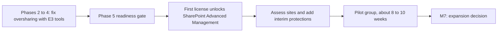

# 16. AI adoption guardrails

> **Reference work.** Fictional scenario built for a public portfolio. Not deployed in, derived from, or describing any employer environment. Not professional advice.

## Purpose and scope

This document sets the guardrails for how Fabrikam (fictional) adopts generative AI: principles, the AI rules for the Acceptable Use Policy (POL-02), Copilot readiness, intake for new AI tools, a high-level review path for AI features in Fabrikam's product, training, and monitoring. It uses public sources only, chiefly the NIST AI Risk Management Framework, NIST AI 600-1, and Microsoft's published guidance on Copilot data protection, oversharing, and data security posture, each dated because both are changing. It treats AI as an opportunity to capture safely, and it carries the treatment of risks R-07 and R-13 in document [11](11-risk-management.md).

## Starting point

On day 1, employees use public AI tools without guidance, leadership is interested in Microsoft Copilot (formerly Microsoft 365 Copilot), and product teams are building AI features (assumption A-12 in document [01](01-scenario-and-assumptions.md)). The pattern is common. Verizon's 2026 Data Breach Investigations Report says 45 percent of employees now use AI regularly on their corporate devices, up from 15 percent a year earlier, and that 67 percent of users reach AI services through non-corporate accounts on corporate devices.

For a company that holds customers' payroll registers, Social Security numbers, and bank details, two risks follow. Data pasted into a tool with no data protection commitments leaves Fabrikam's control (R-13). An assistant that can search everything a user can open turns overshared files into easy finds (R-07).

The answer is to offer a safe path before closing the unsafe ones: an approved tool and interim rules in Phase 2, approved rules at M3, and a Copilot pilot only after the oversharing work in document [06](06-microsoft-365-security-baseline.md). NIST CSF 2.0 supports treating AI this way. Its outcomes apply to "artificial intelligence systems" like any other technology, and it advises that "Treating AI risks alongside other enterprise risks (e.g., financial, cybersecurity, reputational, and privacy) will yield a more integrated outcome and organizational efficiencies."

## Framework references, dated

| Reference | Status (checked 2026-10-13) | Use in this plan |
|---|---|---|
| NIST AI Risk Management Framework, AI RMF 1.0 (NIST AI 100-1, released 2023-01-26) | Current. NIST states: "The AI RMF 1.0 is being revised as part of the White House AI Action Plan." No draft revision is posted | Its four functions (Govern, Map, Measure, Manage) frame the review of product AI features |
| NIST AI 600-1, Generative Artificial Intelligence Profile (July 2024) | Final and still posted by NIST. It describes itself as issued pursuant to Executive Order 14110, which the Federal Register records as revoked on 2025-01-20 | Its suggested actions shape the acceptable use rules and the intake questions; its risk list shapes training |
| NIST IR 8596, Cyber AI Profile, a CSF 2.0 Community Profile | Initial preliminary draft (2025-12-16); comments closed 2026-01-30; NIST planned an initial public draft for 2026 | Watched, not adopted |
| NIST SP 800-218A, Secure Software Development Practices for Generative AI and Dual-Use Foundation Models (July 2024) | Final | Reference for Engineering if it builds or fine-tunes models |
| NIST CSF 2.0 (February 2024) | Final | The hub framework; mapping at the end of this document |
| Microsoft Learn guidance on Copilot data protection, oversharing, and data security posture | Page dates from 2025 to 2026, listed in Sources | Copilot readiness, data protections, and licensing as Microsoft states them |

Because NIST's AI guidance and Microsoft's product names are both moving, these guardrails are reviewed six months after approval and again at M7 (proposals, like every cadence in the plan; document 01).

## Principles

1. **Offer a safe tool before banning unsafe ones.** People use AI because it helps. An approved tool, signed in with the work account, removes most reasons to use a personal one.
2. **The data decides, not the tool.** The rules follow the data classification in POL-05, so one rule set covers every tool, including next year's.
3. **People stay accountable for AI output.** A named person reviews anything that goes to a customer, and AI never decides about a person on its own.
4. **Permissions before assistants.** Copilot shows people what they can already open, so access is cleaned up first.
5. **Review before connecting.** No AI tool reaches Fabrikam data or accounts without the intake review.
6. **Say what is watched.** POL-02 tells staff how AI use is monitored, and reports name teams, not people, except in an investigation under document [08](08-detection-and-incident-response.md).
7. **Date everything.** Frameworks and products change fast, so rules and references carry review dates.

## Acceptable use rules for POL-02

POL-02 (Acceptable Use Policy, co-owned with People) gets an AI section, which the executive team approves with the policy set at M3 (document [10](10-governance-and-compliance-program.md)). An interim notice goes out in Phase 2 so that guidance does not wait for the full policy. New hires accept POL-02 at first sign-in through a Conditional Access terms of use prompt (Microsoft Entra ID P1, in Microsoft 365 E3; document [07](07-identity-lifecycle-joiners-movers-leavers.md)). NIST AI 600-1 suggests that organizations "Establish transparent acceptable use policies for GAI that address illegal use or applications of GAI" (suggested action GV-1.4-002).

### Approved tools

- **Microsoft Copilot Chat (formerly Microsoft 365 Copilot Chat), signed in with the work account,** is the default approved tool from Phase 2. Microsoft includes web-based Copilot Chat with eligible Microsoft 365 subscriptions at no extra cost. Microsoft states that use of Copilot and Copilot Chat "is covered by the terms of the Microsoft Products and Services Data Protection Addendum (DPA) and Microsoft Product Terms, with Microsoft acting as a data processor", and that "the prompts, responses, and data accessed through Microsoft Graph aren't used to train foundation models." One limit shapes the rules below: Microsoft says web search queries are not covered by the Data Protection Addendum and that for queries sent to Bing it "acts as an independent data controller". These are Microsoft's contractual statements, not independent assurance.
- **Microsoft Copilot (formerly Microsoft 365 Copilot),** the per-user add-on that grounds answers in the work data a user can access, is approved only for the pilot group in Phase 5, after the readiness stages below. Microsoft lists Microsoft 365 E3 among its licensing prerequisites.
- **Other AI tools** are approved one at a time through intake, each up to a stated data classification, and recorded in the application inventory in document [15](15-enterprise-systems-and-saas.md). NIST AI 600-1 suggests that organizations "establish approved GAI technology and service provider lists" (part of suggested action GV-6.1-007).

### Data rules for AI inputs

Classifications follow the label set in document 06: Public, Internal, Confidential, and Restricted (customer and employee personal data).

| Classification | Examples | Microsoft Copilot (pilot users) | Copilot Chat with the work account | Another tool approved through intake | Unapproved tool or personal account |
|---|---|---|---|---|---|
| Public | Published marketing and documentation | Allowed | Allowed | Allowed | Allowed |
| Internal | Internal procedures, routine meeting notes | Allowed | Allowed | Allowed | Not allowed |
| Confidential | Contracts, financials, source code, security details, customer names | Allowed for Fabrikam's own material; customer details stay out while web search is on, because web search queries fall outside the Data Protection Addendum in Copilot as in Copilot Chat (Microsoft's Allow web search in Copilot policy can turn it off for the pilot group) | Allowed for Fabrikam's own material; customer details stay out, because web search queries fall outside the Data Protection Addendum | Only if the tool is approved for Confidential data | Not allowed |
| Restricted | Customer payroll registers and exports, Social Security numbers, bank details, Form I-9 and E-Verify data, background check results, benefits and dependent data, clock-in location, Fabrikam employees' HR records | Not typed or pasted into prompts, except in a use case the data owner and General Counsel approve. Copilot can still surface Restricted files a user can open, which is why readiness comes first | Never | Only in an approved use case, in a tool approved for Restricted data | Never |

A prompt DLP policy (Phase 4) backs the Restricted row for Copilot and Copilot Chat by blocking prompts that contain document 06's payroll identifier types (Social Security, bank account, ABA routing, and taxpayer identification numbers). Microsoft labels this blocking as preview and still rolling out to tenants (preview, as of 2026-10-13), and it checks only the text typed into a prompt, not files uploaded into it, so the rule against uploading Restricted files rests on training and intake until Microsoft extends it.

### Human review and accountability

- A named person reviews any AI-assisted content that goes to a customer (support replies, notices, contract or security language, training material) and answers for it as if they wrote it. NIST AI 600-1 lists confabulation, meaning confident but false output, among the risks that generative AI introduces or makes worse.
- AI output is never the only basis for a decision about a person: hiring, pay, performance, discipline, or access. California's rules on automated decisionmaking technology (ADMT) apply from 2027-01-01, and General Counsel confirms how they reach Fabrikam as an employer and as a service provider.
- AI-generated code is reviewed like any other code under POL-12, which Engineering owns.

### Not allowed

- Restricted data in any unapproved AI tool, browser extension, or personal account.
- A personal AI account used for Fabrikam work.
- Connecting an AI tool to Microsoft 365, the product, or another Fabrikam system, for example by granting it access to mail or files, without intake approval.
- An unapproved AI note-taker in a meeting, or recording and transcribing customer or employee conversations without the notice General Counsel requires.

**Mistakes are reported, not hidden.** Anyone who puts data into the wrong tool tells the service desk at once. It is handled as a security event under document 08, and a prompt report is never punished.

## Copilot readiness: oversharing first, then a pilot, then measured expansion

Microsoft's deployment guidance for Copilot is organized in three pillars: remediate oversharing, set up guardrails, and meet regulations. It explains that Copilot works "by grounding responses in the data users already have permission to access", so readiness starts with permissions, not licenses. The oversharing work pays off even without Copilot, because R-07 exists today.

| Stage | When | What happens | Microsoft capability and license | Gate to the next stage |
|---|---|---|---|---|
| 1. Fix oversharing | Phases 2 to 5 (document 06 actions 06.18, 06.28, and 06.34) | Anyone links limited, then removed; customer exports moved out of mail and OneDrive; manual labels on Restricted content; DLP for payroll identifiers; site owners confirm the membership of Finance, People, Support, and executive sites | Sharing settings, manual sensitivity labels, and DLP for Exchange, SharePoint, and OneDrive, all in Microsoft 365 E3 (Phase 1 confirms manual labeling in the tenant, because Microsoft's pages conflict; document 06) | No Anyone links to Restricted content; Restricted sites labeled and confirmed by their owners |
| 2. Unlock and assess | Phase 5, after the gate | One Copilot license, assigned to the Security Engineer, makes SharePoint Advanced Management available. Its content management assessment and site access reviews check what remains. Restricted Content Discovery keeps sensitive sites out of Copilot discovery as an interim protection, as Microsoft's guidance describes, until their permissions are fixed. The prompt DLP policy from Phase 4 is confirmed to cover licensed Copilot | SharePoint Advanced Management applies once at least one user holds a Copilot license (or through its own add-on, or with Microsoft 365 E7). Microsoft's Purview service description lists DLP for prompts as "available to all users of Microsoft Copilot and Copilot Chat". Blocking sensitive information types in prompts is labeled preview on Microsoft's feature page (preview, as of 2026-10-13). DLP that stops Copilot from processing labeled files and emails needs E5-level licensing, such as Microsoft 365 E5 or Microsoft Purview Suite (formerly Microsoft 365 E5 Compliance) | High-risk sites fixed or under interim protection; prompt DLP enforced |
| 3. Pilot | About 8 to 10 weeks over the summer of 2027 | About 25 to 40 volunteers from several departments, trained before licenses are assigned; Support and People staff join only after their sites pass stage 2; a survey, prompt DLP matches, and the stage 2 reports measure value and exposure | Microsoft Copilot add-on licenses on E3 | Readout to the IT and Security Steering Group |
| 4. Measured expansion | Decision at M7, inside the next-year plan and budget | Department waves, each with its own site check first, or a stop | Further Copilot licenses; the executive team approves the budget line, and the CFO releases the spend | The expansion criteria below |

**Expansion criteria (proposals).**

- No Restricted content reached by a pilot user who should not see it, or each such finding fixed at the site within its target.
- Prompt DLP enforced, with its matches reviewed.
- Every pilot user trained before a license was assigned (KPI-14).
- Pilot users report clear value in the survey, and the CFO judges it against the cost.
- R-07 and R-13 at or below Medium at the month 9 Quarterly Risk Review, with no open exception touching Restricted data.
- [ADR-001](adr/ADR-001-microsoft-365-security-licensing.md) revisits Microsoft Purview Suite or Microsoft 365 E5 once a pilot or wider rollout is approved, because automatic labeling and DLP that restricts Copilot sit at that level.

**Data Security Posture Management.** Microsoft's guidance also uses Microsoft Purview Data Security Posture Management (DSPM) data risk assessments to find overshared sites. Microsoft now labels the earlier DSPM for AI as "(classic)" and says the current DSPM replaces it. Microsoft's pages do not state which license the current DSPM needs: its deployment considerations page points to the Purview service description, and the service description points to the classic page (checked 2026-10-13). ADR-001 confirms the licensing before the plan relies on DSPM; until then, stages 1 and 2 use the E3 and SharePoint Advanced Management tools above.

## Intake for new AI tools

New AI tools come through the application intake in document 15, which adds the questions below. Review depth follows data access and business criticality. A tool that only sees Public or Internal data gets a light check of its terms and sign-in by the Security Engineer (the Director of IT and Security until the Security Engineer starts). A tool approved for Confidential data gets the full security and contract review under POL-10. Anything that would see Restricted or customer data also needs the data owner and General Counsel, and customer contracts decide whether customers must be told first.

| Question | Why it matters |
|---|---|
| Does the provider train or improve models on Fabrikam's prompts, outputs, or files, or on customer data? Is that off for business accounts, and is it in the contract? | Training use is the main way data leaves Fabrikam's control |
| What does it retain (prompts, outputs, files, logs), for how long, and can Fabrikam delete it? | Retention sets the exposure window; POL-15 sets Fabrikam's own |
| Which subprocessors does it use, including the model provider behind it, where do they process data, and how are changes announced? | A new subprocessor touching customer data may need customer notice under their contracts |
| Which model provider and model does it use, and can that change without notice? | NIST AI 600-1 lists value chain and component integration among generative AI risks |
| Can provider staff read prompts, for example for abuse monitoring? | Human access is another disclosure path |
| What assurance and terms does it offer: a SOC 2 report or equivalent, a data processing agreement, breach notice? | NIST AI 600-1 (Appendix A.1.3) lists standard third-party controls, including "statement on standards for attestation engagement (SSAE) reports" |
| Does it support single sign-on with Microsoft Entra ID, admin controls, and audit logs Fabrikam can see? | Offboarding (R-05) and investigations (R-10) |
| Which permissions does it request in Microsoft 365 or other systems? | Broad mail or file access goes through the admin consent workflow in document 06 |
| Does it act on Fabrikam's systems on its own, rather than only answer? | Outside year-one scope beyond this review (see AI agents below) |
| What is the most sensitive data it would see? | Sets its approval level in the data rules table |

**AI features inside approved software.** New AI features in tools Fabrikam already uses, such as the CRM or the customer support platform, count as a new use. The system owner keeps them off until the intake questions are answered, because the support platform holds customer payroll exports in cases (A-06).

**Consent requests.** AI note-takers and writing assistants often ask to read mail, calendars, or files. Document 06 limits user consent to verified publishers and low-impact permissions and routes the rest to the admin consent workflow, where reviewers check each request against this intake before any approval. That narrows the consent phishing path in scenario S-05 of the [threat profile](17-threat-profile.md).

**First reviews.** The tools teams already rely on, found in the Phase 1 conversations, are reviewed first, starting with Engineering's code assistants, so that intake does not stall work already under way.

## AI features in Fabrikam's product

Engineering and Product own the product's AI features; the CTO and the Chief Product Officer decide what ships. The Director's part is to make sure each feature gets a security and privacy review in proportion to its data and its effect on people, that its risks enter the register (document 11, mainly R-12), and that changes to the SOC 2 system description reach document 10. The review follows the four AI RMF 1.0 functions at a high level.

| AI RMF function | NIST's description | Questions for a feature review | Lead |
|---|---|---|---|
| Govern | "a cross-cutting function that is infused throughout AI risk management and enables the other functions" | Who is accountable for the feature? Which policies apply (POL-12, POL-15)? Has General Counsel reviewed it? | Chief Product Officer |
| Map | "The map function establishes the context to frame risks related to an AI system" | Which decisions does it support, for example ranking applicants or flagging time entries? Whose data does it use, and do customer contracts allow that use? Which model provider sits behind it? | The Chief Product Officer's team, with the Engineering Manager |
| Measure | It "employs quantitative, qualitative, or mixed-method tools, techniques, and methodologies" | How are accuracy, false or invented output, unfair outcomes across groups of workers, and security weaknesses such as prompt injection tested before launch? | Engineering Manager |
| Manage | It "entails allocating risk resources to mapped and measured risks on a regular basis" | How is the feature monitored, how do customers report a problem, can it be switched off quickly, and how do its incidents reach document 08? | Engineering Manager and SRE lead |

NIST AI 600-1 also warns that "repeated use of the same model or algorithm in consequential decision-making settings like employment and lending can result in increased susceptibility by systems to correlated failures (like unexpected shocks), due to multiple actors relying on the same algorithm." A feature used by several thousand employers at once is that setting: one model fault becomes many customers' fault at the same moment.

Three triggers send a feature to General Counsel before design or launch (analysis, not legal advice):

- **Biometric data.** Product has proposed voice verification for customers' administrators who call Fabrikam's support line. The proposal is held at the privacy review gate (document [10](10-governance-and-compliance-program.md)) and is not live. Illinois' Biometric Information Privacy Act lists a "voiceprint" among biometric identifiers, as the Illinois Supreme Court quotes it, and Texas Business and Commerce Code section 503.001 lists one too. Any feature that would capture, store, compare, or match voiceprints or other biometric identifiers goes to General Counsel before design.
- **Decisions about workers.** California's ADMT requirements apply from 2027-01-01. The regulations count decisions such as hiring, allocation or assignment of work, and compensation as significant decisions, and they require service providers to cooperate with the businesses they serve on risk assessments. Features that rank, score, or recommend people go to General Counsel before launch.
- **Background data.** A feature that assembled or evaluated information about applicants from several sources for employers could raise Fair Credit Reporting Act questions, because the statute defines a consumer reporting agency by that kind of activity (15 U.S.C. 1681a(f)).

For depth, Engineering can use NIST SP 800-218A for generative AI development and the mapping that NIST lists among its CSF 2.0 informative references as OWASP-LLM-Top10-v2.0-to-CSF-v2.0. If a product AI feature is live before the June to August 2027 external test, Engineering and the Director decide whether to add it to that test's scope (document 08); no separate test is planned.

## Training (document 09)

Document [09](09-security-awareness-and-training.md) carries the AI content:

- **Everyone, at onboarding and in the regular cycle:** the approved tools, the data rules table, how to check AI output, how to report a mistake, and AI-assisted scams such as convincing fake requests and cloned voices. The FBI's Internet Crime Complaint Center counted 22,364 AI-related complaints in 2025.
- **By role:** Support (customer data stays out of prompts, and AI-drafted replies are reviewed); Finance and payroll (a voice or video request to move money is verified out of band, as in the [payroll diversion playbook](playbooks/payroll-diversion-and-email-compromise.md)); People (no AI-only decisions about people); Engineering (no secrets or customer data in code assistants, review of AI-generated code, secure development of AI features); executives (approving AI use cases and their risks).
- **Copilot pilot users:** a short session before a license is assigned, on what Copilot can see and how to report a file they should not have reached.

KPI-14 tracks completion, and KPI-15's phishing simulations can include AI-themed lures.

## Monitoring

- **Discovery of generative AI apps, where licensed.** Microsoft's guidance says the Defender for Cloud Apps catalog "includes a Generative AI category" and that Microsoft has added more than a thousand generative AI apps to it; security teams can filter on that category, see each app's risk assessment, and sanction or unsanction apps. Seeing managed laptops wherever staff work needs Defender for Cloud Apps together with Defender for Endpoint Plan 2, both in Microsoft Defender Suite (formerly Microsoft 365 E5 Security), which ADR-001 proposes from Phase 4. Blocking an unsanctioned app on a device relies on Defender for Endpoint network protection. On E3 alone, Cloud App Discovery works only from uploaded firewall or proxy logs; with no web proxy in the plan (document 06), those logs cover only traffic that passes through an office.
- **Copilot and Copilot Chat activity.** Microsoft says Copilot "supports audit of interactions". Prompt DLP matches and audit records support investigations under document 08.
- **Reporting.** A monthly summary to the IT and Security Steering Group covers generative AI use by category and team, intake decisions, prompt DLP matches, and incidents with an AI cause (KPI-17). Names appear only in an investigation.
- **Notice to staff.** Monitoring internet and app use can trigger employee notice laws where Fabrikam has an office, for example Connecticut General Statutes section 31-48d, as substituted by Public Act 26-73 effective 2026-10-01, and Delaware's 19 Del. C. section 705. General Counsel confirms which apply once the office locations are known, and POL-02 carries the notice.

## AI agents

AI agents that act on Fabrikam's systems, rather than only answer people, are out of scope for the first-year plan beyond the intake review in this document.

## Phase plan

| Phase | Action ID | Action | Outcome | KPI | Owner role | Workstream |
|---|---|---|---|---|---|---|
| Phase 1 | 16.01 | Ask each executive and team lead how their teams use AI and what they plan (with document 05 and assumption A-12); review the product's AI features with the Chief Product Officer and the CTO; record findings by team, never by person | AI use picture in the M1 listening report | KPI-01 | Director of IT and Security | WS-9 |
| Phase 1 | 16.02 | Draft a one-page interim AI notice with the VP of People and General Counsel: no Confidential or Restricted data in unapproved tools, Copilot Chat with the work account, and how to ask for a tool | Interim rules ready for executive approval | KPI-01 | Director of IT and Security | WS-9 |
| Phase 2 | 16.03 | The executive team approves the interim notice and the VP of People issues it; confirm in the tenant that Copilot Chat is available to staff signed in with work accounts | Rules and a safe tool in place before year-end | KPI-01 | Director of IT and Security | WS-9 |
| Phase 2 | 16.04 | Add the AI questions to document 15's application intake; review first the tools teams already use; once action 06.12 turns on the admin consent workflow in January, route AI tools that request mail, file, or calendar access through it | AI tools reviewed through intake: by rule from December (15.04), and through admin consent once 06.12 limits user consent in January | KPI-05 | Director of IT and Security | WS-9 |
| Phase 3 | 16.05 | Write the AI section of POL-02, with the data rules table and the monitoring notice, for approval with the policy set at M3 (document 10) | Approved AI rules (M3) | KPI-02 | Director of IT and Security | WS-9 |
| Phase 3 | 16.06 | Put the AI choices into the M3 budget proposal: discovery through Microsoft Defender Suite (ADR-001) and a Phase 5 Copilot pilot line, each with its cost driver | Funding decided at M3 | KPI-01 | Director of IT and Security | WS-9 |
| Phase 3 | 16.07 | Agree the product AI feature review and its legal triggers with the Chief Product Officer, the CTO, and General Counsel; record product AI risks under R-12 | Review path agreed at M3 | KPI-01 | Director of IT and Security | WS-9 |
| Phase 4 | 16.08 | Add the AI module to onboarding and role-based training and collect POL-02 acknowledgments (document 09) | Staff trained on the approved rules | KPI-14 | Security Engineer | WS-9 |
| Phase 4 | 16.09 | Create a Purview DLP policy for Copilot and Copilot Chat prompts with document 06's payroll identifier types: simulation first, then block | Restricted identifiers stopped at the prompt | KPI-17 | Security Engineer | WS-9 |
| Phase 4 | 16.10 | With Defender Suite, turn on endpoint-based discovery and review generative AI apps monthly by category and team, sending unsanctioned apps to intake or blocking them; without it, use office log uploads and intake | Visibility of AI app use where licensed | KPI-07 | Security Engineer | WS-9 |
| Phase 5 | 16.11 | Readiness gate with document 06 (action 06.34): confirm stage 1; the IT and Security Steering Group recommends go or no-go, and the CFO releases the pilot licenses from the pilot line the executive team approved in the M3 budget | Pilot go or no-go | KPI-01 | Director of IT and Security | WS-9 |
| Phase 5 | 16.12 | Stage 2: assign the first license to unlock SharePoint Advanced Management; run the content management assessment and site access reviews; apply Restricted Content Discovery to sensitive sites; confirm prompt DLP covers Copilot | Pilot starts on cleaned-up permissions | KPI-17 | Security Engineer | WS-9 |
| Phase 5 | 16.13 | Stage 3: train and license the pilot group and run the pilot for about 8 to 10 weeks; collect the survey, DLP matches, and exposure findings | Evidence for the expansion decision | KPI-14 | IT Operations Manager | WS-9 |
| Phase 5 | 16.14 | Pilot readout against the expansion criteria to the IT and Security Steering Group; the decision goes into the next-year plan and budget at M7 | Expansion or a stop, decided on evidence | KPI-01 | Director of IT and Security | WS-9 |
| Phase 5 | 16.15 | Review the guardrails six months after approval and again at M7: the AI RMF revision, IR 8596, California ADMT, Microsoft names and licensing; update the AI section of POL-02 | Guardrails current at M7 | KPI-02 | GRC Analyst | WS-9 |

## Resourcing and dependencies

- **Roles.** The Director of IT and Security owns this document and proposes the rules and the budget lines. The VP of People co-owns POL-02, issues the interim notice, and is the proposed owner of R-13. General Counsel advises on contracts, privacy, ADMT, biometrics, and monitoring notice. The Chief Customer Officer (proposed owner of R-07) decides customer-facing AI use in Support. The executive team approves the Defender Suite and Copilot pilot lines in the M3 budget, and the CFO releases the spend. The CTO and the Chief Product Officer own product AI features, with the Engineering Manager and the SRE lead running their reviews. The Systems Engineer (Identity and Endpoint) runs the consent workflow from January (action 06.12) and assigns licenses; the Service Desk Analyst takes requests and reported mistakes. From March 2027 (the base case start) the Security Engineer runs prompt DLP, discovery, and readiness stage 2, and the GRC Analyst keeps intake records and the six-month review (the Director keeps intake records until the GRC Analyst starts); the IT Operations Manager runs pilot logistics in Phase 5.
- **Partners.** The SOC 2 audit firm (system description changes from product AI features) and the penetration testing firm (a live product AI feature may join the June to August 2027 test's scope, document 08).
- **Licenses by phase.** Phases 1 to 3: Microsoft 365 E3, with Copilot Chat included at no extra cost. Phase 4: prompt DLP (preview, as of 2026-10-13), which Microsoft lists for all Copilot Chat users; Microsoft Defender Suite for discovery if approved at M3 (ADR-001). Phase 5: Microsoft Copilot add-on licenses for the pilot, which also make SharePoint Advanced Management available. The Allow web search in Copilot policy is set in Cloud Policy service, which Microsoft supports on most Microsoft 365 plans that include Microsoft 365 Apps; Microsoft 365 E3 includes Microsoft 365 Apps for enterprise. DLP that restricts Copilot from processing labeled content, and automatic labeling, need Microsoft 365 E5 or Microsoft Purview Suite, which ADR-001 revisits if a pilot is approved; licensing for the current DSPM is still to be confirmed.
- **Depends on.** Documents [01](01-scenario-and-assumptions.md) (A-12), [05](05-environment-discovery.md) (AI use discovery), [06](06-microsoft-365-security-baseline.md) (labels, sharing, DLP, app consent, action 06.34), [07](07-identity-lifecycle-joiners-movers-leavers.md) (POL-02 at first sign-in), [08](08-detection-and-incident-response.md) (security events and investigations), [09](09-security-awareness-and-training.md) (training), [10](10-governance-and-compliance-program.md) (POL-02, POL-05, POL-10, POL-12, POL-15, and the SOC 2 system description), [11](11-risk-management.md) (R-07, R-12, R-13), [12](12-metrics-and-executive-reporting.md) (KPIs), [15](15-enterprise-systems-and-saas.md) (application intake and inventory), and [17](17-threat-profile.md) (S-05); [ADR-001](adr/ADR-001-microsoft-365-security-licensing.md). It feeds documents [00](00-executive-summary.md), [02](02-first-90-days.md), and [03](03-twelve-month-roadmap.md).

## Risks and open questions

- **Unapproved use will not reach zero.** The approved tool and training reduce it; discovery measures it only where licensed.
- **E3 limits.** Without E5-level Purview licensing there is no endpoint DLP and no DLP that stops Copilot processing labeled content; without Defender Suite, discovery sees only office traffic.
- **Microsoft's names, licenses, and statements change.** Microsoft's 2026 Learn pages rename Microsoft 365 Copilot and Microsoft 365 Copilot Chat to Microsoft Copilot and Microsoft Copilot Chat, DSPM for AI became "classic", and SharePoint Advanced Management availability depends on Copilot licenses. All are rechecked on publication day and in the tenant. Microsoft's data protection statements are contractual, not independent assurance, and web search queries sit outside the Data Protection Addendum. Prompt DLP's preview status is rechecked with them.
- **NIST guidance is moving.** The AI RMF is being revised and IR 8596 is a draft; the six-month review picks up changes.
- **Questions for General Counsel.** Which state monitoring notice laws apply (the office locations are not yet known), how the California ADMT rules reach Fabrikam, how biometric laws treat the proposed voice verification, whether a background-data feature raises Fair Credit Reporting Act questions, and which customer contracts restrict new subprocessors.
- **Product pace.** AI features may ship faster than the review path; the Chief Product Officer and the CTO own that gate.
- **Pilot bias.** Volunteers tend to be enthusiasts, so the survey asks about problems as well as value, and the expansion criteria include exposure findings.

## Framework mapping

By identifier only, consistent with the [crosswalk](crosswalk/csf2-soc2-crosswalk.md). The relationships are this plan's own analysis; no official AICPA mapping between the Trust Services Criteria and CSF 2.0 was found.

| Theme | NIST CSF 2.0 | SOC 2 (2017 TSC) |
|---|---|---|
| AI rules in policy, communicated to staff | GV.PO-01, GV.PO-02 | CC2.2, CC5.3 |
| AI as opportunity and risk in strategy | GV.RM-02, GV.RM-07 | CC3.2 |
| Intake and AI providers | GV.SC-05, GV.SC-06, GV.SC-07, ID.AM-04 | CC9.2, CC3.4 |
| Data rules and Copilot readiness | PR.AA-05, PR.DS-01, PR.DS-02, PR.DS-10, ID.AM-07 | CC6.1, CC6.7, C1.1 |
| Training | PR.AT-01, PR.AT-02 | CC1.4, CC2.2 |
| Monitoring AI use | DE.CM-03, ID.AM-02 | CC7.2 |
| Product AI feature review | ID.RA-03, ID.RA-04, PR.PS-06 | CC3.2, CC8.1 |

## Sources

- AI Risk Management Framework (AI RMF 1.0, NIST AI 100-1; revision status). NIST. https://www.nist.gov/itl/ai-risk-management-framework . Checked 2026-10-13. Primary.
- AI RMF Core (section 5). NIST Trustworthy and Responsible AI Resource Center. https://airc.nist.gov/airmf-resources/airmf/5-sec-core/ . Checked 2026-10-13. Primary.
- Artificial Intelligence Risk Management Framework: Generative Artificial Intelligence Profile (NIST AI 600-1, July 2024). NIST. https://www.nist.gov/publications/artificial-intelligence-risk-management-framework-generative-artificial-intelligence (PDF: https://nvlpubs.nist.gov/nistpubs/ai/NIST.AI.600-1.pdf). Checked 2026-10-13. Primary.
- Federal Register document record for Executive Order 14110 (revocation by EO 14148). Office of the Federal Register. https://www.federalregister.gov/api/v1/documents/2023-24283.json . Checked 2026-10-13. Primary.
- Cybersecurity Framework Profile for Artificial Intelligence (Cyber AI Profile): NIST Community Profile (IR 8596, initial preliminary draft). NIST. https://csrc.nist.gov/pubs/ir/8596/iprd . Checked 2026-10-13. Primary.
- Draft NIST Guidelines Rethink Cybersecurity for the AI Era (December 16, 2025). NIST. https://www.nist.gov/news-events/news/2025/12/draft-nist-guidelines-rethink-cybersecurity-ai-era . Checked 2026-10-13. Primary.
- Secure Software Development Practices for Generative AI and Dual-Use Foundation Models: An SSDF Community Profile (SP 800-218A, July 2024). NIST. https://csrc.nist.gov/pubs/sp/800/218/a/final . Checked 2026-10-13. Primary.
- The NIST Cybersecurity Framework (CSF) 2.0 (CSWP 29, February 26, 2024), sections 2 and 5.2 and Appendix A. NIST. https://nvlpubs.nist.gov/nistpubs/CSWP/NIST.CSWP.29.pdf . Checked 2026-10-13. Primary.
- CSF 2.0 Informative References. NIST. https://www.nist.gov/cyberframework/informative-references . Checked 2026-10-13. Primary.
- Enterprise data protection in Microsoft Copilot and Microsoft Copilot Chat. Microsoft Learn. https://learn.microsoft.com/en-us/microsoft-365/copilot/enterprise-data-protection . Checked 2026-10-13. Primary.
- Data, privacy, and security for web search in Microsoft Copilot and Microsoft Copilot Chat (ms.date 2026-08-18), including the rename note and the Allow web search in Copilot policy. Microsoft Learn. https://learn.microsoft.com/en-us/microsoft-365/copilot/manage-public-web-access . Checked 2026-10-13. Primary.
- Overview of Cloud Policy service for Microsoft 365 (ms.date 2026-07-16), licensing requirements. Microsoft Learn. https://learn.microsoft.com/en-us/microsoft-365-apps/admin-center/overview-cloud-policy . Checked 2026-10-14. Primary.
- Microsoft 365 and Office 365 plan options (ms.date 2025-07-18), service availability table (Microsoft 365 desktop client apps in Microsoft 365 E3) and its note on plans that do not include Microsoft 365 Apps for enterprise (Microsoft 365 E3 is not among them). Microsoft Learn (Service Descriptions). https://learn.microsoft.com/en-us/office365/servicedescriptions/office-365-platform-service-description/office-365-plan-options . Checked 2026-10-14. Primary.
- Microsoft 365 for enterprise overview (ms.date 2025-11-18), components (Microsoft 365 Apps for enterprise) and plans (E3, E5, F3). Microsoft Learn. https://learn.microsoft.com/en-us/microsoft-365/enterprise/microsoft-365-overview . Checked 2026-10-14. Primary.
- Microsoft Purview DLP for Microsoft 365 Copilot and Cowork (ms.date 2026-10-05), on blocking sensitive information types in prompts (preview) and files uploaded in prompts. Microsoft Learn. https://learn.microsoft.com/en-us/purview/dlp-microsoft365-copilot-location-learn-about . Checked 2026-10-13. Primary.
- Set Up Microsoft Entra Terms of Use with Conditional Access (ms.date 2026-03-24), prerequisites. Microsoft Learn. https://learn.microsoft.com/en-us/entra/identity/conditional-access/terms-of-use . Checked 2026-10-13. Primary.
- License Options for Microsoft Copilot. Microsoft Learn. https://learn.microsoft.com/en-us/microsoft-365/copilot/microsoft-365-copilot-licensing . Checked 2026-10-13. Primary.
- Secure & Governed Data Foundation for Microsoft Copilot, Foundational Deployment Guidance (ms.date 2026-05-06). Microsoft Learn. https://learn.microsoft.com/en-us/microsoft-365/copilot/secure-govern-copilot-foundational-deployment-guidance . Checked 2026-10-13. Primary.
- Configure a secure and governed foundation for Microsoft Copilot (ms.date 2026-10-06). Microsoft Learn. https://learn.microsoft.com/en-us/microsoft-365/copilot/configure-secure-governed-data-foundation-microsoft-365-copilot . Checked 2026-10-13. Primary.
- SharePoint Advanced Management overview. Microsoft Learn. https://learn.microsoft.com/en-us/sharepoint/advanced-management . Checked 2026-10-13. Primary.
- Prerequisites for SharePoint Advanced Management. Microsoft Learn. https://learn.microsoft.com/en-us/sharepoint/sharepoint-advanced-management-prerequisites . Checked 2026-10-13. Primary.
- Microsoft Purview service description (DLP for Microsoft Copilot; licensing note on Data Security Posture Management for AI). Microsoft Learn. https://learn.microsoft.com/en-us/office365/servicedescriptions/microsoft-365-service-descriptions/microsoft-365-tenantlevel-services-licensing-guidance/microsoft-purview-service-description . Checked 2026-10-13. Primary.
- Learn about Microsoft Purview Data Security Posture Management (DSPM). Microsoft Learn. https://learn.microsoft.com/en-us/purview/data-security-posture-management-learn-about . Checked 2026-10-13. Primary.
- Considerations for deploying Microsoft Purview Data Security Posture Management (ms.date 2026-05-01). Microsoft Learn. https://learn.microsoft.com/en-us/purview/data-security-posture-management-considerations . Checked 2026-10-13. Primary.
- DSPM for AI (classic) overview. Microsoft Learn. https://learn.microsoft.com/en-us/purview/dspm-for-ai . Checked 2026-10-13. Primary.
- Discover AI apps and data (security for AI series; ms.date 2025-04-01, updated 2026-04-27). Microsoft Learn. https://learn.microsoft.com/en-us/security/security-for-ai/discover . Checked 2026-10-13. Primary.
- Discovery capability differences for Defender for Cloud Apps and Cloud App Discovery. Microsoft Learn. https://learn.microsoft.com/en-us/defender-cloud-apps/editions-cloud-app-security-aad . Checked 2026-10-13. Primary.
- Integrate Microsoft Defender for Endpoint (Defender for Cloud Apps). Microsoft Learn. https://learn.microsoft.com/en-us/defender-cloud-apps/mde-integration . Checked 2026-10-13. Primary.
- Security Suites (Microsoft Licensing guidance). Microsoft. https://www.microsoft.com/licensing/guidance/Security-Suites . Checked 2026-10-13. Primary.
- 2026 Data Breach Investigations Report, Executive Summary. Verizon Business. https://www.verizon.com/business/resources/executivebriefs/2026-dbir-executive-summary.pdf . Checked 2026-10-13. Primary (vendor research; primary for what Verizon reports).
- 2025 Internet Crime Report. FBI Internet Crime Complaint Center (IC3). https://www.ic3.gov/AnnualReport/Reports/2025_IC3Report.pdf . Checked 2026-10-13. Primary.
- California Finalizes Regulations to Strengthen Consumers' Privacy (September 23, 2025). California Privacy Protection Agency. https://www.cppa.ca.gov/announcements/2025/20250923.html . Checked 2026-10-13. Primary.
- Text of approved regulations on CCPA updates, cybersecurity audits, risk assessments, and automated decisionmaking technology (sections 7001 and 7050). California Privacy Protection Agency. https://cppa.ca.gov/regulations/pdf/ccpa_updates_cyber_risk_admt_appr_text.pdf . Checked 2026-10-13. Primary.
- Illinois Supreme Court opinion, 2019 IL 123186 (quoting the Biometric Information Privacy Act's definitions, paragraph 19). Supreme Court of Illinois. https://www.illinoiscourts.gov/resources/f71510f1-fb2a-43d8-ba14-292c8009dfd9/file . Checked 2026-10-13. Primary.
- Texas Business and Commerce Code, Chapter 503 (section 503.001). Texas Legislature. https://tcss.legis.texas.gov/resources/BC/htm/BC.503.htm . Checked 2026-10-13. Primary.
- 15 U.S.C. 1681a, definitions (United States Code, 2023 edition). US Government Publishing Office (GovInfo). https://www.govinfo.gov/content/pkg/USCODE-2023-title15/html/USCODE-2023-title15-chap41-subchapIII-sec1681a.htm . Checked 2026-10-13. Primary.
- Public Act 26-73, An Act Concerning the Electronic Surveillance of Employees. Connecticut General Assembly. https://prdext3.cga.ct.gov/2026/ACT/PA/PDF/2026PA-00073-R00SB-00472-PA.PDF . Checked 2026-10-13. Primary.
- Delaware Code, Title 19, Chapter 7, section 705. State of Delaware. https://delcode.delaware.gov/title19/c007/sc01/index.html . Checked 2026-10-13. Primary.
