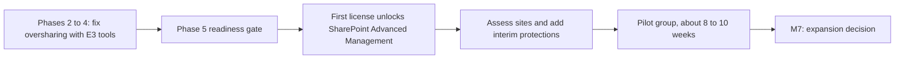

# 16. AI security and adoption guardrails

> **Reference work.** Fictional scenario built for a public portfolio. Not deployed in, derived from, or describing any employer environment. Not professional advice.

## Purpose and scope

This document sets how Fabrikam (fictional) adopts generative AI and keeps it secure: an AI security overview for executives, the AI rules for people in the Acceptable Use Policy (POL-02), an AI security standard under the Information Security Policy (POL-01), and a register of the AI security controls that enforce and detect. It also covers Copilot readiness, intake for new AI tools, training, monitoring, and AI incidents. It uses public sources only (NIST, OWASP, MITRE, CISA and its partner agencies, the FBI, and Microsoft's published guidance), each dated because all of them are changing. It carries the treatment of risks R-07 and R-13 in document [11](11-risk-management.md), supports R-12 for AI applied to Fabrikam's own workforce data, and adds AI-enabled fraud to R-01's treatment. AI features inside Fabrikam's product are owned by Engineering and are out of scope here.

## AI security overview

Employees already use AI tools and leadership wants Microsoft Copilot (assumption A-12). Fabrikam treats AI as an opportunity to capture safely: it offers an approved tool first, sets rules by data classification, and adds controls in step with the licenses the executive team approves. The program has three layers.

| Layer | What it holds | Who approves or owns it |
|---|---|---|
| **Policy:** what governs AI | The AI section of POL-02 for people; the AI security standard under POL-01 for AI systems and connections; POL-05 for data classification; POL-10 for AI vendors | The executive team approves all of them with the policy set at M3 (document [10](10-governance-and-compliance-program.md)) |
| **Guardrails:** what people and teams may do | Approved tools, starting with Copilot Chat signed in with the work account; the data rules; a named person reviewing AI output before it reaches a customer; intake before any new AI tool or connection; AI agents only after intake | The Director of IT and Security proposes them; the VP of People issues the rules to staff |
| **Controls:** what enforces and detects | The AI security controls register below. In plain terms: see which AI apps staff use, and block unapproved ones on company laptops where licensed; stop payroll identifiers typed into Copilot and Copilot Chat prompts (preview, as of 2026-10-14); review any app that asks for access to mail or files; fix file permissions before Copilot can search them; check inbound email for hidden instructions aimed at AI assistants (prompt injection) once Defender Suite is live; call back on a known number whatever a voice or face says; put AI vendor terms in contracts; have a named person review AI output before customers see it; and handle AI incidents through document [08](08-detection-and-incident-response.md) | Each control names its owner role: the Director of IT and Security for most Microsoft 365 controls and AI vendor terms, the Systems Engineer (Identity and Endpoint) for app consent, the CFO for payment verification, and business leaders for human review of AI output |

**Risks it answers** (document 11):

| Risk (owner) | What AI changes | Main controls |
|---|---|---|
| R-13, data leaking through unsanctioned AI tools (VP of People) | Staff paste or upload data into tools with no data protection commitments | AIC-01, AIC-02, AIC-04, AIC-07 |
| R-07, oversharing in Microsoft 365 (Chief Customer Officer) | Copilot, and Copilot Chat in Outlook from Phase 2, find what a user can open in seconds | AIC-02, AIC-03, AIC-05, AIC-11 |
| R-12, privacy of employee and workforce data (General Counsel) | AI applied to Fabrikam's own applicant and worker data can shape decisions about people | AIC-09 |
| R-01, payroll and payment fraud (CFO) | Cloned voices and live video make bank-change requests more convincing | AIC-06 |

**How progress shows,** in existing KPIs only (document [12](12-metrics-and-executive-reporting.md)): approved AI tools are counted in KPI-07 (single sign-on) and AI vendors in KPI-05 (current reviews), and the monthly AI summary shows the AI share of each; KPI-14 for training before access; KPI-17 for incidents, each record carrying document 08's AI-involved flag; KPI-01 for the treatment of R-07, R-12, and R-13; and KPI-02 for policies reviewed on cycle.

**What the executive team decides.** At M3: POL-02's AI section and the AI security standard with the policy set; Microsoft Defender Suite, which brings discovery of AI apps on laptops, app governance, and detection of prompt injection in email (the [ADR-001](adr/ADR-001-microsoft-365-security-licensing.md) fallback gives those up); and a Copilot pilot line. At M7: whether Copilot expands.

## Starting point

On day 1, employees use public AI tools without guidance and leadership is interested in Microsoft Copilot (formerly Microsoft 365 Copilot) (assumption A-12 in document [01](01-scenario-and-assumptions.md)). The pattern is common. Verizon's 2026 Data Breach Investigations Report says 45 percent of employees now use AI regularly on their corporate devices, up from 15 percent a year earlier, and that 67 percent of users reach AI services through non-corporate accounts on corporate devices. In June 2026 the Five Eyes cyber security agencies, CISA among them, wrote that AI "accelerates the speed, scale, and sophistication of cyber threats" and that "Defence in depth remains essential."

For a company that holds sensitive customer and employee data such as Social Security numbers and bank details, three risks follow. Data pasted into a tool with no data protection commitments leaves Fabrikam's control (R-13). An assistant that can search everything a user can open turns overshared files into easy finds (R-07). And a cloned voice asking for a bank change sounds like the person it copies (R-01).

The answer is to offer a safe path before closing the unsafe ones: an approved tool and interim rules in Phase 2, approved rules and the AI security standard at M3, and a Copilot pilot only after the oversharing work in document [06](06-microsoft-365-security-baseline.md). NIST CSF 2.0 supports treating AI this way. Its outcomes apply to "artificial intelligence systems" like any other technology, and it advises that "Treating AI risks alongside other enterprise risks (e.g., financial, cybersecurity, reputational, and privacy) will yield a more integrated outcome and organizational efficiencies."

## Framework references, dated

| Reference | Status (checked 2026-10-14 unless noted) | Use in this plan |
|---|---|---|
| NIST AI Risk Management Framework, AI RMF 1.0 (NIST AI 100-1, released 2023-01-26) | Current. NIST states: "The AI RMF 1.0 is being revised as part of the White House AI Action Plan." No draft revision is posted | Its four functions (Govern, Map, Measure, Manage) tag each control in Appendix A |
| NIST AI 600-1, Generative Artificial Intelligence Profile (July 2024) | Final and still posted by NIST. It describes itself as issued pursuant to Executive Order 14110, which the Federal Register records as revoked on 2025-01-20 | Its suggested actions shape the acceptable use rules and the intake questions; its risk list shapes training and tags each control in Appendix A |
| NIST IR 8596, Cyber AI Profile, a CSF 2.0 Community Profile | Initial preliminary draft (2025-12-16); comments closed 2026-01-30; NIST announced working sessions for spring 2026, and no later draft is posted | Watched, not adopted |
| NIST Control Overlays for Securing AI Systems (COSAiS) | A concept paper (2025-08-14) and an annotated outline for predictive AI (2026-01-08); no draft overlay was found | Watched; an input to the six-month review |
| NIST SP 800-218A, Secure Software Development Practices for Generative AI and Dual-Use Foundation Models (July 2024) | Final (checked 2026-10-13) | Reference for Engineering if it builds or fine-tunes models |
| OWASP Top 10 for LLM Applications 2026 | Current edition, released August 2026, licensed CC BY-SA 4.0. It replaced the 2025 list; "System Prompt Leakage" became LLM08:2026 Hidden Context Exposure | Risks for AI applications; IDs cited with their year, descriptions paraphrased |
| MITRE ATLAS | Content release 2026.09 (2026-09-15). MITRE now releases monthly, and names can change between releases | Adversary techniques, named in words, where a control maps cleanly; every name taken from content release 2026.09 |
| Joint government guidance: AI Data Security (May 2025) and Deploying AI Systems Securely (April 2024), led by the NSA's Artificial Intelligence Security Center with CISA, the FBI, and partner agencies; Guidelines for Secure AI System Development (November 2023), from CISA and the UK's National Cyber Security Centre with partner agencies | Published | Data rules for AI inputs and outputs, AI vendor assurance, and Engineering's secure development of AI features |
| NIST CSF 2.0 (February 2024) | Final | The hub framework; mapping at the end of this document |
| Microsoft Learn guidance on Copilot data protection, oversharing, prompt injection, and data security posture | Page dates from 2025 to 2026, listed in Sources | Copilot capabilities, licensing, and preview status as Microsoft states them |

CISA's web pages now retitle some of these documents with "SI" (super intelligence). NIST's notices tie its own change of wording to Executive Order 14434, "Inaugurating the Era of Super Intelligence" (signed 2026-09-29). The documents themselves keep "AI", and this plan cites their own titles. Because all of these references move, the guardrails and the AI security standard are reviewed six months after approval and again at M7 (16.15; proposals, like every cadence in the plan; document 01).

## Principles

1. **Offer a safe tool before banning unsafe ones.** People use AI because it helps. An approved tool, signed in with the work account, removes most reasons to use a personal one.
2. **The data decides, not the tool.** The rules follow the data classification in POL-05, so one rule set covers every tool, including next year's.
3. **People stay accountable for AI output.** A named person reviews anything that goes to a customer, and AI never decides about a person on its own.
4. **Permissions before assistants.** Copilot shows people what they can already open, so access is cleaned up first.
5. **Review before connecting.** No AI tool reaches Fabrikam data or accounts without the intake review.
6. **Say what is watched.** POL-02 tells staff how AI use is monitored, and reports name teams, not people, except in an investigation under document [08](08-detection-and-incident-response.md).
7. **Date everything.** Frameworks and products change fast, so rules and references carry review dates.
8. **Assume some injected instructions get through.** Microsoft says its own approach "does not rely on our ability to block all prompt injections", so controls limit what an assistant can reach, and a person verifies anything that moves money or changes access.

## Acceptable use rules for POL-02

POL-02 (Acceptable Use Policy, co-owned with People) gets an AI section, which the executive team approves with the policy set at M3 (document [10](10-governance-and-compliance-program.md)). An interim notice goes out in Phase 2 so that guidance does not wait for the full policy. New hires accept POL-02 at first sign-in through a Conditional Access terms of use prompt (Microsoft Entra ID P1, in Microsoft 365 E3; document [07](07-identity-lifecycle-joiners-movers-leavers.md)). NIST AI 600-1 suggests that organizations "Establish transparent acceptable use policies for GAI that address illegal use or applications of GAI" (suggested action GV-1.4-002).

### Approved tools

- **Microsoft Copilot Chat (formerly Microsoft 365 Copilot Chat), signed in with the work account,** is the default approved tool from Phase 2. Microsoft includes web-based Copilot Chat with eligible Microsoft 365 subscriptions at no extra cost. Microsoft states that use of Copilot and Copilot Chat "is covered by the terms of the Microsoft Products and Services Data Protection Addendum (DPA) and Microsoft Product Terms, with Microsoft acting as a data processor", and that "the prompts, responses, and data accessed through Microsoft Graph aren't used to train foundation models." One limit shapes the rules below: Microsoft says web search queries are not covered by the Data Protection Addendum and that for queries sent to Bing it "acts as an independent data controller". These are Microsoft's contractual statements, not independent assurance.
- **Copilot Chat reaches more than the web.** It answers from the web by default, but it also works with what users bring to it: pasted text, uploaded files (which Microsoft stores in the user's OneDrive), and, in Outlook, the user's "emails, calendar, meetings, chats, and files", the files limited to OneDrive files the user can access, frequently visited SharePoint sites, and files shared with or used by the user. No Copilot license is needed for that; Microsoft reserves access to full work data for Copilot license holders (checked 2026-10-14). So oversharing (R-07) and prompt injection (AIC-05) start to matter in Phase 2, not only at the Phase 5 pilot.
- **Microsoft Copilot (formerly Microsoft 365 Copilot),** the per-user add-on that grounds answers in the work data a user can access, is approved only for the pilot group in Phase 5, after the readiness stages below. Microsoft lists Microsoft 365 E3 among its licensing prerequisites.
- **Other AI tools** are approved one at a time through intake, each up to a stated data classification, and recorded in the application inventory in document [15](15-enterprise-systems-and-saas.md). NIST AI 600-1 suggests that organizations "establish approved GAI technology and service provider lists" (part of suggested action GV-6.1-007).

### Data rules for AI inputs

Classifications follow the label set in document 06: Public, Internal, Confidential, and Restricted (customer and employee personal data).

| Classification | Examples | Microsoft Copilot (pilot users) | Copilot Chat with the work account | Another tool approved through intake | Unapproved tool or personal account |
|---|---|---|---|---|---|
| Public | Published marketing and documentation | Allowed | Allowed | Allowed | Allowed |
| Internal | Internal procedures, routine meeting notes | Allowed | Allowed | Allowed | Not allowed |
| Confidential | Contracts, financials, source code, security details, customer names | Allowed for Fabrikam's own material; customer details stay out while web search is on, because web search queries fall outside the Data Protection Addendum in Copilot as in Copilot Chat (Microsoft's Allow web search in Copilot policy can turn it off for the pilot group) | Allowed for Fabrikam's own material; customer details stay out, because web search queries fall outside the Data Protection Addendum | Only if the tool is approved for Confidential data | Not allowed |
| Restricted | Payroll registers, Social Security numbers, bank details, Form I-9 and E-Verify data, background check results, benefits and dependent data, Fabrikam employees' HR records | Not typed or pasted into prompts, except in a use case the data owner and General Counsel approve. Copilot can still surface Restricted files a user can open, which is why readiness comes first | Never | Only in an approved use case, in a tool approved for Restricted data | Never |

These rules govern what people type, paste, or upload. AI output takes the classification of its most sensitive input; the joint AI Data Security guidance puts it this way: "the output of AI systems should be classified at the same level as the input data". Copilot Chat in Outlook can also read a user's own mail, so the sensitive company and employee files kept in mailboxes today (A-06) are within its reach from Phase 2 until document 06 moves them out (06.28).

A prompt DLP policy (Phase 4, 16.09) backs the Restricted row for Copilot and Copilot Chat by blocking prompts that contain document 06's payroll identifier types (Social Security, bank account, ABA routing, and taxpayer identification numbers). Microsoft labels this blocking as preview and still rolling out to tenants (preview, as of 2026-10-14), and it checks only the text typed into a prompt, not files uploaded into it, so the rule against uploading Restricted files rests on training and intake until Microsoft extends it. A second rule keeps prompts that contain those types out of web search, which backs the Confidential row. Microsoft shows no preview label for that action but states no license for it (checked 2026-10-14), so ADR-001 confirms the license before Fabrikam relies on it.

### Human review and accountability

- A named person reviews any AI-assisted content that goes to a customer (support replies, notices, contract or security language, training material) and answers for it as if they wrote it. NIST AI 600-1 lists confabulation, meaning confident but false output, among the risks that generative AI introduces or makes worse.
- AI output is never the only basis for a decision about a person: hiring, pay, performance, discipline, or access. California's rules on automated decisionmaking technology (ADMT) apply from 2027-01-01, and General Counsel confirms how they reach Fabrikam as an employer.
- **An AI summary is never verification.** A bank-detail or payment change is verified by a call back on a known number, whatever an assistant's summary, a familiar voice, or a face on a video call says (the [payroll diversion playbook](playbooks/payroll-diversion-and-email-compromise.md)); an access reset follows document [13](13-it-service-management.md)'s caller verification, where a face on video never counts without the employee's manager.

### Not allowed

- Restricted data in any unapproved AI tool, browser extension, or personal account.
- A personal AI account used for Fabrikam work.
- Connecting an AI tool to Microsoft 365, the product, or another Fabrikam system, for example by granting it access to mail or files, without intake approval.
- Turning on an AI agent, or an AI feature that acts on Fabrikam's systems rather than only answering, inside Microsoft 365 or approved software without intake approval.
- An unapproved AI note-taker in a meeting, or recording and transcribing customer or employee conversations without the notice General Counsel requires.

**Mistakes are reported, not hidden.** Anyone who puts data into the wrong tool tells the service desk at once. It is handled as a security event under document 08, and a prompt report is never punished.

## AI security standard (under POL-01)

POL-01 sets Fabrikam's security requirements; this standard sets how they apply to AI systems and to connections between AI tools and Fabrikam's systems. POL-02 keeps the rules for people. The Director drafts the standard in Phase 3 (16.16) and the executive team approves it with the policy set at M3; it adds no policy ID (document 10). Requirements that depend on later work take effect when that work completes, and the standard states each date: prompt DLP with 16.09 (Phase 4), AI app discovery and app governance with 16.10 where licensed; the web search and external email DLP rules count only after ADR-001 confirms their license. Until then the interim rule in POL-02 and this document applies, so the approved standard never describes a control that is not yet running, which matters for SOC 2 evidence (R-11). Later changes that relax a requirement go to the executive team; other updates go through the IT and Security Steering Group and the standard's version history.

| Section | Requirement (proposal) | Carried out in |
|---|---|---|
| 1. Scope | AI tools staff use, including AI features inside approved software; connections from AI tools to Microsoft 365, the product, or other Fabrikam systems; AI agents at policy level (section 13) | This document; documents 06, 07, 15 |
| 2. Approved tools | Only tools approved through intake, each up to a stated data classification and recorded in the application inventory; Copilot Chat with the work account is the default | Intake below; document 15 |
| 3. Data classification limits | POL-05's classes decide what may go into each tool (the data rules table); AI output takes the classification of its most sensitive input; Restricted data goes only into a use case the data owner and General Counsel approve | POL-02 AI section (16.05) |
| 4. Identity | Work accounts only; single sign-on with Microsoft Entra ID and MFA under document 06's Conditional Access; a tool approved for Confidential or Restricted data supports single sign-on or holds an exception under document 11 | Documents 06, 15 |
| 5. Connections and consent | AI tools that ask for mail, file, calendar, meeting, or chat permissions go through intake and the admin consent workflow; consent no longer needed is removed | 06.12, 16.04, 16.10 |
| 6. Logging and audit | Copilot and Copilot Chat interactions are kept in the audit log and in mailboxes for eDiscovery, as far as Microsoft records them (16.03 confirms Copilot Chat coverage); tools approved for Confidential or Restricted data give Fabrikam audit logs | 06.19, 16.03 |
| 7. Prompt data loss prevention | Prompts with payroll identifier types blocked in Copilot and Copilot Chat after a simulation period (preview, as of 2026-10-14), from Phase 4, and kept out of web search once ADR-001 confirms that action's license; uploaded files are not scanned, so training carries that rule | 16.09 |
| 8. Vendor terms | In the contract, under POL-10: no training on Fabrikam or customer data; stated retention and deletion; subprocessors, including the model provider, with notice of changes; breach notice fast enough for Fabrikam's shortest customer clock; an assurance report in proportion to the data | 16.04; 10.17 |
| 9. Product AI features | Owned by Engineering under the CTO and the Chief Product Officer and out of scope for this standard; their risks enter the register (R-12) and any SOC 2 system-description change reaches document 10 | Document 11; document 10 |
| 10. Monitoring and incident handling | Prompt DLP alert emails to document 08's on-call alias where they work for the Copilot location (16.09), otherwise the Purview DLP alerts dashboard; a monthly review of AI app discovery, consent grants, prompt DLP matches, and Copilot audit flags; AI incidents through document 08's severity matrix and playbooks | 16.09, 16.10; document 08 |
| 11. Exceptions | Through document 11's exception process; Restricted data in unapproved AI tools is not open to exception | Document 11 |
| 12. Review | Six months after approval and again at M7, with POL-02's AI section | 16.15 |
| 13. AI agents | Intake approval, then document 07's non-human identity controls; a fuller agent standard is a year-two decision | AI agents below |

AI features inside Fabrikam's product are owned by Engineering under the CTO and the Chief Product Officer and are out of scope for this standard. The Director's part is limited to ensuring that their risks enter the register (document 11, R-12) and that any change to the SOC 2 system description reaches document 10.

## AI security controls

Each row names a threat that matters to Fabrikam, the control that answers it, and where the plan delivers it. Most controls reuse actions already in documents 06, 08, and 16; the new work is the AI security standard (16.16). Licenses follow [ADR-001](adr/ADR-001-microsoft-365-security-licensing.md): Microsoft 365 E3 from day 1, Microsoft Defender Suite (formerly Microsoft 365 E5 Security) from Phase 4 if approved at M3, and Copilot licenses for the Phase 5 pilot. Framework references for each row are in Appendix A. Every control is a proposal, and none is tested.

| ID | Threat | Control | Type | Owner role | License | Phase and action | KPI |
|---|---|---|---|---|---|---|---|
| AIC-01 | **Unsanctioned AI use.** Staff use AI tools, browser extensions, or note-takers nobody approved (R-13) | Copilot Chat with the work account offered first; intake for every new AI tool, recorded in the application inventory; a monthly review of generative AI apps by category and team, with unsanctioned apps sent to intake or blocked on managed devices; Microsoft Edge on managed computers accepts only extensions on an approved list, with AI extensions approved through intake (06.26) | Preventive, detective | Director of IT and Security; Systems Engineer (Identity and Endpoint) for the extension allow list | Copilot Chat: Microsoft 365 E3. Endpoint-based discovery and blocking: Defender for Cloud Apps with Defender for Endpoint Plan 2 (Microsoft Defender Suite). E3 alone: Cloud App Discovery from uploaded logs. Extension allow list: Intune Plan 1 (E3) with Microsoft Edge | Phase 2: 16.03, 16.04. Phase 4: 16.10, 06.26 | KPI-07, KPI-05 |
| AIC-02 | **Data leakage through prompts and uploads.** Restricted or Confidential data typed, pasted, or uploaded into an AI tool (R-13, R-07) | The data rules in POL-02; DLP that blocks Copilot and Copilot Chat prompts containing payroll identifier types, after simulation, and keeps such prompts out of web search; training on the upload rule, because DLP does not scan uploaded files | Preventive | Director of IT and Security; VP of People for POL-02 | Prompt blocking: all Copilot and Copilot Chat users, so E3 (preview, as of 2026-10-14). Web search action: license not stated by Microsoft (checked 2026-10-14) | Phase 2: 16.03. Phase 3: 16.05. Phase 4: 16.08, 16.09 | KPI-14, KPI-17 |
| AIC-03 | **Copilot surfacing overshared files.** An assistant finds every overshared file a user, or an attacker holding the user's session, can open (R-07; S-04, S-07) | Permissions before assistants: document 06's sharing limits, labels, and DLP; the readiness gate; SharePoint Advanced Management assessments and site access reviews; Restricted Content Discovery on sensitive sites while they are fixed; label inheritance in Copilot output | Preventive, detective | Director of IT and Security, with site owners | Document 06's controls: E3. SharePoint Advanced Management and Restricted Content Discovery: from the first Copilot license. Label inheritance: for content that Copilot-licensed users create, not for Copilot Chat alone. DLP that stops Copilot processing labeled content: Microsoft 365 E5 or Microsoft Purview Suite (ADR-001's M7 revisit) | Phases 2 to 4: 06.18, 06.22, 06.28. Phase 5: 06.34, 16.11, 16.12 | KPI-17, KPI-01 |
| AIC-04 | **Over-permissioned AI apps and consent phishing.** An "AI assistant" or note-taker asks users for mail, calendar, or file access, legitimately or as an attack (R-13; S-05) | User consent limited to verified publishers and low-impact permissions; the admin consent workflow, with each request checked against AI intake; existing grants reviewed; app governance alerts and a monthly review of apps holding mail, file, meeting, or chat permissions | Preventive, detective | Systems Engineer (Identity and Endpoint); Director of IT and Security for app governance | Consent controls: Microsoft Entra ID, with no added license named by Microsoft. App governance: Defender for Cloud Apps (Microsoft Defender Suite) | Phase 2: 16.04. Phase 3: 06.12. Phase 4: 16.10 | KPI-07, KPI-17 |
| AIC-05 | **Indirect prompt injection.** Instructions hidden in an email, file, chat, or web page steer an assistant that reads it for a user: a misleading summary of a bank-change request, or data the user can reach sent out (R-07, R-01; S-11) | Microsoft's built-in classifiers; prompt injection detection on inbound email; Safe Links on links Copilot returns; the limits on Copilot's reach in AIC-03; the rule that an AI summary is never verification; a monthly review of the injection flags in Copilot audit records; for finance, payroll, and People pilot users, a DLP rule that keeps external email out of Copilot, tested in simulation first | Preventive, detective | Director of IT and Security | Classifiers: included; Microsoft says they "may not be available in all Microsoft Copilot scenarios". Email detection: Defender for Office 365 Plan 2 (Microsoft Defender Suite). Safe Links: Plan 1 (E3). Audit flags: Audit (Standard) (E3). External email rule: preview, as of 2026-10-14, license not stated by Microsoft | Phase 2: 16.03, 06.14. Phase 4: 16.10, with Defender Suite if approved at M3 (06.23). Phase 5: 16.12 | KPI-17 |
| AIC-06 | **AI-enabled social engineering.** A cloned voice, live deepfake video, or AI-written message asks finance, payroll, People, the service desk, or the support line to change bank details, release a payment, or reset access (R-01; S-01, S-02, S-03) | The no-exception call-back on a known number for bank-detail and payment changes, and document 13's caller verification for access resets, stated so that a familiar voice or face never counts as verification on its own; two-person approval for vendor bank changes; finance and payroll training with a cloned-voice example; a cloned-voice request in the late-February tabletop; impersonation protection and the External tag; external Teams chat limited to partner domains; the identity check before a new hire's first credentials (document 07, R-15) | Preventive, detective (people who report) | CFO for the verification standard; Director of IT and Security for training and the tabletop | Call-back: none. Impersonation protection: Defender for Office 365 Plan 1 (E3). No Microsoft 365 control in the plan detects synthetic voice or video | Phase 2: 08.05, 06.14. Phase 3: 16.07. Phase 4: 16.08, 08.09, 06.28 | KPI-14, KPI-15, KPI-17, KPI-18 |
| AIC-07 | **AI vendor and model supply chain.** A provider trains on, keeps, or exposes Fabrikam data, or changes its model provider without notice; a compromised model, package, or extension reaches a tool (R-13; R-08) | Intake questions and a POL-10 review in proportion to data access; the vendor terms in the AI security standard; a decision with General Counsel on whether Copilot may use the third-party models Microsoft lists as subprocessors | Preventive | Director of IT and Security; General Counsel for contract terms | None | Phase 2: 16.03, 16.04. Phase 3: 10.17 | KPI-05 |
| AIC-08 | **Confident but false output reaching customers.** An AI-drafted support reply, notice, or other staff communication states wrong pay, tax, or benefits information, and a customer acts on it | A named person reviews AI-assisted content before it reaches a customer and answers for it; errors with no security impact go to the business owner, not to document 08 | Preventive | Chief Customer Officer for Support | None | Phase 3: 16.05. Phase 4: 16.08 | KPI-14, KPI-01 |
| AIC-09 | **AI in decisions about people.** AI output decides hiring, pay, scheduling, discipline, or access in Fabrikam's own HR without human or legal review (R-12) | AI output never the only basis for a decision about a person (POL-02); Fabrikam's ADMT position settled before 2027-01-01 | Preventive (policy) | VP of People; General Counsel | None | Phase 2: 10.12. Phase 3: 16.05 | KPI-02, KPI-01 |
| AIC-10 | **AI features in Fabrikam's product.** A product AI feature could expose or misuse workforce data, but its security is owned by Engineering, not the Director (R-12 where product-AI risk touches workforce-data privacy) | Boundary and handoff: product AI features are owned by Engineering under the CTO and the Chief Product Officer and are out of scope for this plan; the Director's part is to ensure their risks enter the register (document 11) and that any SOC 2 system-description change reaches document 10 | Preventive (governance) | CTO and Chief Product Officer own the features; Director of IT and Security for register and SOC 2 scope | None in Microsoft 365 (Engineering's product stack) | Phase 3: 16.07 | KPI-01 |
| AIC-11 | **AI incidents missed or mishandled.** A data exposure through an AI tool or Copilot, a malicious AI app, prompt injection with impact, or AI-enabled fraud is handled outside the normal process (R-10; R-07 for Copilot exposures) | Document 08's severity matrix and playbooks, judged by impact; starting severities and first-hour steps in Appendix B; document 08's AI-involved flag on incident records; prompt DLP alert emails to the internal on-call where they work for the Copilot location (16.09), otherwise the Purview DLP alerts dashboard; Copilot jailbreak alerts in the Defender portal, where Microsoft raises them, through 08.01's routing; a monthly review of Copilot audit flags, which are records, not alerts | Detective, corrective | Director of IT and Security; the Director as incident commander for SEV-1 and SEV-2 | Audit (Standard), eDiscovery content search, and prompt DLP single-event alerts with their alert emails: E3. DLP incidents in the Defender portal: E5-level licenses, such as Microsoft Purview Suite (ADR-001's revisit). Email prompt injection detections: Microsoft Defender Suite. Defender portal jailbreak alerts: license not stated by Microsoft (checked 2026-10-14) | Phase 2: 08.05. Phase 3: 08.08. Phase 4: 08.09, 16.09, 16.10 | KPI-17, KPI-16 |
| AIC-12 | **AI agents.** AI that acts on Fabrikam's systems, rather than only answering, turns a planted instruction into an action taken with its own permissions | Policy level only: intake approval before any AI agent or automation acts on Fabrikam's systems, including agent features inside Microsoft 365 or approved software, then document 07's non-human identity controls; a fuller agent standard is a year-two decision | Preventive (policy) | Director of IT and Security | None | Phase 2: 16.04. Phase 3: 16.16 | KPI-05 |

**Why prompt injection gets layers, not one fix.** OWASP's 2026 list says no reliable way to prevent prompt injection exists today, so defense has to come from how the system is designed. Microsoft says its approach "does not rely on our ability to block all prompt injections", and that its email detection focuses on a few attacker goals while "Runtime safeguards in Microsoft Copilot or another AI assistant remain important". The risk is not theoretical: Microsoft fixed an information disclosure flaw of this kind in Copilot, CVE-2025-32711, in the service, with no customer action needed. So AIC-05 layers Microsoft's protections with limits on what Copilot can reach (AIC-03) and a rule that an AI summary never verifies a payment or access change (AIC-06).

## Copilot readiness: oversharing first, then a pilot, then measured expansion

Microsoft's deployment guidance for Copilot is organized in three pillars: remediate oversharing, set up guardrails, and meet regulations. It explains that Copilot works "by grounding responses in the data users already have permission to access", so readiness starts with permissions, not licenses. The oversharing work pays off even without Copilot, because R-07 exists today, and Copilot Chat in Outlook already reaches a user's own mail and a bounded set of files.

| Stage | When | What happens | Microsoft capability and license | Gate to the next stage |
|---|---|---|---|---|
| 1. Fix oversharing | Phases 2 to 5 (document 06 actions 06.18, 06.28, and 06.34) | Anyone links limited, then removed; customer exports moved out of mail and OneDrive; manual labels on Restricted content; DLP for payroll identifiers; site owners confirm the membership of Finance, People, Support, and executive sites | Sharing settings, manual sensitivity labels, and DLP for Exchange, SharePoint, and OneDrive, all in Microsoft 365 E3 (Phase 1 confirms manual labeling in the tenant, because Microsoft's pages conflict; document 06) | No Anyone links to Restricted content; Restricted sites labeled and confirmed by their owners |
| 2. Unlock and assess | Phase 5, after the gate | One Copilot license, assigned to the Director of IT and Security, makes SharePoint Advanced Management available. Its content management assessment and site access reviews check what remains. Restricted Content Discovery keeps sensitive sites out of Copilot discovery as an interim protection, as Microsoft's guidance describes, until their permissions are fixed; Microsoft describes it as temporary, it applies to SharePoint sites only, not OneDrive, and on very large sites it can take more than a week to apply. The prompt DLP policy from Phase 4 is confirmed to cover licensed Copilot | SharePoint Advanced Management applies once at least one user holds a Copilot license (or through its own add-on, or with Microsoft 365 E7); its sensitivity labels report needs E5. Microsoft's Purview service description lists DLP for prompts as "available to all users of Microsoft Copilot and Copilot Chat". Blocking sensitive information types in prompts is labeled preview on Microsoft's feature page (preview, as of 2026-10-14). DLP that stops Copilot from processing labeled files and emails needs E5-level licensing, such as Microsoft 365 E5 or Microsoft Purview Suite (formerly Microsoft 365 E5 Compliance) | High-risk sites fixed or under interim protection; prompt DLP enforced |
| 3. Pilot | About 8 to 10 weeks over the summer of 2027 | About 25 to 40 volunteers from several departments, trained before licenses are assigned; Support and People staff join only after their sites pass stage 2; a survey, prompt DLP matches, and the stage 2 reports measure value and exposure | Microsoft Copilot add-on licenses on E3, which also bring label inheritance from source files to Copilot output | Readout to the IT and Security Steering Group |
| 4. Measured expansion | Decision at M7, inside the next-year plan and budget | Department waves, each with its own site check first, or a stop | Further Copilot licenses; the executive team approves the budget line, and the CFO releases the spend | The expansion criteria below |

**Pilot decisions in stage 2 (16.12).** Three settings are decided before licenses go out. First, the web search setting for pilot users. Second, whether finance, payroll, and People pilot users get the DLP rule that keeps email from external senders out of Copilot (preview, as of 2026-10-14; license not stated by Microsoft): Microsoft ties it to prompt injection risk, but it also hides legitimate customer and partner mail, which is why Support stays out of it. Third, if Phase 1 confirmed that labels can apply encryption in the tenant, whether a narrow Restricted set, such as payroll registers and bank details, is labeled so that Copilot cannot summarize it; Microsoft says users need the EXTRACT usage right, as well as VIEW, for AI apps to return encrypted content.

**Expansion criteria (proposals).**

- No Restricted content reached by a pilot user who should not see it, or each such finding fixed at the site within its target.
- Prompt DLP enforced, with its matches reviewed.
- Every pilot user trained before a license was assigned (KPI-14).
- Microsoft Defender Suite live, so inbound email is checked for prompt injection before pilot users' Copilot reads it, or the gap recorded as a pilot residual that R-07's owner accepts.
- Pilot users report clear value in the survey, and the CFO judges it against the cost.
- R-07 and R-13 at or below Medium at the month 9 Quarterly Risk Review, with no open exception touching Restricted data.
- [ADR-001](adr/ADR-001-microsoft-365-security-licensing.md) revisits Microsoft Purview Suite or Microsoft 365 E5 once a pilot or wider rollout is approved, because automatic labeling and DLP that restricts Copilot sit at that level.

**Data Security Posture Management.** Microsoft's guidance also uses Microsoft Purview Data Security Posture Management (DSPM) data risk assessments to find overshared sites. Microsoft now labels the earlier DSPM for AI as "(classic)" and says the current DSPM replaces it. Microsoft's pages do not state which license the current DSPM needs: its deployment considerations page points to the Purview service description, and the service description points to the classic page (rechecked 2026-10-14). ADR-001 confirms the licensing before the plan relies on DSPM; until then, stages 1 and 2 use the E3 and SharePoint Advanced Management tools above.

## Intake for new AI tools

New AI tools come through the application intake in document 15, which adds the questions below. Review depth follows data access and business criticality. A tool that only sees Public or Internal data gets a light check of its terms and sign-in by the Director of IT and Security. A tool approved for Confidential data gets the full security and contract review under POL-10. Anything that would see Restricted or customer data also needs the data owner and General Counsel, and customer contracts decide whether customers must be told first.

| Question | Why it matters |
|---|---|
| Does the provider train or improve models on Fabrikam's prompts, outputs, or files, or on customer data? Is that off for business accounts, and is it in the contract? | Training use is the main way data leaves Fabrikam's control |
| What does it retain (prompts, outputs, files, logs), for how long, and can Fabrikam delete it? | Retention sets the exposure window; POL-15 sets Fabrikam's own |
| Which subprocessors does it use, including the model provider behind it, where do they process data, and how are changes announced? | A new subprocessor touching customer data may need customer notice under their contracts |
| Which model provider and model does it use, and can that change without notice? | NIST AI 600-1 lists value chain and component integration among generative AI risks |
| Can provider staff read prompts, for example for abuse monitoring? | Human access is another disclosure path |
| What assurance and terms does it offer: a SOC 2 report or equivalent, a data processing agreement, breach notice? | NIST AI 600-1 (Appendix A.1.3) lists standard third-party controls, including "statement on standards for attestation engagement (SSAE) reports" |
| Does it support single sign-on with Microsoft Entra ID, admin controls, and audit logs Fabrikam can see? | Offboarding (R-05) and investigations (R-10) |
| Which permissions does it request in Microsoft 365 or other systems? | Broad mail or file access goes through the admin consent workflow in document 06 |
| Does it read email, files, or web content on a user's behalf? | Instructions hidden in that content can steer it (AIC-05) |
| Does it act on Fabrikam's systems on its own, rather than only answer? | If so, it is an AI agent: intake approval, then document 07's non-human identity controls (AI agents below) |
| What is the most sensitive data it would see? | Sets its approval level in the data rules table |

**AI features inside approved software.** New AI features in tools Fabrikam already uses, such as the CRM or the customer support platform, count as a new use, and so do agent features that act inside them. The system owner keeps them off until the intake questions are answered, because the support platform holds sensitive data in cases (A-06).

**Consent requests.** AI note-takers and writing assistants often ask to read mail, calendars, meetings, chats, or files. Document 06 limits user consent to verified publishers and low-impact permissions and routes the rest to the admin consent workflow, where reviewers check each request against this intake before any approval. Microsoft's own managed consent policy now keeps users from consenting to mail, calendar, chat, and online meeting permissions and to broad file and site permissions, the access such tools usually ask for (checked 2026-10-14), and document 06 confirms that its low-impact classification excludes the same permissions (06.12). Microsoft also turns on by default a separate policy that lets users consent to mail permissions for a short list of popular mail apps, and 06.12 decides whether it stays on. That narrows the consent phishing path in scenario S-05 of the [threat profile](17-threat-profile.md).

**First reviews.** The tools teams already rely on, found in the Phase 1 conversations, are reviewed first, starting with Engineering's code assistants, so that intake does not stall work already under way.

## AI features in Fabrikam's product

AI features inside Fabrikam's product are owned by Engineering and Product; the CTO and the Chief Product Officer decide what ships, and their security, testing, and launch review run under Engineering's own process and are out of scope for this plan. The Director's part is limited to making sure each product AI feature's risks enter the register (document 11, mainly R-12) and that any change to the SOC 2 system description reaches document 10. Where AI is applied to Fabrikam's own workforce and makes a decision about Fabrikam's own people, the internal AI rules in POL-02 and control AIC-09 apply, and Fabrikam's position on California's ADMT requirements (effective 2027-01-01) is settled before that date with General Counsel.

## Training (document 09)

Document [09](09-security-awareness-and-training.md) carries the AI content:

- **Everyone, at onboarding and in the regular cycle:** the approved tools, the data rules table, how to check AI output, how to report a mistake, and AI-assisted scams such as convincing fake requests and cloned voices. Because AI writes fluent lures, training stops treating spelling mistakes as the main warning sign. The FBI's Internet Crime Complaint Center counted 22,364 AI-related complaints in 2025.
- **By role:** Support (customer data stays out of prompts, AI-drafted replies are reviewed, and a caller's familiar voice is not verification); Finance and payroll (a voice or video request to move money is verified by calling back on a known number, because a familiar voice or face is not verification, as in the [payroll diversion playbook](playbooks/payroll-diversion-and-email-compromise.md)); People (no AI-only decisions about people); Engineering (no secrets or customer data in code assistants, AI provider keys treated as secrets); executives (approving AI use cases and their risks).
- **Copilot pilot users:** a short session before a license is assigned, on what Copilot can see, why an AI summary is never verification, and how to report a file they should not have reached.

KPI-14 tracks completion, and KPI-15's phishing simulations can include AI-themed lures.

## Monitoring and AI incidents

- **Discovery of generative AI apps, where licensed.** Microsoft's guidance says the Defender for Cloud Apps catalog "includes a Generative AI category" and that Microsoft has added more than a thousand generative AI apps to it; security teams can filter on that category, see each app's risk assessment, and sanction or unsanction apps. Seeing managed laptops wherever staff work needs Defender for Cloud Apps together with Defender for Endpoint Plan 2, both in Microsoft Defender Suite, which ADR-001 proposes from Phase 4. Blocking an unsanctioned app on a device relies on Defender for Endpoint network protection. On E3 alone, Cloud App Discovery works only from uploaded firewall or proxy logs; with no web proxy in the plan (document 06), those logs cover only traffic that passes through an office.
- **Copilot and Copilot Chat activity.** Microsoft logs Copilot interactions under Audit (Standard), with no extra setup once auditing is on, and keeps them for 180 days. The records show which files and sites Copilot used, with their sensitivity labels, any policy that blocked access, whether web search was used, and two flags: one for a cross-prompt injection detected in a resource Copilot read (XPIADetected) and one for a jailbreak attempt detected in a prompt (JailbreakDetected). They do not hold the prompt or response text; eDiscovery content search retrieves that, and Microsoft lists it for Copilot interactions on Microsoft 365 E3. Microsoft's service description says these audit logs "are generated only when Microsoft Copilot is licensed and in use", while its Copilot Chat page says prompts and responses "are logged and stored in Exchange for auditing/eDiscovery", so Phase 2 confirms in the tenant what is recorded for Copilot Chat use without a Copilot license (16.03).
- **Where the signals go.** Prompt DLP alerts do not become Defender incidents on this licensing: Microsoft names E5-level licenses for investigating DLP incidents in the Defender portal, and since early October 2026 a built-in tuning rule keeps DLP signals out of the incident queue by default; Microsoft's Defender Experts MDR FAQ also puts Data Loss Prevention, Compliance, and Custom Detections incidents outside that service's scope. So the prompt DLP rules send their alert emails to document 08's on-call alias (08.01), which 16.09 confirms in the tenant for the Copilot location. Microsoft's pages point both ways: the Copilot DLP page lists DLP alerts and notifications as supported for that location, while the DLP policy reference's table of email notification support by location lists "Microsoft 365 Copilot (preview)" as not supported. That table sits under user notifications rather than admin alerts, but if alert emails do not work for the Copilot location, prompt DLP matches are seen only in the Purview DLP alerts dashboard and in the 16.10 monthly review. Copilot audit flags are records, not alerts: the Director of IT and Security reviews them in Purview in the monthly review (16.10). Microsoft also says jailbreak classifier triggers surface as alerts in the Defender portal and states no license for them (checked 2026-10-14); where they appear, they follow 08.01's routing, and ADR-003 asks whether the provider triages them. Whether a provider triages app governance alerts and email prompt injection detections is a question in the [ADR-003](adr/ADR-003-managed-detection-and-response.md) evaluation.
- **AI incidents.** They use document 08's severity matrix and playbooks and are judged by their impact, not by the AI involved. Appendix B gives proposed starting severities and the first-hour steps for an AI tool data exposure.
- **Reporting.** A monthly summary to the IT and Security Steering Group covers generative AI use by category and team, intake decisions, the AI share of KPI-07 and KPI-05 (approved AI tools behind single sign-on, AI vendors with a current review), consent grants to AI apps, prompt DLP matches, Copilot audit flags, and incidents flagged as AI-involved (KPI-17). Names appear only in an investigation.
- **Notice to staff.** Monitoring internet and app use can trigger employee notice laws where Fabrikam has an office, for example Connecticut General Statutes section 31-48d, as substituted by Public Act 26-73 effective 2026-10-01, and Delaware's 19 Del. C. section 705. General Counsel confirms which apply once the office locations are known, and POL-02 carries the notice.

## AI agents

An AI agent, meaning AI that acts on Fabrikam's systems rather than only answering people, needs intake approval before it is turned on, including agent features inside Microsoft 365 or approved software. Once approved, it is handled as a non-human identity under document 07's existing controls. A fuller agent standard is a year-two decision; the joint guidance Careful Adoption of Agentic AI Services (May 2026) is a likely starting point for it.

## Phase plan

| Phase | Action ID | Action | Outcome | KPI | Owner role | Workstream |
|---|---|---|---|---|---|---|
| Phase 1 | 16.01 | Ask each executive and team lead how their teams use AI and what they plan (with document 05 and assumption A-12); record findings by team, never by person | AI use picture in the M1 listening report | KPI-01 | Director of IT and Security | WS-9 |
| Phase 1 | 16.02 | Draft a one-page interim AI notice with the VP of People and General Counsel: no Confidential or Restricted data in unapproved tools, Copilot Chat with the work account, and how to ask for a tool | Interim rules ready for executive approval | KPI-01 | Director of IT and Security | WS-9 |
| Phase 2 | 16.03 | The executive team approves the interim notice and the VP of People issues it; confirm in the tenant that Copilot Chat is available to staff signed in with work accounts, and what the audit log and eDiscovery content search record for Copilot Chat use without a Copilot license (the answer goes to document 08); with General Counsel, decide whether Copilot may use the third-party models Microsoft lists as subprocessors, checked against customer subprocessor clauses | Rules and a safe tool in place before year-end; audit coverage known | KPI-01 | Director of IT and Security | WS-9 |
| Phase 2 | 16.04 | Add the AI questions to document 15's application intake, covering AI features and agent features inside approved software; review first the tools teams already use; once action 06.12 turns on the admin consent workflow in January, route AI tools that request mail, file, calendar, meeting, or chat access through it | AI tools reviewed through intake: by rule from December (15.04), and through admin consent once 06.12 limits user consent in January | KPI-05 | Director of IT and Security | WS-9 |
| Phase 3 | 16.05 | Write the AI section of POL-02, with the data rules table, the rule that an AI summary is never verification, and the monitoring notice, for approval with the policy set at M3 (document 10) | Approved AI rules (M3) | KPI-02 | Director of IT and Security | WS-9 |
| Phase 3 | 16.06 | Put the AI choices into the M3 budget proposal: discovery through Microsoft Defender Suite (ADR-001) and a Phase 5 Copilot pilot line, each with its cost driver, and list the AI controls the ADR-001 fallback gives up (discovery on laptops, app governance, prompt injection detection on email) | Funding decided at M3, with the trade-offs visible | KPI-01 | Director of IT and Security | WS-9 |
| Phase 3 | 16.07 | Confirm with the Chief Product Officer, the CTO, and General Counsel that AI features in Fabrikam's product get Engineering's own security and privacy review, that their risks reach the register (R-12), and that any SOC 2 system-description change reaches document 10 | Boundary and handoff agreed at M3 | KPI-01 | Director of IT and Security | WS-9 |
| Phase 3 | 16.16 | Write the AI security standard under POL-01 for approval with the policy set at M3 (document 10) | Approved AI security standard (M3) | KPI-02 (through POL-01) | Director of IT and Security | WS-9 |
| Phase 4 | 16.08 | Add the AI module to onboarding and role-based training, with a cloned-voice example for finance and payroll, and collect POL-02 acknowledgments (document 09) | Staff trained on the approved rules | KPI-14 | Director of IT and Security | WS-9 |
| Phase 4 | 16.09 | Create a Purview DLP policy for Copilot and Copilot Chat prompts with document 06's payroll identifier types, simulation first, then block; send the policy's alert emails to the 08.01 on-call alias and confirm in the tenant that this works for the Copilot location, and if it does not, review the matches in the Purview DLP alerts dashboard and in 16.10; add a rule that keeps prompts with those types out of web search once ADR-001 confirms its license; give the Director of IT and Security the Purview Data Security AI Admin role, which Microsoft says cannot read prompts and responses, rather than a broader compliance role | Restricted identifiers stopped at the prompt and kept off the web | KPI-17 | Director of IT and Security | WS-9 |
| Phase 4 | 16.10 | With Defender Suite, turn on endpoint-based discovery and app governance; each month, review by category and team the generative AI apps in use (unsanctioned ones go to intake or are blocked), apps holding mail, file, meeting, or chat permissions, prompt DLP matches, and the injection flags in Copilot audit records; without Defender Suite, use office log uploads, the consent workflow, and the audit search | Visibility of AI app use and AI signals where licensed | KPI-07 | Director of IT and Security | WS-9 |
| Phase 5 | 16.11 | Readiness gate with document 06 (action 06.34): confirm stage 1, and whether Defender Suite's email prompt injection detection is live; the IT and Security Steering Group recommends go or no-go, and the CFO releases the pilot licenses from the pilot line the executive team approved in the M3 budget | Pilot go or no-go | KPI-01 | Director of IT and Security | WS-9 |
| Phase 5 | 16.12 | Stage 2: assign the first license to unlock SharePoint Advanced Management; run the content management assessment and site access reviews; apply Restricted Content Discovery to sensitive sites; confirm prompt DLP covers Copilot; make the three pilot decisions (web search setting, the external email DLP rule in simulation for finance, payroll, and People pilot users, and label encryption for a narrow Restricted set if Phase 1 confirmed it) | Pilot starts on cleaned-up permissions, with its protections decided | KPI-17 | Director of IT and Security | WS-9 |
| Phase 5 | 16.13 | Stage 3: train and license the pilot group and run the pilot for about 8 to 10 weeks; collect the survey, DLP matches, and exposure findings | Evidence for the expansion decision | KPI-14 | IT Operations Manager | WS-9 |
| Phase 5 | 16.14 | Pilot readout against the expansion criteria to the IT and Security Steering Group; the decision goes into the next-year plan and budget at M7 | Expansion or a stop, decided on evidence | KPI-01 | Director of IT and Security | WS-9 |
| Phase 5 | 16.15 | Review the guardrails and the AI security standard six months after approval and again at M7: the AI RMF revision, IR 8596, COSAiS, new OWASP and MITRE ATLAS releases, California ADMT, Microsoft names, licensing, and preview status; update POL-02's AI section and the standard | Guardrails and standard current at M7 | KPI-02 (through POL-01 and POL-02) | Director of IT and Security | WS-9 |

## Resourcing and dependencies

- **Roles.** The Director of IT and Security owns this document, proposes the rules, the AI security standard, and the budget lines, and owns the controls register. The VP of People co-owns POL-02, issues the interim notice, and is the proposed owner of R-13. General Counsel advises on contracts, privacy, ADMT, biometrics, and monitoring notice. The Chief Customer Officer (proposed owner of R-07) decides customer-facing AI use in Support. The CFO owns the verification standard for bank-detail and payment changes. The executive team approves the policies, the standard, and the Defender Suite and Copilot pilot lines at M3, and the CFO releases the spend. AI features in Fabrikam's product are owned by Engineering under the CTO and the Chief Product Officer and are out of scope here. The Systems Engineer (Identity and Endpoint) runs the consent workflow from January (action 06.12) and assigns licenses; the Service Desk Analyst takes requests and reported mistakes. The Director of IT and Security personally runs prompt DLP, discovery, the monthly review, readiness stage 2, intake records, and the six-month review, with contracted specialist help for surge and build work; the IT Operations Manager runs pilot logistics in Phase 5.
- **Partners.** The SOC 2 audit firm (system description changes), the penetration testing firm (scope set in document 08), and the MDR provider (which AI signals it triages is settled in the ADR-003 evaluation).
- **Licenses by phase.** Phases 1 to 3: Microsoft 365 E3, with Copilot Chat at no extra cost, Audit (Standard), and eDiscovery content search for Copilot interactions. Phase 4: prompt DLP (preview, as of 2026-10-14), which Microsoft lists for all Copilot Chat users; Microsoft states no license for the web search DLP action or the external email DLP rule (checked 2026-10-14), so ADR-001 confirms both; Microsoft Defender Suite, if approved at M3, brings endpoint-based discovery, app governance, and prompt injection detection on inbound email (Defender for Office 365 Plan 2). Phase 5: Microsoft Copilot add-on licenses for the pilot, which also make SharePoint Advanced Management, Restricted Content Discovery, and label inheritance available. The Allow web search in Copilot policy is set in Cloud Policy service, which Microsoft supports on most Microsoft 365 plans that include Microsoft 365 Apps; Microsoft 365 E3 includes Microsoft 365 Apps for enterprise. DLP that restricts Copilot from processing labeled content, automatic labeling, Endpoint DLP for third-party AI sites, and Insider Risk Management need Microsoft 365 E5 or Microsoft Purview Suite, which ADR-001 revisits if a pilot is approved; licensing for the current DSPM is still to be confirmed.
- **Depends on.** Documents [01](01-scenario-and-assumptions.md) (A-12), [04](04-operating-model-team-and-budget.md) (the shared RACI with Engineering), [05](05-environment-discovery.md) (AI use discovery), [06](06-microsoft-365-security-baseline.md) (labels, sharing, DLP, app consent, email protection, action 06.34), [07](07-identity-lifecycle-joiners-movers-leavers.md) (POL-02 at first sign-in, non-human identities, the identity check before first credentials), [08](08-detection-and-incident-response.md) (security events, severity, playbooks, and the AI-involved flag), [09](09-security-awareness-and-training.md) (training), [10](10-governance-and-compliance-program.md) (POL-01, POL-02, POL-05, POL-10, POL-15, the review gate, and the SOC 2 system description), [11](11-risk-management.md) (R-01, R-07, R-12, R-13, and exceptions), [12](12-metrics-and-executive-reporting.md) (KPIs), [15](15-enterprise-systems-and-saas.md) (application intake and inventory), and [17](17-threat-profile.md) (S-01 to S-05, S-07, S-11); [ADR-001](adr/ADR-001-microsoft-365-security-licensing.md) and [ADR-003](adr/ADR-003-managed-detection-and-response.md). It feeds documents [00](00-executive-summary.md), [02](02-first-90-days.md), and [03](03-twelve-month-roadmap.md).

## Risks and open questions

- **Unapproved use will not reach zero.** The approved tool and training reduce it; discovery measures it only where licensed. Discovery and blocking also work by app, not by account, so a personal account on a service Fabrikam has approved can look like approved use, the pattern behind the Verizon figure in Starting point. In year one POL-02, training, and single sign-on for approved tools carry that case, and the six-month review (16.15) decides whether a technical control is worth its cost.
- **Prompt injection has no complete fix.** OWASP and Microsoft both say so. Between Phase 2, when Copilot Chat in Outlook starts reading mail, and Phase 4, when Defender Suite can check inbound email for prompt injection, only Microsoft's built-in classifiers, the Plan 1 email presets, and the call-back rule stand in that path. If the executive team chooses the ADR-001 fallback, the email check, app governance, and discovery on laptops do not arrive at all.
- **No Microsoft 365 control in the plan detects a cloned voice or video.** The call-back carries AIC-06, and the limit on external Teams chat (06.28) lands only after the year-end peak.
- **E3 limits.** Without E5-level Purview licensing there is no endpoint DLP, no DLP that stops Copilot processing labeled content, and no Insider Risk Management; without Defender Suite, discovery sees only office traffic.
- **Microsoft's names, licenses, and statements change.** Microsoft's 2026 Learn pages rename Microsoft 365 Copilot and Microsoft 365 Copilot Chat to Microsoft Copilot and Microsoft Copilot Chat, DSPM for AI became "classic", and SharePoint Advanced Management availability depends on Copilot licenses. Microsoft states no license for the web search DLP action or the external email DLP rule, and its pages conflict on whether Copilot Chat use without a Copilot license is audited (16.03). Microsoft's pages also conflict on email notification support for the Copilot DLP location (16.09), and Microsoft states no license for Defender portal jailbreak alerts. All are rechecked on publication day and in the tenant. Microsoft's data protection statements are contractual, not independent assurance, and web search queries sit outside the Data Protection Addendum. Prompt DLP's preview status is rechecked with them.
- **Framework releases move.** MITRE ATLAS now publishes monthly content releases, and OWASP's own list page still showed the 2025 list on 2026-10-14 although the 2026 edition is published, so every ATLAS technique name and OWASP ID in Appendix A is rechecked on publication day and at each review. The AI RMF is being revised and IR 8596 is a draft; the six-month review picks up changes.
- **Questions for General Counsel.** Which state monitoring notice laws apply (the office locations are not yet known), how the California ADMT rules and other state and local laws on automated tools in hiring and employment decisions reach Fabrikam as an employer, and whether Copilot may use third-party models.
- **Pilot bias.** Volunteers tend to be enthusiasts, so the survey asks about problems as well as value, and the expansion criteria include exposure findings.

## Framework mapping

By identifier only, consistent with the [crosswalk](crosswalk/csf2-soc2-crosswalk.md). The relationships are this plan's own analysis; no official AICPA mapping between the Trust Services Criteria and CSF 2.0 was found. The AI-specific references for each control (AI RMF, AI 600-1, OWASP, MITRE ATLAS) are in Appendix A.

| Theme | NIST CSF 2.0 | SOC 2 (2017 TSC) |
|---|---|---|
| AI rules in policy and the AI security standard, communicated to staff | GV.PO-01, GV.PO-02 | CC2.2, CC5.3 |
| AI as opportunity and risk in strategy | GV.RM-02, GV.RM-07 | CC3.2 |
| Intake, AI vendors, and AI model supply chain | GV.SC-05, GV.SC-06, GV.SC-07, ID.AM-04 | CC9.2, CC3.4 |
| Data rules, prompt DLP, and Copilot readiness | PR.AA-05, PR.DS-01, PR.DS-02, PR.DS-10, ID.AM-07 | CC6.1, CC6.7, C1.1 |
| Training, including AI-enabled fraud | PR.AT-01, PR.AT-02 | CC1.4, CC2.2 |
| Monitoring AI use and AI signals (incident response through document 08) | DE.CM-03, ID.AM-02 | CC7.2 |

## Appendix A: framework references for the AI security controls

This plan's own analysis: each row names the closest references, not an official mapping. OWASP Top 10 for LLM Applications 2026 IDs and names are cited with attribution to the OWASP GenAI Security Project under CC BY-SA 4.0, and no entry text is reproduced; they appear on product rows only. MITRE ATLAS™ (a trademark of The MITRE Corporation) techniques are named in words, without their identifiers, from content release 2026.09, cited with attribution, and appear only where a row maps cleanly; ATLAS releases content monthly, so each name is rechecked before use. AI 600-1 risk names are NIST's.

| ID | NIST CSF 2.0 | AI RMF 1.0 function | NIST AI 600-1 risk | OWASP Top 10 for LLM Applications 2026 | MITRE ATLAS 2026.09 |
|---|---|---|---|---|---|
| AIC-01 | ID.AM-02, DE.CM-03, GV.PO-01 | Govern, Map | Data Privacy; Information Security | Product rows only | None clean (not an adversary technique) |
| AIC-02 | PR.DS-02, PR.DS-10, GV.PO-01 | Manage | Data Privacy | Product rows only | None clean (accidental disclosure) |
| AIC-03 | PR.AA-05, PR.DS-01, ID.AM-07 | Map, Manage | Data Privacy; Information Security | Product rows only | Data from AI Services, where an attacker uses a stolen account |
| AIC-04 | PR.AA-05, ID.AM-02, GV.SC-07 | Govern, Manage | Information Security; Value Chain and Component Integration | Product rows only | None clean (document 17 maps the ATT&CK techniques) |
| AIC-05 | PR.DS-10, ID.RA-03, DE.CM-03 | Measure, Manage | Information Security; Information Integrity | Product rows only | LLM Prompt Injection (indirect) |
| AIC-06 | PR.AT-01, PR.AT-02, ID.RA-03 | Manage | Information Integrity | Not applicable (not an attack on an AI application) | Generate Deepfakes; Impersonation |
| AIC-07 | GV.SC-05, GV.SC-06, GV.SC-07, ID.AM-04 | Govern, Map | Value Chain and Component Integration; Data Privacy | Product rows only | AI Supply Chain Compromise, with its AI Software and Model sub-techniques |
| AIC-08 | GV.PO-01, PR.AT-02 | Govern, Manage | Confabulation | Product rows only | None clean |
| AIC-09 | GV.PO-01, GV.PO-02, ID.RA-04 | Govern, Map | Human-AI Configuration; Harmful Bias and Homogenization | Not applicable (a legal and policy control) | None clean |
| AIC-10 | ID.RA-04 | Govern | Data Privacy | Not applicable (Engineering owns product AI) | Not mapped (Engineering owns product AI) |
| AIC-11 | DE.CM-03; response outcomes through document 08 | Manage | Information Security | Not applicable | Not applicable |
| AIC-12 | GV.PO-01, PR.AA-05 | Govern | Human-AI Configuration | Not applicable (OWASP keeps agent risks in a separate list) | Not mapped (policy level only) |

## Appendix B: AI incidents in document 08's model

AI incidents start at the severity their impact earns in document 08's matrix; the incident commander can raise severity at any time, and lowering it still needs the incident commander and the Director (document 08's rule). The starting points below are proposals to tune after the first months of incident data. AI output errors with no security impact go to their business owners (the Chief Customer Officer for Support replies) and reach document 08 only when customer data is exposed or changed or a service is disrupted, so KPI-17 stays a count of security incidents.

| AI incident | Starting severity (document 08's matrix) | Raised when | KPI-17 cause (existing list) |
|---|---|---|---|
| Data put into an unapproved AI tool or personal account | SEV-2 when Restricted customer data is involved, until ruled out (document 08's escalation rule), and, as this plan's proposal, when Restricted employee data is involved, with General Counsel the same day in both cases; SEV-4 for Fabrikam-only Internal or Confidential material | The tool trains on or publishes its inputs; many customers' data is involved (SEV-1) | Other, or insider misuse if deliberate |
| Sensitive data surfaced through Copilot or Copilot Chat | SEV-3 when a user reached overshared Restricted content and kept it inside Fabrikam. A single prompt that DLP blocked is a security event counted in the monthly summary, not an incident; SEV-4 for repeated blocks for the same user or an attempt to work around a block | SEV-2 if the content was sent or shared outside Fabrikam | Misconfiguration or oversharing, or insider misuse if deliberate |
| Malicious or over-permissioned AI app | SEV-4 for a malicious consent request blocked by the workflow; SEV-3 for a malicious app consented by a user whose mailbox and files held no customer data, with no evidence of data access; SEV-2 for a malicious app consented by a user whose mailbox or files held customer data; SEV-1 for an unknown app granted access to all mail or files across the tenant. A legitimate but over-permissioned request goes back to intake and is not an incident | The app shows data access, or the grant was an admin consent | Malicious OAuth app |
| Prompt injection with impact | SEV-4 when a control stopped it; SEV-3 when it led to a bank-change or payment request stopped before any change; SEV-2 when customer data may have been disclosed (until ruled out) or money moved; SEV-1 when an outside party is confirmed to have obtained customer workforce data | Document 08's raise rules (loss threshold, payroll window, regulator inquiry) | The outcome's cause, for example BEC or payment fraud attempt |
| AI-enabled fraud attempt, such as a cloned voice or video call | SEV-3 when stopped before any change; SEV-2 when money moved | Document 08's raise rules | BEC or payment fraud attempt; service desk social engineering for access requests |

**First-hour steps for an AI tool data exposure** (status: untested template).

1. **Service Desk Analyst.** Logs a security event with the AI-involved flag, recording the tool, the account type (work or personal), the data classification, and the time.
2. **On-call.** Sets the starting severity from the table above: SEV-2 and General Counsel the same day when Restricted data is involved.
3. **On-call.** Preserves first: records what was shared, from the user's account and screenshots of the conversation and the tool's data settings. For a SEV-1 or SEV-2 case, the user deletes the conversation, where the tool allows, only after General Counsel confirms that no hold is needed; for a SEV-4 case, deletion follows once the record is captured. Any key, password, or token in the shared material is rotated by its system owner at once. For a Copilot exposure, this step becomes scoping instead: export the Copilot interaction records for the period and filter them on the file to see which other users' sessions reached it (an approach to confirm in the tenant), and the site owner removes the excess access.
4. **System owner.** For a tool approved through intake, asks the provider to delete the data under the contract and records the answer. For a personal account, the on-call records the provider's published retention and training terms.
5. **General Counsel.** Decides whether a customer contract or a notice law is engaged, using the contract clause inventory and document 08's decision path.
6. **Director of IT and Security.** Sends the tool to intake or blocks it (16.10), and the case goes into the monthly summary.

## Sources

- AI Risk Management Framework (AI RMF 1.0, NIST AI 100-1; revision status). NIST. https://www.nist.gov/itl/ai-risk-management-framework . Checked 2026-10-14. Primary.
- AI RMF Core (section 5). NIST Trustworthy and Responsible AI Resource Center. https://airc.nist.gov/airmf-resources/airmf/5-sec-core/ . Checked 2026-10-13. Primary.
- Artificial Intelligence Risk Management Framework: Generative Artificial Intelligence Profile (NIST AI 600-1, July 2024), publication page and PDF (risk list, suggested actions, Appendix A.1.3, footnote 3). NIST. https://www.nist.gov/publications/artificial-intelligence-risk-management-framework-generative-artificial-intelligence (PDF: https://nvlpubs.nist.gov/nistpubs/ai/NIST.AI.600-1.pdf). Checked 2026-10-14 (publication page) and 2026-10-13 (PDF). Primary.
- Federal Register document record for Executive Order 14110 (revocation by EO 14148). Office of the Federal Register. https://www.federalregister.gov/api/v1/documents/2023-24283.json . Checked 2026-10-13. Primary.
- Inaugurating the Era of Super Intelligence (Executive Order 14434, signed 2026-09-29; FR Doc. 2026-20321, 91 FR 63129, published 2026-10-02), Federal Register document record. Office of the Federal Register. https://www.federalregister.gov/api/v1/documents/2026-20321.json . Checked 2026-10-14. Primary.
- Cybersecurity Framework Profile for Artificial Intelligence (Cyber AI Profile): NIST Community Profile (IR 8596, initial preliminary draft), with the 2026-04-21 planning note and the notice on the term "super intelligence". NIST. https://csrc.nist.gov/pubs/ir/8596/iprd . Checked 2026-10-14. Primary.
- Draft NIST Guidelines Rethink Cybersecurity for the AI Era (December 16, 2025). NIST. https://www.nist.gov/news-events/news/2025/12/draft-nist-guidelines-rethink-cybersecurity-ai-era . Checked 2026-10-13. Primary.
- Control Overlays for Securing AI Systems (COSAiS), project page. NIST. https://csrc.nist.gov/projects/cosais . Checked 2026-10-14. Primary.
- Secure Software Development Practices for Generative AI and Dual-Use Foundation Models: An SSDF Community Profile (SP 800-218A, July 2024). NIST. https://csrc.nist.gov/pubs/sp/800/218/a/final . Checked 2026-10-13. Primary.
- The NIST Cybersecurity Framework (CSF) 2.0 (CSWP 29, February 26, 2024), sections 2 and 5.2 and Appendix A. NIST. https://nvlpubs.nist.gov/nistpubs/CSWP/NIST.CSWP.29.pdf . Checked 2026-10-13. Primary.
- CSF 2.0 Informative References (the entry OWASP-LLM-Top10-v2.0-to-CSF-v2.0). NIST. https://www.nist.gov/cyberframework/informative-references . Checked 2026-10-14. Primary (entry name only).
- OWASP Top 10 for LLM Applications 2026 (resource page and PDF, released August 2026; licensed CC BY-SA 4.0). OWASP GenAI Security Project. https://genai.owasp.org/resource/owasp-genai-llm-top-10-2026/ . Checked 2026-10-14. Primary.
- LLMRisks Archive (the LLM Top 10 list page, still showing the 2025 list). OWASP GenAI Security Project. https://genai.owasp.org/llm-top-10/ . Checked 2026-10-14. Primary.
- MITRE ATLAS, content release 2026.09 (release manifest and ATLAS-2026.09.yaml, the source of the technique names in Appendix A; Apache License 2.0 in the repository's LICENSE file). The MITRE Corporation. https://github.com/mitre-atlas/atlas-data (manifest: https://raw.githubusercontent.com/mitre-atlas/atlas-data/main/dist/manifest.yaml). Checked 2026-10-14. Primary.
- MITRE ATLAS. The MITRE Corporation. https://atlas.mitre.org . Checked 2026-10-14. Primary.
- AI Data Security: Best Practices for Securing Data Used to Train & Operate AI Systems (Joint Cybersecurity Information Sheet, May 22, 2025). NSA Artificial Intelligence Security Center, CISA, FBI, ASD's ACSC, NCSC-NZ, and NCSC-UK. https://www.cisa.gov/resources-tools/resources/ai-data-security-best-practices-securing-data-used-train-operate-ai-systems (PDF read: https://www.ic3.gov/CSA/2025/250522.pdf). Checked 2026-10-14. Primary.
- Joint Guidance on Deploying AI Systems Securely (April 15, 2024). CISA (guidance led by the NSA Artificial Intelligence Security Center with partner agencies). https://www.cisa.gov/news-events/alerts/2024/04/15/joint-guidance-deploying-ai-systems-securely . Checked 2026-10-14. Primary (landing page).
- DHS CISA and UK NCSC Release Joint Guidelines for Secure AI System Development (November 26, 2023). CISA. https://www.cisa.gov/news-events/news/dhs-cisa-and-uk-ncsc-release-joint-guidelines-secure-ai-system-development . Checked 2026-10-14. Primary (news release).
- Careful Adoption of Agentic AI Services (May 1, 2026; CISA's page now titles it with "SI"). CISA with ASD's ACSC and partner agencies. https://www.cisa.gov/resources-tools/resources/careful-adoption-agentic-ai-services . Checked 2026-10-14. Primary (CISA page).
- Artificial Intelligence topic page (titles relabeled "SI"). CISA. https://www.cisa.gov/ai . Checked 2026-10-14. Primary.
- Five Eyes Cyber Security Agencies Statement (June 22, 2026). CISA. https://www.cisa.gov/news-events/news/five-eyes-cyber-security-agencies-statement . Checked 2026-10-14. Primary.
- Criminals Use Generative Artificial Intelligence to Facilitate Financial Fraud (Alert I-120324-PSA, December 3, 2024). FBI Internet Crime Complaint Center (IC3). https://www.ic3.gov/PSA/2024/PSA241203 . Checked 2026-10-14. Primary.
- CVE-2025-32711 Detail. NIST National Vulnerability Database. https://nvd.nist.gov/vuln/detail/CVE-2025-32711 . Checked 2026-10-14. Primary.
- CVE-2025-32711, M365 Copilot Information Disclosure Vulnerability (Security Update Guide). Microsoft Security Response Center. https://msrc.microsoft.com/update-guide/vulnerability/CVE-2025-32711 . Checked 2026-10-14. Primary.
- How Microsoft defends against indirect prompt injection attacks (July 29, 2025). Microsoft Security Response Center. https://www.microsoft.com/en-us/msrc/blog/2025/07/how-microsoft-defends-against-indirect-prompt-injection-attacks . Checked 2026-10-14. Primary (vendor statement).
- Enterprise data protection in Microsoft Copilot and Microsoft Copilot Chat. Microsoft Learn. https://learn.microsoft.com/en-us/microsoft-365/copilot/enterprise-data-protection . Checked 2026-10-13. Primary.
- Microsoft Copilot Chat Privacy and Protections (ms.date 2026-08-18, updated 2026-08-24), organizational data and logging. Microsoft Learn. https://learn.microsoft.com/en-us/copilot/privacy-and-protections . Checked 2026-10-14. Primary.
- Data, Privacy, and Security for Microsoft Copilot (ms.date 2026-07-09, updated 2026-10-08), jailbreak and cross-prompt injection classifiers and third-party models. Microsoft Learn. https://learn.microsoft.com/en-us/microsoft-365/copilot/microsoft-365-copilot-privacy . Checked 2026-10-14. Primary.
- Microsoft Copilot prompt defense in depth (ms.date 2026-09-10, updated 2026-09-30), step 3: jailbreak classifier triggers expose signals in the Microsoft Defender portal and Microsoft Purview audit logging, with no license named. Microsoft Learn. https://learn.microsoft.com/en-us/microsoft-365/copilot/copilot-prompt-defense-in-depth . Checked 2026-10-14. Primary.
- Prompt injection protection in Microsoft Defender for Office 365 (ms.date 2026-09-02, updated 2026-09-10). Microsoft Learn. https://learn.microsoft.com/en-us/defender-office-365/step-by-step-guides/prompt-injection-protection-defender-for-office-365 . Checked 2026-10-14. Primary.
- Data, privacy, and security for web search in Microsoft Copilot and Microsoft Copilot Chat (ms.date 2026-08-18), including the rename note and the Allow web search in Copilot policy. Microsoft Learn. https://learn.microsoft.com/en-us/microsoft-365/copilot/manage-public-web-access . Checked 2026-10-14. Primary.
- Overview of Cloud Policy service for Microsoft 365 (ms.date 2026-07-16), licensing requirements. Microsoft Learn. https://learn.microsoft.com/en-us/microsoft-365-apps/admin-center/overview-cloud-policy . Checked 2026-10-14. Primary.
- Microsoft 365 and Office 365 plan options (ms.date 2025-07-18), service availability table (Microsoft 365 desktop client apps in Microsoft 365 E3) and its note on plans that do not include Microsoft 365 Apps for enterprise (Microsoft 365 E3 is not among them). Microsoft Learn (Service Descriptions). https://learn.microsoft.com/en-us/office365/servicedescriptions/office-365-platform-service-description/office-365-plan-options . Checked 2026-10-14. Primary.
- Microsoft 365 for enterprise overview (ms.date 2025-11-18), components (Microsoft 365 Apps for enterprise) and plans (E3, E5, F3). Microsoft Learn. https://learn.microsoft.com/en-us/microsoft-365/enterprise/microsoft-365-overview . Checked 2026-10-14. Primary.
- Microsoft Purview DLP for Microsoft 365 Copilot and Cowork (ms.date 2026-10-05), on blocking sensitive information types in prompts (preview), blocking web search, excluding external email (preview), and files uploaded in prompts. Microsoft Learn. https://learn.microsoft.com/en-us/purview/dlp-microsoft365-copilot-location-learn-about . Checked 2026-10-14. Primary.
- Data Loss Prevention policy reference (ms.date 2026-10-05, updated 2026-10-14), incident reports and alert emails, and the table "Email notifications support by selected location" under user notifications, which lists "Microsoft 365 Copilot (preview)" as not supported. Microsoft Learn. https://learn.microsoft.com/en-us/purview/dlp-policy-reference . Checked 2026-10-14. Primary.
- Get started with data loss prevention alerts (ms.date 2026-06-26), licensing for single-event and aggregated alert configuration. Microsoft Learn. https://learn.microsoft.com/en-us/purview/dlp-alerts-get-started . Checked 2026-10-14. Primary.
- Investigate data loss alerts with Microsoft Defender XDR (ms.date 2026-07-02), licensing and the built-in DLP alert tuning rule in effect from early October 2026. Microsoft Learn. https://learn.microsoft.com/en-us/defender-xdr/dlp-investigate-alerts-defender . Checked 2026-10-14. Primary.
- Audit logs for Copilot and AI applications (ms.date 2026-08-26). Microsoft Learn. https://learn.microsoft.com/en-us/purview/audit-copilot . Checked 2026-10-14. Primary.
- Learn about auditing solutions in Microsoft Purview (Audit (Standard) retention). Microsoft Learn. https://learn.microsoft.com/en-us/purview/audit-solutions-overview . Checked 2026-10-13. Primary.
- Considerations for Microsoft Purview to manage Microsoft 365 Copilot and Channel Agent in Teams for security and compliance (ms.date 2026-06-30), audit versus eDiscovery for prompt and response text. Microsoft Learn. https://learn.microsoft.com/en-us/purview/ai-m365-copilot-considerations . Checked 2026-10-14. Primary.
- Use Microsoft Purview to manage data security & compliance for Microsoft 365 Copilot & Microsoft 365 Copilot Chat (ms.date 2026-05-01), encryption usage rights and label inheritance. Microsoft Learn. https://learn.microsoft.com/en-us/purview/ai-m365-copilot . Checked 2026-10-14. Primary.
- Set Up Microsoft Entra Terms of Use with Conditional Access (ms.date 2026-03-24), prerequisites. Microsoft Learn. https://learn.microsoft.com/en-us/entra/identity/conditional-access/terms-of-use . Checked 2026-10-13. Primary.
- License Options for Microsoft Copilot (ms.date 2026-09-25). Microsoft Learn. https://learn.microsoft.com/en-us/microsoft-365/copilot/microsoft-365-copilot-licensing . Checked 2026-10-14. Primary.
- Secure & Governed Data Foundation for Microsoft Copilot, Foundational Deployment Guidance (ms.date 2026-05-06). Microsoft Learn. https://learn.microsoft.com/en-us/microsoft-365/copilot/secure-govern-copilot-foundational-deployment-guidance . Checked 2026-10-13. Primary.
- Configure a secure and governed foundation for Microsoft Copilot (ms.date 2026-10-06). Microsoft Learn. https://learn.microsoft.com/en-us/microsoft-365/copilot/configure-secure-governed-data-foundation-microsoft-365-copilot . Checked 2026-10-13. Primary.
- SharePoint Advanced Management overview. Microsoft Learn. https://learn.microsoft.com/en-us/sharepoint/advanced-management . Checked 2026-10-13. Primary.
- Prerequisites for SharePoint Advanced Management (ms.date 2026-06-30). Microsoft Learn. https://learn.microsoft.com/en-us/sharepoint/sharepoint-advanced-management-prerequisites . Checked 2026-10-14. Primary.
- SharePoint Advanced Management features in Microsoft Copilot licenses (ms.date 2026-06-30), including the sensitivity labels report. Microsoft Learn. https://learn.microsoft.com/en-us/sharepoint/sharepoint-advanced-management-features-copilot-license . Checked 2026-10-14. Primary.
- Restrict discovery of SharePoint sites and content (ms.date 2026-10-11). Microsoft Learn. https://learn.microsoft.com/en-us/sharepoint/restricted-content-discovery . Checked 2026-10-14. Primary.
- Microsoft Purview service description (Audit and eDiscovery for Copilot interactions; DLP for Microsoft Copilot; label inheritance; Insider Risk Management; licensing note on Data Security Posture Management for AI). Microsoft Learn (Service Descriptions). https://learn.microsoft.com/en-us/office365/servicedescriptions/microsoft-365-service-descriptions/microsoft-365-tenantlevel-services-licensing-guidance/microsoft-purview-service-description . Checked 2026-10-14. Primary.
- Learn about Microsoft Purview Data Security Posture Management (DSPM). Microsoft Learn. https://learn.microsoft.com/en-us/purview/data-security-posture-management-learn-about . Checked 2026-10-14. Primary.
- Considerations for deploying Microsoft Purview Data Security Posture Management (ms.date 2026-05-01). Microsoft Learn. https://learn.microsoft.com/en-us/purview/data-security-posture-management-considerations . Checked 2026-10-14. Primary.
- DSPM for AI (classic) overview. Microsoft Learn. https://learn.microsoft.com/en-us/purview/dspm-for-ai . Checked 2026-10-14. Primary.
- Discover AI apps and data (security for AI series; ms.date 2025-04-01, updated 2026-04-27). Microsoft Learn. https://learn.microsoft.com/en-us/security/security-for-ai/discover . Checked 2026-10-14. Primary.
- Discovery capability differences for Defender for Cloud Apps and Cloud App Discovery. Microsoft Learn. https://learn.microsoft.com/en-us/defender-cloud-apps/editions-cloud-app-security-aad . Checked 2026-10-14. Primary.
- Integrate Microsoft Defender for Endpoint (Defender for Cloud Apps). Microsoft Learn. https://learn.microsoft.com/en-us/defender-cloud-apps/mde-integration . Checked 2026-10-14. Primary.
- App governance in Microsoft Defender for Cloud Apps and Microsoft Defender XDR (ms.date 2026-09-28). Microsoft Learn. https://learn.microsoft.com/en-us/defender-cloud-apps/app-governance-manage-app-governance . Checked 2026-10-14. Primary.
- Turn on app governance in Microsoft Defender for Cloud Apps (ms.date 2026-07-03), license statement. Microsoft Learn. https://learn.microsoft.com/en-us/defender-cloud-apps/app-governance-get-started . Checked 2026-10-14. Primary.
- Configure the admin consent workflow. Microsoft Learn. https://learn.microsoft.com/en-us/entra/identity/enterprise-apps/configure-admin-consent-workflow . Checked 2026-10-14. Primary.
- Manage app consent policies (ms.date 2026-01-22, updated 2026-08-28), the Microsoft-managed user consent policy and the mail client policy enabled by default. Microsoft Learn. https://learn.microsoft.com/en-us/entra/identity/enterprise-apps/manage-app-consent-policies . Checked 2026-10-14. Primary.
- Use group policies to manage Microsoft Edge extensions (ms.date 2024-01-12, updated 2026-06-15): blocking all extensions with "*" alongside the allow list. Microsoft Learn. https://learn.microsoft.com/en-us/deployedge/microsoft-edge-manage-extensions-policies . Checked 2026-10-14. Primary.
- FAQs related to Microsoft Defender Experts MDR (ms.date 2026-07-28), incident scope. Microsoft Learn. https://learn.microsoft.com/en-us/defender-xdr/defender-experts/defender-experts-mdr-faq . Checked 2026-10-14. Primary.
- Security Suites (Microsoft Licensing guidance). Microsoft. https://www.microsoft.com/licensing/guidance/Security-Suites . Checked 2026-10-13. Primary.
- 2026 Data Breach Investigations Report, Executive Summary. Verizon Business. https://www.verizon.com/business/resources/executivebriefs/2026-dbir-executive-summary.pdf . Checked 2026-10-13. Primary (vendor research; primary for what Verizon reports).
- 2025 Internet Crime Report. FBI Internet Crime Complaint Center (IC3). https://www.ic3.gov/AnnualReport/Reports/2025_IC3Report.pdf . Checked 2026-10-13. Primary.
- California Finalizes Regulations to Strengthen Consumers' Privacy (September 23, 2025). California Privacy Protection Agency. https://www.cppa.ca.gov/announcements/2025/20250923.html . Checked 2026-10-13. Primary.
- Text of approved regulations on CCPA updates, cybersecurity audits, risk assessments, and automated decisionmaking technology (sections 7001 and 7050). California Privacy Protection Agency. https://cppa.ca.gov/regulations/pdf/ccpa_updates_cyber_risk_admt_appr_text.pdf . Checked 2026-10-13. Primary.- Public Act 26-73, An Act Concerning the Electronic Surveillance of Employees. Connecticut General Assembly. https://prdext3.cga.ct.gov/2026/ACT/PA/PDF/2026PA-00073-R00SB-00472-PA.PDF . Checked 2026-10-13. Primary.
- Delaware Code, Title 19, Chapter 7, section 705. State of Delaware. https://delcode.delaware.gov/title19/c007/sc01/index.html . Checked 2026-10-13. Primary.
