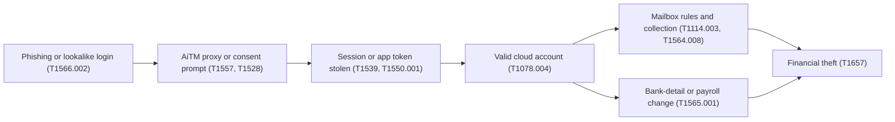

# 17. Threat profile

> **Reference work.** Fictional scenario built for a public portfolio. Not deployed in, derived from, or describing any employer environment. Not professional advice.

## Purpose and scope

This document names the threats that matter most to Fabrikam (fictional) and explains, at a strategy level, how each one would unfold, what it would cost a payroll and human resources (HR) platform, how likely it is, and which controls and documents answer it. It is a reasoning aid, not an assessment of any real environment, and it contains no exploitation steps, tooling, or operator procedures. It informs the risk register (document [11](11-risk-management.md)), the security baseline (document [06](06-microsoft-365-security-baseline.md)), detection and response (document [08](08-detection-and-incident-response.md)), awareness (document [09](09-security-awareness-and-training.md)), and the service desk (document [13](13-it-service-management.md)); likelihoods are proposals to be tuned after discovery (document [05](05-environment-discovery.md)).

## How to read the techniques

Every technique below is cited to MITRE ATT&CK v20 (Enterprise matrix), which MITRE released on 2026-10-13; every technique ID and name cited here was checked against v20 that day. MITRE's v19 release split the former Defense Evasion tactic into Stealth (TA0005) and Defense Impairment (TA0112).

MITRE's v19 release also replaced the standalone Impersonation and Email Spoofing techniques with sub-techniques of T1684 (Social Engineering). The mappings here use the current structure, so older material may need remapping. Techniques describe adversary behavior at the level ATT&CK itself does. The data source named for each scenario is the telemetry a defender needs to see the behavior; many of those sources are Microsoft 365 audit and sign-in logs that run at standard retention today (document [06](06-microsoft-365-security-baseline.md) sets logging and retention). Where a data source depends on a license, the license is named in parentheses; anything beyond E3 is a licensing decision in [ADR-001](adr/ADR-001-microsoft-365-security-licensing.md).

Fabrikam processes sensitive workforce data for its customers: Social Security numbers, tax and direct-deposit bank details, benefits and dependent data, background screening results, and GPS location captured at clock-in. That data, and the money movement around payroll, is what almost every scenario below is ultimately after. Product has proposed voice verification for customers' administrators who call Fabrikam's support line. The proposal is held at the privacy review gate (document [10](10-governance-and-compliance-program.md)) and is not live. The FBI has warned that criminals "obtain access to bank accounts using AI-generated audio clips of individuals and impersonating them," which bears on any voice check on that line (S-02).

## Threat landscape (sourced)

Published reporting frames the priorities. The FBI's Internet Crime Complaint Center (IC3) received just over one million complaints in 2025 and reported that losses rose 26 percent year over year; business email compromise (BEC) was the second largest loss category, with 24,768 complaints (up from 21,442 in 2024), and the IC3 reports that 86 percent of BEC transactions moved by wire or ACH transfer. The IC3 counted 3,611 ransomware complaints in 2025, up from 3,156 in 2024. Two FBI public service announcements speak directly to this sector: a 2018 alert on credential phishing that redirects employees' direct-deposit pay, and a 2025 alert warning that criminals impersonate employee self-service portals through search-engine ads and that multifactor authentication (MFA) does not protect a user who lands on a fraudulent login page.

Verizon's 2026 Data Breach Investigations Report (DBIR) analyzed more than 31,000 incidents and reports that exploitation of vulnerabilities is now the most common initial access vector at 31 percent, that ransomware was present in 48 percent of breaches (up from 44 percent), that third-party involvement rose to 48 percent of breaches, and that the human element was present in 62 percent. Microsoft's 2026 Digital Defense Report (MDDR) reports that user execution, valid accounts, social engineering, and phishing together make up 73.3 percent of initial access attempts, that 63 percent of intrusions involved data theft, that it detected more than 46 million business email impersonation attacks, and that phishing-resistant MFA, identity hygiene, tiered administration, and privileged-access enforcement remain the highest-leverage controls. Microsoft's 2025 report earlier found that over half of attacks were financially motivated and that phishing-resistant MFA prevents up to 99 percent of the password-guessing identity attacks it describes. CISA's #StopRansomware Guide notes that ransomware actors have posed as company IT or help-desk staff by phone or SMS to obtain credentials, and CISA names HR staff and help-desk and IT administrators as early priorities for phishing-resistant MFA.

One public incident teaches the outage lesson directly: in a December 2021 ransomware attack on a major workforce management provider's private cloud, customers ran payroll and timekeeping by hand for weeks and still had to pay workers, including holiday pay and overtime. For a provider on which customers depend to run payroll on time, availability is a security outcome, not only an IT one.

## Scenario summary

| ID | Scenario | Primary risk | Qualitative likelihood |
|---|---|---|---|
| S-01 | Payroll diversion and payment fraud by BEC against Fabrikam's own finance and HR | R-01 | High |
| S-02 | Takeover of a customer administrator account in the product, leading to bank-detail changes | R-02 | High |
| S-03 | Impersonation of employees to the IT service desk to reset passwords or MFA | R-01, R-06 | Medium to High |
| S-04 | Adversary-in-the-middle phishing and session token theft, leading to mailbox takeover | R-01, R-07 | High |
| S-05 | Consent phishing with a malicious OAuth application | R-07, R-08 | Medium to High |
| S-06 | Ransomware against corporate endpoints and Microsoft 365 data | R-03 | Medium to High |
| S-07 | Misuse of customer data by an insider | R-07, R-12 | Medium |
| S-08 | Compromise of an integration credential or partner connection | R-08 | Medium to High |
| S-09 | Spoofing of Fabrikam's own and older brand email domains to phish customers | R-02, R-01 | High (for attempts) |
| S-10 | Loss or theft of employee devices and of customer devices running the app | R-07, R-03 | Medium |

### Common identity-centric attack path

Scenarios S-02 through S-05 share a shape: a lure defeats the login, an account or token is taken, and the outcome is money movement or data theft.

## Scenarios

### S-01. Payroll diversion and payment fraud by BEC against Fabrikam's own finance and HR

**Who and why.** Financially motivated external actors who run BEC and payment fraud. The goal is to redirect money: a vendor payment, a payroll run, or an employee's direct deposit, into an account they control.

**How it unfolds (strategy level).**
- Reconnaissance of who holds finance and HR authority: T1591.004 (Gather Victim Org Information: Identify Roles) and T1589.003 (Gather Victim Identity Information: Employee Names).
- A pretext message from a spoofed or lookalike sender, an impersonated executive, or a genuinely compromised partner mailbox: T1684.001 (Social Engineering: Impersonation) and T1586.002 (Compromise Accounts: Email Accounts).
- A request to change bank details or release a payment, ending in T1657 (Financial Theft).

| Attribute | Detail |
|---|---|
| Business impact | Direct loss of funds that is hard to recover once wired, plus finance-team disruption and loss of trust. For a payroll provider the same lure also threatens customer payroll (S-09). |
| Qualitative likelihood | High. BEC is the second largest IC3 loss category and needs no malware. |
| Linked risks | R-01 (primary), R-10. |
| Controls and documents | Email authentication and anti-phishing in document [06](06-microsoft-365-security-baseline.md); role-based finance and payroll training in document [09](09-security-awareness-and-training.md); out-of-band verification of bank changes in the service desk and change process (document [13](13-it-service-management.md)) and the [payroll diversion and email compromise playbook](playbooks/payroll-diversion-and-email-compromise.md); the executive [payroll diversion tabletop](templates/tabletop-payroll-diversion.md); detection and response in document [08](08-detection-and-incident-response.md). |
| Data sources | Exchange Online message trace; Defender for Office 365 anti-phishing and impersonation detections (Plan 1, in E3 per document [01](01-scenario-and-assumptions.md)); the Microsoft 365 unified audit log (E3). Payment and bank-change approvals live in the finance system, not Microsoft 365. |
| Residual concern | Out-of-band verification depends on human discipline under time pressure, and lookalike domains and display-name tricks survive email authentication (S-09). |

### S-02. Takeover of a customer administrator account in the product, leading to bank-detail changes (shared with Engineering)

**Who and why.** Financially motivated actors targeting the employer administrators who use Fabrikam's product, so they can change hourly workers' direct-deposit details at scale. The 2025 FBI alert describes the same technique used against employees' own self-service accounts (search-engine ads that lead to fake login pages, then direct-deposit changes); S-02 applies it to administrators who can change many workers' details at once.

**How it unfolds (strategy level).**
- T1583.001 (Acquire Infrastructure: Domains) and T1583.008 (Acquire Infrastructure: Malvertising) to stand up a convincing fake login reached through search ads.
- T1598.003 (Phishing for Information: Spearphishing Link), T1110.004 (Brute Force: Credential Stuffing), or T1110.003 (Brute Force: Password Spraying) to obtain credentials.
- A call to Fabrikam's support line posing as the administrator to get a sign-in or MFA reset: T1684.001 (Social Engineering: Impersonation).
- T1557 (Adversary-in-the-Middle) and T1539 (Steal Web Session Cookie) to get past MFA on the product, then T1078.004 (Valid Accounts: Cloud Accounts).
- T1565.001 (Data Manipulation: Stored Data Manipulation) to change bank details, ending in T1657 (Financial Theft).

| Attribute | Detail |
|---|---|
| Business impact | Customer workers' pay redirected, Fabrikam breach-notification and contractual duties triggered, and enterprise-sales and churn risk. |
| Qualitative likelihood | High. FBI reporting describes the technique against employee self-service accounts and warns that "Multi-factor authentication will not protect you if you land on a fraudulent login page." |
| Linked risks | R-02 (primary), R-10, R-11, R-12. |
| Controls and documents | The Director's proposal for the Chief Product Officer's M3 decision (document [11](11-risk-management.md)): MFA by default for customer administrators and payroll approvers, with passkeys and federation to the customer's identity provider where offered; step-up authentication on bank-detail changes, with notice to the worker and the administrator; a hold or verification before the first payment to a new bank account; and detection of a destination account that recurs across workers or customers. Engineering builds under the shared RACI (document [04](04-operating-model-team-and-budget.md)); the decisions stay with the Chief Product Officer, and with the CEO for any acceptance outside appetite. [ADR-004](adr/ADR-004-phishing-resistant-authentication-rollout.md) covers workforce sign-in only, not product administrators. Support verifies a customer administrator by calling back through contacts already in the CRM before changing access (document [09](09-security-awareness-and-training.md)); customer notification readiness, detection, and the planned compromised customer administrator playbook are in document [08](08-detection-and-incident-response.md). |
| Data sources | Product application and authentication logs and the product's audit trail of bank-detail changes (Engineering-owned), support platform records of administrator access changes, plus anomalous sign-in telemetry. |
| Residual concern | Customer administrators' own device hygiene and training sit outside Fabrikam's direct control. If the Chief Product Officer declines the proposal, R-02 stays outside appetite (document [11](11-risk-management.md)), and the Chief Product Officer and the CEO accept it for a set period; while its current rating stays Critical, only the executive team can accept it, 30 days at a time. |

### S-03. Impersonation of employees to the IT service desk to reset passwords or MFA

**Who and why.** External actors, including ransomware affiliates, who phone or message the help desk posing as a staff member to get a password or MFA reset and so take over an account. CISA's #StopRansomware Guide records the mirror image, actors posing as IT or help desk staff to employees; documents [09](09-security-awareness-and-training.md) and [13](13-it-service-management.md) cover both directions.

**How it unfolds (strategy level).**
- Reconnaissance of names and roles: T1589.003 (Gather Victim Identity Information: Employee Names) and T1591.004 (Gather Victim Org Information: Identify Roles).
- T1684.001 (Social Engineering: Impersonation) against a help-desk analyst.
- The analyst resets or re-enrolls authentication, which the attacker captures: T1556.006 (Modify Authentication Process: Multi-Factor Authentication) and T1098.005 (Account Manipulation: Device Registration), then T1078.004 (Valid Accounts: Cloud Accounts).

| Attribute | Detail |
|---|---|
| Business impact | Account takeover that bypasses the MFA investment, giving a foothold for BEC (S-01) or ransomware (S-06); worse if the account is privileged or a product administrator. |
| Qualitative likelihood | Medium to High. A lean help desk with ad hoc processes and no strong caller verification is exposed. |
| Linked risks | R-01, R-03, R-06, R-02. |
| Controls and documents | Caller identity verification in the service desk request catalog (document [13](13-it-service-management.md)); authentication-method governance and lifecycle in documents [06](06-microsoft-365-security-baseline.md) and [07](07-identity-lifecycle-joiners-movers-leavers.md); role-based training for the service desk in document [09](09-security-awareness-and-training.md); detection of reset and registration events in document [08](08-detection-and-incident-response.md). |
| Data sources | Microsoft Entra audit log (authentication-method and device registration events), sign-in logs, service desk ticket records, and identity alerts in Defender XDR (Entra ID Protection detections need Entra ID P2). |
| Residual concern | High-pressure social engineering can defeat process; phishing-resistant methods reduce the value of a reset, but the enrollment flow itself stays a target. |

### S-04. Adversary-in-the-middle phishing and session token theft, leading to mailbox takeover

**Who and why.** Financially motivated actors using adversary-in-the-middle (AiTM) phishing to steal a session token, bypass MFA, and take over a mailbox as a base for fraud and data theft.

**How it unfolds (strategy level).**
- T1566.002 (Phishing: Spearphishing Link) to an AiTM proxy page.
- T1557 (Adversary-in-the-Middle), T1111 (Multi-Factor Authentication Interception), and T1539 (Steal Web Session Cookie) capture credentials and the live session.
- T1550.004 (Use Alternate Authentication Material: Web Session Cookie) replays the token, giving T1078.004 (Valid Accounts: Cloud Accounts).
- T1114.002 (Email Collection: Remote Email Collection), T1114.003 (Email Collection: Email Forwarding Rule), and T1564.008 (Hide Artifacts: Email Hiding Rules) harvest mail and hide the activity; T1534 (Internal Spearphishing) spreads it.

| Attribute | Detail |
|---|---|
| Business impact | A launchpad for invoice and payroll fraud, exposure of sensitive workforce data, and notification duties. |
| Qualitative likelihood | High. Valid-account and phishing paths dominate current initial-access reporting, and AiTM kits are widely available. |
| Linked risks | R-01, R-07, R-10. |
| Controls and documents | Phishing-resistant MFA and token protection ([ADR-004](adr/ADR-004-phishing-resistant-authentication-rollout.md)), anti-phishing, and blocking legacy authentication in document [06](06-microsoft-365-security-baseline.md); detection of risky sign-ins and new mailbox rules, with managed detection and response for after-hours coverage ([ADR-003](adr/ADR-003-managed-detection-and-response.md)), in document [08](08-detection-and-incident-response.md); phishing simulation and reporting in document [09](09-security-awareness-and-training.md). |
| Data sources | Entra sign-in logs, including anomalous sessions (Entra ID P1, in E3; full risk detections need Entra ID P2), the unified audit log for new inbox rules and forwarding (E3), message trace, and Defender XDR alerts and Defender for Cloud Apps (Microsoft Defender Suite or E5). |
| Residual concern | Phishing-resistant MFA is the durable defense but rollout runs to month 9 (M6); token theft by device malware remains possible; Microsoft-provided SMS and voice remain available until they retire on 2027-02-01 (2027-07-01 for Global Administrators and external users). |

### S-05. Consent phishing with a malicious OAuth application

**Who and why.** Actors who trick a user into granting OAuth consent to an attacker-controlled application, gaining persistent, token-based access to mail and files without a password and without tripping MFA.

**How it unfolds (strategy level).**
- T1566.002 (Phishing: Spearphishing Link) to a consent prompt.
- T1528 (Steal Application Access Token) through the granted consent, with persistence via T1671 (Cloud Application Integration).
- T1550.001 (Use Alternate Authentication Material: Application Access Token), then T1530 (Data from Cloud Storage), T1114.002 (Email Collection: Remote Email Collection), and T1213.002 (Data from Information Repositories: Sharepoint).

| Attribute | Detail |
|---|---|
| Business impact | Silent, MFA-independent access to sensitive workforce data that survives a password reset. |
| Qualitative likelihood | Medium to High. Users can consent to third-party apps today (day-1 assumption A-02), which is the default condition this targets. |
| Linked risks | R-07, R-08, R-13. |
| Controls and documents | App-consent hardening (restrict user consent, admin-consent workflow, verified-publisher requirement) in document [06](06-microsoft-365-security-baseline.md); OAuth and SaaS application inventory and governance in document [15](15-enterprise-systems-and-saas.md); consent-grant detection in document [08](08-detection-and-incident-response.md); AI-tool consent guardrails in document [16](16-ai-adoption-guardrails.md). |
| Data sources | Entra audit log (consent and app-role grants), app governance in Defender for Cloud Apps (Microsoft Defender Suite or E5), enterprise-application sign-in logs, unified audit log. |
| Residual concern | Over-privileged but legitimate-looking apps from verified publishers can still over-request, and already-granted consents must be reviewed, not only future ones. |

### S-06. Ransomware against corporate endpoints and Microsoft 365 data

**Who and why.** Ransomware affiliates running double extortion: steal data, then encrypt or destroy it, and demand payment.

**How it unfolds (strategy level).**
- Initial access by T1566.002 (Phishing: Spearphishing Link), T1078.004 (Valid Accounts: Cloud Accounts), or T1190 (Exploit Public-Facing Application).
- T1685 (Disable or Modify Tools), a Defense Impairment technique, to reduce visibility.
- T1530 (Data from Cloud Storage) and T1567.002 (Exfiltration Over Web Service: Exfiltration to Cloud Storage) before encryption.
- T1486 (Data Encrypted for Impact), T1490 (Inhibit System Recovery), and in destructive cases T1485 (Data Destruction), including mass deletion of SharePoint, OneDrive, and mailbox content.

| Attribute | Detail |
|---|---|
| Business impact | Corporate outage, disruption to customers' payroll windows, extortion pressure, and notification duties. Recovery can take weeks. |
| Qualitative likelihood | Medium to High. Ransomware complaint counts rose in 2025 and the behavior is present in nearly half of reported breaches. |
| Linked risks | R-03 (primary), R-04, R-07, R-10. |
| Controls and documents | Attack surface reduction, Defender for Endpoint, phishing-resistant MFA, and blocking legacy authentication in document [06](06-microsoft-365-security-baseline.md); immutable, tested Microsoft 365 backup ([ADR-006](adr/ADR-006-microsoft-365-backup.md)) and restore testing in document [14](14-business-continuity-and-backup.md); managed detection and response ([ADR-003](adr/ADR-003-managed-detection-and-response.md)) and automatic attack disruption (Defender for Endpoint Plan 2, in Microsoft Defender Suite) in document [08](08-detection-and-incident-response.md); endpoint standards and patching in document [13](13-it-service-management.md). |
| Data sources | Defender for Endpoint (Plan 1 in E3; endpoint detection and response needs Plan 2, in Microsoft Defender Suite or E5) and Defender XDR incidents (Plan 1 already lists endpoint incidents and alerts in the Microsoft Defender portal), Entra sign-in logs, unified audit log (mass-delete and mass-download), Microsoft 365 Backup status ([ADR-006](adr/ADR-006-microsoft-365-backup.md)). |
| Residual concern | Backups must prove the whole recovery path, not only that copies exist; a lean team depends on an MDR provider for nights and weekends; exfiltration may precede detection. |

### S-07. Misuse of customer data by an insider

**Who and why.** A malicious or negligent insider who takes or misuses customer payroll and identity data: for example a support agent or engineer with broad access, a departing employee, or a fraudulent remote hire who passed onboarding under a false or borrowed identity and so holds legitimate access (R-15).

**How it unfolds (strategy level).**
- T1078.004 (Valid Accounts: Cloud Accounts), used as an abuse of legitimate entitlement rather than an exploit.
- T1213.002 (Data from Information Repositories: Sharepoint) and T1213.003 (Data from Information Repositories: Code Repositories), T1530 (Data from Cloud Storage), and T1005 (Data from Local System).
- T1567.002 (Exfiltration Over Web Service: Exfiltration to Cloud Storage) or T1052.001 (Exfiltration Over Physical Medium: Exfiltration over USB).

| Attribute | Detail |
|---|---|
| Business impact | Exposure of regulated workforce data (Social Security numbers, bank details, benefits, location data), privacy-law and contractual exposure, and loss of trust. |
| Qualitative likelihood | Medium. Oversharing and broad support access are day-1 conditions (A-06), and the E3 baseline has limited data-loss tooling. |
| Linked risks | R-07 (primary), R-12, R-05, R-06, R-15. |
| Controls and documents | Identity verification before a new hire's first credential (R-15), least privilege, access packages, access reviews, and prompt offboarding in document [07](07-identity-lifecycle-joiners-movers-leavers.md); data classification, sensitivity labels, and sharing controls in document [06](06-microsoft-365-security-baseline.md); SaaS access governance in document [15](15-enterprise-systems-and-saas.md); policy and privacy coordination in document [10](10-governance-and-compliance-program.md). |
| Data sources | Unified audit log (file access, download, and sharing), Entra sign-in logs, Defender for Cloud Apps (Microsoft Defender Suite or E5), SharePoint and OneDrive sharing events. Insider Risk Management and advanced data-loss prevention (DLP) need Microsoft 365 E5, Microsoft Purview Suite, or the matching add-on: Microsoft 365 E5 Insider Risk Management, or Microsoft 365 E5 Information Protection and Governance for endpoint and Teams DLP (see architecture gaps). |
| Residual concern | Insiders with legitimate access are hard to detect without E5-tier tooling; least privilege and logging shrink the blast radius and speed investigation but do not prevent misuse. |

### S-08. Compromise of an integration credential or partner connection

**Who and why.** Actors who steal an API key or service-principal secret, or compromise a connected partner (an ERP or accounting system, a benefits carrier, or a screening provider), to reach Fabrikam data through a trusted path.

**How it unfolds (strategy level).**
- T1199 (Trusted Relationship) through a compromised partner or connector.
- T1552.001 (Unsecured Credentials: Credentials In Files) and T1213.003 (Data from Information Repositories: Code Repositories) to find secrets.
- T1078.004 (Valid Accounts: Cloud Accounts) and T1550.001 (Use Alternate Authentication Material: Application Access Token), then T1530 (Data from Cloud Storage) and T1567.002 (Exfiltration Over Web Service: Exfiltration to Cloud Storage).

| Attribute | Detail |
|---|---|
| Business impact | Data exposure across the scope of the integration, and a trust path that is hard to detect because the traffic looks authorized. |
| Qualitative likelihood | Medium to High. Third-party involvement in breaches is rising sharply, and acquisitions left duplicate, unmanaged connections (A-08). |
| Linked risks | R-08 (primary), R-09, R-07, R-10. |
| Controls and documents | Integration and SaaS inventory, single sign-on, secret management, and acquisition consolidation in document [15](15-enterprise-systems-and-saas.md); third-party risk management (POL-10) in document [10](10-governance-and-compliance-program.md); service-account and non-human identity governance in document [07](07-identity-lifecycle-joiners-movers-leavers.md); app-consent and workload-identity hygiene in document [06](06-microsoft-365-security-baseline.md); Engineering asks for the CTO's decision (document [11](11-risk-management.md)): single sign-on and MFA on code hosting, secret scanning that blocks credentials at commit, protected branches, pipeline secrets in a vault, and dependency alerts. |
| Data sources | Entra sign-in logs for service principals and workload identities, application audit logs, partner-connector logs, Defender for Cloud Apps (Microsoft Defender Suite or E5). |
| Residual concern | Non-human identities often lack MFA and rotation; partner-side controls are contractual, not directly observable by Fabrikam. |

### S-09. Spoofing of Fabrikam's own and older brand email domains to phish customers

**Who and why.** Actors who spoof Fabrikam's main domain or the two older brand domains from the acquisitions (A-05) to send fake pay and bank-change notices to customers' payroll administrators and hourly workers. This is the classic payroll-diversion lure the FBI describes.

**How it unfolds (strategy level).**
- T1583.001 (Acquire Infrastructure: Domains) for a lookalike, or T1684.002 (Social Engineering: Email Spoofing) of a real Fabrikam domain.
- T1566.002 (Phishing: Spearphishing Link) to the recipients and T1598.003 (Phishing for Information: Spearphishing Link) to harvest credentials, feeding product account takeover (S-02) and T1657 (Financial Theft).

| Attribute | Detail |
|---|---|
| Business impact | Erosion of trust in mail from Fabrikam, payroll diversion against customers, and brand damage across all three domains, including the one that no longer sends mail. |
| Qualitative likelihood | High for attempts. On day 1 (A-05) the main domain publishes DMARC at p=none and its aggregate reports go to a mailbox nobody reviews, so it gives neither protection nor visibility. Of the two older brand domains, one no longer sends mail but publishes no SPF or DMARC record, and the other sends only through a marketing service and has no DMARC record, so receivers get no DMARC policy for either and Fabrikam gets no reports on mail sent in their names. |
| Linked risks | R-02, R-01, R-12. |
| Controls and documents | The email authentication subsection of document [06](06-microsoft-365-security-baseline.md): aggregate reporting on every sending domain, DKIM alignment for third-party senders, and staged enforcement to reject after the freeze, with the sending older brand domain first and the main domain last. The older brand domain that no longer sends gets parked-domain records early (SPF with -all and DMARC at p=reject), a non-disruptive quick win in Phase 1 or 2; the one that sends gets a DMARC record with reporting in Phase 1, then either reaches enforcement or moves its mail to a subdomain of the main brand. The product bank-change safeguards proposed under S-02 limit the payoff; customer-facing guidance is a product and customer matter (note the scope boundary). |
| Data sources | DMARC aggregate (rua) reports and the sender inventory built from them; spoof intelligence on inbound mail (built into all cloud mailboxes, so included in E3). |
| Residual concern | Enforcement stops exact-domain spoofing but not lookalike domains, display-name tricks, or compromised legitimate accounts, so customer-side verification is still needed; lookalike domain monitoring follows in Phase 4 (document [15](15-enterprise-systems-and-saas.md)). The main domain reaches enforcement last, after the freeze, so it stays spoofable longest. |

### S-10. Loss or theft of employee devices and of customer devices running the app

**Who and why.** Opportunistic theft or loss of employee laptops and phones, and of the shared phones and tablets at customers' work sites that run Fabrikam's app (customers buy and manage those devices), risking exposure of local data and, if a device is unlocked or holds cached credentials or a live session, account access.

**How it unfolds (strategy level).**
- Physical loss or theft, then an attempt to get past the lock screen of a tablet or phone.
- A search of local storage on a phone or tablet for what the app keeps there, or T1005 (Data from Local System) on a laptop for files.
- If credentials are cached or a session is live, T1078.004 (Valid Accounts: Cloud Accounts).

| Attribute | Detail |
|---|---|
| Business impact | Exposure of files on employee devices and of whatever the app keeps on a customer device, possible account access, replacement of employee devices, and privacy duties. |
| Qualitative likelihood | Medium. Hourly workers use the app on their own phones or on shared phones and tablets at work sites, which customers buy and manage (document [01](01-scenario-and-assumptions.md)), and inconsistent compliance, common local admin rights, no LAPS, and some remaining Windows 10 devices are day-1 conditions on Fabrikam's own computers (A-04). |
| Linked risks | R-07, R-03, R-12. |
| Controls and documents | Employee laptops: Intune compliance, BitLocker and FileVault disk encryption, Conditional Access device compliance, and Windows LAPS in document [06](06-microsoft-365-security-baseline.md). Phones: Intune app protection with selective wipe of company data for personal phones (no enrollment, [ADR-008](adr/ADR-008-endpoint-management-standard.md)), and Intune enrollment for the company-owned phones administrators use ([ADR-004](adr/ADR-004-phishing-resistant-authentication-rollout.md)). Device lifecycle and loss reporting are in document [13](13-it-service-management.md), and the planned lost-device playbook in document [08](08-detection-and-incident-response.md) covers employee devices plus the app's remote sign-out for customer devices. The shared phones and tablets at customers' work sites belong to customers, who secure and manage them (a complementary user entity control in document [10](10-governance-and-compliance-program.md)); Fabrikam controls only its app on them: what it keeps on a device, session length, and remote sign-out of a lost device, decided by Engineering under the shared RACI (document [04](04-operating-model-team-and-budget.md)). Hourly workers' clock-in accounts are product identities (document [07](07-identity-lifecycle-joiners-movers-leavers.md)). |
| Data sources | Intune device inventory, compliance, and app protection status and Entra device registration and sign-in logs (all in E3); BitLocker recovery-key escrow and access audit; service desk lost-device reports; for customer devices running the app, the product's sign-in and session logs (Engineering-owned). |
| Residual concern | Shared use complicates per-user attribution; disk encryption and remote wipe reduce exposure only on devices Fabrikam manages, so on customer devices Fabrikam's reach is its app and the rest depends on customers; the Windows 10 Extended Security Updates decision affects the remaining devices. |

## Detection gaps for document 08 (prioritized)

These feed the detection and response model (document [08](08-detection-and-incident-response.md)) and the advanced-hunting queries. In priority order:

1. Sign-ins that complete without phishing-resistant authentication, and any legacy-authentication sign-ins (S-04, S-02, S-03).
2. Creation or change of inbox forwarding and hiding rules and mailbox delegation (S-01, S-04).
3. OAuth application consent grants and new service-principal credentials (S-05, S-08).
4. MFA-method and device-registration changes, especially soon after a help-desk reset (S-03).
5. Mass download or large export and creation of anonymous sharing links (S-07, S-06).
6. Privileged role changes, which map to T1098.003 (Account Manipulation: Additional Cloud Roles), and the standing Global Administrator count (KPI-09) (S-03, S-06).
7. Mass deletion or bulk version change of Microsoft 365 content and endpoint ransomware behaviors, with after-hours coverage through the MDR provider (S-06).

## Architecture gaps for document 06 and ADR-001 (prioritized)

These feed the security baseline (document [06](06-microsoft-365-security-baseline.md)) and the licensing decision ([ADR-001](adr/ADR-001-microsoft-365-security-licensing.md)):

1. Phishing-resistant MFA rollout order and token protection ([ADR-004](adr/ADR-004-phishing-resistant-authentication-rollout.md)) is the single highest-leverage control for workforce accounts across S-03 and S-04. It does not reach product administrators (S-02, the Chief Product Officer's M3 decision) or consent grants (S-05, item 3).
2. The E3 baseline lacks risk-based Conditional Access (Microsoft Entra ID Protection, which needs Entra ID P2), Insider Risk Management and advanced data-loss prevention (Microsoft Purview, E5 level), and centralized attack-surface-reduction reporting (E5 level); these are add-on decisions for [ADR-001](adr/ADR-001-microsoft-365-security-licensing.md).
3. App-consent hardening (restrict user consent, admin-consent workflow, verified-publisher requirement) in document [06](06-microsoft-365-security-baseline.md).
4. Staged DMARC enforcement to reject on every sending domain (the older brand domain that still sends first, the main domain last), and early parked-domain records on the one that no longer sends, in the email authentication subsection of document [06](06-microsoft-365-security-baseline.md).
5. Immutable, tested Microsoft 365 backup ([ADR-006](adr/ADR-006-microsoft-365-backup.md)) that proves the whole recovery path.

## Phase plan

| Phase | Action ID | Action | Outcome | KPI | Owner role | Workstream |
|---|---|---|---|---|---|---|
| Phase 1 | 17.01 | Draft this threat profile and map each scenario to the draft risk register (R-01 to R-15) and to a control owner | Top threats tied to risks and to the controls that answer them | KPI-01 | Director of IT and Security | WS-5 |
| Phase 3 | 17.02 | Validate the profile against the approved risk register and the NIST CSF 2.0 target profile; confirm the detection and architecture gaps above are accepted into documents 08 and 06 | Threat-to-control coverage confirmed at plan approval (M3) | KPI-01 | Director of IT and Security | WS-5 |
| Phase 4 | 17.03 | Use the profile to scope the first exercises: the executive payroll-diversion tabletop in late February and detection validation for the mailbox-takeover and ransomware behaviors, drawing executable tests from an existing, publicly maintained, ATT&CK-aligned validation library that document 08 selects and runs in an isolated lab | Exercise and validation scope defined; no attack procedures authored here | KPI-18 | Director of IT and Security | WS-4 |
| Phase 5 | 17.04 | Re-baseline the profile at the annual review (M7) and remap techniques to the then-current ATT&CK version | Refreshed profile and mappings | KPI-17 | Security Engineer | WS-5 |

## Resourcing and dependencies

- **Roles.** Director of IT and Security (owns the profile and scopes the first exercises); Security Engineer and GRC Analyst, who start in March 2027 in the base case after the M3 budget approval (maintenance and later exercise scoping); IT Operations Manager and Service Desk Analyst (S-03, S-10); and the Engineering Manager and Site Reliability Engineering lead for the shared product path in S-02. The hiring sequence and the RACI are in document [04](04-operating-model-team-and-budget.md).
- **Partners.** The MDR provider (after-hours detection, S-04 and S-06), the penetration testing firm (independent validation of S-02 and S-08), and the SOC 2 audit firm (control coverage).
- **Licenses.** Microsoft 365 E3 is the baseline. Risk-based Conditional Access (Entra ID P2), Insider Risk Management and advanced data-loss prevention (Microsoft Purview), and Privileged Identity Management (Entra ID P2 or Microsoft Entra ID Governance) are add-on decisions in [ADR-001](adr/ADR-001-microsoft-365-security-licensing.md); document [06](06-microsoft-365-security-baseline.md) names the license each control needs.
- **Depends on.** Documents [01](01-scenario-and-assumptions.md) (scenario and assumptions), [05](05-environment-discovery.md) (discovery that tunes the likelihoods), and [04](04-operating-model-team-and-budget.md) (the shared RACI). Feeds documents [02](02-first-90-days.md), [03](03-twelve-month-roadmap.md), [06](06-microsoft-365-security-baseline.md), [08](08-detection-and-incident-response.md), [09](09-security-awareness-and-training.md), [11](11-risk-management.md), and [15](15-enterprise-systems-and-saas.md), plus the [payroll diversion playbook](playbooks/payroll-diversion-and-email-compromise.md) and the [payroll diversion tabletop](templates/tabletop-payroll-diversion.md).

## Risks and open questions

- This is a strategy-level profile, not an assessment of any environment. Likelihoods are qualitative proposals to be tuned in discovery (document [05](05-environment-discovery.md)) and scored in the risk register (document [11](11-risk-management.md)).
- Named threat-actor attribution is deliberately omitted. Actor and campaign context should be refreshed through the current IC3, DBIR, and MDDR editions rather than characterized from memory; the counts here are point-in-time and vendor-attributed.
- Several high-value detections and controls (Insider Risk Management, advanced data-loss prevention, risk-based Conditional Access) depend on licensing above the E3 baseline, so S-05 and S-07 coverage is partly a budget decision ([ADR-001](adr/ADR-001-microsoft-365-security-licensing.md)).
- The product path in S-02 depends on Engineering telemetry under the shared RACI; corporate IT sees only part of that path, so coverage there is a joint commitment, not a corporate-IT control.
- MITRE's v19 release split Defense Evasion into Stealth and Defense Impairment and revoked the former standalone Impersonation and Email Spoofing techniques. ATT&CK v20 (2026-10-13) left every ID and name cited here unchanged. Recheck the mappings at each ATT&CK release, historically around April and October.

## Framework mapping

By identifier only, consistent with the [crosswalk](crosswalk/csf2-soc2-crosswalk.md). This document supports:

| Theme | NIST CSF 2.0 | SOC 2 (2017 TSC) |
|---|---|---|
| Threat and risk identification (the profile itself) | ID.RA-01, ID.RA-03, ID.RA-04, ID.RA-05; GV.RM-06 | CC3.1, CC3.2, CC3.3, CC3.4 |
| Identity, authentication, and access (S-01 to S-05, S-08) | PR.AA-01, PR.AA-05 | CC6.1, CC6.2, CC6.3 |
| Lost or stolen devices and physical access (S-10) | PR.AA-06 | CC6.4 |
| Email, data protection, and external threats (S-01, S-04, S-07, S-09) | PR.DS-01, PR.DS-02 | CC6.6, CC6.7, CC6.8, C1.1 |
| Supply chain and third parties (S-08) | GV.SC-01, GV.SC-07, GV.SC-10 | CC9.2 |
| Awareness and training (S-01, S-03, S-04) | PR.AT-01, PR.AT-02 | CC1.4, CC2.2 |
| Detection and monitoring (all scenarios) | DE.CM-01, DE.CM-03, DE.CM-09, DE.AE-02, DE.AE-03 | CC7.1, CC7.2, CC7.3 |
| Incident response and recovery (S-06) | RS.MA-01, RS.MI-01, RS.MI-02, RC.RP-01 | CC7.4, CC7.5, A1.2, A1.3 |
| Oversight and reporting | GV.OV-03 | CC4.1, CC4.2 |

## Sources

- MITRE ATT&CK, Enterprise matrix, v20 (technique and tactic pages, and the versions list). MITRE. https://attack.mitre.org/resources/versions/ . Checked 2026-10-13. Primary.
- MITRE ATT&CK, Updates: April 2026 (v19 release notes, including the Defense Evasion split and the revocations of the former Impersonation and Email Spoofing techniques). MITRE. https://attack.mitre.org/resources/updates/updates-april-2026/ . Checked 2026-10-13. Primary.
- MITRE ATT&CK, Updates: October 2026 (v20 release notes, start date October 13, 2026). MITRE. https://attack.mitre.org/resources/updates/updates-october-2026/ . Checked 2026-10-13. Primary.
- The NIST Cybersecurity Framework (CSF) 2.0 (CSWP 29). NIST. https://nvlpubs.nist.gov/nistpubs/CSWP/NIST.CSWP.29.pdf . Checked 2026-10-13. Primary.
- 2025 Internet Crime Report. FBI Internet Crime Complaint Center (IC3). https://www.ic3.gov/AnnualReport/Reports/2025_IC3Report.pdf . Checked 2026-10-13. Primary.
- Cybercriminals Utilize Social Engineering Techniques To Obtain Employee Credentials To Conduct Payroll Diversion (Alert I-091818-PSA). FBI IC3. https://www.ic3.gov/PSA/2018/PSA180918 . Checked 2026-10-13. Primary.
- Cyber Criminals Impersonating Employee Self-Service Websites to Steal Victim Information and Funds (Alert I-042425-PSA). FBI IC3. https://www.ic3.gov/PSA/2025/PSA250424 . Checked 2026-10-13. Primary.
- Criminals Use Generative Artificial Intelligence to Facilitate Financial Fraud (Alert I-120324-PSA, December 3, 2024). FBI IC3. https://www.ic3.gov/PSA/2024/PSA241203 . Checked 2026-10-13. Primary.
- 2026 Data Breach Investigations Report, Executive Summary. Verizon Business. https://www.verizon.com/business/resources/executivebriefs/2026-dbir-executive-summary.pdf . Checked 2026-10-13. Primary (vendor research; primary for what Verizon reports).
- 2026 Microsoft Digital Defense Report, Executive Summary. Microsoft. https://cdn-dynmedia-1.microsoft.com/is/content/microsoftcorp/microsoft/msc/documents/presentations/CSR/2026-Microsoft-DDR-Exec-Summary.pdf . Checked 2026-10-13. Primary (vendor research; primary for what Microsoft reports).
- Microsoft releases 2025 Digital Defense Report (newsroom summary). Microsoft. https://news.microsoft.com/source/asia/2026/01/07/microsoft-releases-2025-digital-defense-report-highlighting-the-changing-cyber-threat-landscape-and-the-importance-of-security-in-the-ai-era/ . Checked 2026-10-13. Primary (vendor research; used for trend context only).
- #StopRansomware Guide (version 3.0, October 2023). CISA, MS-ISAC, NSA, FBI. https://www.cisa.gov/resources-tools/resources/stopransomware-guide . Checked 2026-10-13. Primary.
- Implementing Phishing-Resistant MFA (fact sheet, October 2022). CISA. https://www.cisa.gov/sites/default/files/publications/fact-sheet-implementing-phishing-resistant-mfa-508c.pdf . Checked 2026-10-13. Primary.
- Set up DMARC to validate email in Microsoft 365. Microsoft Learn. https://learn.microsoft.com/en-us/defender-office-365/email-authentication-dmarc-configure . Checked 2026-10-13. Primary.
- Set up SPF to identify valid email sources for your Microsoft 365 domain. Microsoft Learn. https://learn.microsoft.com/en-us/defender-office-365/email-authentication-spf-configure . Checked 2026-10-13. Primary.
- Why do I need Microsoft Defender for Office 365? Microsoft Learn. https://learn.microsoft.com/en-us/defender-office-365/mdo-about . Checked 2026-10-13. Primary.
- Microsoft Defender service description. Microsoft Learn. https://learn.microsoft.com/en-us/office365/servicedescriptions/microsoft-365-service-descriptions/microsoft-365-tenantlevel-services-licensing-guidance/microsoft-defender-service-description . Checked 2026-10-13. Primary.
- Microsoft Defender XDR prerequisites. Microsoft Learn. https://learn.microsoft.com/en-us/defender-xdr/prerequisites . Checked 2026-10-14. Primary.
- Overview of Microsoft Defender for Endpoint Plan 1 (Plan 1 in Microsoft 365 E3; incidents and alerts in the Microsoft Defender portal). Microsoft Learn. https://learn.microsoft.com/en-us/defender-endpoint/defender-endpoint-plan-1 . Checked 2026-10-14. Primary.
- Microsoft Entra service description. Microsoft Learn. https://learn.microsoft.com/en-us/office365/servicedescriptions/azure-active-directory . Checked 2026-10-13. Primary.
- What is Microsoft Entra ID Protection? Microsoft Learn. https://learn.microsoft.com/en-us/entra/id-protection/overview-identity-protection . Checked 2026-10-13. Primary.
- Microsoft Entra ID Governance licensing fundamentals. Microsoft Learn. https://learn.microsoft.com/en-us/entra/id-governance/licensing-fundamentals . Checked 2026-10-13. Primary.
- Microsoft Purview service description. Microsoft Learn. https://learn.microsoft.com/en-us/office365/servicedescriptions/microsoft-365-service-descriptions/microsoft-365-tenantlevel-services-licensing-guidance/microsoft-purview-service-description . Checked 2026-10-14 (Insider Risk Management, endpoint DLP, and DLP for Teams license tables). Primary.
- ASR rules overview. Microsoft Learn. https://learn.microsoft.com/en-us/defender-endpoint/attack-surface-reduction-rules-overview . Checked 2026-10-13. Primary.
- Passkeys by default and retirement of Microsoft-provided SMS and voice authentication. Microsoft Learn. https://learn.microsoft.com/en-us/entra/identity/authentication/concept-sms-voice-retirement . Checked 2026-10-13. Primary.
- Ultimate Kronos Group pulls cloud services after ransomware (December 13, 2021). The Register. https://www.theregister.com/2021/12/13/ultimate_kronos_group_ransomware_attack/ . Checked 2026-10-13. Secondary (names the affected provider in the source title).
- Concerns Linger Following UKG Ransomware Attack (February 1, 2022). SHRM. https://shrm.org/topics-tools/news/technology/concerns-linger-following-ukg-ransomware-attack . Checked 2026-10-13. Secondary (names the affected provider in the source title).
