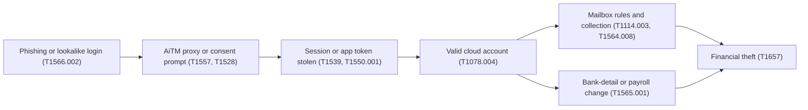

# 17. Threat profile

> **Reference work.** Fictional scenario built for a public portfolio. Not deployed in, derived from, or describing any employer environment. Not professional advice.

## Purpose and scope

This document names the threats that matter most to Fabrikam (fictional) and explains, at a strategy level, how each one would unfold, what it would cost Fabrikam's own operations, how likely it is, and which controls and documents answer it. It is a reasoning aid, not an assessment of any real environment, and it contains no exploitation steps, tooling, or operator procedures. It informs the risk register (document [11](11-risk-management.md)), the security baseline (document [06](06-microsoft-365-security-baseline.md)), detection and response (document [08](08-detection-and-incident-response.md)), awareness (document [09](09-security-awareness-and-training.md)), the service desk (document [13](13-it-service-management.md)), and AI security (document [16](16-ai-adoption-guardrails.md)); likelihoods are proposals to be tuned after discovery (document [05](05-environment-discovery.md)).

## How to read the techniques

Every technique below is cited to MITRE ATT&CK v20 (Enterprise matrix), which MITRE released on 2026-10-13; every technique ID and name cited here was checked against v20 on 2026-10-13 or 2026-10-14. ATT&CK v20 also added techniques for attacks that use or target AI: T1608.007 (Stage Capabilities: AI Result Poisoning), used in S-02, and T1698 (Indirect Prompt Injection), T1699 (Direct Prompt Injection), and T1700 (AI-Enabled Exfiltration), used in S-11, which document [16](16-ai-adoption-guardrails.md) answers (AIC-05). MITRE's v19 release split the former Defense Evasion tactic into Stealth (TA0005) and Defense Impairment (TA0112).

MITRE's v19 release also replaced the standalone Impersonation and Email Spoofing techniques with sub-techniques of T1684 (Social Engineering). The mappings here use the current structure, so older material may need remapping. Techniques describe adversary behavior at the level ATT&CK itself does. The data source named for each scenario is the telemetry a defender needs to see the behavior; many of those sources are Microsoft 365 audit and sign-in logs that run at standard retention today (document [06](06-microsoft-365-security-baseline.md) sets logging and retention). Where a data source depends on a license, the license is named in parentheses; anything beyond E3 is a licensing decision in [ADR-001](adr/ADR-001-microsoft-365-security-licensing.md).

Fabrikam holds sensitive data about its own workforce: employee Social Security numbers, tax and direct-deposit bank details, and benefits and dependent data. That data, and the money movement around Fabrikam's own payroll and vendor payments, is what almost every scenario below is ultimately after. The FBI has warned that criminals "obtain access to bank accounts using AI-generated audio clips of individuals and impersonating them," which bears on any voice-based check at Fabrikam's own service desk or on a bank-change call (S-03, S-01); no verification in the plan rests on a voice alone (document [16](16-ai-adoption-guardrails.md), AIC-06).

## Threat landscape (sourced)

Published reporting frames the priorities. The FBI's Internet Crime Complaint Center (IC3) received just over one million complaints in 2025 and reported that losses rose 26 percent year over year; business email compromise (BEC) was the second largest loss category, with 24,768 complaints (up from 21,442 in 2024), and the IC3 reports that 86 percent of BEC transactions moved by wire or ACH transfer. The IC3 counted 3,611 ransomware complaints in 2025, up from 3,156 in 2024. Two FBI public service announcements speak directly to this sector: a 2018 alert on credential phishing that redirects employees' direct-deposit pay, and a 2025 alert warning that criminals impersonate employee self-service portals through search-engine ads and that multifactor authentication (MFA) does not protect a user who lands on a fraudulent login page.

Verizon's 2026 Data Breach Investigations Report (DBIR) analyzed more than 31,000 incidents and reports that exploitation of vulnerabilities is now the most common initial access vector at 31 percent, that ransomware was present in 48 percent of breaches (up from 44 percent), that third-party involvement rose to 48 percent of breaches, and that the human element was present in 62 percent. Microsoft's 2026 Digital Defense Report (MDDR) reports that user execution, valid accounts, social engineering, and phishing together make up 73.3 percent of initial access attempts, that 63 percent of intrusions involved data theft, that it detected more than 46 million business email impersonation attacks, and that phishing-resistant MFA, identity hygiene, tiered administration, and privileged-access enforcement remain the highest-leverage controls. Microsoft's 2025 report earlier found that over half of attacks were financially motivated and that phishing-resistant MFA prevents up to 99 percent of the password-guessing identity attacks it describes. CISA's #StopRansomware Guide notes that ransomware actors have posed as company IT or help-desk staff by phone or SMS to obtain credentials, and CISA names HR staff and help-desk and IT administrators as early priorities for phishing-resistant MFA.

One public incident shows how long recovery can take: in a December 2021 ransomware attack on a major workforce management provider's private cloud, the provider's services were down and organizations that relied on it ran payroll and timekeeping by hand for weeks. For Fabrikam the lesson is internal: ransomware that reaches its corporate systems (S-06) could halt its own operations and delay its own payroll for weeks, so the ability to detect, contain, and recover is a security outcome, not only an IT one.

## Scenario summary

| ID | Scenario | Primary risk | Qualitative likelihood |
|---|---|---|---|
| S-01 | Payroll diversion and payment fraud by BEC against Fabrikam's own finance and HR | R-01 | High |
| S-02 | Takeover of a Fabrikam employee's own account, leading to a direct-deposit change | R-10, R-11, R-12 | High |
| S-03 | Impersonation of employees to the IT service desk to reset passwords or MFA | R-01, R-06 | Medium to High |
| S-04 | Adversary-in-the-middle phishing and session token theft, leading to mailbox takeover | R-01, R-07 | High |
| S-05 | Consent phishing with a malicious OAuth application | R-07, R-08 | Medium to High |
| S-06 | Ransomware against corporate endpoints and Microsoft 365 data | R-03 | Medium to High |
| S-07 | Misuse of company and employee data by an insider | R-07, R-12 | Medium |
| S-08 | Compromise of an integration credential or partner connection | R-08 | Medium to High |
| S-09 | Spoofing of Fabrikam's own and older brand email domains to phish its own staff and partners | R-01, R-12 | High (for attempts) |
| S-10 | Loss or theft of employee devices | R-07, R-03 | Medium |
| S-11 | Prompt injection against AI assistants that read corporate data | R-01, R-07, R-12 | Low to Medium in Phases 2 to 4; Medium from the Phase 5 Copilot pilot |

### Common identity-centric attack path

Scenarios S-02 through S-05 share a shape: a lure defeats the login, an account or token is taken, and the outcome is money movement or data theft.

## Scenarios

### S-01. Payroll diversion and payment fraud by BEC against Fabrikam's own finance and HR

**Who and why.** Financially motivated external actors who run BEC and payment fraud. The goal is to redirect money: a vendor payment, a payroll run, or an employee's direct deposit, into an account they control.

**How it unfolds (strategy level).**
- Reconnaissance of who holds finance and HR authority: T1591.004 (Gather Victim Org Information: Identify Roles) and T1589.003 (Gather Victim Identity Information: Employee Names).
- A pretext from a spoofed or lookalike sender, an impersonated executive, or a genuinely compromised partner mailbox, made more convincing with an AI-written lure, a cloned voice, or a live deepfake video call: T1588.007 (Obtain Capabilities: Artificial Intelligence), T1684.001 (Social Engineering: Impersonation), and T1586.002 (Compromise Accounts: Email Accounts).
- A request to change bank details or release a payment, ending in T1657 (Financial Theft).

| Attribute | Detail |
|---|---|
| Business impact | Direct loss of funds that is hard to recover once wired, plus finance-team disruption and loss of trust. The same lure also reaches Fabrikam's own staff and partners through spoofed Fabrikam domains (S-09). |
| Qualitative likelihood | High. BEC is the second largest IC3 loss category and needs no malware. |
| Linked risks | R-01 (primary), R-10. |
| Controls and documents | Email authentication and anti-phishing in document [06](06-microsoft-365-security-baseline.md); role-based finance and payroll training in document [09](09-security-awareness-and-training.md); out-of-band verification of bank changes in the service desk and change process (document [13](13-it-service-management.md)) and the [payroll diversion and email compromise playbook](playbooks/payroll-diversion-and-email-compromise.md); the executive [payroll diversion tabletop](templates/tabletop-payroll-diversion.md); detection and response in document [08](08-detection-and-incident-response.md); the AI-enabled social engineering control AIC-06 in document [16](16-ai-adoption-guardrails.md), under which the call-back holds whatever the channel. |
| Data sources | Exchange Online message trace; Defender for Office 365 anti-phishing and impersonation detections (Plan 1, in E3 per document [01](01-scenario-and-assumptions.md)); the Microsoft 365 unified audit log (E3). Payment and bank-change approvals live in the finance system, not Microsoft 365. |
| Residual concern | Out-of-band verification depends on human discipline under time pressure, and lookalike domains and display-name tricks survive email authentication (S-09). A convincing voice or face is not identity, and no Microsoft 365 control in the plan detects a cloned voice or video (document [16](16-ai-adoption-guardrails.md)), so the call-back carries that case alone. |

### S-02. Takeover of a Fabrikam employee's own account, leading to a direct-deposit change

**Who and why.** Financially motivated actors who take over a Fabrikam employee's own corporate or self-service account so they can redirect that employee's pay. The 2025 FBI alert describes exactly this pattern against employees' self-service accounts: search-engine ads that lead to fake login pages, then a direct-deposit change.

**How it unfolds (strategy level).**
- T1583.001 (Acquire Infrastructure: Domains), T1583.008 (Acquire Infrastructure: Malvertising), and T1608.007 (Stage Capabilities: AI Result Poisoning) to stand up a convincing fake Fabrikam or HR login reached through search ads or through answers from AI search and chat tools.
- T1598.003 (Phishing for Information: Spearphishing Link), T1110.004 (Brute Force: Credential Stuffing), or T1110.003 (Brute Force: Password Spraying) to obtain the employee's credentials.
- A call to Fabrikam's IT service desk posing as the employee, possibly in a cloned voice, to get a sign-in or MFA reset: T1588.007 (Obtain Capabilities: Artificial Intelligence) and T1684.001 (Social Engineering: Impersonation); the service-desk path is covered in depth in S-03.
- T1557 (Adversary-in-the-Middle) and T1539 (Steal Web Session Cookie) to get past MFA, then T1078.004 (Valid Accounts: Cloud Accounts).
- T1565.001 (Data Manipulation: Stored Data Manipulation) to change direct-deposit details in the HR system of record, ending in T1657 (Financial Theft).

| Attribute | Detail |
|---|---|
| Business impact | The employee's own pay redirected, Fabrikam's own breach-notification and privacy duties for its workforce data triggered, and, where the incident reveals an access-control or monitoring gap, a possible SOC 2 exception. |
| Qualitative likelihood | High. FBI reporting describes the technique against employee self-service accounts and warns that "Multi-factor authentication will not protect you if you land on a fraudulent login page." |
| Linked risks | R-10, R-11, R-12. |
| Controls and documents | Phishing-resistant MFA for workforce accounts, finance, payroll, People, and executives first ([ADR-004](adr/ADR-004-phishing-resistant-authentication-rollout.md)), which defeats fake-login and adversary-in-the-middle pages; the self-service model in which employees change their own direct deposit only while signed in themselves and People staff do not key changes from email (document [07](07-identity-lifecycle-joiners-movers-leavers.md) and the [payroll diversion playbook](playbooks/payroll-diversion-and-email-compromise.md)); a hold or verification before the first payment to a new bank account (the same playbook); caller identity verification at the service desk (document [13](13-it-service-management.md) and S-03); email authentication against the fake-login lure (document [06](06-microsoft-365-security-baseline.md)); detection of risky sign-ins and authentication-method changes, with the executive tabletop, in document [08](08-detection-and-incident-response.md); the AI-enabled social engineering control AIC-06 in document [16](16-ai-adoption-guardrails.md). |
| Data sources | Entra sign-in logs, including anomalous sign-ins (Entra ID P1, in E3; full risk detections need Entra ID P2); the Microsoft 365 unified audit log (E3); the direct-deposit change history in the HR system of record and the bank-change audit trail in the finance system (confirmed in discovery, document [05](05-environment-discovery.md)); service desk ticket records. |
| Residual concern | Phishing-resistant methods such as passkeys defeat fake-login and adversary-in-the-middle pages, but the rollout runs to month 9 (M6) and employees still on push or SMS before then stay exposed; the self-service change path depends on the employee's own account staying uncompromised; a cloned voice is not identity, so service-desk and bank-change call-backs rest on known-number verification, not the voice (document [16](16-ai-adoption-guardrails.md), AIC-06). |

### S-03. Impersonation of employees to the IT service desk to reset passwords or MFA

**Who and why.** External actors, including ransomware affiliates, who phone or message the help desk posing as a staff member to get a password or MFA reset and so take over an account. CISA's #StopRansomware Guide records the mirror image, actors posing as IT or help desk staff to employees; documents [09](09-security-awareness-and-training.md) and [13](13-it-service-management.md) cover both directions.

**How it unfolds (strategy level).**
- Reconnaissance of names and roles: T1589.003 (Gather Victim Identity Information: Employee Names) and T1591.004 (Gather Victim Org Information: Identify Roles).
- T1684.001 (Social Engineering: Impersonation) against a help-desk analyst, possibly in a cloned voice (T1588.007, Obtain Capabilities: Artificial Intelligence); caller verification does not rest on the voice (document [13](13-it-service-management.md); AIC-06 in document [16](16-ai-adoption-guardrails.md)).
- The analyst resets or re-enrolls authentication, which the attacker captures: T1556.006 (Modify Authentication Process: Multi-Factor Authentication) and T1098.005 (Account Manipulation: Device Registration), then T1078.004 (Valid Accounts: Cloud Accounts).

| Attribute | Detail |
|---|---|
| Business impact | Account takeover that bypasses the MFA investment, giving a foothold for BEC (S-01) or ransomware (S-06); worse if the account is privileged. |
| Qualitative likelihood | Medium to High. A lean help desk with ad hoc processes and no strong caller verification is exposed. |
| Linked risks | R-01, R-03, R-06. |
| Controls and documents | Caller identity verification in the service desk request catalog (document [13](13-it-service-management.md)); authentication-method governance and lifecycle in documents [06](06-microsoft-365-security-baseline.md) and [07](07-identity-lifecycle-joiners-movers-leavers.md); role-based training for the service desk in document [09](09-security-awareness-and-training.md); detection of reset and registration events in document [08](08-detection-and-incident-response.md). |
| Data sources | Microsoft Entra audit log (authentication-method and device registration events), sign-in logs, service desk ticket records, and identity alerts in Defender XDR (Entra ID Protection detections need Entra ID P2). |
| Residual concern | High-pressure social engineering can defeat process; phishing-resistant methods reduce the value of a reset, but the enrollment flow itself stays a target. |

### S-04. Adversary-in-the-middle phishing and session token theft, leading to mailbox takeover

**Who and why.** Financially motivated actors using adversary-in-the-middle (AiTM) phishing to steal a session token, bypass MFA, and take over a mailbox as a base for fraud and data theft.

**How it unfolds (strategy level).**
- T1566.002 (Phishing: Spearphishing Link) to an AiTM proxy page.
- T1557 (Adversary-in-the-Middle), T1111 (Multi-Factor Authentication Interception), and T1539 (Steal Web Session Cookie) capture credentials and the live session.
- T1550.004 (Use Alternate Authentication Material: Web Session Cookie) replays the token, giving T1078.004 (Valid Accounts: Cloud Accounts).
- T1114.002 (Email Collection: Remote Email Collection), T1114.003 (Email Collection: Email Forwarding Rule), and T1564.008 (Hide Artifacts: Email Hiding Rules) harvest mail and hide the activity; T1534 (Internal Spearphishing) spreads it.

| Attribute | Detail |
|---|---|
| Business impact | A launchpad for invoice and payroll fraud, exposure of sensitive workforce data, and notification duties. |
| Qualitative likelihood | High. Valid-account and phishing paths dominate current initial-access reporting, and AiTM kits are widely available. |
| Linked risks | R-01, R-07, R-10. |
| Controls and documents | Phishing-resistant MFA and token protection ([ADR-004](adr/ADR-004-phishing-resistant-authentication-rollout.md)), anti-phishing, and blocking legacy authentication in document [06](06-microsoft-365-security-baseline.md); detection of risky sign-ins and new mailbox rules, with managed detection and response for after-hours coverage ([ADR-003](adr/ADR-003-managed-detection-and-response.md)), in document [08](08-detection-and-incident-response.md); phishing simulation and reporting in document [09](09-security-awareness-and-training.md). |
| Data sources | Entra sign-in logs, including anomalous sessions (Entra ID P1, in E3; full risk detections need Entra ID P2), the unified audit log for new inbox rules and forwarding (E3), message trace, and Defender XDR alerts and Defender for Cloud Apps (Microsoft Defender Suite or E5). |
| Residual concern | Phishing-resistant MFA is the durable defense but rollout runs to month 9 (M6); token theft by device malware remains possible; Microsoft-provided SMS and voice remain available until they retire on 2027-02-01 (2027-07-01 for Global Administrators and external users). Where Copilot is licensed, a stolen session finds overshared data faster (document [16](16-ai-adoption-guardrails.md), AIC-03 and the Copilot readiness gate). |

### S-05. Consent phishing with a malicious OAuth application

**Who and why.** Actors who trick a user into granting OAuth consent to an attacker-controlled application, gaining persistent, token-based access to mail and files without a password and without tripping MFA.

**How it unfolds (strategy level).**
- T1566.002 (Phishing: Spearphishing Link) to a consent prompt.
- T1528 (Steal Application Access Token) through the granted consent, with persistence via T1671 (Cloud Application Integration).
- T1550.001 (Use Alternate Authentication Material: Application Access Token), then T1530 (Data from Cloud Storage), T1114.002 (Email Collection: Remote Email Collection), and T1213.002 (Data from Information Repositories: Sharepoint).

| Attribute | Detail |
|---|---|
| Business impact | Silent, MFA-independent access to sensitive workforce data that survives a password reset. |
| Qualitative likelihood | Medium to High. Users can consent to third-party apps today (day-1 assumption A-02), which is the default condition this targets. |
| Linked risks | R-07, R-08, R-13. |
| Controls and documents | App-consent hardening (restrict user consent, admin-consent workflow, verified-publisher requirement) in document [06](06-microsoft-365-security-baseline.md); OAuth and SaaS application inventory and governance in document [15](15-enterprise-systems-and-saas.md); consent-grant detection in document [08](08-detection-and-incident-response.md); AI-tool consent guardrails (AIC-04) in document [16](16-ai-adoption-guardrails.md). |
| Data sources | Entra audit log (consent and app-role grants), app governance in Defender for Cloud Apps (Microsoft Defender Suite or E5), enterprise-application sign-in logs, unified audit log. |
| Residual concern | Over-privileged but legitimate-looking apps from verified publishers can still over-request, and already-granted consents must be reviewed, not only future ones. |

### S-06. Ransomware against corporate endpoints and Microsoft 365 data

**Who and why.** Ransomware affiliates running double extortion: steal data, then encrypt or destroy it, and demand payment.

**How it unfolds (strategy level).**
- Initial access by T1566.002 (Phishing: Spearphishing Link), T1078.004 (Valid Accounts: Cloud Accounts), or T1190 (Exploit Public-Facing Application).
- T1685 (Disable or Modify Tools), a Defense Impairment technique, to reduce visibility.
- T1530 (Data from Cloud Storage) and T1567.002 (Exfiltration Over Web Service: Exfiltration to Cloud Storage) before encryption.
- T1486 (Data Encrypted for Impact), T1490 (Inhibit System Recovery), and in destructive cases T1485 (Data Destruction), including mass deletion of SharePoint, OneDrive, and mailbox content.

| Attribute | Detail |
|---|---|
| Business impact | Corporate outage, disruption to Fabrikam's own operations and payroll run, extortion pressure, and notification duties. Recovery can take weeks. |
| Qualitative likelihood | Medium to High. Ransomware complaint counts rose in 2025 and the behavior is present in nearly half of reported breaches. |
| Linked risks | R-03 (primary), R-07, R-10. |
| Controls and documents | Attack surface reduction, Defender for Endpoint, phishing-resistant MFA, and blocking legacy authentication in document [06](06-microsoft-365-security-baseline.md); immutable, tested Microsoft 365 backup ([ADR-006](adr/ADR-006-microsoft-365-backup.md)) and restore testing in document [14](14-business-continuity-and-backup.md); managed detection and response ([ADR-003](adr/ADR-003-managed-detection-and-response.md)) and automatic attack disruption (Defender for Endpoint Plan 2, in Microsoft Defender Suite) in document [08](08-detection-and-incident-response.md); endpoint standards and patching in document [13](13-it-service-management.md). |
| Data sources | Defender for Endpoint (Plan 1 in E3; endpoint detection and response needs Plan 2, in Microsoft Defender Suite or E5) and Defender XDR incidents (Plan 1 already lists endpoint incidents and alerts in the Microsoft Defender portal), Entra sign-in logs, unified audit log (mass-delete and mass-download), Microsoft 365 Backup status ([ADR-006](adr/ADR-006-microsoft-365-backup.md)). |
| Residual concern | Backups must prove the whole recovery path, not only that copies exist; a lean team depends on an MDR provider for nights and weekends; exfiltration may precede detection. |

### S-07. Misuse of company and employee data by an insider

**Who and why.** A malicious or negligent insider who takes or misuses sensitive company and employee data in Microsoft 365, or customer data that has reached corporate systems such as a support thread: for example a support agent or engineer with broad access, a departing employee, or a fraudulent remote hire who passed onboarding under a false or borrowed identity, possibly behind a real-time deepfake face or voice during hiring and the identity check (T1588.007, Obtain Capabilities: Artificial Intelligence; the FBI alerts in document [07](07-identity-lifecycle-joiners-movers-leavers.md)'s Sources describe the pattern, and document 07's identity check before the first credential answers it), and so holds legitimate access (R-15).

**How it unfolds (strategy level).**
- T1078.004 (Valid Accounts: Cloud Accounts), used as an abuse of legitimate entitlement rather than an exploit.
- T1213.002 (Data from Information Repositories: Sharepoint) and T1213.003 (Data from Information Repositories: Code Repositories), T1530 (Data from Cloud Storage), and T1005 (Data from Local System).
- T1567.002 (Exfiltration Over Web Service: Exfiltration to Cloud Storage) or T1052.001 (Exfiltration Over Physical Medium: Exfiltration over USB).

| Attribute | Detail |
|---|---|
| Business impact | Exposure of regulated workforce data (Social Security numbers, bank details, benefits), privacy-law and contractual exposure, and loss of trust. |
| Qualitative likelihood | Medium. Oversharing and broad support access are day-1 conditions (A-06), and the E3 baseline has limited data-loss tooling. |
| Linked risks | R-07 (primary), R-12, R-05, R-06, R-15. |
| Controls and documents | Identity verification before a new hire's first credential (R-15), least privilege, access packages, access reviews, and prompt offboarding in document [07](07-identity-lifecycle-joiners-movers-leavers.md); data classification, sensitivity labels, and sharing controls in document [06](06-microsoft-365-security-baseline.md); SaaS access governance in document [15](15-enterprise-systems-and-saas.md); policy and privacy coordination in document [10](10-governance-and-compliance-program.md); where Copilot is licensed, Copilot readiness (AIC-03 in document [16](16-ai-adoption-guardrails.md)) limits how fast an insider can find overshared data. |
| Data sources | Unified audit log (file access, download, and sharing), Entra sign-in logs, Defender for Cloud Apps (Microsoft Defender Suite or E5), SharePoint and OneDrive sharing events. Insider Risk Management and advanced data-loss prevention (DLP) need Microsoft 365 E5, Microsoft Purview Suite, or the matching add-on: Microsoft 365 E5 Insider Risk Management, or Microsoft 365 E5 Information Protection and Governance for endpoint and Teams DLP (see architecture gaps). |
| Residual concern | Insiders with legitimate access are hard to detect without E5-tier tooling; least privilege and logging shrink the blast radius and speed investigation but do not prevent misuse. |

### S-08. Compromise of an integration credential or partner connection

**Who and why.** Actors who steal an API key or service-principal secret, or compromise a connected partner (an ERP or accounting system, a benefits carrier, or a screening provider), to reach Fabrikam data through a trusted path.

**How it unfolds (strategy level).**
- T1199 (Trusted Relationship) through a compromised partner or connector.
- T1552.001 (Unsecured Credentials: Credentials In Files) and T1213.003 (Data from Information Repositories: Code Repositories) to find secrets.
- T1078.004 (Valid Accounts: Cloud Accounts) and T1550.001 (Use Alternate Authentication Material: Application Access Token), then T1530 (Data from Cloud Storage) and T1567.002 (Exfiltration Over Web Service: Exfiltration to Cloud Storage).
- Where the stolen secret is an AI provider key held by Fabrikam for its own approved AI tooling (AIC-07), T1496.004 (Resource Hijacking: Cloud Service Hijacking): attackers run their own AI workloads on Fabrikam's account until a quota or a bill shows it.
- T1195.001 (Supply Chain Compromise: Compromise Software Dependencies and Development Tools) for a poisoned package or development tool; its v20 version also covers the configuration and instruction files that development environments and AI coding agents consume.

| Attribute | Detail |
|---|---|
| Business impact | Data exposure across the scope of the integration, and a trust path that is hard to detect because the traffic looks authorized. |
| Qualitative likelihood | Medium to High. Third-party involvement in breaches is rising sharply, and acquisitions left duplicate, unmanaged connections (A-08). |
| Linked risks | R-08 (primary), R-09, R-07, R-10. |
| Controls and documents | Integration and SaaS inventory, single sign-on, secret management, and acquisition consolidation in document [15](15-enterprise-systems-and-saas.md); third-party risk management (POL-10) in document [10](10-governance-and-compliance-program.md); service-account and non-human identity governance in document [07](07-identity-lifecycle-joiners-movers-leavers.md); app-consent and workload-identity hygiene in document [06](06-microsoft-365-security-baseline.md); Engineering asks for the CTO's decision (document [11](11-risk-management.md)): single sign-on and MFA on code hosting, secret scanning that blocks credentials at commit, protected branches, pipeline secrets in a vault, and dependency alerts; the AI vendor and model supply chain controls, including AI provider keys held as secrets with spend alerts (AIC-07), in document [16](16-ai-adoption-guardrails.md). |
| Data sources | Entra sign-in logs for service principals and workload identities, application audit logs, partner-connector logs, Defender for Cloud Apps (Microsoft Defender Suite or E5); AI provider usage, quota, and key activity logs for Fabrikam's own AI tooling (AIC-07). |
| Residual concern | Non-human identities often lack MFA and rotation; partner-side controls are contractual, not directly observable by Fabrikam. |

### S-09. Spoofing of Fabrikam's own and older brand email domains to phish its own staff and partners

**Who and why.** Actors who spoof Fabrikam's main domain or the two older brand domains from the acquisitions (A-05) to send fake pay and bank-change notices to Fabrikam's own finance, payroll, People, and executive staff, and to its partners. This is the classic payroll-diversion lure the FBI describes, turned against the company itself.

**How it unfolds (strategy level).**
- T1583.001 (Acquire Infrastructure: Domains) for a lookalike, or T1684.002 (Social Engineering: Email Spoofing) of a real Fabrikam domain.
- T1566.002 (Phishing: Spearphishing Link) to the recipients and T1598.003 (Phishing for Information: Spearphishing Link) to harvest credentials, feeding account takeover (S-02) and internal BEC (S-01), ending in T1657 (Financial Theft).

| Attribute | Detail |
|---|---|
| Business impact | Erosion of trust in mail from Fabrikam, payroll and payment diversion against Fabrikam's own finance and HR, and brand damage across all three domains, including the one that no longer sends mail. |
| Qualitative likelihood | High for attempts. On day 1 (A-05) the main domain publishes DMARC at p=none and its aggregate reports go to a mailbox nobody reviews, so it gives neither protection nor visibility. Of the two older brand domains, one no longer sends mail but publishes no SPF or DMARC record, and the other sends only through a marketing service and has no DMARC record, so receivers get no DMARC policy for either and Fabrikam gets no reports on mail sent in their names. |
| Linked risks | R-01, R-12. |
| Controls and documents | The email authentication subsection of document [06](06-microsoft-365-security-baseline.md): aggregate reporting on every sending domain, DKIM alignment for third-party senders, and staged enforcement to reject after the freeze, with the sending older brand domain first and the main domain last. The older brand domain that no longer sends gets parked-domain records early (SPF with -all and DMARC at p=reject), a non-disruptive quick win in Phase 1 or 2; the one that sends gets a DMARC record with reporting in Phase 1, then either reaches enforcement or moves its mail to a subdomain of the main brand. The bank-change verification standard in the [payroll diversion playbook](playbooks/payroll-diversion-and-email-compromise.md) limits the payoff. |
| Data sources | DMARC aggregate (rua) reports and the sender inventory built from them; spoof intelligence on inbound mail (built into all cloud mailboxes, so included in E3). |
| Residual concern | Enforcement stops exact-domain spoofing but not lookalike domains, display-name tricks, or compromised legitimate accounts, so recipient-side verification is still needed; lookalike domain monitoring follows in Phase 4 (document [15](15-enterprise-systems-and-saas.md)). The main domain reaches enforcement last, after the freeze, so it stays spoofable longest. |

### S-10. Loss or theft of employee devices

**Who and why.** Opportunistic theft or loss of Fabrikam employee laptops and phones, risking exposure of local data and, if a device is unlocked or holds cached credentials or a live session, account access.

**How it unfolds (strategy level).**
- Physical loss or theft, then an attempt to get past the lock screen of a laptop or phone.
- A search of local storage for files: T1005 (Data from Local System).
- If credentials are cached or a session is live, T1078.004 (Valid Accounts: Cloud Accounts).

| Attribute | Detail |
|---|---|
| Business impact | Exposure of files on employee devices, possible account access, replacement of employee devices, and privacy duties. |
| Qualitative likelihood | Medium. Inconsistent compliance, common local admin rights, no LAPS, and some remaining Windows 10 devices are day-1 conditions on Fabrikam's own computers (A-04). |
| Linked risks | R-07, R-03, R-12. |
| Controls and documents | Employee laptops: Intune compliance, BitLocker and FileVault disk encryption, Conditional Access device compliance, and Windows LAPS in document [06](06-microsoft-365-security-baseline.md). Phones: Intune app protection with selective wipe of company data for personal phones (no enrollment, [ADR-008](adr/ADR-008-endpoint-management-standard.md)), and Intune enrollment for the company-owned phones administrators use ([ADR-004](adr/ADR-004-phishing-resistant-authentication-rollout.md)). Device lifecycle and loss reporting are in document [13](13-it-service-management.md), and the planned lost-device playbook in document [08](08-detection-and-incident-response.md) covers employee devices. |
| Data sources | Intune device inventory, compliance, and app protection status and Entra device registration and sign-in logs (all in E3); BitLocker recovery-key escrow and access audit; service desk lost-device reports. |
| Residual concern | Disk encryption and remote wipe reduce exposure only on devices Fabrikam manages and only when they are enrolled and compliant; the Windows 10 Extended Security Updates decision affects the remaining devices. |

### S-11. Prompt injection against AI assistants that read corporate data

**Who and why.** Actors who cannot reach Fabrikam's data directly but can place text where an AI assistant will read it on a user's behalf: an email, a shared file, a chat, a web page, a support ticket, or an applicant's resume or answers in Fabrikam's own hiring. The goal is to make the assistant disclose data, mislead the person relying on it, or act with that person's permissions.

**How it unfolds (strategy level).**
- Content carrying instructions aimed at the AI reaches a mailbox, a site, or a ticket: T1698 (Indirect Prompt Injection). A user may instead type such instructions into an assistant directly: T1699 (Direct Prompt Injection).
- The assistant, reading on a user's behalf, follows them within that user's reach (the Execution step that T1698 and T1699 describe): a misleading summary of a payment request, files surfaced, or its own instructions revealed.
- Where the assistant can fetch or send through its sanctioned connections, data can leave that way: T1700 (AI-Enabled Exfiltration).

| Attribute | Detail |
|---|---|
| Business impact | Workforce data exposed through Fabrikam's own assistants, and decisions about applicants or workers skewed by planted text. |
| Qualitative likelihood | Low to Medium in Phases 2 to 4, when Copilot Chat in Outlook reads a user's own mail, calendar, meetings, chats, and a bounded set of files (document [16](16-ai-adoption-guardrails.md)); Medium from the Phase 5 Copilot pilot. It rises with each Copilot expansion after the pilot. |
| Linked risks | R-01 (misleading summaries of payment requests), R-07 (Copilot and Copilot Chat surfacing overshared data), R-12 (workforce data in assistant results). |
| Controls and documents | The AI security controls in document [16](16-ai-adoption-guardrails.md). For assistants, AIC-05: prompt injection detection for inbound email (Defender for Office 365 Plan 2, in Microsoft Defender Suite, [ADR-001](adr/ADR-001-microsoft-365-security-licensing.md)), Safe Links on links Copilot returns (Plan 1, in E3), and the rule that an AI summary never replaces call-back verification, on top of the Copilot readiness gate and Restricted Content Discovery (AIC-03). Sensitivity labels are in document [06](06-microsoft-365-security-baseline.md). |
| Data sources | Copilot interaction audit records (Audit (Standard), in E3; generated when Microsoft Copilot is licensed and in use, and action 16.03 confirms what is recorded for Copilot Chat), which flag a cross-prompt injection detected in a resource Copilot read (XPIADetected) and a jailbreak attempt detected in a prompt (JailbreakDetected); Defender for Office 365 Plan 2 detections with the detection technology "Prompt injection protection" (Microsoft Defender Suite). ATT&CK v20 lists one detection strategy, DET0927 (Detect AI-Enabled Exfiltration), for T1700 and none for T1698 or T1699. |
| Residual concern | Microsoft documents that its email-layer detection covers a focused set of objectives and that safeguards inside the assistant remain important; no layer is complete, so the durable limit is how much an assistant can reach and do. Any AI that can act widens the outcome; AI agents stay at policy level in year one (document [16](16-ai-adoption-guardrails.md)). |

## Detection gaps for document 08 (prioritized)

These feed the detection and response model (document [08](08-detection-and-incident-response.md)) and the advanced-hunting queries. In priority order:

1. Sign-ins that complete without phishing-resistant authentication, and any legacy-authentication sign-ins (S-04, S-02, S-03).
2. Creation or change of inbox forwarding and hiding rules and mailbox delegation (S-01, S-04).
3. OAuth application consent grants and new service-principal credentials, including grants to AI tools such as note-takers and writing assistants and any new mail, file, calendar, meeting, or chat permission (S-05, S-08; AIC-04 in document [16](16-ai-adoption-guardrails.md)).
4. MFA-method and device-registration changes, especially soon after a help-desk reset (S-03).
5. Mass download or large export and creation of anonymous sharing links (S-07, S-06).
6. Privileged role changes, which map to T1098.003 (Account Manipulation: Additional Cloud Roles), and the standing Global Administrator count (KPI-09) (S-03, S-06).
7. Mass deletion or bulk version change of Microsoft 365 content and endpoint ransomware behaviors, with after-hours coverage through the MDR provider (S-06).
8. Copilot interaction audit records (Audit (Standard), in E3) that flag a cross-prompt injection detected in a resource Copilot read (XPIADetected) or a jailbreak attempt in a prompt (JailbreakDetected), and interactions whose accessed files carry the Restricted label, checked against who should reach them. These records are the main evidence for T1698 (Indirect Prompt Injection), for which ATT&CK v20 lists no detection strategy. They are audit records, not alerts, so they are reviewed in Purview in document 16's monthly review (16.10), from the Phase 5 Copilot pilot, or earlier if action 16.03 confirms Copilot Chat coverage (S-11, S-04, S-07; AIC-05 and AIC-11 in document [16](16-ai-adoption-guardrails.md)).
9. Defender for Office 365 Plan 2 prompt injection detections on inbound email (a High confidence phishing verdict with the detection technology Prompt injection protection, filterable in Threat Explorer and advanced hunting), triaged as mailbox threats once Microsoft Defender Suite is live; whether the MDR provider triages them is a question in the [ADR-003](adr/ADR-003-managed-detection-and-response.md) evaluation, action 08.06 (S-11; AIC-05 in document [16](16-ai-adoption-guardrails.md); [ADR-001](adr/ADR-001-microsoft-365-security-licensing.md)).

## Architecture gaps for document 06 and ADR-001 (prioritized)

These feed the security baseline (document [06](06-microsoft-365-security-baseline.md)) and the licensing decision ([ADR-001](adr/ADR-001-microsoft-365-security-licensing.md)):

1. Phishing-resistant MFA rollout order and token protection ([ADR-004](adr/ADR-004-phishing-resistant-authentication-rollout.md)) is the single highest-leverage control for workforce accounts across S-02, S-03, and S-04. It does not reach consent grants (S-05, item 3).
2. The E3 baseline lacks risk-based Conditional Access (Microsoft Entra ID Protection, which needs Entra ID P2), Insider Risk Management and advanced data-loss prevention (Microsoft Purview, E5 level), and centralized attack-surface-reduction reporting (E5 level); these are add-on decisions for [ADR-001](adr/ADR-001-microsoft-365-security-licensing.md).
3. App-consent hardening (restrict user consent, admin-consent workflow, verified-publisher requirement) in document [06](06-microsoft-365-security-baseline.md).
4. Staged DMARC enforcement to reject on every sending domain (the older brand domain that still sends first, the main domain last), and early parked-domain records on the one that no longer sends, in the email authentication subsection of document [06](06-microsoft-365-security-baseline.md).
5. Immutable, tested Microsoft 365 backup ([ADR-006](adr/ADR-006-microsoft-365-backup.md)) that proves the whole recovery path.
6. Inbound-email prompt injection detection is a Defender for Office 365 Plan 2 capability, so it arrives with Microsoft Defender Suite (or E5), not with the Plan 1 in E3 ([ADR-001](adr/ADR-001-microsoft-365-security-licensing.md)). Document 16's Copilot readiness gate (16.11) checks whether it is live before the pilot, and if it is not, document 16 records the gap as a pilot residual that R-07's owner accepts (S-11; AIC-05).

## Phase plan

| Phase | Action ID | Action | Outcome | KPI | Owner role | Workstream |
|---|---|---|---|---|---|---|
| Phase 1 | 17.01 | Draft this threat profile and map each scenario to the draft risk register (R-01, R-03, and R-05 to R-15) and to a control owner | Top threats tied to risks and to the controls that answer them | KPI-01 | Director of IT and Security | WS-5 |
| Phase 3 | 17.02 | Validate the profile against the approved risk register and the NIST CSF 2.0 target profile; confirm the detection and architecture gaps above are accepted into documents 08, 06, and 16 | Threat-to-control coverage confirmed at plan approval (M3) | KPI-01 | Director of IT and Security | WS-5 |
| Phase 4 | 17.03 | Use the profile to scope the first exercises: the executive payroll-diversion tabletop in late February and detection validation for the mailbox-takeover and ransomware behaviors, drawing executable tests from an existing, publicly maintained, ATT&CK-aligned validation library that document 08 selects and runs in an isolated lab | Exercise and validation scope defined; no attack procedures authored here | KPI-18 | Director of IT and Security | WS-4 |
| Phase 5 | 17.04 | Re-baseline the profile at the annual review (M7) and remap techniques to the then-current ATT&CK version | Refreshed profile and mappings | KPI-17 | Director of IT and Security | WS-5 |

## Resourcing and dependencies

- **Roles.** Director of IT and Security (owns the profile, scopes the first exercises, and personally maintains it and the later exercise scoping, with contracted specialist help for surge work); IT Operations Manager and Service Desk Analyst (S-03, S-10). The operating model and the RACI are in document [04](04-operating-model-team-and-budget.md).
- **Partners.** The MDR provider (after-hours detection, S-04 and S-06), the penetration testing firm (independent validation of S-02 and S-08), and the SOC 2 audit firm (control coverage).
- **Licenses.** Microsoft 365 E3 is the baseline. Risk-based Conditional Access (Entra ID P2), Insider Risk Management and advanced data-loss prevention (Microsoft Purview), and Privileged Identity Management (Entra ID P2 or Microsoft Entra ID Governance) are add-on decisions in [ADR-001](adr/ADR-001-microsoft-365-security-licensing.md); document [06](06-microsoft-365-security-baseline.md) names the license each control needs.
- **Depends on.** Documents [01](01-scenario-and-assumptions.md) (scenario and assumptions), [05](05-environment-discovery.md) (discovery that tunes the likelihoods), and [04](04-operating-model-team-and-budget.md) (the shared RACI). Feeds documents [02](02-first-90-days.md), [03](03-twelve-month-roadmap.md), [06](06-microsoft-365-security-baseline.md), [08](08-detection-and-incident-response.md), [09](09-security-awareness-and-training.md), [11](11-risk-management.md), [15](15-enterprise-systems-and-saas.md), and [16](16-ai-adoption-guardrails.md), plus the [payroll diversion playbook](playbooks/payroll-diversion-and-email-compromise.md) and the [payroll diversion tabletop](templates/tabletop-payroll-diversion.md).

## Risks and open questions

- This is a strategy-level profile, not an assessment of any environment. Likelihoods are qualitative proposals to be tuned in discovery (document [05](05-environment-discovery.md)) and scored in the risk register (document [11](11-risk-management.md)).
- Named threat-actor attribution is deliberately omitted. Actor and campaign context should be refreshed through the current IC3, DBIR, and MDDR editions rather than characterized from memory; the counts here are point-in-time and vendor-attributed.
- Several high-value detections and controls (Insider Risk Management, advanced data-loss prevention, risk-based Conditional Access) depend on licensing above the E3 baseline, so S-05 and S-07 coverage is partly a budget decision ([ADR-001](adr/ADR-001-microsoft-365-security-licensing.md)).
- MITRE's v19 release split Defense Evasion into Stealth and Defense Impairment and revoked the former standalone Impersonation and Email Spoofing techniques. ATT&CK v20 (2026-10-13) kept every ID and name cited here that existed in v19, widened the scope of T1195.001, and added T1608.007, T1698, T1699, and T1700. Recheck the mappings at each ATT&CK release, historically around April and October.

## Framework mapping

By identifier only, consistent with the [crosswalk](crosswalk/csf2-soc2-crosswalk.md). This document supports:

| Theme | NIST CSF 2.0 | SOC 2 (2017 TSC) |
|---|---|---|
| Threat and risk identification (the profile itself) | ID.RA-01, ID.RA-03, ID.RA-04, ID.RA-05; GV.RM-06 | CC3.1, CC3.2, CC3.3, CC3.4 |
| Identity, authentication, and access (S-01 to S-05, S-08) | PR.AA-01, PR.AA-05 | CC6.1, CC6.2, CC6.3 |
| Lost or stolen devices and physical access (S-10) | PR.AA-06 | CC6.4 |
| Email, data protection, and external threats (S-01, S-04, S-07, S-09, S-11) | PR.DS-01, PR.DS-02 | CC6.6, CC6.7, CC6.8, C1.1 |
| Supply chain and third parties (S-08) | GV.SC-01, GV.SC-07, GV.SC-10 | CC9.2 |
| Awareness and training (S-01, S-03, S-04) | PR.AT-01, PR.AT-02 | CC1.4, CC2.2 |
| Detection and monitoring (all scenarios) | DE.CM-01, DE.CM-03, DE.CM-09, DE.AE-02, DE.AE-03 | CC7.1, CC7.2, CC7.3 |
| Incident response and recovery (S-06) | RS.MA-01, RS.MI-01, RS.MI-02, RC.RP-01 | CC7.4, CC7.5, A1.2, A1.3 |
| Oversight and reporting | GV.OV-03 | CC4.1, CC4.2 |

## Sources

- MITRE ATT&CK, Enterprise matrix, v20 (technique and tactic pages, and the versions list). MITRE. https://attack.mitre.org/resources/versions/ . Checked 2026-10-13. Primary.
- MITRE ATT&CK, Updates: April 2026 (v19 release notes, including the Defense Evasion split and the revocations of the former Impersonation and Email Spoofing techniques). MITRE. https://attack.mitre.org/resources/updates/updates-april-2026/ . Checked 2026-10-13. Primary.
- MITRE ATT&CK, Updates: October 2026 (v20 release notes, start date October 13, 2026). MITRE. https://attack.mitre.org/resources/updates/updates-october-2026/ . Checked 2026-10-13. Primary.
- MITRE ATT&CK v20 technique pages for the AI-related techniques: T1588.007 https://attack.mitre.org/techniques/T1588/007/ ; T1608.007 https://attack.mitre.org/techniques/T1608/007/ ; T1496.004 https://attack.mitre.org/techniques/T1496/004/ ; T1195.001 (version 2.0) https://attack.mitre.org/techniques/T1195/001/ ; T1698 https://attack.mitre.org/techniques/T1698/ ; T1699 https://attack.mitre.org/techniques/T1699/ ; T1700 https://attack.mitre.org/techniques/T1700/ ; T1565.001 (rechecked for S-11) https://attack.mitre.org/techniques/T1565/001/ ; detection strategy DET0927 (Detect AI-Enabled Exfiltration) https://attack.mitre.org/detectionstrategies/DET0927/ . MITRE. Checked 2026-10-14. Primary.
- The NIST Cybersecurity Framework (CSF) 2.0 (CSWP 29). NIST. https://nvlpubs.nist.gov/nistpubs/CSWP/NIST.CSWP.29.pdf . Checked 2026-10-13. Primary.
- 2025 Internet Crime Report. FBI Internet Crime Complaint Center (IC3). https://www.ic3.gov/AnnualReport/Reports/2025_IC3Report.pdf . Checked 2026-10-13. Primary.
- Cybercriminals Utilize Social Engineering Techniques To Obtain Employee Credentials To Conduct Payroll Diversion (Alert I-091818-PSA). FBI IC3. https://www.ic3.gov/PSA/2018/PSA180918 . Checked 2026-10-13. Primary.
- Cyber Criminals Impersonating Employee Self-Service Websites to Steal Victim Information and Funds (Alert I-042425-PSA). FBI IC3. https://www.ic3.gov/PSA/2025/PSA250424 . Checked 2026-10-13. Primary.
- Criminals Use Generative Artificial Intelligence to Facilitate Financial Fraud (Alert I-120324-PSA, December 3, 2024). FBI IC3. https://www.ic3.gov/PSA/2024/PSA241203 . Checked 2026-10-13. Primary.
- 2026 Data Breach Investigations Report, Executive Summary. Verizon Business. https://www.verizon.com/business/resources/executivebriefs/2026-dbir-executive-summary.pdf . Checked 2026-10-13. Primary (vendor research; primary for what Verizon reports).
- 2026 Microsoft Digital Defense Report, Executive Summary. Microsoft. https://cdn-dynmedia-1.microsoft.com/is/content/microsoftcorp/microsoft/msc/documents/presentations/CSR/2026-Microsoft-DDR-Exec-Summary.pdf . Checked 2026-10-13. Primary (vendor research; primary for what Microsoft reports).
- Microsoft releases 2025 Digital Defense Report (newsroom summary). Microsoft. https://news.microsoft.com/source/asia/2026/01/07/microsoft-releases-2025-digital-defense-report-highlighting-the-changing-cyber-threat-landscape-and-the-importance-of-security-in-the-ai-era/ . Checked 2026-10-13. Primary (vendor research; used for trend context only).
- #StopRansomware Guide (version 3.0, October 2023). CISA, MS-ISAC, NSA, FBI. https://www.cisa.gov/resources-tools/resources/stopransomware-guide . Checked 2026-10-13. Primary.
- Implementing Phishing-Resistant MFA (fact sheet, October 2022). CISA. https://www.cisa.gov/sites/default/files/publications/fact-sheet-implementing-phishing-resistant-mfa-508c.pdf . Checked 2026-10-13. Primary.
- Set up DMARC to validate email in Microsoft 365. Microsoft Learn. https://learn.microsoft.com/en-us/defender-office-365/email-authentication-dmarc-configure . Checked 2026-10-13. Primary.
- Set up SPF to identify valid email sources for your Microsoft 365 domain. Microsoft Learn. https://learn.microsoft.com/en-us/defender-office-365/email-authentication-spf-configure . Checked 2026-10-13. Primary.
- Why do I need Microsoft Defender for Office 365? Microsoft Learn. https://learn.microsoft.com/en-us/defender-office-365/mdo-about . Checked 2026-10-13. Primary.
- Microsoft Defender service description. Microsoft Learn. https://learn.microsoft.com/en-us/office365/servicedescriptions/microsoft-365-service-descriptions/microsoft-365-tenantlevel-services-licensing-guidance/microsoft-defender-service-description . Checked 2026-10-13. Primary.
- Microsoft Defender XDR prerequisites. Microsoft Learn. https://learn.microsoft.com/en-us/defender-xdr/prerequisites . Checked 2026-10-14. Primary.
- Overview of Microsoft Defender for Endpoint Plan 1 (Plan 1 in Microsoft 365 E3; incidents and alerts in the Microsoft Defender portal). Microsoft Learn. https://learn.microsoft.com/en-us/defender-endpoint/defender-endpoint-plan-1 . Checked 2026-10-14. Primary.
- Microsoft Entra service description. Microsoft Learn. https://learn.microsoft.com/en-us/office365/servicedescriptions/azure-active-directory . Checked 2026-10-13. Primary.
- What is Microsoft Entra ID Protection? Microsoft Learn. https://learn.microsoft.com/en-us/entra/id-protection/overview-identity-protection . Checked 2026-10-13. Primary.
- Microsoft Entra ID Governance licensing fundamentals. Microsoft Learn. https://learn.microsoft.com/en-us/entra/id-governance/licensing-fundamentals . Checked 2026-10-13. Primary.
- Microsoft Purview service description. Microsoft Learn. https://learn.microsoft.com/en-us/office365/servicedescriptions/microsoft-365-service-descriptions/microsoft-365-tenantlevel-services-licensing-guidance/microsoft-purview-service-description . Checked 2026-10-14 (Insider Risk Management, endpoint DLP, and DLP for Teams license tables; the Audit (Standard) for Microsoft Copilot interactions row and its footnote). Primary.
- ASR rules overview. Microsoft Learn. https://learn.microsoft.com/en-us/defender-endpoint/attack-surface-reduction-rules-overview . Checked 2026-10-13. Primary.
- Prompt injection protection in Microsoft Defender for Office 365 (ms.date 2026-09-02, updated 2026-09-10). Microsoft Learn. https://learn.microsoft.com/en-us/defender-office-365/step-by-step-guides/prompt-injection-protection-defender-for-office-365 . Checked 2026-10-14. Primary.
- Audit logs for Copilot and AI applications (ms.date 2026-08-26). Microsoft Learn. https://learn.microsoft.com/en-us/purview/audit-copilot . Checked 2026-10-14. Primary.
- Microsoft Copilot prompt defense in depth (ms.date 2026-09-10, updated 2026-09-30), Safe Links on links Copilot returns and Restricted Content Discovery. Microsoft Learn. https://learn.microsoft.com/en-us/microsoft-365/copilot/copilot-prompt-defense-in-depth . Checked 2026-10-14. Primary.
- Microsoft Copilot Chat Privacy and Protections (ms.date 2026-08-18, updated 2026-08-24), what Copilot Chat in Outlook can reach. Microsoft Learn. https://learn.microsoft.com/en-us/copilot/privacy-and-protections . Checked 2026-10-14. Primary.
- Security Suites (Microsoft Licensing guidance; Microsoft Defender Suite, previously Microsoft 365 E5 Security). Microsoft. https://www.microsoft.com/licensing/guidance/Security-Suites . Checked 2026-10-14. Primary.
- Passkeys by default and retirement of Microsoft-provided SMS and voice authentication. Microsoft Learn. https://learn.microsoft.com/en-us/entra/identity/authentication/concept-sms-voice-retirement . Checked 2026-10-13. Primary.
- Ultimate Kronos Group pulls cloud services after ransomware (December 13, 2021). The Register. https://www.theregister.com/2021/12/13/ultimate_kronos_group_ransomware_attack/ . Checked 2026-10-13. Secondary (names the affected provider in the source title).
- Concerns Linger Following UKG Ransomware Attack (February 1, 2022). SHRM. https://shrm.org/topics-tools/news/technology/concerns-linger-following-ukg-ransomware-attack . Checked 2026-10-13. Secondary (names the affected provider in the source title).
