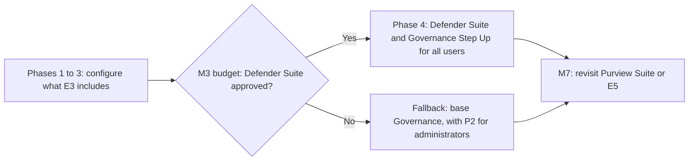

# ADR-001: Microsoft 365 security licensing

> **Reference work.** Fictional scenario built for a public portfolio. Not deployed in, derived from, or describing any employer environment. Not professional advice.

## Status

Proposed. Date: 2026-10-13.

The Director of IT and Security proposes this decision. The executive team approves the spend as part of the M3 budget (end of January 2027).

## Context

- **What Fabrikam already pays for.** Fabrikam (fictional) licenses Microsoft 365 E3 for about 450 employees on cloud-only Microsoft Entra ID. Microsoft's 2026 packaging update, effective July 1, 2026 and rolled out by August 1, 2026, added Defender for Office 365 Plan 1, Intune Plan 2, Remote Help, and Intune Advanced Analytics to E3. At Fabrikam these run at their defaults, so the first gain is configuration, not purchase.
- **What E3 cannot do.** The threat profile ([17](../17-threat-profile.md)) lists the gaps. Privileged Identity Management needs Microsoft Entra ID P2 or Microsoft Entra ID Governance, and risk-based Conditional Access needs P2. Endpoint detection and response, automatic attack disruption, and vulnerability management need Defender for Endpoint Plan 2. Attack simulation training needs Defender for Office 365 Plan 2; E3 gets a limited trial. Endpoint-based SaaS discovery and OAuth app governance need Defender for Cloud Apps. Automatic labeling, insider risk management, endpoint and Teams DLP, DLP that restricts Copilot, and one-year audit retention need E5-level Purview licensing.
- **A lean team with an MDR provider.** IT is an IT Operations Manager and three generalists, with no dedicated security staff. The plan adds a Security Engineer and a managed detection and response (MDR) provider for after-hours coverage ([ADR-003](ADR-003-managed-detection-and-response.md)). An MDR provider can act only on the telemetry it receives. Microsoft's own MDR service requires at least one of Defender for Endpoint Plan 2, Defender for Office 365 Plan 2, Defender for Identity, Defender for Cloud Apps, or Entra ID P2 in active mode, so E3 alone does not qualify.
- **Paths that are closed.** Microsoft's business plans, including Business Premium with Defender for Business, are capped at 300 users.
- **Current names.** Microsoft Defender Suite (formerly Microsoft 365 E5 Security) and Microsoft Purview Suite (formerly Microsoft 365 E5 Compliance) are add-ons to Microsoft 365 E3. Microsoft 365 E7 became generally available on May 1, 2026 and combines E5, Microsoft Copilot, Agent 365, and Microsoft Entra Suite.
- **Licensing mechanics.** Defender for Office 365 protections are on tenant-wide by default, and every user who benefits needs a license; Defender for Identity is enabled at the tenant level; Privileged Identity Management needs licenses for users with eligible assignments, approvers, and reviewers. Buying Defender capabilities for only some users therefore creates compliance gaps.
- **Cost.** This record compares cost only in relative terms. Quotes come at decision time.

## Decision drivers

1. **R-01, payroll diversion through business email compromise:** identity risk signals for every user, email investigation, phishing simulation.
2. **R-03, ransomware:** endpoint detection and response, automatic attack disruption, and telemetry an MDR provider can act on.
3. **R-06, standing privileged access:** just-in-time administration.
4. **R-07, oversharing made worse by AI assistants:** labels, DLP, and oversharing tools before Copilot.
5. **Lean-team capacity:** one console, Microsoft-maintained defaults, and an MDR provider instead of an in-house security operations center.
6. **Value first:** use the July 2026 E3 additions before buying more.
7. **Whole-tenant licensing** where Microsoft enables features tenant-wide.
8. **SOC 2 continuity:** no tooling switch that breaks evidence before the current period closes (M4).
9. **M6 commitments:** identity lifecycle automation ([ADR-002](ADR-002-hr-system-of-record-drives-identity.md)) and phishing-resistant MFA ([ADR-004](ADR-004-phishing-resistant-authentication-rollout.md)) by month 9.

## Options considered

| Capability (risk) | A: E3 after July 2026 | B: E3 plus Entra ID P2 for administrators | C: E3 plus Defender Suite | D: E5 | E: E7 |
|---|---|---|---|---|---|
| Conditional Access, passkeys, authentication strengths (R-01) | Yes | Yes | Yes | Yes | Yes |
| Risk-based Conditional Access (R-01) | No | Administrators only | All users | All users | All users |
| Privileged Identity Management (R-06) | No | Administrators | Yes | Yes | Yes |
| Lifecycle Workflows, automatic assignment, full access reviews (R-05, M6) | Governance add-on | Governance add-on | Governance Step Up for P2 | Governance Step Up for P2 | Included (Microsoft Entra Suite) |
| Endpoint detection and response, automatic attack disruption, vulnerability management (R-03) | No (Plan 1) | No | Yes (Plan 2) | Yes | Yes |
| Attack simulation training (R-01) | Limited trial | Limited trial | Yes | Yes | Yes |
| OAuth app governance and endpoint-based SaaS discovery (R-09) | Log-upload discovery only | Log-upload discovery only | Yes | Yes | Yes |
| Manual labels; DLP for Exchange, SharePoint, OneDrive (R-07) | Yes | Yes | Yes | Yes | Yes |
| Automatic labeling, insider risk, endpoint and Teams DLP, DLP that restricts Copilot (R-07) | No | No | No | Yes | Yes |
| Default audit retention (R-10) | 180 days | 180 days | 180 days | One year for key logs | One year for key logs |
| Endpoint Privilege Management, Microsoft Cloud PKI | Add-on | Add-on | Add-on | Yes | Yes |
| Security Copilot capacity | No | No | No | Yes | Yes |
| Microsoft Copilot, Microsoft Entra Suite, Agent 365 | No | No | No | No | Yes |
| Relative recurring cost | Current | Current plus small | Moderate | Higher | Highest |

Every option except E7 also needs a Governance license for lifecycle automation (see the related choice below), so the order of relative cost holds with or without it.

### Option A: E3 as licensed, fully configured

- **Adds:** nothing to buy. Configures the Defender for Office 365 Plan 1 presets, Intune Plan 2 features such as Remote Help, Defender for Endpoint Plan 1 attack surface reduction and web protection, Conditional Access, passkeys, manual labels, DLP for Exchange, SharePoint, and OneDrive, and Audit (Standard).
- **Pros:** no new spend; covers most of document [06](../06-microsoft-365-security-baseline.md) Phases 1 to 3; uses what Fabrikam already pays for.
- **Cons:** leaves R-03 and R-06 open (no endpoint detection and response, no Privileged Identity Management); no risk-based Conditional Access; thin telemetry for the MDR provider; phishing simulation limited to a trial.
- **Relative cost:** none beyond today.
- **Verdict:** adopted as step 1; rejected as the end state.

### Option B: E3 plus Microsoft Entra ID P2 for administrators only

- **Adds:** Privileged Identity Management and Entra ID Protection risk policies for the licensed administrators and approvers.
- **Pros:** the smallest new spend; closes most of R-06.
- **Cons:** risk-based Conditional Access cannot protect unlicensed staff, so the finance and payroll accounts that business email compromise targets stay uncovered; no endpoint detection and response; no phishing simulation; little for the MDR provider.
- **Relative cost:** low, a handful of licenses.
- **Verdict:** the fallback, alongside the base Governance product, if Option C is not approved at M3.

### Option C: E3 plus Microsoft Defender Suite for all users

- **Adds:** Entra ID P2 (Privileged Identity Management, Entra ID Protection); Defender for Endpoint Plan 2 (endpoint detection and response, automatic attack disruption, vulnerability management, threat analytics); Defender for Office 365 Plan 2 (attack simulation training, Threat Explorer, automated investigation and response, advanced hunting); Defender for Identity; Defender for Cloud Apps (app governance for OAuth apps, and endpoint-based cloud discovery together with Defender for Endpoint Plan 2); Safe Documents.
- **Pros:** closes the R-03 and R-06 gaps; adds risk-based policies for every user and email investigation for R-01; gives document 09 phishing simulation and document 15 SaaS discovery without another vendor; makes Microsoft's MDR service eligible and gives any MDR provider endpoint telemetry; one add-on across the tenant matches how Microsoft enables these features.
- **Cons:** Purview gaps remain (no automatic labeling, insider risk management, endpoint or Teams DLP, or one-year audit default); Defender for Identity adds less in a cloud-only tenant, because its sensors are built for on-premises identity servers, which Fabrikam does not run; no Security Copilot capacity, which Microsoft includes only with E5 and E7; a recurring per-user cost for every employee.
- **Relative cost:** moderate.

### Option D: Microsoft 365 E5 for all users

- **Adds:** everything in C, plus Purview Audit (Premium) with a one-year default for Microsoft Entra, Exchange, OneDrive, and SharePoint records, automatic labeling, insider risk management, endpoint DLP, Teams DLP, and DLP that restricts Copilot. Since July 2026 E5 also includes Intune Endpoint Privilege Management, Enterprise Application Management, Microsoft Cloud PKI, and Security Copilot capacity (by Microsoft's published formula, roughly 180 security compute units a month at about 450 licenses; this is arithmetic, not a figure Microsoft states).
- **Pros:** closes most R-07 and R-10 gaps; removes standing local admin rights through managed elevation; one suite.
- **Cons:** a higher per-user cost than C; insider risk management and automatic labeling need people and tuning time the team will not have until later in the year; Cloud PKI, which the plan needs only for office Wi-Fi, is available as an add-on on E3 (Decision, item 4); Copilot remains a separate add-on.
- **Relative cost:** higher. A variant, E3 plus Defender Suite plus Purview Suite, approximates E5's security and compliance content without E5's Intune additions or Security Copilot capacity; compare both at quote time.

### Option E: Microsoft 365 E7 for all users

- **Adds:** E5 plus Microsoft Copilot, Agent 365, Microsoft Entra Suite, and advanced Defender, Intune, and Purview capabilities.
- **Pros:** one license for security, compliance, and AI; SharePoint Advanced Management included.
- **Cons:** Copilot for every user before oversharing is fixed would magnify R-07; AI agents are outside year-one scope; the Entra Suite internet traffic features are not part of this plan; the highest cost.
- **Relative cost:** highest.
- **Verdict:** rejected for now (see Revisit when).

### A related choice: Microsoft Entra ID Governance

API-driven inbound provisioning from an HR system works on P1, but Lifecycle Workflows, automatic access package assignment, and the full set of access reviews need Microsoft Entra ID Governance or Microsoft Entra Suite. [ADR-002](ADR-002-hr-system-of-record-drives-identity.md) and document [07](../07-identity-lifecycle-joiners-movers-leavers.md) need those capabilities for lifecycle automation by M6, counted for every member user in scope, and leave the form of the license to this record. Microsoft sells Governance as products that differ only in their prerequisites: the base product needs P1 or P2 in the tenant, and the Step Up for Microsoft Entra ID P2 needs P2, with Microsoft 365 E5 Security (Defender Suite's former name) among Microsoft's listed prerequisites. Every Governance product also contains Privileged Identity Management. Microsoft 365 E7 includes Governance through Microsoft Entra Suite.

## Decision

1. **Phases 1 to 3: Option A.** Configure what E3 already includes, and confirm the July 2026 service plans in the tenant.
2. **M3 budget proposal: Option C from Phase 4, with Governance.** The Director of IT and Security proposes Microsoft Defender Suite for all users and, for ADR-002's lifecycle automation, Microsoft Entra ID Governance Step Up for Microsoft Entra ID P2 for every member user in scope; the executive team approves the spend. If Defender Suite is not approved, the base Governance product still delivers Privileged Identity Management and lifecycle automation on E3, and Option B's P2 for administrators adds risk-based policies for them alone.
3. **M7: decide on Purview.** Purview Suite or E5 (Option D) is revisited at the first annual program review, or earlier on a trigger below. E7 is rejected for now.
4. **Conditional Phase 4 lines, bought only if their trigger holds.**
   - **A certificate authority for EAP-TLS Wi-Fi in the two offices** (document 06, action 06.26): the Microsoft Cloud PKI add-on on E3. Microsoft sells Cloud PKI as a subscription in addition to Intune Plan 1 or Plan 2, standalone or in the Intune Suite, and E5 has included it since July 2026, so the add-on avoids moving everyone to E5 for one capability. The cloud RADIUS service that checks the device certificates is not a Microsoft license; document [04](../04-operating-model-team-and-budget.md) budgets it under tooling.
   - **Microsoft Entra Private Access, only if a surviving application needs it** (document 06, action 06.31): a non-web application from the acquisitions that cannot be retired, moved, or published through Microsoft Entra application proxy, for that application's named group only. Microsoft sells it standalone or within Microsoft Entra Suite, and its users need Entra ID P1 or P2 (P1 is included in E3); the quote compares the standalone license for that named group with the Suite. Document 04 holds it in the contingency line.
5. **Phase 5, conditional: Microsoft Copilot add-on licenses for a pilot group,** carried as a pilot line in the M3 budget, which the executive team approves. At document 16's readiness gate (16.11) the IT and Security Steering Group recommends go or no-go, and the CFO releases the pilot licenses from that line. A wider rollout is the executive team's decision at M7, inside the next-year plan and budget. A Copilot license also makes SharePoint Advanced Management available (document 06), and a pilot that passes the gate triggers the Purview reassessment below.
6. **Lines that other records decide.** Microsoft 365 Backup ([ADR-006](ADR-006-microsoft-365-backup.md)); a Windows 10 Extended Security Updates bridge, per device and only if needed (document 06); cross-tenant add-ons for files left in an acquisition tenant ([ADR-005](ADR-005-acquired-company-consolidation.md)); vendor plan upgrades for single sign-on and provisioning (document 15); and, if the fallback is chosen, a costed phishing simulation option (document 09). They are listed here so that every license in document 04's licensing and contingency categories traces to one decision record.

## Consequences

**Positive**

- The R-03 and R-06 gaps close in Phase 4 (document 06 actions 06.25 and 06.30): endpoint detection and response with automatic attack disruption, vulnerability data for KPI-11, and Privileged Identity Management for KPI-09.
- The MDR provider receives endpoint, email, and identity telemetry it can act on.
- Document [09](../09-security-awareness-and-training.md) gets phishing simulation (KPI-15) and document [15](../15-enterprise-systems-and-saas.md) gets SaaS and OAuth app discovery (KPI-07) without new vendors.
- Lifecycle automation for M6 (document 07) is funded in the same decision, so KPI-12 and KPI-23 do not wait for a second budget cycle.
- Budget remains for people (the Security Engineer) and the MDR service, which matter more to a lean team than more tooling.

**Negative**

- Year-one R-07 controls stay at E3 depth: manual labels, DLP for Exchange, SharePoint, and OneDrive, and sharing limits, with no insider risk tooling.
- The unified audit log keeps 180 days unless document [08](../08-detection-and-incident-response.md) adds an export path or Audit (Premium) in Phase 5; longer identity history relies on the Microsoft Entra log archive.
- Removing local admin rights relies on Windows LAPS and a service desk process instead of Endpoint Privilege Management.
- Two add-ons to track (Defender Suite and Governance) instead of one suite, plus up to two conditional ones (Cloud PKI and Private Access), each with its own renewal date.
- A second licensing decision may follow at M7.

## Risks and mitigations

| Risk | Mitigation |
|---|---|
| The M3 decision slips, so Phase 4 controls slip | Option B with the base Governance product as the fallback; MDR onboarding scoped to whatever is licensed |
| Entitlements differ from announcements (Microsoft's own pages disagreed about Defender for Office 365 Plan 1 in E3 during the rollout) | Confirm the service plans in the admin center in Phase 1 |
| Partial licensing breaks the terms for tenant-wide features | License every user for Defender Suite |
| Privileged Identity Management licenses lapse, which removes eligible assignments and makes active time-bound ones permanent | Renewal dates tracked by the CFO's team; KPI-09 checked after each renewal |
| Packaging or pricing changes (Microsoft's 2026 update changed both) | Quotes at decision time; this record uses relative cost only |
| Paying for features nobody turns on | Each added capability has an action, owner, and phase in document 06 |
| Document 16 may want Microsoft Purview Data Security Posture Management (DSPM) for oversharing assessments, but Microsoft's DSPM overview states no license and points to the Purview service description (checked 2026-10-13) | Confirm current DSPM licensing in the tenant or in the Microsoft Product Terms before document 16 relies on it; until then, document 16 uses the E3 and SharePoint Advanced Management tools |

## Revisit when

- A Copilot pilot passes document 16's readiness gate (16.11), or the executive team approves a wider rollout at M7 (document [16](../16-ai-adoption-guardrails.md)): reassess Purview Suite or E5 for automatic labeling and DLP that restricts Copilot.
- A customer contract, audit finding, or incident needs audit history or insider risk tooling beyond this decision (R-07, R-10).
- The MDR provider chosen under ADR-003 needs different telemetry.
- Fabrikam's Microsoft agreement nears renewal, or Microsoft changes suite packaging.
- The first annual program review (M7).

## Related documents

- [06. Microsoft 365 security baseline](../06-microsoft-365-security-baseline.md)
- [17. Threat profile](../17-threat-profile.md)
- [04. Operating model, team, and budget](../04-operating-model-team-and-budget.md)
- [07. Identity lifecycle](../07-identity-lifecycle-joiners-movers-leavers.md), [08. Detection and incident response](../08-detection-and-incident-response.md), [09. Security awareness and training](../09-security-awareness-and-training.md), [11. Risk management](../11-risk-management.md), [15. Enterprise systems and SaaS](../15-enterprise-systems-and-saas.md), [16. AI adoption guardrails](../16-ai-adoption-guardrails.md)
- [ADR-002](ADR-002-hr-system-of-record-drives-identity.md), [ADR-003](ADR-003-managed-detection-and-response.md), [ADR-004](ADR-004-phishing-resistant-authentication-rollout.md), [ADR-005](ADR-005-acquired-company-consolidation.md), [ADR-006](ADR-006-microsoft-365-backup.md), [ADR-008](ADR-008-endpoint-management-standard.md)

## Sources

- Microsoft 365 Pricing and Packaging Updates. Microsoft (Licensing news). https://www.microsoft.com/en-us/licensing/news/2026-m365-packaging-pricing-updates . Checked 2026-10-13. Primary.
- Microsoft 365 Packaging and Pricing Updates Public FAQ. Microsoft (Licensing news). https://www.microsoft.com/en-us/licensing/news/2026-m365-packaging-pricing-updates-faq . Checked 2026-10-13. Primary.
- Security Suites (Microsoft Licensing guidance). Microsoft. https://www.microsoft.com/licensing/guidance/Security-Suites . Checked 2026-10-13. Primary.
- Microsoft Entra service description. Microsoft Learn. https://learn.microsoft.com/en-us/office365/servicedescriptions/azure-active-directory . Checked 2026-10-13. Primary.
- Microsoft Defender service description. Microsoft Learn. https://learn.microsoft.com/en-us/office365/servicedescriptions/microsoft-365-service-descriptions/microsoft-365-tenantlevel-services-licensing-guidance/microsoft-defender-service-description . Checked 2026-10-13. Primary.
- Microsoft Purview service description. Microsoft Learn. https://learn.microsoft.com/en-us/office365/servicedescriptions/microsoft-365-service-descriptions/microsoft-365-tenantlevel-services-licensing-guidance/microsoft-purview-service-description . Checked 2026-10-13. Primary.
- Why do I need Microsoft Defender for Office 365? Microsoft Learn. https://learn.microsoft.com/en-us/defender-office-365/mdo-about . Checked 2026-10-13. Primary.
- Get started using Attack simulation training. Microsoft Learn. https://learn.microsoft.com/en-us/defender-office-365/attack-simulation-training-get-started . Checked 2026-10-13. Primary.
- Microsoft Defender XDR prerequisites. Microsoft Learn. https://learn.microsoft.com/en-us/defender-xdr/prerequisites . Checked 2026-10-13. Primary.
- Before you begin using the Microsoft Defender Experts MDR service. Microsoft Learn. https://learn.microsoft.com/en-us/defender-xdr/defender-experts/defender-experts-mdr-prerequisites . Checked 2026-10-13. Primary.
- Microsoft Defender for Identity Overview. Microsoft Learn. https://learn.microsoft.com/en-us/defender-for-identity/what-is . Checked 2026-10-13. Primary.
- Discovery capability differences for Defender for Cloud Apps and Cloud App Discovery. Microsoft Learn. https://learn.microsoft.com/en-us/defender-cloud-apps/editions-cloud-app-security-aad . Checked 2026-10-13. Primary.
- Integrate Microsoft Defender for Endpoint (Defender for Cloud Apps). Microsoft Learn. https://learn.microsoft.com/en-us/defender-cloud-apps/mde-integration . Checked 2026-10-13. Primary.
- What is Microsoft Entra ID Protection? Microsoft Learn. https://learn.microsoft.com/en-us/entra/id-protection/overview-identity-protection . Checked 2026-10-13. Primary.
- Microsoft Entra ID Governance licensing fundamentals. Microsoft Learn. https://learn.microsoft.com/en-us/entra/id-governance/licensing-fundamentals . Checked 2026-10-13. Primary.
- API-driven inbound provisioning concepts. Microsoft Learn. https://learn.microsoft.com/en-us/entra/identity/app-provisioning/inbound-provisioning-api-concepts . Checked 2026-10-13. Primary.
- Microsoft Intune Licensing Plans and Options. Microsoft Learn. https://learn.microsoft.com/en-us/intune/fundamentals/licensing . Checked 2026-10-13. Primary.
- Learn about using Endpoint Privilege Management with Microsoft Intune. Microsoft Learn. https://learn.microsoft.com/en-us/intune/epm/overview . Checked 2026-10-13. Primary.
- Microsoft Cloud PKI for Microsoft Intune. Microsoft Learn. https://learn.microsoft.com/en-us/intune/cloud-pki/ . Checked 2026-10-13. Primary.
- What is Global Secure Access? Microsoft Learn. https://learn.microsoft.com/en-us/entra/global-secure-access/overview-what-is-global-secure-access . Checked 2026-10-13. Primary.
- Learn about Microsoft Purview Data Security Posture Management (DSPM). Microsoft Learn. https://learn.microsoft.com/en-us/purview/data-security-posture-management-learn-about . Checked 2026-10-13. Primary.
- Microsoft Product Terms. Microsoft. https://www.microsoft.com/licensing/terms/ . Checked 2026-10-13. Primary.
- Learn about auditing solutions in Microsoft Purview. Microsoft Learn. https://learn.microsoft.com/en-us/purview/audit-solutions-overview . Checked 2026-10-13. Primary.
- Learn about Security Copilot for Microsoft 365 E5 and E7 customers. Microsoft Learn. https://learn.microsoft.com/en-us/copilot/security/security-copilot-inclusion . Checked 2026-10-13. Primary.
- Introducing the First Frontier Suite built on Intelligence + Trust (March 9, 2026). Microsoft (Official Microsoft Blog). https://blogs.microsoft.com/blog/2026/03/09/introducing-the-first-frontier-suite-built-on-intelligence-trust/ . Checked 2026-10-13. Primary.
- Prerequisites for SharePoint Advanced Management. Microsoft Learn. https://learn.microsoft.com/en-us/sharepoint/sharepoint-advanced-management-prerequisites . Checked 2026-10-13. Primary.
- License Options for Microsoft Copilot. Microsoft Learn. https://learn.microsoft.com/en-us/microsoft-365/copilot/microsoft-365-copilot-licensing . Checked 2026-10-13. Primary.
- Microsoft 365 User Subscription Suites for Small and Medium-sized Businesses (plan comparison, June 2025). Microsoft. https://cdn-dynmedia-1.microsoft.com/is/content/microsoftcorp/microsoft/final/en-us/microsoft-brand/documents/modern-work-plan-comparison-smb5.pdf . Checked 2026-10-13. Primary.
- What is Microsoft Defender for Business? Microsoft Learn. https://learn.microsoft.com/en-us/defender-business/mdb-overview . Checked 2026-10-13. Primary.
