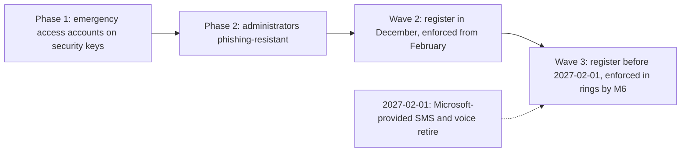

# ADR-004: Phishing-resistant authentication, methods and rollout order

> **Reference work.** Fictional scenario built for a public portfolio. Not deployed in, derived from, or describing any employer environment. Not professional advice.

## Status

Proposed. Date: 2026-10-13.

The Director of IT and Security proposes this decision; the executive team approves it with the plan and the Identity and Access Management Policy (POL-03) at M3. The emergency access and administrator steps run earlier, in Phases 1 and 2, as the urgent risk reductions the Director owns.

## Context

- **Day 1 (assumption A-01).** At Fabrikam (fictional), most users meet an MFA requirement through Conditional Access, mostly with push or SMS. Several Global Administrators hold standing assignments, and there is no Privileged Identity Management.
- **Threats.** The threat profile ([17](../17-threat-profile.md)) puts adversary-in-the-middle phishing and session theft (S-04), help desk impersonation (S-03), and consent phishing (S-05) at the center of the identity attack path. The FBI warns: "Multi-factor authentication will not protect you if you land on a fraudulent login page." CISA's fact sheet on phishing-resistant MFA ranks FIDO/WebAuthn and PKI-based MFA as phishing-resistant, rates app-based codes and push with number matching as vulnerable to phishing, and calls SMS and voice a last resort; it suggests help desk and IT administrators as a first phase and names HR staff among high-value targets. Microsoft reports in its 2026 Digital Defense Report that phishing-resistant MFA remains among the highest-leverage controls.
- **Microsoft's changes.** Synced passkeys and passkey profiles became generally available in March 2026. Passkeys became the default sign-in experience on September 1, 2026, switched on automatically for users enabled for SMS or voice. Microsoft-provided SMS and voice MFA retire on February 1, 2027, and on July 1, 2027 for Global Administrators and external users. After the retirement, a user whose only method is SMS or voice must register a passkey at sign-in, a blocking prompt with no opt-out. Customers that want to keep SMS can configure a telephony provider from Microsoft Security Store from October 30, 2026.
- **Calendar.** February 1, 2027 is the first day after year-end payroll and tax form season and the customer-facing freeze. The finance, payroll, People, and Support teams are busiest from mid-December through January.
- **Devices.** Windows laptops are enrolled in Intune; Engineering and Design use Macs that are partly managed; email and Teams run on personal phones (A-04). [ADR-008](ADR-008-endpoint-management-standard.md) sets the endpoint standard.
- **Standards.** NIST SP 800-63B-4 (July 2025) defines phishing resistance and assurance levels. Fabrikam is not a federal agency and uses it as a reference model.
- **Target.** M6: phishing-resistant MFA for all administrators and most users by month 9 (KPI-08).

## Decision drivers

1. Close the S-03, S-04, and S-05 paths first for the accounts that administer the tenant, move money, or hold customer data (R-01, R-03, R-06).
2. Meet the February 1, 2027 date with no user stranded.
3. Enforce nothing new on finance and payroll staff in January.
4. Protect service desk capacity (KPI-20) and day-one productivity for new hires (KPI-22).
5. Recover lost methods without reopening the help desk path (S-03).
6. Buy hardware only where it adds protection.
7. Follow Microsoft's advice that emergency access accounts not use the same authentication methods as other administrative accounts, as far as a design without a PKI allows (Risks and mitigations).
8. Reach M6 and make KPI-08 measurable by population.

## Options considered

| Option | Pros | Cons | Verdict |
|---|---|---|---|
| 1. Risk-ordered waves, with methods set per population through passkey profiles | Highest-value accounts first; lessons from the small administrator wave; fits the business calendar | Longer overall rollout; two strengths in force side by side for a while | Chosen |
| 2. Everyone at once before February 1 | One campaign | Lands on the year-end peak; service desk surge; no lessons from administrators first | Rejected |
| 3. Move SMS users to Authenticator push with number matching and stop there | Fast, cheap, familiar | CISA's fact sheet rates it vulnerable to phishing; NIST SP 800-63B-4 does not treat out-of-band or code-entry authenticators as phishing-resistant; adversary-in-the-middle kits (S-04) still work | Rejected as an end state; allowed only as a bridge in wave 3 |
| 4. Keep SMS and voice through a telephony provider from Microsoft Security Store | Least change for users | Keeps the method CISA's fact sheet calls a last resort; adds a vendor and a cost | Rejected |
| 5. FIDO2 security keys for every employee | Strong and attestable; no phone needed | Purchase, shipping, and replacement for about 450 remote staff; platform methods give the same phishing resistance on devices people already carry | Rejected for everyone; keys go to emergency access, to administrators' separate accounts (a different model, because platform methods do not work for an account that does not sign in to the operating system), and to wave 3 staff who cannot use a phone method |
| 6. Certificate-based authentication | Phishing-resistant and in Microsoft's built-in strength | Needs a PKI (Microsoft Cloud PKI is in E5 or an add-on on E3) and certificate lifecycle work a small team cannot absorb in year one | Rejected for year one |

## Decision

| Wave | Who | Methods | Passkey profile | Enforced by | Register | Enforce |
|---|---|---|---|---|---|---|
| Emergency access | The two emergency access accounts | FIDO2 security keys of their own model, two per account, stored in separate secure locations | 1: security keys only, restricted to the emergency access key model, attestation enforced | Microsoft's mandatory MFA; excluded from enforced Conditional Access policies | Phase 1 | Phase 1 |
| Wave 1 | Administrators' separate cloud-only admin accounts | A FIDO2 security key, a model different from the emergency access keys and allowed by AAGUID in the custom strength, plus a device-bound passkey in Microsoft Authenticator on a company-owned, Intune-managed phone. Windows Hello for Business and the macOS platform credential count for an admin account only on a dedicated admin workstation where that account signs in to the operating system | 2: device-bound passkeys only (the administrators' key model and Authenticator), attestation enforced | CA-02 with a custom strength that accepts only the administrators' key model and Authenticator passkeys (by AAGUID) | Phase 2 (December) | Phase 2 |
| Wave 2 | Finance, payroll, People, Support staff with customer data access, executives, and IT staff daily accounts; the Engineering Manager may add engineers with production access | Windows Hello for Business or the platform credential on managed devices, plus a device-bound passkey in Authenticator | 2 | CA-04, with its own custom strength that accepts only these methods | Early December, before year-end close | February (Phase 4) |
| Wave 3 | All other employees | Any phishing-resistant method: Windows Hello for Business, the platform credential, device-bound or synced passkeys; Authenticator push with number matching only until CA-05 | 3: the default profile, device-bound and synced | CA-03 (MFA), then CA-05 (built-in phishing-resistant strength) | By the end of Phase 3, before 2027-02-01 | Phase 5 in rings, most by M6 |
| Guests | External users | MFA from their Microsoft Entra home tenant, which inbound cross-tenant access settings trust as the organization default or per partner. Guests from other identity providers or with personal accounts register a method in Fabrikam's tenant and are the population of document 06's action 06.32; Microsoft does not support passkey registration for guests in the resource tenant | None | CA-11 (MFA) | In Fabrikam's tenant only for guests outside Microsoft Entra | Phase 4 |

Fabrikam removes SMS and voice from its authentication methods policy at the end of Phase 3, does not configure a telephony provider, and does not opt out of Microsoft's passkey default.

**How the profiles hold.** Microsoft's passkey page supports up to three passkey profiles, including the default (its release notes announce a higher limit), and this design uses exactly three. A user scoped to several profiles may use any passkey that satisfies one of them, so profile 3 targets a group of everyone outside the emergency access, administrator, and wave 2 groups rather than all users; document [07](../07-identity-lifecycle-joiners-movers-leavers.md)'s group rules keep it current. Excluding users from the passkey method itself would block passkeys for them entirely, so exclusion is not used. CA-02 and CA-04 each use a custom authentication strength that restricts passkeys to approved authenticator models (Microsoft supports restricting by authenticator model, AAGUID): CA-02 accepts only the wave 1 methods, and CA-04 only the wave 2 methods. A synced passkey satisfies neither, even if one were registered. Microsoft requires MFA within the previous five minutes before a passkey can be registered, which is why everyone registers while their current method still works, or with a Temporary Access Pass.

### Temporary access and recovery

- **Temporary Access Pass settings.** One-time use, a one-hour lifetime (Microsoft's default) and an eight-hour maximum; Microsoft allows one pass per user, and a pass does not replace the password. Microsoft states that a Temporary Access Pass satisfies Conditional Access requirements for MFA, so CA-10 permits registration with it; with a one-time pass, registration must finish within 10 minutes of sign-in. Microsoft's page names no license requirement.
- **New hires.** Document 07's workflow creates a single-use pass, valid from the start time, and sends it to the new hire's manager the day before the start date; until that workflow is live in Phase 4, the service desk issues passes by hand after the joiner checks in documents 07 and [13](../13-it-service-management.md), never through the channel that requested them. Either way, document 07's identity verification applies (R-15): the new account stays disabled until the verifier records the identity check, or the pass is issued during the verified call. The new hire registers Windows Hello for Business or the platform credential during Autopilot or automated device enrollment, then an Authenticator passkey. Since July 6, 2026, Conditional Access policies that target registration also apply when users register Windows Hello for Business and macOS Platform SSO credentials, so CA-10 must be satisfiable during device setup; the pass covers that (KPI-22).
- **Lost or replaced device.** Identity verification (document 13), a one-time pass, a new method registered, the old method removed. Every pass issued and every method change raises an alert (document [08](../08-detection-and-incident-response.md)).
- **Administrators.** Each admin account holds two methods that work for an account that does not sign in to the operating system, the security key and the Authenticator passkey, which makes a pass rare. If both are lost, a pass for an administrator account needs a second administrator's approval, and the Director of IT and Security is told.
- **Emergency access accounts.** Never recovered with a pass. If one key is lost, the account signs in with its second key to register a replacement and remove the lost one, the safe combinations change, and the next validation test confirms the account works.
- **No phone method.** Wave 3 staff who cannot or will not use a phone method get a FIDO2 security key of a different model from the emergency access keys. Wave 2 staff in that position sign in with Windows Hello for Business or the platform credential and use work apps on their managed laptop, because the custom strength for CA-04 does not accept security keys.

### Help desk identity verification

Document [13](../13-it-service-management.md) owns the procedure; this decision depends on it.

- No reset, pass, or method change on the caller's word or on contact details the caller supplies.
- A callback to the contact details held in the HR system of record, or a live video check that includes the employee's manager.
- A callback number changed in the HR system in the last 30 days does not count; the live video check with the manager applies instead (document 13).
- A second approver for administrator accounts and the wave 2 group.
- The pass is delivered out of band, never read out on the inbound call.
- Service desk staff are trained on the script (document [09](../09-security-awareness-and-training.md)). CISA's #StopRansomware Guide warns that ransomware actors pose as IT or help desk staff to obtain credentials from employees; the threat profile covers the reverse, attackers posing as employees to the help desk (S-03).

### Synced passkeys and NIST assurance levels

- **Phishing resistance.** NIST SP 800-63B-4 defines it as the authentication protocol's ability to prevent disclosure of authentication secrets and valid outputs to an impostor verifier, by channel binding or verifier name binding. Authenticators that need manual entry of an output, such as out-of-band and one-time password authenticators, are not phishing-resistant.
- **Assurance levels.** At AAL2, verifiers "SHALL offer at least one phishing-resistant authentication option". At AAL3, the authenticator needs a non-exportable private key and phishing resistance.
- **Syncable authenticators.** They "SHALL NOT be used at AAL3". Appendix B allows them up to AAL2 when keys held in the sync fabric are encrypted and access to the sync fabric is protected by AAL2-equivalent MFA.
- **Microsoft's position.** Synced passkeys do not support attestation; Microsoft says to treat them as phishing-resistant with the same posture as other unattested authenticators.
- **Fabrikam's design choice.** This is the plan's own inference, not NIST text. Administrators and emergency access aim at an AAL3-like posture (device-bound, attested, non-exportable keys). The wave 2 group stays on device-bound methods because those accounts move money and hold customer data. Everyone else aims at AAL2 and may use synced passkeys, whose protection then rests on the employee's own platform account, which Fabrikam does not manage. NIST's federal guidance expects managed devices for syncing keys; Fabrikam cannot impose that on personal phones, which is why synced passkeys stop at wave 3.

### Platform specifics (status as of 2026-10-13)

| Platform | Method | Status and use |
|---|---|---|
| Windows | Windows Hello for Business | Microsoft calls it the recommended method for corporate managed, Microsoft Entra joined devices. Keys are generated and protected in the device's TPM, and the PIN never leaves the device. Licensed with Windows Pro and Enterprise editions; satisfies Conditional Access MFA and is in the built-in phishing-resistant strength. The primary method for daily accounts on Fabrikam laptops |
| Windows | Microsoft Entra passkey on Windows | Public preview in Microsoft's March 2026 release notes, with no later general availability entry found, although the how-to page carries no preview label. It does not replace Windows Hello for Business and does not support device sign-in. Not used |
| Windows | Token protection | Generally available for native apps; the CA-15 pilot in Phase 5 |
| macOS | Platform SSO with a Secure Enclave key (platform credential) | Microsoft describes it as password-less and meeting phishing-resistant MFA requirements; included in every Intune plan; needs macOS 13 or newer, with macOS 14 recommended. Generally available since August 2025 (Microsoft Entra release notes). Used, with the Authenticator passkey as fallback |
| macOS | Token protection | Microsoft's page conflicts: its platform table lists macOS native apps as generally available, while its supported-devices section is headed "Apple (Preview)" (as of 2026-10-13); MDM management and the Enterprise SSO plug-in or Platform SSO are required. Not used in year one |
| iOS and Android | Device-bound passkey in Microsoft Authenticator | Supported; Microsoft's own example profile enforces attestation for Authenticator passkeys |
| iOS and Android | Synced passkeys | Generally available since March 2026; no attestation. Wave 3 only |
| Any | FIDO2 security keys | Emergency access (one model); administrators' separate accounts and wave 3 staff who cannot use a phone method (a different model) |

## Consequences

**Positive**

- Administrators are phishing-resistant by the end of Phase 2 (December 2026), the wave 2 group from February 2027, and every employee is off SMS and voice before 2027-02-01, which keeps M6 within reach.
- Adversary-in-the-middle token theft and push fatigue stop working against covered accounts, and a stolen password alone is worthless.
- Help desk resets become a controlled, logged event.
- KPI-08 can be reported by population.

**Negative**

- Hardware costs: security keys for emergency access and for administrators' separate accounts, company-owned phones for administrators, and keys for wave 3 staff who cannot use a phone method.
- Service desk load lands in December and January, the busy season.
- Wave 3 may use synced passkeys, a weaker posture than device-bound methods.
- Windows Hello for Business and the platform credential depend on device enrollment progress (ADR-008); unmanaged Macs wait.
- Two strengths run side by side until CA-05.

## Risks and mitigations

| Risk | Mitigation |
|---|---|
| Users miss registration and meet Microsoft's blocking prompt after 2027-02-01 | Campaign from December; a January list of users still on SMS or voice; extra service desk cover in the first week of February |
| Help desk social engineering during registration or recovery (S-03) | Document 13's verification script; a second approver for administrators and wave 2; an alert on every pass issued and every method change |
| An employee's personal platform account that syncs passkeys is compromised | Synced passkeys only in wave 3; risk-based Conditional Access from Phase 4 ([ADR-001](ADR-001-microsoft-365-security-licensing.md)); alerts on new methods |
| Administrator lockout | Two methods per admin account that work without an operating system sign-in (the security key and the Authenticator passkey); emergency access accounts tested quarterly |
| Admin accounts and emergency access accounts both use FIDO2 security keys, although Microsoft advises that emergency access accounts not use the same authentication methods as other administrative accounts | Different key models, each allowed only in its own passkey profile and custom strength (by AAGUID), so no key works for both groups. The remaining shared dependency is the passkey (FIDO2) method itself; the other method Microsoft names for emergency access, certificate-based authentication, needs a PKI (Option 6), so it is reassessed once the Phase 4 certificate authority exists (Revisit when) |
| Microsoft changes dates, defaults, or built-in strengths | Recheck Microsoft's pages at each phase gate; check the tenant's built-in strength definition, which Microsoft updates as new methods arrive; custom strengths for administrators and wave 2 |
| Microsoft's pages give different passkey profile limits | The design needs three, the lowest stated limit |
| Apps or devices that cannot use modern sign-in | Document [15](../15-enterprise-systems-and-saas.md)'s inventory; CA-01 blocks legacy authentication; workload identities for automation |
| Year-end disruption | Wave 2 registers in early December; enforcement waits for February |

## Revisit when

- Microsoft announces general availability for Microsoft Entra passkeys on Windows, removes the preview label from token protection's Apple supported-devices section, or changes the SMS and voice dates. Entra passkeys on Windows, which Microsoft describes as device-bound passkeys in the local Windows Hello container that do not support device sign-in, would also give admin accounts a platform option without a dedicated admin workstation; Microsoft's profile for them cannot enforce attestation, so profile 2 would be revisited at the same time.
- A phishing or help desk social engineering attack succeeds against a covered account (KPI-17).
- NIST publishes errata or implementation guidance that changes how syncable authenticators are treated; NIST announced its SP 800-63-4 Implementation Resource Hub on 2026-10-06.
- The Phase 4 certificate authority for office Wi-Fi (the conditional Microsoft Cloud PKI line in [ADR-001](ADR-001-microsoft-365-security-licensing.md)) is in place: reassess certificate-based authentication, including for the emergency access accounts, because the PKI that Option 6 lacked would then exist.
- The first annual program review (M7).

## Related documents

- [06. Microsoft 365 security baseline](../06-microsoft-365-security-baseline.md) (Conditional Access set CA-01 to CA-15)
- [07. Identity lifecycle](../07-identity-lifecycle-joiners-movers-leavers.md), [08. Detection and incident response](../08-detection-and-incident-response.md), [09. Security awareness and training](../09-security-awareness-and-training.md), [13. IT service management](../13-it-service-management.md), [17. Threat profile](../17-threat-profile.md)
- [05. Environment discovery](../05-environment-discovery.md), [12. Metrics and executive reporting](../12-metrics-and-executive-reporting.md)
- [ADR-001](ADR-001-microsoft-365-security-licensing.md), [ADR-008](ADR-008-endpoint-management-standard.md)
- [Payroll diversion and email compromise playbook](../playbooks/payroll-diversion-and-email-compromise.md)

## Sources

- Passkeys by default and retirement of Microsoft-provided SMS and voice authentication. Microsoft Learn. https://learn.microsoft.com/en-us/entra/identity/authentication/concept-sms-voice-retirement . Checked 2026-10-13. Primary.
- Microsoft Entra ID security updates: Passkeys are the default authentication method in Entra ID (July 13, 2026). Microsoft (Microsoft Security Blog). https://www.microsoft.com/en-us/security/blog/2026/07/13/microsoft-entra-id-security-updates-passkeys-are-the-default-authentication-method-in-entra-id/ . Checked 2026-10-13. Primary.
- How to enable passkeys (FIDO2) in Microsoft Entra ID. Microsoft Learn. https://learn.microsoft.com/en-us/entra/identity/authentication/how-to-authentication-passkeys-fido2 . Checked 2026-10-13. Primary.
- Microsoft Entra releases and announcements. Microsoft Learn. https://learn.microsoft.com/en-us/entra/fundamentals/whats-new . Checked 2026-10-13. Primary.
- Microsoft Entra releases and announcements archive (August 2025, General Availability - Platform SSO for macOS with Microsoft Entra ID). Microsoft Learn. https://learn.microsoft.com/en-us/entra/fundamentals/whats-new-archive . Checked 2026-10-13. Primary.
- Enable Microsoft Entra passkey on Windows (its profile cannot enforce attestation). Microsoft Learn. https://learn.microsoft.com/en-us/entra/identity/authentication/how-to-authentication-entra-passkeys-on-windows . Checked 2026-10-14. Primary.
- Overview of Conditional Access Authentication Strengths. Microsoft Learn. https://learn.microsoft.com/en-us/entra/identity/authentication/concept-authentication-strengths . Checked 2026-10-13. Primary.
- How to Configure Grant Controls in Microsoft Entra. Microsoft Learn. https://learn.microsoft.com/en-us/entra/identity/conditional-access/concept-conditional-access-grant . Checked 2026-10-13. Primary.
- Configure a Temporary Access Pass in Microsoft Entra ID to register passwordless authentication methods. Microsoft Learn. https://learn.microsoft.com/en-us/entra/identity/authentication/howto-authentication-temporary-access-pass . Checked 2026-10-13. Primary.
- Control security information registration with Conditional Access. Microsoft Learn. https://learn.microsoft.com/en-us/entra/identity/conditional-access/policy-all-users-security-info-registration . Checked 2026-10-13. Primary.
- Manage emergency access admin accounts. Microsoft Learn. https://learn.microsoft.com/en-us/entra/identity/role-based-access-control/security-emergency-access . Checked 2026-10-13. Primary.
- Authentication and Conditional Access for B2B users. Microsoft Learn. https://learn.microsoft.com/en-us/entra/external-id/authentication-conditional-access . Checked 2026-10-13. Primary.
- Cross-tenant access settings (inbound trust settings for MFA and device claims). Microsoft Learn. https://learn.microsoft.com/en-us/entra/external-id/cross-tenant-access-settings-b2b-collaboration . Checked 2026-10-13. Primary.
- Plan for mandatory Microsoft Entra multifactor authentication (MFA). Microsoft Learn. https://learn.microsoft.com/en-us/entra/identity/authentication/concept-mandatory-multifactor-authentication . Checked 2026-10-13. Primary.
- Windows Hello for Business overview. Microsoft Learn. https://learn.microsoft.com/en-us/windows/security/identity-protection/hello-for-business/ . Checked 2026-10-13. Primary.
- Configure Platform SSO for macOS devices. Microsoft Learn. https://learn.microsoft.com/en-us/intune/device-configuration/settings-catalog/configure-platform-sso-macos . Checked 2026-10-13. Primary.
- macOS Platform Single Sign-on (PSSO) overview. Microsoft Learn. https://learn.microsoft.com/en-us/entra/identity/devices/macos-psso . Checked 2026-10-13. Primary.
- How Token Protection Enhances Conditional Access Policies. Microsoft Learn. https://learn.microsoft.com/en-us/entra/identity/conditional-access/concept-token-protection . Checked 2026-10-13. Primary.
- Digital Identity Guidelines (SP 800-63-4, July 2025), with SP 800-63A-4, 800-63B-4, and 800-63C-4. NIST. https://csrc.nist.gov/pubs/sp/800/63/4/final . Checked 2026-10-13. Primary.
- Authentication and Authenticator Management (SP 800-63B-4, HTML edition). NIST. https://pages.nist.gov/800-63-4/sp800-63b.html . Checked 2026-10-13. Primary.
- Digital Identity Guidelines | Implementation Resource Hub Now Available (bulletin, October 6, 2026). NIST. https://content.govdelivery.com/accounts/USNIST/bulletins/42c1f8c . Checked 2026-10-13. Primary.
- Implementation Resources for SP 800-63 Revision 4. NIST. https://pages.nist.gov/800-63-4-Implementation-Resources/ . Checked 2026-10-13. Primary.
- Implementing Phishing-Resistant MFA (fact sheet, October 2022). CISA. https://www.cisa.gov/sites/default/files/publications/fact-sheet-implementing-phishing-resistant-mfa-508c.pdf . Checked 2026-10-13. Primary.
- Cyber Criminals Impersonating Employee Self-Service Websites to Steal Victim Information and Funds (Alert I-042425-PSA). FBI IC3. https://www.ic3.gov/PSA/2025/PSA250424 . Checked 2026-10-13. Primary.
- #StopRansomware Guide (version 3.0, October 2023). CISA, MS-ISAC, NSA, FBI. https://www.cisa.gov/resources-tools/resources/stopransomware-guide . Checked 2026-10-13. Primary.
- 2026 Microsoft Digital Defense Report, Executive Summary. Microsoft. https://cdn-dynmedia-1.microsoft.com/is/content/microsoftcorp/microsoft/msc/documents/presentations/CSR/2026-Microsoft-DDR-Exec-Summary.pdf . Checked 2026-10-13. Primary (vendor research; primary for what Microsoft reports).
