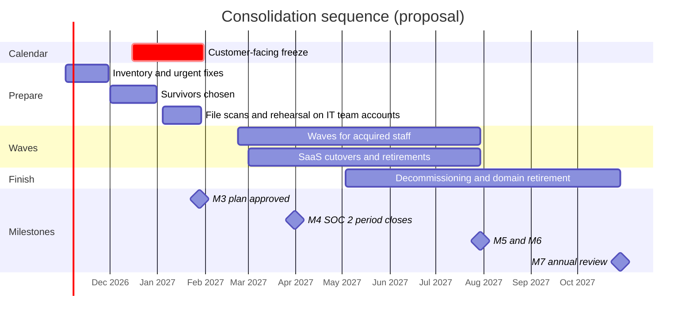

# ADR-005: Consolidating acquired-company identities, devices, files, and SaaS

> **Reference work.** Fictional scenario built for a public portfolio. Not deployed in, derived from, or describing any employer environment. Not professional advice.

## Status

Proposed. Date: 2026-10-13.

The Director of IT and Security proposes this decision; the executive team approves it with the 12-month plan and budget at M3. Business owners choose the surviving application in each duplicated category. If any system stays separate after Phase 5, the executive accountable for it accepts that risk through the exception process in document [11](../11-risk-management.md).

## Context

- **How Fabrikam got here.** Fabrikam (fictional) grew through two acquisitions of smaller workforce-software companies. The products sell as one platform, and the acquired companies' email domains already run in Fabrikam's primary Microsoft 365 tenant. Some file storage, device management, identities, and SaaS applications from the acquisitions are still separate or duplicated (assumption A-08). Accounts from the acquisitions have unclear owners (A-02). Of the two older brand domains from the acquisitions, one no longer sends mail but publishes no SPF or DMARC record, and the other sends only through a marketing service and has no DMARC record (A-05).
- **What the split costs.** Duplicate tools nobody fully owns (R-09). Leavers whose access survives in a system the leaver process does not reach (R-05); document [07](../07-identity-lifecycle-joiners-movers-leavers.md) carries those systems as a manual checklist item until consolidation. Administrators in systems outside Fabrikam's privileged access controls (R-06). Integration credentials and enterprise apps for tools nobody uses (R-08). Investigations that must search several sets of logs (R-10). Duplicate contracts.
- **What M1 must answer.** Whether a leftover Microsoft 365 tenant exists and what it holds, whether another identity provider is in use, which file servers sit in the two offices inherited from the acquisitions, which other cloud storage is in use, and how many people, devices, and gigabytes are involved. Durations wait for those counts (document [05](../05-environment-discovery.md)).
- **Calendar.** Customer-facing changes freeze from mid-December to January 31. Exchange Online disables SMTP AUTH Basic authentication by default for existing tenants at the end of December 2026, per Microsoft's message center as relayed by a community mirror (document [06](../06-microsoft-365-security-baseline.md)). Microsoft-provided SMS and voice MFA retire on 2027-02-01, and users with no other method then face a blocking registration prompt. The current SOC 2 review period closes at M4 (end of March 2027), M5 and M6 fall in month 9 (July 2027), and M7 is in October 2027.
- **Capacity.** An IT Operations Manager and three IT generalists run the service desk, devices, and Microsoft 365. The company adds no security or GRC hire: the Director of IT and Security takes on the security-engineering and GRC work, with the Systems Engineer (Identity and Endpoint) for hands-on work, the outside audit-readiness consultant for SOC 2, and contracted specialist help for surge and build work (documents [03](../03-twelve-month-roadmap.md) and [04](../04-operating-model-team-and-budget.md)).
- **Scope boundary.** Any product code and infrastructure from the acquisitions belong to Engineering under the RACI in document 04. This record covers the corporate IT of the acquired teams: identities, devices, files, and SaaS. Mail already runs in the primary tenant.
- **Dependencies.** [ADR-002](ADR-002-hr-system-of-record-drives-identity.md) makes the HR record the source of identity, so acquired people are matched by worker ID, and the HR feed goes live in February 2027 (action 07.11). [ADR-008](ADR-008-endpoint-management-standard.md) sets Intune as the one endpoint standard and fixes the order for moving a device out of another tenant. [ADR-001](ADR-001-microsoft-365-security-licensing.md) decides the licenses for SaaS discovery and governance, and [ADR-004](ADR-004-phishing-resistant-authentication-rollout.md) the sign-in methods that migrated staff register.

## Decision drivers

1. One identity per person, driven by the HR record, before M6 (ADR-002, KPI-12).
2. One device standard and one compliance signal for Conditional Access (ADR-008, KPI-06).
3. No disruption to customer-facing work: customer-facing changes after the freeze, and customer-facing integrations last.
4. SOC 2 continuity: no evidence break before M4 (KPI-03); the acquired teams move onto Fabrikam's standard corporate controls through consolidation.
5. Service desk capacity in a small team (R-14, KPI-20, KPI-21).
6. A rollback point for every step, and a communication plan for every change people will notice.
7. Cost: end duplicate contracts at their notice dates and use what Microsoft 365 E3 already includes.
8. No security shortcuts: no Conditional Access exclusions to ease migration, and no oversharing carried across (R-07).

## Options considered

### Option 1: Phased consolidation into the primary tenant and Fabrikam standards (chosen)

Prepare in Phases 1 to 3, move people in waves from late February 2027, retire duplicates at their contract notice dates, and decommission leftovers by M7.

- **Pros.** One tenant, one set of Conditional Access policies, one admin population, one log trail, and one SOC 2 evidence source. Leavers and access reviews reach everyone through document 07. Duplicate contracts end, which offsets part of the plan's cost. Waves sized to service desk capacity keep each step small and reversible, and the calendar keeps changes away from the freeze and the SOC 2 period close.
- **Cons.** Several months of mixed states, and user disruption in every wave: sign-in prompts, sync re-setup, broken links, and reshares. Changing a user principal name (UPN) changes the user's OneDrive URL. If a leftover Microsoft 365 tenant holds files, Microsoft's cross-tenant tools are one-way, cost per user or per volume moved, and (for SharePoint) are in private preview (as of 2026-10-13). The work competes with document 06's Phase 4 rings for the same small team.
- **Verdict.** Chosen.

### Option 2: Keep acquired-company systems separate long term, joined by cross-tenant features

Leave any acquired tenant, devices, and tools in place and connect them. Microsoft Entra's multitenant organization feature lets an organization "define a boundary around the Microsoft Entra tenants that your organization owns". It needs Microsoft Entra ID P1 (one license per employee per multitenant organization, and at least one per tenant), allows up to 100 active tenants, and a tenant can create or join only one. Cross-tenant synchronization of users needs a P1 license for each synchronized user in the source tenant, while the target tenant uses Microsoft Entra External ID monthly active user billing and needs at least one P1 license for automatic redemption. Synchronizing groups needs Microsoft Entra ID Governance (or Microsoft Entra Suite); Microsoft's release notes list it as a public preview in March 2026 and as generally available in May 2026 (checked 2026-10-13).

- **Pros.** The least disruption now, no migration project, familiar tools for each team, and quick collaboration across tenants.
- **Cons.** Two sets of Conditional Access policies, admin roles, emergency access accounts, and logs for the same small team to run. Every leaver must be removed in two places (R-05), and access reviews and investigations must cover both (R-10). Duplicate licenses and contracts continue (R-09). Devices enrolled in another tenant cannot give ADR-008's single compliance signal. The SOC 2 system description and its evidence grow more complex, and the acquired teams would sit on different corporate controls.
- **Verdict.** Rejected as an end state. Cross-tenant synchronization of users is allowed only as a temporary bridge during the waves, if a leftover tenant still hosts something staff need, and it is removed at decommissioning.

### Option 3: A single big-bang weekend migration

Move every acquired identity, device, file store, and application over one weekend.

- **Pros.** The shortest period of mixed states, one communication, and duplicate costs that end sooner.
- **Cons.** A device reset takes a working session and Macs must be wiped for automated enrollment, so a small team cannot cover the acquired fleet in one weekend. Cross-tenant OneDrive and SharePoint moves allow no incremental or delta passes, so a failed weekend has no clean way back. Microsoft recommends making UPN changes in batches and starting cross-tenant site moves with a few sites, the opposite of one large event. Monday would bring a service desk flood just when Support and Finance are at their busiest. Any weekend before February collides with the freeze, year-end, and the 2027-02-01 SMS and voice retirement, and any weekend before April risks SOC 2 exceptions.
- **Verdict.** Rejected. It concentrates the risk in one irreversible event that a lean team cannot staff.

## Decision

Adopt Option 1, sequenced around the freeze. Preparation in Phases 1 to 3 changes nothing for business teams. Consolidation waves begin in Phase 4, after the freeze and the February registration peak, and finish in Phase 5. The waves depend on ADR-002, whose HR feed matches each acquired person to one identity from February 2027, and on ADR-008, whose device standard and device order every wave follows. Execution detail, the per-stream steps, and the ranked list of what usually goes wrong are in document [15](../15-enterprise-systems-and-saas.md).

| Phase | What happens | Gate to the next step |
|---|---|---|
| Phase 1 (November) | Inventory of tenants, directories, device tools, file stores, SaaS, and domains. Three fixes that cannot wait: admins of any leftover tenant under MFA and emergency access; confirmed leavers disabled, never deleted; acquired-company SMTP AUTH senders fixed before the freeze (document 06). Any cross-tenant add-on goes into the M3 budget proposal | M1 inventory |
| Phase 2 (December) | Business owners choose survivors, with no cutovers. Identity map drafted from the HR record | M2 |
| Phase 3 (January) | Migration Manager agents installed and file servers scanned read-only. A rehearsal on the IT team's own accounts, devices, and files, with copies only. Runbooks, rollback points, and communications written. Executive approval at M3. Small January waves for teams outside year-end work were considered and deferred, because January carries year-end support and the run-up to the SMS and voice retirement | M3 approval |
| Phase 4 (February to April) | Waves from late February. Each person moves in the order identity (matched through the HR feed), device (ADR-008's order), files, then SaaS. Acquired teams join document 06's managed-device rings (CA-06) only after their device wave. Teams with payroll and customer duties move mid-week, outside peaks agreed with their leaders. Systems in the current SOC 2 system description move after M4 or with the SOC 2 audit firm's agreement. Customer-facing integrations move last, and the older brand domain that still sends follows document 06's enforcement path | KPI-20, KPI-21, and KPI-24 hold before each next wave |
| Phase 5 (May to October) | Remaining waves. The acquired companies' teams on standard identity, devices, and files before M5, and one identity for everyone before M6. Decommissioning by M7: any leftover tenant, file servers sanitized under NIST SP 800-88 Rev. 2, retired SaaS with deletion confirmed, and retired domains | M7 |

Rules for every wave:

1. No Conditional Access exclusions to ease migration. Devices enroll first and policies are tested in report-only (document 06).
2. Every mail flow, DNS, UPN, sign-in, or access change has a written rollback and a communication plan approved by the Change Advisory Board (document [13](../13-it-service-management.md)).
3. Copy before moving, set sources read-only at cutover, and pilot any one-way move on a few sites first.
4. The survivor is live before anything retires. A retired application stays readable for one business cycle, and its contract ends at the notice date with deletion confirmed.
5. Nothing under a hold or needed under POL-15 is deleted. Leavers' UPNs and primary addresses are not changed, because Microsoft warns that changing them before deletion blocks later removal of the resulting inactive mailbox.
6. Oversharing is fixed before data moves: Anyone links and broad access come off first.

**Microsoft tools for a leftover tenant (checked 2026-10-13).** These apply only if M1 finds a leftover Microsoft 365 tenant that holds files.

| Tool | What it does | License and status | Limits that shape the plan |
|---|---|---|---|
| Cross-tenant OneDrive migration | Moves OneDrive accounts between tenants through SharePoint Online PowerShell | Requires the Cross Tenant User Data Migration add-on: per user, a one-time fee, offered to Enterprise Agreement customers through the Microsoft account team. The same license covers cross-tenant mailbox migration | One-way, with no incremental or delta passes. Read-only for a few minutes. A redirect stays at the source until that tenant is deprovisioned. Fails if a OneDrive already exists for the user in the target tenant, if a hold applies, if a path exceeds 400 characters, or if the source tenant uses Customer Key |
| Cross-tenant SharePoint migration | Moves SharePoint sites between tenants | Cross-Tenant Shared Data Migration licenses per 100 GB moved, for Enterprise Agreement customers only. Microsoft's migration tools overview calls it a private preview (as of 2026-10-13), although its own overview page carries no preview label | One-way, with no delta passes. Does not move Teams content, channels, or structure. Power Apps and Power Automate must be rebuilt. Labels with user-defined permissions must be removed first. Microsoft advises starting with a few sites |
| Migration Manager | Copies file shares and supported cloud storage into SharePoint, OneDrive, and Teams through agents on servers | Microsoft's pages name no separate license. A Microsoft 365 Migration Administrator role limits migration staff to migration tasks | File share migrations support files up to 250 GB. Copies leave the source in place |

Acquired staff already sign in to the primary tenant and may already have a OneDrive there, which makes a cross-tenant OneDrive move fail for them. For those people the plan uses user-led copies through the OneDrive sync app, with service desk help.

## Consequences

### Positive

- One tenant, one admin population, one Conditional Access set, one log trail, and one evidence source.
- Leavers and access reviews reach acquired staff through document 07 (KPI-12, KPI-13).
- Every acquired device reports one compliance signal (KPI-06).
- Duplicate contracts end at their notice dates, a cost offset in document 04's budget.
- The acquired teams are on Fabrikam's standard corporate controls before M5, which closes the consolidation gaps.

### Negative

- Months of mixed states and user disruption, with service desk load in every wave.
- UPN changes break saved links to OneDrive, links to files users shared from OneDrive, and flows that reference OneDrive URLs. Users reshare, and owners fix their flows.
- If a leftover Microsoft 365 tenant holds files: one-way moves, one-time add-on costs per user or per 100 GB, Enterprise Agreement terms, and a SharePoint tool still in private preview (as of 2026-10-13).
- Duplicate costs continue until each notice date, which may fall after the waves finish.
- Phase 4 is crowded. Document 06's Conditional Access and attack surface reduction rings, Mac enrollment, and single sign-on cutovers compete for the same people, and consolidation waves yield first when they collide.

## Risks and mitigations

| Risk | Mitigation |
|---|---|
| Unmapped users or groups, or oversharing carried across | Owners check the identity map; Anyone links and broad access are removed before any move |
| A target OneDrive already exists, so a cross-tenant move fails | User-led copies through the OneDrive sync app for those users |
| Known Folder Move still points at the old organization, so the desktop looks empty | Turned off before redirecting, as Microsoft advises |
| Paths over 400 characters, holds, or Customer Key block moves | Phase 3 scans; holds handled with General Counsel |
| Device records deleted too early, so the LAPS password stored in Entra ID is lost and BitLocker sits suspended | ADR-008's order; no Entra or Intune deletes outside it |
| Service desk overload | Waves sized to capacity; the next wave held if KPI-20, KPI-21, or KPI-24 slip |
| SOC 2 evidence break | In-scope systems move after M4 or with the audit firm's agreement |
| Fabrikam is not an Enterprise Agreement customer, so the cross-tenant add-ons are unavailable | User-led copies, plus Migration Manager where it applies; scope confirmed at M1 |
| Customer contracts name old-brand notice addresses | Aliases kept; domain retirement waits for General Counsel |

## Revisit when

- The M1 inventory finds a leftover tenant that still holds mailboxes, or a separate identity provider used for administration.
- Microsoft makes cross-tenant SharePoint migration generally available or changes its Enterprise Agreement-only terms.
- Two consecutive waves miss the KPI-20 or KPI-24 targets.
- The SOC 2 audit firm declines in-period cutovers for a system, or consolidation needs the acquired teams on standard controls earlier.
- Fabrikam signs another acquisition. This record then becomes the playbook, with Option 2 as a time-boxed bridge.
- The first annual program review (M7).

## Related documents

- [15. Enterprise systems and SaaS](../15-enterprise-systems-and-saas.md)
- [06. Microsoft 365 security baseline](../06-microsoft-365-security-baseline.md)
- [07. Identity lifecycle: joiners, movers, and leavers](../07-identity-lifecycle-joiners-movers-leavers.md)
- [05. Environment discovery](../05-environment-discovery.md)
- [10. Governance and compliance program](../10-governance-and-compliance-program.md)
- [13. IT service management](../13-it-service-management.md)
- [14. Business continuity and backup](../14-business-continuity-and-backup.md)
- [03. Twelve-month roadmap](../03-twelve-month-roadmap.md)
- [04. Operating model, team, and budget](../04-operating-model-team-and-budget.md)
- [ADR-001: Microsoft 365 security licensing](ADR-001-microsoft-365-security-licensing.md)
- [ADR-002: The HR system of record drives the identity lifecycle](ADR-002-hr-system-of-record-drives-identity.md)
- [ADR-004: Phishing-resistant authentication rollout](ADR-004-phishing-resistant-authentication-rollout.md)
- [ADR-006: Microsoft 365 backup](ADR-006-microsoft-365-backup.md)
- [ADR-008: One endpoint management standard](ADR-008-endpoint-management-standard.md)

## Sources

- What is a multitenant organization in Microsoft Entra ID? Microsoft Learn. https://learn.microsoft.com/en-us/entra/identity/multi-tenant-organizations/multi-tenant-organization-overview . Checked 2026-10-13. Primary.
- Microsoft Entra licensing (multitenant organizations and cross-tenant synchronization). Microsoft Learn. https://learn.microsoft.com/en-us/entra/fundamentals/licensing . Checked 2026-10-13. Primary.
- Microsoft Entra ID Governance licensing fundamentals. Microsoft Learn. https://learn.microsoft.com/en-us/entra/id-governance/licensing-fundamentals . Checked 2026-10-13. Primary.
- Microsoft Entra releases and announcements (May 2026: cross-tenant group synchronization generally available; March 2026: public preview). Microsoft Learn. https://learn.microsoft.com/en-us/entra/fundamentals/whats-new . Checked 2026-10-13. Primary.
- Cross-tenant OneDrive migration overview. Microsoft Learn. https://learn.microsoft.com/en-us/microsoft-365/migration/cross-tenant-onedrive-migration . Checked 2026-10-13. Primary.
- Cross-tenant SharePoint site migration overview. Microsoft Learn. https://learn.microsoft.com/en-us/microsoft-365/migration/cross-tenant-sharepoint-migration . Checked 2026-10-13. Primary.
- Migrate to Microsoft 365 (migration tools overview, including the cross-tenant SharePoint preview status and the Migration Administrator role). Microsoft Learn. https://learn.microsoft.com/en-us/sharepointmigration/migrate-to-sharepoint-online . Checked 2026-10-13. Primary.
- Migrate your file shares to Microsoft 365 with Migration Manager. Microsoft Learn. https://learn.microsoft.com/en-us/sharepointmigration/mm-get-started . Checked 2026-10-13. Primary.
- How UPN changes affect OneDrive. Microsoft Learn. https://learn.microsoft.com/en-us/sharepoint/upn-changes . Checked 2026-10-13. Primary.
- Redirect and move Windows known folders to OneDrive. Microsoft Learn. https://learn.microsoft.com/en-us/sharepoint/redirect-known-folders . Checked 2026-10-13. Primary.
- Restore or permanently remove recently deleted user. Microsoft Learn. https://learn.microsoft.com/en-us/entra/fundamentals/users-restore . Checked 2026-10-13. Primary.
- Learn about inactive mailboxes. Microsoft Learn. https://learn.microsoft.com/en-us/purview/inactive-mailboxes-in-office-365 . Checked 2026-10-13. Primary.
- Overview of Windows LAPS with Microsoft Intune. Microsoft Learn. https://learn.microsoft.com/en-us/intune/device-security/laps/overview . Checked 2026-10-13. Primary.
- Encrypt Windows devices with BitLocker using Intune. Microsoft Learn. https://learn.microsoft.com/en-us/intune/device-configuration/endpoint-security/encrypt-bitlocker-windows . Checked 2026-10-13. Primary.
- Set up automated device enrollment (ADE) for macOS. Microsoft Learn. https://learn.microsoft.com/en-us/intune/device-enrollment/apple/setup-automated-macos . Checked 2026-10-13. Primary.
- Passkeys by default and retirement of Microsoft-provided SMS and voice authentication. Microsoft Learn. https://learn.microsoft.com/en-us/entra/identity/authentication/concept-sms-voice-retirement . Checked 2026-10-13. Primary.
- MC786329, Exchange Online to retire Basic Auth for Client Submission (SMTP AUTH). mc.merill.net (community mirror of Microsoft 365 Message Center posts). https://mc.merill.net/message/MC786329 . Checked 2026-10-13. Secondary.
- Guidelines for Media Sanitization (SP 800-88 Rev. 2, September 2025). NIST. https://csrc.nist.gov/pubs/sp/800/88/r2/final . Checked 2026-10-13. Primary.
