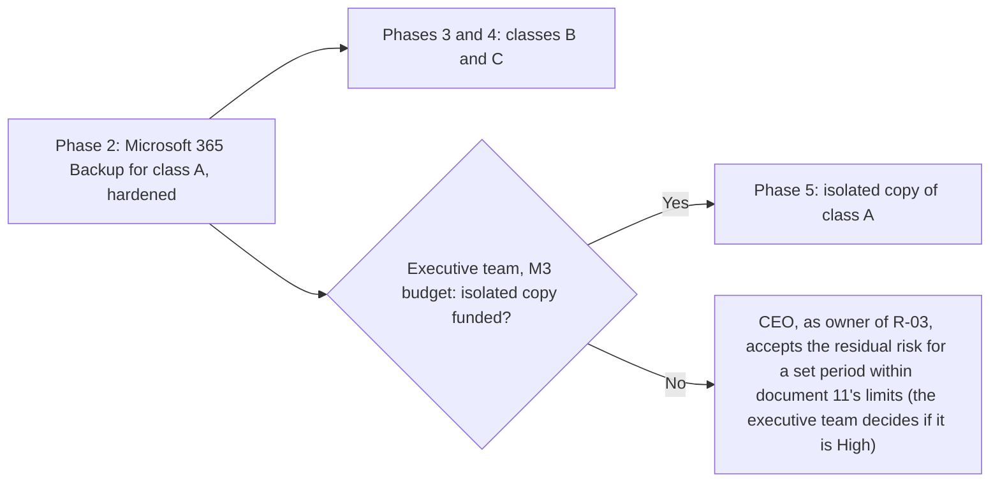

# ADR-006: Microsoft 365 backup

> **Reference work.** Fictional scenario built for a public portfolio. Not deployed in, derived from, or describing any employer environment. Not professional advice.

## Status

- **Status:** Proposed
- **Date:** 2026-10-13
- **Decision owner:** The Director of IT and Security proposes. The CFO approves the consumption spend for class A protection ahead of the budget, and the executive team approves this decision with the plan and budget at M3. The executive team decides in the M3 budget whether to fund the isolated copy; if it does not, the CEO, as owner of R-03, accepts the residual risk for a set period within document [11](../11-risk-management.md)'s limits (the executive team decides if the residual is High).
- **Risks addressed:** R-03 (primary), R-14

## Context

- **Day 1.** At Fabrikam (fictional), Microsoft 365 data has no backup beyond retention settings (assumption A-09). The [threat profile](../17-threat-profile.md) rates ransomware against corporate endpoints and Microsoft 365 data (S-06) Medium to High. In MITRE ATT&CK v20 terms, attackers encrypt or destroy content, T1486 (Data Encrypted for Impact) and T1485 (Data Destruction), and try to stop recovery, T1490 (Inhibit System Recovery).
- **Whose job it is.** Microsoft's shared responsibility guidance says: "For all cloud deployment types, you own your data and identities." Its Microsoft 365 Backup FAQ says that stance has not changed, and that Microsoft is "now offering more tools to help organizations achieve those goals and responsibilities."
- **Objectives first.** Document [14](../14-business-continuity-and-backup.md) proposes recovery classes from its business impact analysis. Class A (data whose loss stops Fabrikam's own payroll and payments, or incident response) has a proposed recovery time objective (RTO) of 4 hours and recovery point objective (RPO) of 1 hour; class B has one business day and 24 hours; class C has five business days and one week. The owners confirm them at M3, and this decision is revisited if they change.
- **What attackers do to backups.** In a December 2021 ransomware attack on a workforce management provider's private cloud, the attacker disabled the provider's ability to reach its separately stored backups. A copy that an attacker can reach or switch off with the access already gained is not a recovery path. CISA's #StopRansomware Guide asks for offline, encrypted backups and, for cloud environments "such as Microsoft Office 365": "Backup data often; offline or leverage cloud-to-cloud backups."
- **Team and calendar.** IT is an IT Operations Manager and three generalists, with no dedicated security staff; the Director of IT and Security takes on the security-engineering work (R-14). Year-end payroll and tax form season runs from mid-December through January, when internal changes continue with care.
- **Cost.** This record compares cost in relative terms only; quotes come at decision time.

## Decision drivers

1. **Restore speed** against the class A objectives.
2. **Isolation from a tenant compromise:** someone holding Fabrikam's Global Administrator or backup administrator access must not be able to destroy every copy.
3. **Scope:** Exchange mailboxes, SharePoint sites and OneDrive accounts (with Teams channel files), Teams messages, Microsoft Entra ID configuration, and class A software as a service (SaaS) data.
4. **Relative cost,** recurring and one-time.
5. **Effort** to set up and run with a team of about five, including vendor review and monitoring.

## Options considered

| Driver | A: Microsoft 365 Backup | B: a third-party SaaS backup service | C: retention policies only | D: A, plus an isolated copy of class A data in a third-party service |
|---|---|---|---|---|
| Restore speed | Fastest: copies stay inside Microsoft 365, and Microsoft publishes median restore times | Set by the vendor; proven only in a trial | Item by item; not built for mass restore | A's speed for nearly every restore; B's for the worst case |
| Isolation from a tenant compromise | Partial: restore points cannot be altered and deletion is delayed, but the tenant's administrators control the tool | Strong, if copies sit outside Microsoft 365 under separate credentials | None | Strong for class A; partial for the rest |
| Scope | User and shared mailboxes, SharePoint, OneDrive | Varies by vendor; checked in an evaluation | Whatever the policies cover, for compliance | A, plus what the service covers for class A |
| Relative cost | Consumption, by protected data volume | A vendor subscription for the whole tenant | No new spend | A, plus a subscription sized to class A |
| Effort | Low | Highest | None until an incident, then very high | Moderate |

### Option A: Microsoft 365 Backup alone

Microsoft facts, checked on Microsoft Learn on 2026-10-13. Microsoft 365 Backup backs up "all or select SharePoint sites, OneDrive accounts, and Exchange mailboxes". It is "a pay-as-you-go offering that charges based on consumption, unlike traditional user-based licenses": billing runs through an Azure subscription and is metered on the volume of protected data each month, and Microsoft states that restores are free. Its Learn pages carry no preview label. Setup needs a SharePoint Administrator or Global Administrator, and a dedicated Microsoft 365 Backup Administrator role runs the tool.

Pros:

- **Speed.** Microsoft's published median expectations are about 30 minutes for one site or OneDrive account from an express restore point, about 2 hours for one mailbox, and about 3 to 4 hours for 250 of either. Restore points every 10 minutes (two weeks back for sites and OneDrive accounts, 52 weeks for mailboxes) meet class A's RPO.
- **Tamper resistance.** Restore points sit in append-only storage and are "immutable unless expressly deleted by the Backup tool admin via product offboarding"; Microsoft Purview retention and deletion policies do not affect them.
- **Slow, visible deletion.** Offboarding starts a 90-day grace period, during which Microsoft says repaired billing or a support request reverses it without losing backups. Cutting the period to seven days needs two approvers who have each passed a two-day aging window, and harmful actions trigger multi-admin email notifications once they are turned on.
- **Native.** It runs in the Microsoft 365 admin center: no agent, no new console, no vendor review.

Cons:

- **Same tenant, same control plane.** Global Administrators and the Microsoft 365 Backup Administrator role control the tool, and Fabrikam treats SharePoint Administrator the same because Microsoft lets that role set the tool up (document 14); Exchange Administrators and the workload backup administrator roles manage backups for their workloads, and an unhealthy billing state on the Azure subscription starts offboarding. Against an attacker who controls the tenant, its protections are delays and notices, not separation.
- **Scope.** Room and group mailboxes, Teams chat and channel messages, and Microsoft Entra ID are outside it, and a few SharePoint site templates are unsupported. Microsoft's pages differ on file-level restore: the feature table marks restore through versions "(coming soon)", while the performance notes describe a granular folder and file option.
- **A speed trade-off.** The fastest site and OneDrive restores use roughly daily express restore points; a restore point that is not an express point, such as a recent 10-minute point, can be significantly slower.
- **Late warnings.** Notifications of harmful events arrive as a daily digest.
- **Cost** grows with data volume.

### Option B: a third-party SaaS backup service for all Microsoft 365 data

Pros:

- **Isolation,** when the service stores copies outside Microsoft 365 and its console uses accounts that do not sign in through Fabrikam's Microsoft Entra ID. Someone in control of the tenant can remove the service's access and stop new backups, but cannot reach copies already stored.
- **Possibly wider scope.** Some services list Teams conversations, Microsoft Entra objects, or other SaaS applications. Each claim is checked in an evaluation, not assumed.
- **Contractual protection.** Immutability and deletion delays can be written into the contract.

Cons:

- **Unproven speed.** Restore speed depends on the vendor and has to be shown in a trial. Microsoft argues against remote copies on exactly this point: "Recovering large volumes of content is difficult when copying data at a scale from a remote, air-gapped location requiring weeks or even months to get your business back up and running." That is a vendor's claim about its competitors, so a trial decides.
- **Not every third-party service is isolated.** Microsoft says partner applications built on its Microsoft 365 Backup Storage platform operate its Backup tool through the partner's application, so they share option A's isolation profile.
- **A new holder of everything.** The vendor keeps a full copy of Fabrikam's mail and files, sensitive company and employee data included, which brings a POL-10 (Third-Party Risk Management Policy) review, contract terms, a data location General Counsel accepts, and an assurance report to read.
- **A powerful identity.** The service needs an application identity in Fabrikam's tenant that can read every protected mailbox and site and write to them during restores: one of the most sensitive non-human identities Fabrikam would hold (R-08).
- **Effort and cost.** The highest setup effort, a second console for a small team, and a per-user or per-volume subscription for the whole tenant; quotes decide.

### Option C: retention policies only (rejected)

Pros: no new spend or effort; retention keeps content for compliance and eDiscovery under POL-15 (Privacy and Data Retention Policy).

Cons: Microsoft's own FAQ rules it out as a recovery method. Legal holds "retain data, but that feature is optimized for export (for example, via eDiscovery), not for mass restore"; versions are a method that "doesn't scale well for large-scale ransomware attacks where an admin needs to orchestrate the recovery"; and Microsoft's disaster recovery copies keep "the current state of content, not any historical versions from prior points in time." Retention policies serve the same compliance purpose as holds.

Rejected because, by Microsoft's own description, it cannot roll back a ransomware or mass-deletion event at scale, which leaves R-03 untreated.

### Option D: Microsoft 365 Backup plus an isolated copy of class A data

Pros: A's speed and low effort for almost every restore; a copy of the data whose loss hurts most that even a full tenant compromise cannot reach; third-party exposure and cost limited to class A, a small share of users and sites.

Cons: two systems to run and test; classes B and C rely on A alone; restores from the isolated copy are slower and need the separate credentials to hand; the isolated service is still a new vendor with broad access to class A data.

## Decision

Fabrikam adopts option D: option A now, and the isolated copy once funded.

1. **Primary backup: Microsoft 365 Backup** for every Exchange mailbox, OneDrive account, and SharePoint site that holds business data. Class A in Phase 2, before mid-December, on the CFO's interim approval; class B in Phase 3; class C and the remaining stores in February 2027. The recovery window is one year, which General Counsel confirms against POL-15.
2. **Hardened as document 14 sets out:** two named holders of the Microsoft 365 Backup Administrator role on separate cloud-only admin accounts with device-bound phishing-resistant methods, eligible through Privileged Identity Management from Phase 4; harmful-event notifications to people who are not backup administrators; an alert on backup administration changes to the on-call, and to the managed detection and response (MDR) provider if the chosen service triages custom detections ([ADR-003](ADR-003-managed-detection-and-response.md)); named owners and budget alerts on the Azure billing subscription; no approvers for faster deletion unless General Counsel needs them.
3. **Identity:** Microsoft Entra Backup and Recovery (daily backups, seven days of history, needs Microsoft Entra ID P1 or P2; Microsoft's June 2026 release note announces general availability while its body still says "At preview", and Microsoft 365 roadmap item 567885 calls the 7-day recovery generally available (as of 2026-10-13), so document 14's action 14.01 confirms it in the tenant in Phase 1 and action 14.08 rechecks it in Phase 3 before Fabrikam relies on it), plus Fabrikam's own dated export of Conditional Access and authentication settings after every approved change.
4. **The isolated copy,** proposed in the M3 budget for Phase 5: class A data in a third-party service chosen against the criteria below. If it is not funded, the CEO, as owner of R-03, accepts the residual risk for a set period within document 11's limits (the executive team decides if the residual is High), and the gap is revisited at M7.
5. **Retention policies stay** under POL-15 for compliance and are not counted as recovery.
6. **Teams messages** have no restore path in year one. They are kept for compliance where retention covers them, and covered by the isolated copy only if the chosen service offers it.

### Criteria for the isolated copy service

Required; a service that misses one is out:

- Copies stored outside Microsoft 365's trust boundary and outside Fabrikam's tenant, so not built on Microsoft 365 Backup Storage.
- Console accounts that do not sign in through Fabrikam's Microsoft Entra ID, with phishing-resistant MFA, held by two named people.
- Immutable retention, or a deletion delay no single Fabrikam administrator can shorten.
- A data location General Counsel accepts under customer contracts, and a current SOC 2 Type II report reviewed under POL-10.
- A trial restore of a class A sample within the class A RTO.

Scored: scope beyond option A (Teams conversations, Microsoft Entra objects, class A SaaS data); least-privilege application permissions; restore throughput; alerts to addresses outside the tenant; exit terms and confirmed deletion; relative cost.

## Consequences

**Positive**

- Class A data is recoverable before the year-end season, and all business data by February 2027.
- Single sites, accounts, and mailboxes come back in minutes to hours rather than days, and KPI-19 has real tests to count.
- Little new tooling for a small team: one admin center, no agents.
- If the isolated copy is funded, class A survives even a full tenant compromise.

**Negative**

- A monthly charge that grows with protected data.
- Teams messages and group mailboxes have no Microsoft 365 Backup restore path, and Microsoft Entra Backup and Recovery keeps only seven days of history, so for older Conditional Access and authentication settings Fabrikam relies on its own export.
- A new Azure subscription, a new administrator role, and possibly a new vendor to govern.
- Backups keep deleted data for the recovery window, which POL-15 must state.
- Microsoft's FAQ says control of the backups can currently pass from Microsoft's own application to a partner application built on Microsoft 365 Backup Storage, and back only through a support ticket, so any such move is a decision of its own.

## Risks and mitigations

| Risk | Mitigation |
|---|---|
| Someone holding Global Administrator, or another role that manages Microsoft 365 Backup, offboards the backups | The 90-day grace period and support reversal; notifications to people who are not backup administrators; an alert on backup administration events (document 14, action 14.11); fewer than five Global Administrators and Privileged Identity Management (document [06](../06-microsoft-365-security-baseline.md)); the isolated copy for class A |
| The Azure billing subscription goes unhealthy and starts offboarding | Named owners, budget alerts, and a monthly billing health check by the CFO's team |
| Restores run slower than Microsoft's medians | Timed quarterly tests, restores in class order, and objectives revisited with owners using real numbers |
| A restore brings back infected or corrupted content | A restore point before the attacker's first known activity, restored to a new location and checked first where time allows (document 14) |
| A coverage gap surprises someone during an incident | Gaps listed in document 14 and the continuity plan; Teams messages kept for compliance |
| The isolated service becomes a new exposure (R-08) | POL-10 review, least-privilege permissions where offered, monitored sign-ins, and exit and deletion terms |
| Microsoft changes features, terms, or billing | Microsoft Learn rechecked before each phase that relies on them; quotes at decision time |

## Revisit when

- Owners confirm objectives at M3 that differ from document 14's proposals.
- A class A restore test misses its RTO twice in a row.
- Microsoft adds Teams messages or other workloads to Microsoft 365 Backup, adds deletion protection that a tenant administrator cannot override, or changes its billing model.
- A customer contract, the SOC 2 audit firm, or an incident calls for an isolated copy of more than class A.
- Acquired-company data moves into the tenant ([ADR-005](ADR-005-acquired-company-consolidation.md)), or an acquisition adds a tenant.
- The first annual program review (M7).

## Related documents

- [14. Business continuity and backup](../14-business-continuity-and-backup.md): business impact analysis, recovery classes, hardening, restore tests.
- [06. Microsoft 365 security baseline](../06-microsoft-365-security-baseline.md), [08. Detection and incident response](../08-detection-and-incident-response.md), [10. Governance and compliance program](../10-governance-and-compliance-program.md), [11. Risk management](../11-risk-management.md), [12. Metrics and executive reporting](../12-metrics-and-executive-reporting.md), [17. Threat profile](../17-threat-profile.md)
- [ADR-001](ADR-001-microsoft-365-security-licensing.md) (Privileged Identity Management licensing), [ADR-003](ADR-003-managed-detection-and-response.md) (MDR), [ADR-004](ADR-004-phishing-resistant-authentication-rollout.md) (administrator authentication), [ADR-005](ADR-005-acquired-company-consolidation.md) (acquired data stores)

## Sources

- Overview of Microsoft 365 Backup. Microsoft Learn. https://learn.microsoft.com/en-us/microsoft-365/backup/backup-overview . Checked 2026-10-13. Primary.
- Frequently asked questions about Microsoft 365 Backup. Microsoft Learn. https://learn.microsoft.com/en-us/microsoft-365/backup/backup-faq . Checked 2026-10-13. Primary.
- Set up Microsoft 365 Backup. Microsoft Learn. https://learn.microsoft.com/en-us/microsoft-365/backup/backup-setup . Checked 2026-10-14. Primary.
- Offboarding in Microsoft 365 Backup. Microsoft Learn. https://learn.microsoft.com/en-us/microsoft-365/backup/backup-offboarding . Checked 2026-10-13. Primary.
- Microsoft Entra built-in roles (Exchange Backup Administrator, SharePoint Backup Administrator). Microsoft Learn. https://learn.microsoft.com/en-us/entra/identity/role-based-access-control/permissions-reference . Checked 2026-10-13. Primary.
- Shared responsibility in the cloud. Microsoft Learn. https://learn.microsoft.com/en-us/azure/security/fundamentals/shared-responsibility . Checked 2026-10-13. Primary.
- Microsoft Entra Backup and Recovery overview. Microsoft Learn. https://learn.microsoft.com/en-us/entra/backup/overview . Checked 2026-10-13. Primary.
- Microsoft Entra releases and announcements (June 2026 entry on Microsoft Entra Backup and Recovery). Microsoft Learn. https://learn.microsoft.com/en-us/entra/fundamentals/whats-new . Checked 2026-10-14. Primary.
- Microsoft 365 roadmap item 567885, Microsoft 365: Entra ID Backup & Recovery (release communications record). Microsoft. https://www.microsoft.com/releasecommunications/api/v1/m365/567885 . Checked 2026-10-14. Primary.
- #StopRansomware Guide (version 3.0, October 2023). CISA, MS-ISAC, NSA, FBI. https://www.cisa.gov/resources-tools/resources/stopransomware-guide . Checked 2026-10-13. Primary.
- MITRE ATT&CK, Enterprise matrix, v20 (the T1490 page, which names T1485 and T1486). MITRE. https://attack.mitre.org/techniques/T1490/ . Checked 2026-10-13. Primary.
- MITRE ATT&CK updates, October 2026 (the ATT&CK v20 release notes, October 13, 2026). MITRE. https://attack.mitre.org/resources/updates/updates-october-2026/ . Checked 2026-10-13. Primary.
- Kronos attack: backup access targeted amid cold storage overhaul vow (January 6, 2022; updated May 24, 2023). The Stack. https://thestack.technology/kronos-outage-latest-ransomware-backups/ . Checked 2026-10-13. Secondary.
