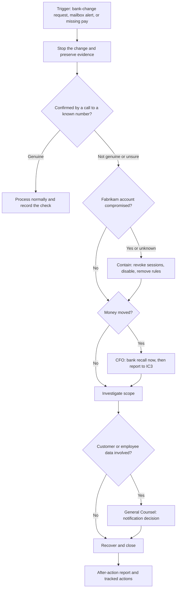

# Playbook: payroll diversion and email compromise

> **Reference work.** Fictional scenario built for a public portfolio. Not deployed in, derived from, or describing any employer environment. Not professional advice.

| Field | Value |
|---|---|
| Status | Untested template. Not exercised; no real incident informed it |
| Version | 0.2, 2026-10-14 (requests by call, voice message, chat, or video call added to the purpose, the triggers, and the verification standard; T1588.007 added to the ATT&CK mapping) |
| Owner | Director of IT and Security |
| Business process owners | CFO (vendor payments), VP of People (employee pay) |
| Risks | R-01 (primary), R-07, R-10 |
| Threat scenarios | S-01, S-04, S-09 in document [17](../17-threat-profile.md) |
| ATT&CK version | MITRE ATT&CK v20 (Enterprise), current as of 2026-10-13 |

## Purpose and scope

This playbook tells responders at Fabrikam (fictional) what to do when someone asks, by email, phone, voice message, chat, or video call, to change where an employee's pay or a vendor's payment goes, and when a mailbox shows signs of takeover. It covers Fabrikam's own finance and HR (R-01). Bank-detail changes made inside Fabrikam's product by a customer's administrator are a product incident, handled with Engineering under document [08](../08-detection-and-incident-response.md)'s interim escalation card until the R-02 playbook is written in Phase 5, although the communication steps here still apply. Every step is defensive.

## Triggers

| ID | Trigger | Usual source |
|---|---|---|
| TR-1 | A request by email, phone, voice message, chat, or video call asks to change direct-deposit details for an employee | People team, payroll team |
| TR-2 | A request by email, phone, voice message, chat, or video call asks to change a vendor's remittance bank details, or to release a payment urgently | Accounts payable, the CFO's office |
| TR-3 | A suspicious inbox rule, forwarding setting, or sign-in on a finance, payroll, People, or executive account | Defender XDR or the MDR provider; a user report |
| TR-4 | An employee says their pay did not arrive, or a vendor says it was not paid | Employee, vendor |
| TR-5 | A customer or partner reports a bank-change or payment request from a Fabrikam address | Customer-facing teams under the Chief Customer Officer |

Starting severity, from the matrix in document 08: a request stopped before any change is SEV-3; a compromised finance, payroll, People, or executive mailbox is SEV-2; money moved is SEV-2, raised to SEV-1 above the CFO's loss threshold or when customer data or customer funds are involved.

## Roles

| Role | Who |
|---|---|
| Incident commander | Director of IT and Security for SEV-1 and SEV-2; primary on-call for SEV-3 |
| Payments | CFO or delegate |
| Employee pay | VP of People or delegate |
| Legal | General Counsel |
| Customer communication | Chief Customer Officer, when customers or partners are involved |
| Investigation and containment | MDR provider, on-call, Systems Engineer (Identity and Endpoint) |
| Credential resets | Service Desk Analyst, after verifying the caller's identity (document [13](../13-it-service-management.md)) |

## Response flow

## Immediate actions (first hour)

| Step | Action | Owner |
|---|---|---|
| 1 | **Stop the change.** Freeze the requested bank-detail change or payment. Do not reply to the message, and do not use any phone number, link, or contact detail in it. A familiar voice or face is not verification. | Payroll or accounts payable lead |
| 2 | **Verify by calling a known number:** the vendor contact on file before the request arrived, or the employee's number in the HR system of record. Two people confirm any change. | Payroll or accounts payable lead |
| 3 | **Preserve evidence.** Keep the message (do not delete it), record when it arrived in UTC, capture the full headers or the message trace, and screenshot any payment record. General Counsel decides on a legal hold. | Process owner, on-call |
| 4 | **Contain a suspected account compromise.** Revoke sign-in sessions and disable the account during the investigation; remove malicious inbox rules (including hidden ones), forwarding settings, and delegates; check registered authentication methods and devices; review app consents and admin roles. | MDR provider or on-call; Systems Engineer (Identity and Endpoint) |
| 5 | **Reset credentials** through the service desk after verifying the person by a channel other than email. Never send a new password by email. | Service Desk Analyst |
| 6 | **If money has moved,** the CFO's delegate calls Fabrikam's bank at once to request a recall or reversal, then files a complaint at ic3.gov with the transaction details and notes "payroll diversion" in it. The FBI says acting quickly helps its IC3 Recovery Asset Team try to freeze funds. | CFO or delegate |
| 7 | **Notify** the incident commander, the CFO (payments), the VP of People (employee pay), and General Counsel when customer data, an outside party, or law enforcement is involved. | On-call |

Steps 4 and 5 follow Microsoft's published guidance for a compromised Microsoft 365 email account and for revoking user access in an emergency.

## Investigation in Defender XDR

Where the logs allow, start the review at least 30 days before the first suspicious event. Advanced hunting holds 30 days of raw data, Entra sign-in logs keep 30 days with Entra ID P1, and the unified audit log keeps 180 days with Audit (Standard) (logging section of document 08). The queries named below are reference templates with untested status. As each query header states, they assume Microsoft Defender Suite ([ADR-001](../adr/ADR-001-microsoft-365-security-licensing.md)); Microsoft 365 E5 also includes these capabilities. On E3 alone, use audit log search, Entra sign-in logs, message trace, and Real-time detections in Defender for Office 365 Plan 1 for the same questions.

| Question | Where to look |
|---|---|
| Was the request spoofed, sent from a lookalike domain, sent from a compromised partner mailbox, or sent from a Fabrikam mailbox? | The message headers (SPF, DKIM, and DMARC results) and message trace; Real-time detections (Plan 1) or Threat Explorer (Plan 2). A message that passes authentication from a partner's real domain can still come from a compromised partner account |
| How did the account holder sign in, and did any sign-in use weak or legacy methods? | [q01-sign-ins-without-strong-auth.kql](../../queries/q01-sign-ins-without-strong-auth.kql) and [q02-legacy-auth-sign-ins.kql](../../queries/q02-legacy-auth-sign-ins.kql); Entra sign-in logs for IP addresses, locations, times, and session details |
| Were inbox rules or forwarding added? | [q04-external-mail-forwarding-rules.kql](../../queries/q04-external-mail-forwarding-rules.kql) for rules and mailbox settings that forward or redirect mail outside the company. Rules that only move, delete, or mark mail as read do not appear in q04: search the audit log for the mailbox's New-InboxRule, Set-InboxRule, and UpdateInboxRules records, and review any alert from the custom detection in document 08 (action 08.12) once it is live |
| Did the attacker grant an app access to mail or files? | [q05-app-consent-grants.kql](../../queries/q05-app-consent-grants.kql) |
| Does the account hold an admin role, and did any role change? | [q03-privileged-role-changes.kql](../../queries/q03-privileged-role-changes.kql) |
| Which messages did the attacker open or sync? | MailItemsAccessed audit records (Audit (Standard), on by default for E3 users), matched to the attacker's session and IP address. Microsoft treats every item in a synced folder as compromised |
| What did the account send, and to whom? | Message trace and the Sent Items folder: look for internal phishing and for messages to customers or partners |
| Did the account open, download, or share customer files? | Audit log file access and download records; [q08-anonymous-sharing-links.kql](../../queries/q08-anonymous-sharing-links.kql) |
| Was a device involved? | The Defender for Endpoint incident and device timeline (Plan 2); antivirus scan results (Plan 1) |
| What changed in the finance and HR systems? | The bank-detail and payment audit trail in the finance system; direct-deposit change history in the HR system of record |

## Decision points

| ID | Question | If yes | Decides |
|---|---|---|---|
| D1 | Was the request genuine, confirmed by a known-number call? | Process the change and record the verification; close as SEV-4 | Process owner |
| D2 | Was a Fabrikam account compromised? | Full containment (steps 4 and 5); SEV-2; check other accounts for the same sign-in pattern | Incident commander |
| D3 | Has money moved? | Bank recall and IC3 report (step 6); severity set against the CFO's loss threshold | CFO |
| D4 | Did the compromised mailbox or files hold customer data the attacker could have reached? | At least SEV-2; General Counsel told the same day; scope with MailItemsAccessed and file records | Incident commander, General Counsel |
| D5 | Is a customer notice due? | Use the contract clause inventory, the decision path, and the holding statements in document 08 | General Counsel decides with CEO approval; the Chief Customer Officer sends |
| D6 | Was Fabrikam employee data or pay affected? | The VP of People leads employee communication and, with the CFO and General Counsel, decides how affected employees are paid on time | VP of People, CFO, General Counsel |
| D7 | Did the attacker write to customers or partners from a Fabrikam address, or did the lure come from a partner's real mailbox? | Warn recipients through known contacts; tell the partner its mailbox may be compromised | Chief Customer Officer or the process owner, with General Counsel |
| D8 | Is a law enforcement report needed beyond IC3? | General Counsel contacts the local FBI field office | General Counsel |
| D9 | Ready to close? | Recovery complete, monitoring in place, after-action review scheduled | Incident commander |

## Recovery

- **Return the account to service.** Reset the password through a verified channel, re-register authentication methods with a phishing-resistant method where available ([ADR-004](../adr/ADR-004-phishing-resistant-authentication-rollout.md)), remove unknown devices, confirm that no rules, forwarding, or delegates remain, then re-enable the account.
- **Correct the records.** Restore the verified bank details, reconcile any diverted payment in finance, and confirm the next payroll run uses only verified details.
- **Watch closely for 30 days (proposal):** the affected account, any account with the same sign-in pattern, and new bank-change requests involving the same vendor or employee.
- **Tidy up.** Remove temporary blocks that are no longer needed, and keep evidence under General Counsel's hold.

## Lessons learned

- An after-action report, which NIST SP 800-61 Rev. 3 recommends (RC.RP-06.R1), within 10 business days for SEV-1 and SEV-2, and a short note for SEV-3 (both timings are proposals).
- Every action gets an owner and a due date in the action tracker (KPI-18).
- Findings feed the verification standard below, role-based training for finance and payroll staff (document [09](../09-security-awareness-and-training.md)), custom detections (document 08), and email authentication (document [06](../06-microsoft-365-security-baseline.md)).

## Prevention controls this playbook relies on

| Control | Owner | Where |
|---|---|---|
| Bank-change verification standard: no change from email, a call, a voice message, a chat message, or a video call alone; call back on a known number; two-person approval for vendor bank changes; a confirmation sent to the previous contact after any change; new vendor bank details not used for a payment within a short hold period without CFO approval (proposal) | CFO and VP of People | This playbook; finance and People procedures |
| Employees change their own direct deposit only in the HR system of record while signed in themselves; People staff do not key changes from email | VP of People | Documents [09](../09-security-awareness-and-training.md) and [13](../13-it-service-management.md); access model in [07](../07-identity-lifecycle-joiners-movers-leavers.md) |
| A review of every bank-detail change before each payroll run and payment release | CFO and VP of People | This playbook |
| Impersonation protection for executives and payment approvers (Defender for Office 365 Plan 1) and DMARC enforcement | Director of IT and Security | Document [06](../06-microsoft-365-security-baseline.md) |
| Phishing-resistant MFA for finance, payroll, People, and executives early in the rollout | Director of IT and Security | [ADR-004](../adr/ADR-004-phishing-resistant-authentication-rollout.md) |
| Role-based training for finance and payroll staff | Director of IT and Security | Document [09](../09-security-awareness-and-training.md) |
| Caller identity verification at the service desk | IT Operations Manager | Document [13](../13-it-service-management.md) |

These match the FBI's payroll diversion advice, which includes "Apply heightened scrutiny to bank information initiated by employees seeking to update or change direct deposit credentials" and "Monitor employee logins that occur outside normal business hours."

## ATT&CK mapping (v20)

| Stage | Techniques |
|---|---|
| Reconnaissance | T1591.004 (Gather Victim Org Information: Identify Roles); T1589.003 (Gather Victim Identity Information: Employee Names) |
| Lure | T1588.007 (Obtain Capabilities: Artificial Intelligence), for AI-written lures, cloned voices, and live deepfake video; T1684.001 (Social Engineering: Impersonation); T1684.002 (Social Engineering: Email Spoofing); T1586.002 (Compromise Accounts: Email Accounts); T1566.002 (Phishing: Spearphishing Link) |
| Account takeover | T1557 (Adversary-in-the-Middle); T1539 (Steal Web Session Cookie); T1550.004 (Use Alternate Authentication Material: Web Session Cookie); T1078.004 (Valid Accounts: Cloud Accounts); T1528 (Steal Application Access Token) |
| Mailbox abuse | T1114.003 (Email Collection: Email Forwarding Rule); T1564.008 (Hide Artifacts: Email Hiding Rules); T1114.002 (Email Collection: Remote Email Collection); T1534 (Internal Spearphishing) |
| Outcome | T1657 (Financial Theft) |

## Validation notes

Not tested. Planned validation: a desk check with the CFO and VP of People in Phase 2; the executive tabletop in late February 2027 ([template](../templates/tabletop-payroll-diversion.md)); lab validation of the mailbox rule and sign-in detections in an isolated tenant; and, from Phase 5, the twice-yearly benign end-to-end alert check in the live tenant, as described in document 08. The expected telemetry is an audit record for the new inbox rule, a sign-in record with the session details, and the Defender alert that should follow. This playbook contains no attack procedures.

## Phase plan

These actions belong to document 08's phase plan, and the IDs match it.

| Phase | Action ID | Action | Outcome | KPI | Owner role | Workstream |
|---|---|---|---|---|---|---|
| Phase 2 | 08.05 | Desk-check this playbook with the CFO and VP of People before the year-end payroll peak, as part of drafting the incident response plan for POL-08 | Finance and People know the verification and escalation steps before mid-December | KPI-02 | Director of IT and Security | WS-4 |
| Phase 2 | 08.07 | Confirm coverage from mid-December through January, including a named finance contact for bank recalls and the IC3 reporting path | Year-end and tax form season has named responders | KPI-16 | IT Operations Manager | WS-4 |
| Phase 4 | 08.09 | Run the executive tabletop on this playbook in late February 2027 and track every action | Tested decisions and owned improvement actions | KPI-18 | Director of IT and Security | WS-4 |
| Phase 4 | 08.12 | March to April: build and validate custom detections for mailbox rule and forwarding changes and risky sign-ins on finance, payroll, People, and executive accounts | The early signs of this attack raise alerts | KPI-16 | Security Engineer | WS-4 |

## Resourcing and dependencies

- **Roles.** Director of IT and Security, IT Operations Manager, Systems Engineer (Identity and Endpoint), Service Desk Analyst, and Security Engineer; the CFO, VP of People, General Counsel, and Chief Customer Officer; the payroll and accounts payable leads as process owners.
- **Partners.** The MDR provider for after-hours detection and containment once live (document 08, [ADR-003](../adr/ADR-003-managed-detection-and-response.md)); an incident response retainer, or pre-agreed emergency terms with an incident response firm, in place before mid-December, for an active compromise (document 08); Fabrikam's bank for payment recalls.
- **Licenses.** Microsoft 365 E3 covers the core steps: audit log search with MailItemsAccessed, Entra sign-in logs, message trace, Real-time detections (Defender for Office 365 Plan 1), session revocation, and manual device isolation. Microsoft Defender Suite ([ADR-001](../adr/ADR-001-microsoft-365-security-licensing.md)) adds advanced hunting for the queries, Threat Explorer, automatic attack disruption, and risk-based sign-in detections (Entra ID P2); Microsoft 365 E5 also includes these capabilities.
- **Depends on.** Document 08 (severity, roles, decision path, holding statements, logging), the contract clause inventory with General Counsel, documents 06, 07, 09, and 13, ADR-004, and the queries in `queries/`.

## Risks and open questions

- Out-of-band verification depends on people doing it under time pressure; attackers time requests before payroll cutoffs, month-end, and holidays.
- Lookalike domains, display-name tricks, and genuinely compromised partner mailboxes all get past email authentication, so the known-number call is the control that matters most.
- A late discovery can outrun the 30-day windows in Entra (P1) and advanced hunting until the log archive and retention decisions in document 08 are in place.
- Customer payroll administrators sit outside Fabrikam's control; product-side protections are a product decision with Engineering (R-02).
- The queries are untested templates and depend on licensing that is not yet approved.
- How affected employees are paid, and whether a diverted payment is recoverable, are business and legal questions for the CFO, the VP of People, and General Counsel, not for this playbook.

## Framework mapping

By identifier only, consistent with the [crosswalk](../crosswalk/csf2-soc2-crosswalk.md).

| Theme | NIST CSF 2.0 | SOC 2 (2017 TSC) |
|---|---|---|
| Fraud risk in payment and payroll processes | ID.RA-03 | CC3.3 |
| Detection and declaration | DE.AE-02, DE.AE-08 | CC7.2, CC7.3 |
| Triage, analysis, and evidence | RS.MA-02, RS.MA-03, RS.AN-03, RS.AN-07 | CC7.4 |
| Containment and eradication | RS.MI-01, RS.MI-02 | CC7.4 |
| Notification and communication | RS.CO-02, RS.CO-03 | CC2.3 |
| Recovery and after-action | RC.RP-01, RC.RP-06 | CC7.5 |

## Sources

- Cybercriminals Utilize Social Engineering Techniques To Obtain Employee Credentials To Conduct Payroll Diversion (Alert I-091818-PSA, September 18, 2018). FBI IC3. https://www.ic3.gov/PSA/2018/PSA180918 . Checked 2026-10-13. Primary.
- Cyber Criminals Impersonating Employee Self-Service Websites to Steal Victim Information and Funds (Alert I-042425-PSA, April 24, 2025). FBI IC3. https://www.ic3.gov/PSA/2025/PSA250424 . Checked 2026-10-13. Primary.
- Criminals Use Generative Artificial Intelligence to Facilitate Financial Fraud (Alert I-120324-PSA, December 3, 2024), on AI-generated audio and real-time video impersonation. FBI IC3. https://www.ic3.gov/PSA/2024/PSA241203 . Checked 2026-10-14. Primary.
- Respond to a compromised email account in Microsoft 365. Microsoft Learn. https://learn.microsoft.com/en-us/defender-office-365/responding-to-a-compromised-email-account . Checked 2026-10-13. Primary.
- Revoke user access in an emergency in Microsoft Entra ID. Microsoft Learn. https://learn.microsoft.com/en-us/entra/identity/users/users-revoke-access . Checked 2026-10-13. Primary.
- Use MailItemsAccessed to investigate compromised accounts. Microsoft Learn. https://learn.microsoft.com/en-us/purview/audit-log-investigate-accounts . Checked 2026-10-13. Primary.
- Learn about auditing solutions in Microsoft Purview. Microsoft Learn. https://learn.microsoft.com/en-us/purview/audit-solutions-overview . Checked 2026-10-13. Primary.
- Microsoft Entra data retention. Microsoft Learn. https://learn.microsoft.com/en-us/entra/identity/monitoring-health/reference-reports-data-retention . Checked 2026-10-13. Primary.
- Advanced hunting overview in Microsoft Defender XDR. Microsoft Learn. https://learn.microsoft.com/en-us/defender-xdr/advanced-hunting-overview . Checked 2026-10-13. Primary.
- Why do I need Microsoft Defender for Office 365? Microsoft Learn. https://learn.microsoft.com/en-us/defender-office-365/mdo-about . Checked 2026-10-13. Primary.
- Overview of Microsoft Defender for Endpoint Plan 1. Microsoft Learn. https://learn.microsoft.com/en-us/defender-endpoint/defender-endpoint-plan-1 . Checked 2026-10-13. Primary.
- Incident Response Recommendations and Considerations for Cybersecurity Risk Management: A CSF 2.0 Community Profile (NIST SP 800-61 Rev. 3). NIST. https://nvlpubs.nist.gov/nistpubs/SpecialPublications/NIST.SP.800-61r3.pdf . Checked 2026-10-13. Primary.
- The NIST Cybersecurity Framework (CSF) 2.0 (CSWP 29). NIST. https://nvlpubs.nist.gov/nistpubs/CSWP/NIST.CSWP.29.pdf . Checked 2026-10-13. Primary.
- MITRE ATT&CK, Enterprise matrix, v20 (technique pages cited, including T1684, T1114.003, T1564.008, T1657, T1550.004, and T1586.002). MITRE. https://attack.mitre.org/resources/versions/ . Checked 2026-10-13. Primary.
- MITRE ATT&CK, T1588.007 (Obtain Capabilities: Artificial Intelligence; Resource Development; version 1.2, last modified 16 September 2026; ATT&CK content v20.0). MITRE. https://attack.mitre.org/techniques/T1588/007/ . Checked 2026-10-14. Primary.
